# 05. 기능 지원 확인 결과

GNS3 이미지에서 설계에 쓰는 기능이 되는지 장비에서 직접 확인한 결과. 확인 날짜와 방법은 비고에 기재하며, 확인하지 않은 항목은 `미확인`으로 표시

## Arista vEOS-lab 4.29.2F

| 기능 | 결과 | 비고 |
|---|---|---|
| 인터페이스 ACL (`ip access-group in/out`) | **지원 안 됨** | `% Unavailable command (not supported on this hardware platform)`. QoS 분류, 패킷 필터에 쓰지 않음 |
| ACL 정의 (`ip access-list`) | 지원 | 적용은 안 됨 |
| 컨트롤 플레인 ACL | 지원 | 기본 ACL(`default-control-plane-acl`, 27규칙)이 활성. **사용자 정의 ACL을 `system control-plane`의 `ip access-group ... in`으로 설정하면 수락되고 Active**(기본 ACL을 대체하는 것으로 보이므로 필수 프로토콜을 허용해야 함). 실제 차단 동작은 미확인 |
| 라우티드 포트 (`no switchport` + `ip address`) | 지원 | `ip routing`을 켜기 전에는 "IP configuration will be ignored" 경고가 나옴(적용은 됨). `ip routing`을 먼저 켜면 안 나옴 |
| MLAG (`mlag configuration`, `domain-id`) | 지원 | 설정이 받아들여지고 `show mlag`에 반영됨 |
| EVPN (`address-family evpn`, `show bgp evpn summary`) | 지원 (조건부) | `service routing protocols model multi-agent` 설정 + `write memory` + `reload` 후 동작 확인됨. 적용 전에는 "% Not supported" |
| EVPN 재부팅 후 동작 | 확인됨 | `show bgp evpn summary`가 정상 출력(Router identifier는 Loopback 주소에서 자동 선택) |
| VXLAN 인터페이스 (`interface Vxlan1`, `vxlan vlan ... vni`) | 미확인 | |
| VRF 정의와 `ip address virtual` | 미확인 | |
| ZeroTouch | 끄는 방법을 문서화 | `zerotouch cancel`, `zerotouch disable` ([샘플](../samples/dc1/02-ztp-disable.md)) |

## Aruba ArubaOS-CX 10.07 (Virtual.10.07.0004)

| 기능 | 결과 | 비고 |
|---|---|---|
| VRF | 지원 | 설정 수락 |
| SVI + active gateway (`active-gateway ip mac`, `active-gateway ip`) | 지원 | 설정 수락 |
| 멀티섀시 LAG (`interface lag N multi-chassis`, `lacp mode active`) | 지원 | 설정 수락. `show lacp aggregates` 동작, 해시 l3-src-dst |
| BGP (`router bgp`, `bgp router-id`) | 지원 | 설정 수락 |
| VSX 하위 모드 | 지원 | `inter-switch-link`, `keepalive`, `role`, `system-mac`, `linkup-delay-timer`, `configuration-sync`, `split-recovery`, `vsx-sync` |
| `show vsx status` | 지원 | peer가 없을 때 ISL Init, 정상 |
| QoS | 명령 존재 | `show qos` 하위에 `cos-map`, `dscp-map`, `queue-profile`, `schedule-profile`, `threshold-profile`, `trust` |
| VSX ISL, VSX LAG 실제 동작 | 미확인 | CX 두 대를 연결해야 확인됨(3단계) |

## Cisco c7200 (IOS 12.4(24)T5, C7200-ADVENTERPRISEK9-M)

| 기능 | 결과 | 비고 |
|---|---|---|
| VRF | 지원 | `ip vrf`, `rd` 수락 (이 버전은 `vrf definition`이 아니라 `ip vrf`) |
| MPLS/LDP | 지원 | `mpls label protocol ldp`, 인터페이스 `mpls ip`, `show mpls interfaces` 동작 |
| MP-BGP VPNv4 | 지원 | `router bgp` 아래 `address-family vpnv4` 수락 |
| QoS | 지원 | `class-map match dscp`, `set mpls experimental imposition`, `priority percent`, `fair-queue`, `shape average`, 중첩 `service-policy` 수락 |
| IPsec 프로파일, 터널 보호 | 지원 | `crypto ipsec transform-set`(esp-aes 256, esp-sha-hmac, transport), `crypto ipsec profile`, `tunnel protection ipsec profile` 수락 |
| IKEv2 | **지원 안 됨** | `show crypto ?`에 `ikev2` 없음 → IKEv1(ISAKMP) 사용 |
| ISAKMP `hash sha256` | **지원 안 됨** | `% Invalid input` → `hash sha`(SHA-1) 사용 |
| ISAKMP `group 14`, `encryption aes 256` | 지원 | `show crypto isakmp policy`에 DH #14(2048bit), AES 256 표시 |
| 터널 `/31` 주소, `ip mtu`, `ip tcp adjust-mss` | 지원 | 수락 |
| 터널 실제 동작(IKE SA, IPsec SA) | 미확인 | 두 장비 연결 후 확인(4단계) |

## Cisco IOSv 스위치 (vios_l2-ADVENTERPRISEK9-M, IOS 15.2(CML_NIGHTLY_20180619))

| 기능 | 결과 | 비고 |
|---|---|---|
| 포트 | Gi0/0 ~ Gi3/3 (16개) | |
| VTP (`vtp mode transparent`) | 지원 | 수락 |
| MSTP (`spanning-tree mode mst`, region name/revision/instance) | 지원 | `show spanning-tree mst configuration`에 반영 |
| 트렁크 (`switchport trunk encapsulation dot1q`, `switchport mode trunk`) | 지원 | 수락 |
| SVI, `ip routing` | 지원 | L2 이미지인데도 수락 |
| VRRP (`vrrp N ip`, `priority`, `preempt`) | 지원 | `show vrrp brief` 동작 (VLAN이 down이면 Init) |
| EtherChannel `channel-group 99 mode active` | **거부** | `Command rejected (Port-channel99, Gi0/0): Invalid group(slot) number` (그룹 번호 상한이 있음) |
| EtherChannel 그룹 번호 | `channel-group ?`는 `<1-255>`로 표시되지만 실제로는 **1, 2, 3 수락, 99 거부** | 실제 상한은 미확인. 설계는 안전한 Po1(DSW 간), Po2(DSW1-ASW1), Po3(DSW2-ASW1) 사용 |
| EtherChannel LACP 동작 | 지원 | `channel-group 1, 2 mode active` 수락, `show etherchannel summary`에 Protocol LACP 표시, 상대 포트가 LACP가 아니면 `%EC-5-L3DONTBNDL2: ... suspended: LACP currently not enabled on the remote port`. 실제 번들링(P)은 상대 스위치 연결 후 확인 |
## 확인 방법

시험 명령 모음은 별도로 정리하지 않았고, 위 표의 각 기능에 해당하는 설정을 장비에 넣어 보고 `% Invalid input`, `% Unavailable command`, `% Incomplete command`가 나오는지 봄. 시험 후에는 만든 설정을 지움

## 참고 (자원)

- Arista vEOS-lab 4.29.2F: RAM 2GB 할당 시 부팅 2분 후 free 약 850MB(설정이 거의 없을 때). EVPN과 BGP 설정 후 사용량이 늘어나므로 RAM 축소는 설정 투입 후 안정성을 확인한 뒤 판단

## 근거 캡처

장비 콘솔에서 직접 확인한 화면이며, 필요한 부분만 크롭하여 수록. 이미지는 `images/feature-check/` 폴더에 있음

### Arista vEOS-lab 4.29.2F

인터페이스 ACL(`ip access-group in/out`) 거부:

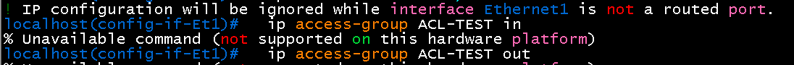

컨트롤 플레인 ACL(기본 ACL)은 활성 상태:

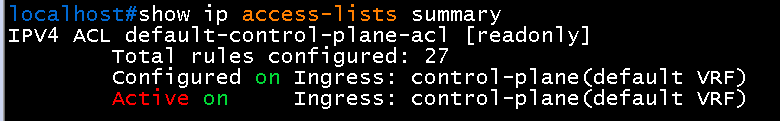

사용자 정의 컨트롤 플레인 ACL 수락과 활성:

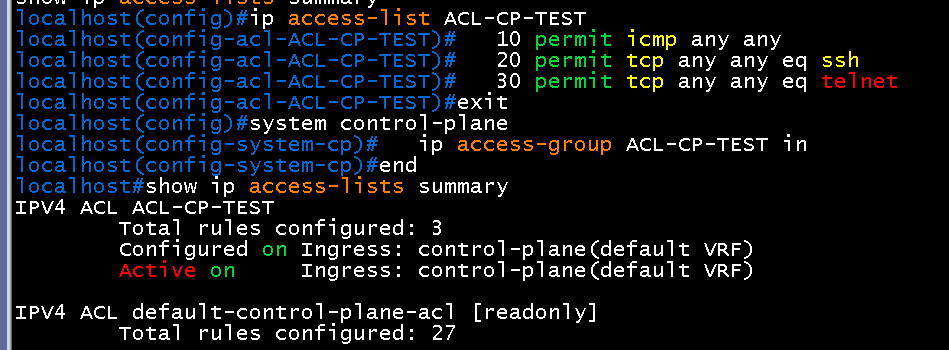

MLAG 설정 수락 (`show mlag`에 domain-id 반영):

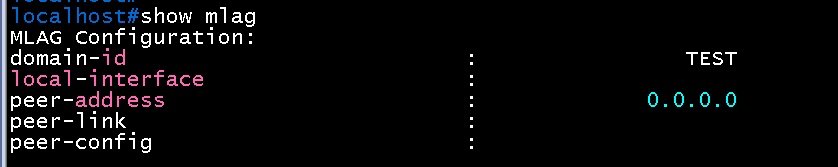

EVPN이 multi-agent 모델 없이 막히는 모습 (설정 전):

multi-agent 설정과 reload 후 EVPN 동작:

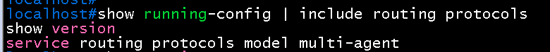
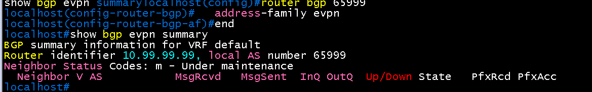

### Aruba ArubaOS-CX 10.07

VRF, active gateway, 멀티섀시 LAG, BGP, VSX 하위 명령이 수락되는 모습:

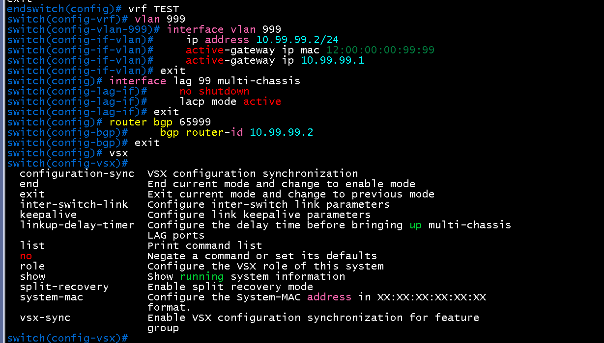

`show vsx status`, `show lacp aggregates`, `show qos`:

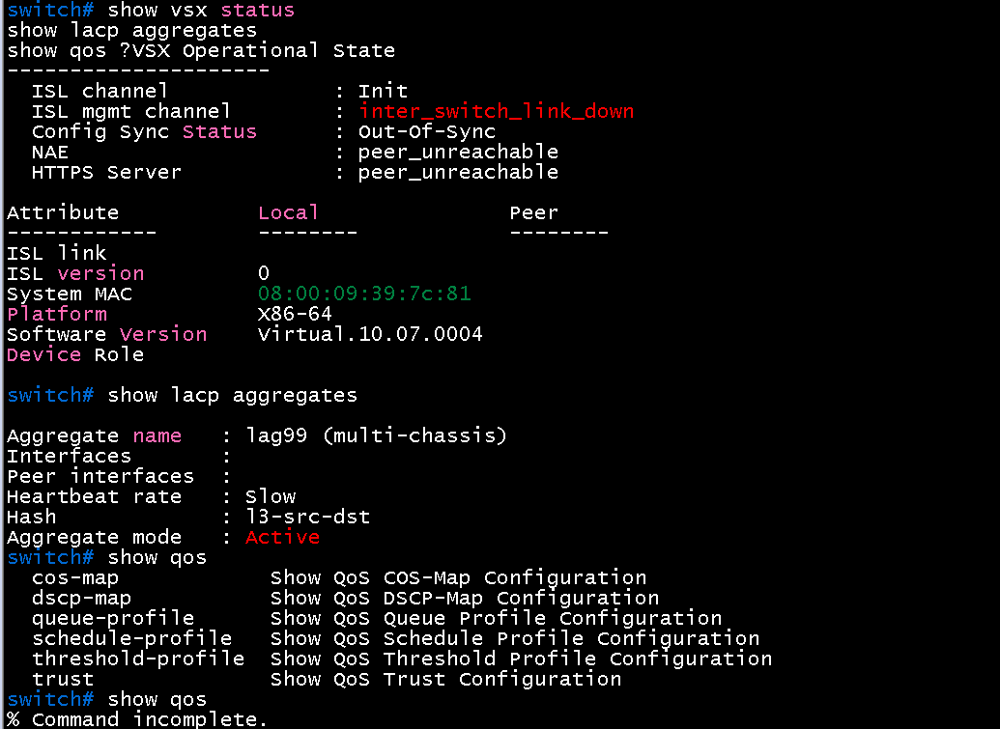

### Cisco c7200 (IOS 12.4(24)T5)

버전, VRF, MPLS, VPNv4, QoS 설정 수락:

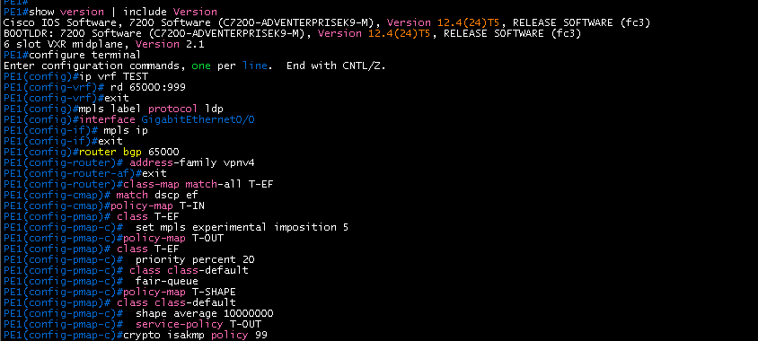

ISAKMP `hash sha256` 거부:

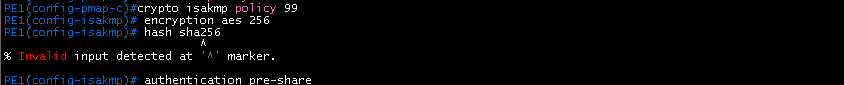

IPsec 프로파일과 터널 보호 수락:

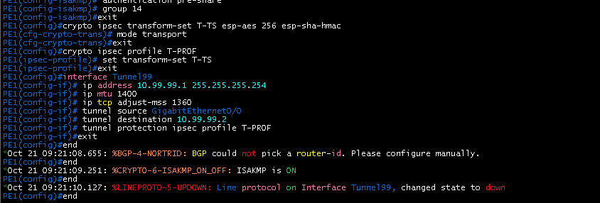

설정 결과(`show ip vrf`, `show mpls interfaces`, `show crypto isakmp policy`, `show policy-map`):

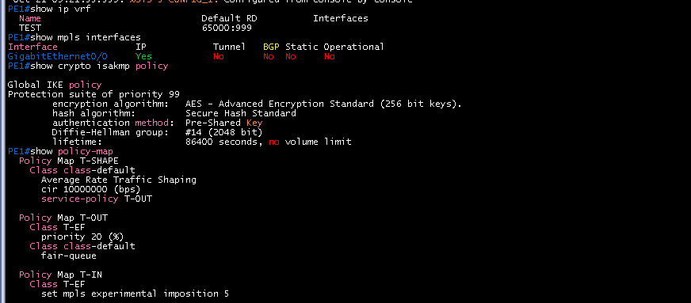

### Cisco IOSv 스위치 (vios_l2)

이미지:

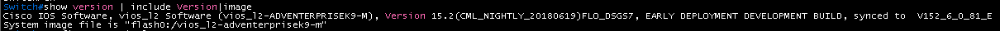

`channel-group 99` 거부:

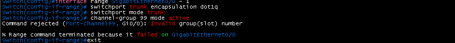

`channel-group 1, 2, 3` 수락 (도움말은 `<1-255>`로 표시):

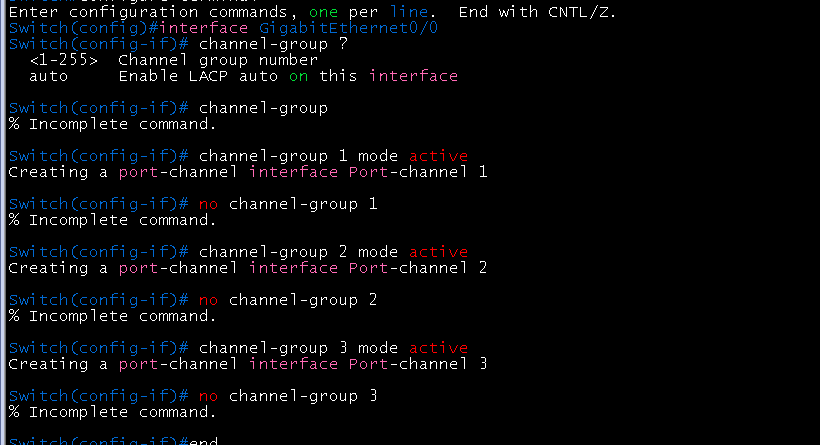

MSTP 설정 확인:

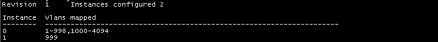

VTP, MST, SVI, VRRP, 트렁크, EtherChannel 설정 수락:

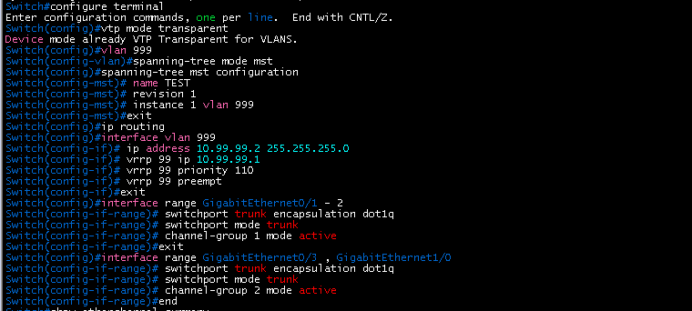

LACP 협상 동작 (상대 포트가 LACP가 아니면 suspended):

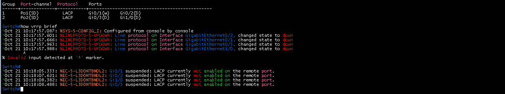