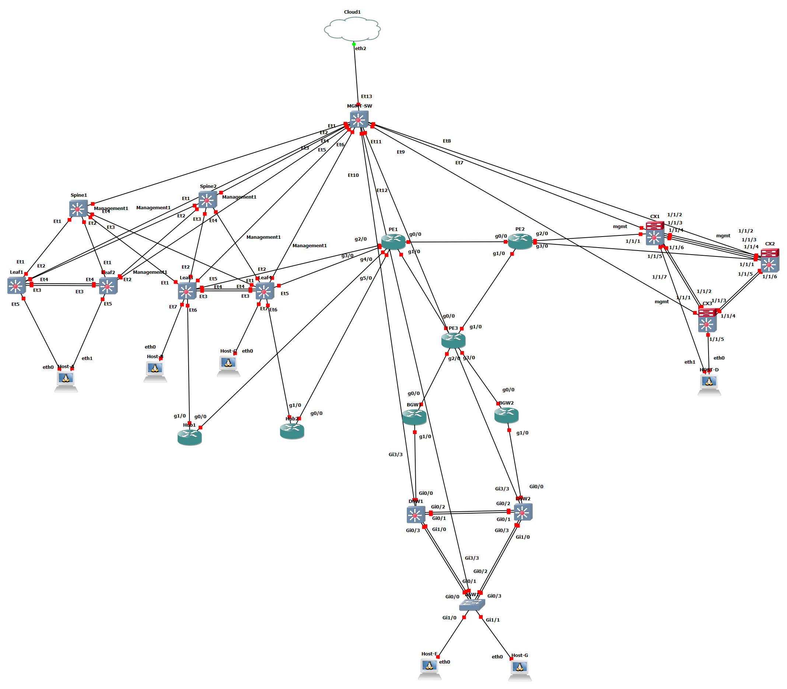

# Multivendor EVPN-VXLAN / MPLS / IPsec Lab

Cisco, Arista, Aruba를 섞어 DC 2곳과 Branch를 MPLS 코어와 GRE over IPsec으로 연결한 하이브리드 WAN을 GNS3에서 구축하고, 단계마다 CLI 출력과 Wireshark 패킷으로 검증한 프로젝트



## 한눈에 보기

| 항목 | 내용 |
|---|---|
| 규모 | 네트워크 장비 19대, 호스트 6대, 3개 벤더 |
| 구성 | DC1(Arista EVPN-VXLAN), MPLS 코어(Cisco PE 3대), DC2(Aruba VSX), Branch(Cisco), Hub-BGW GRE over IPsec 터널 2개 |
| 핵심 기술 | EVPN-VXLAN, MLAG, VSX, MPLS L3VPN(LDP, MP-BGP VPNv4), PE-CE eBGP, GRE over IPsec(IKEv1), 터널 위 eBGP, VRRP, MSTP, QoS(DiffServ) |
| 검증 | 구간마다 기대 결과를 먼저 적고 CLI show 출력과 Wireshark 패킷으로 대조. 검증 캡처 343장 |
| 환경 | GNS3 VM 22GB |

## 주요 결과

- **EVPN-VXLAN**: leaf 쌍이 VTEP 주소를 공유. Host A → Host B는 L2VNI 10010, Host A → Host C는 L3VNI 50001로 확인(VXLAN 패킷 캡처 포함)
- **MPLS L3VPN**: VRF 2개(TENANT-A, WAN-UL)로 DC 구간과 WAN 구간을 분리. DC1, DC2, Branch가 PE-CE eBGP로 접속
- **GRE over IPsec**: IKEv1, AES256, SHA, DH 14. IKE와 ESP 패킷 캡처, 터널 위 eBGP 이웃 4쌍 Established, Host A ↔ Host F 통신
- **장애 시험**: BGW1 WAN 단절 후 감지 8.8초, 터널 위 BGP 복구 10~11초(2회 재현). 이중화의 한계 2가지를 확인하고 개선안 정리
- **QoS**: DSCP 46이 MPLS TC 5로 매핑되고, 혼잡 중 EF와 제어 트래픽은 드롭 0, 드롭은 best-effort에만 발생
- **트러블슈팅**: 가상 이미지의 LAG 데이터 경로 한계, `lacp rate fast` 불안정, 혼잡 중 BGP 단절 등을 확인하고 설계 변경이나 클래스 추가로 대응

## 문서 안내

| 보고 싶은 것 | 위치 |
|---|---|
| 프로젝트를 빠르게 이해 | [`docs/`](docs/README.md): [요약](docs/01-project-summary.md), [구조와 설계 판단](docs/02-architecture.md), [검증 결과](docs/03-verification-results.md), [트러블슈팅](docs/04-troubleshooting.md), [한계](docs/05-limitations.md) |
| 구축 순서 | [`guide/`](guide/00-prerequisites.md) 0단계부터 5단계 |
| 전체 기준(토폴로지, IP, 프로토콜) | [`00-overview/`](00-overview/README.md) |
| 설정 근거와 값 | [`baseline/`](baseline/br/README.md) |
| 장비별 컨피그 | [`configs/`](configs/core/PE1.ios), [`samples/`](samples/br/README.md) |
| 검증 항목과 캡처 | [`verification/`](verification/br/README.md) |

## 폴더 구조

상위는 문서 종류, 그 아래가 지역

```text
docs/               포트폴리오 요약 문서 (요약, 설계 판단, 검증 결과, 트러블슈팅, 한계)
guide/              단계별 진행 순서 (0 사전 준비 ~ 5 QoS, 06은 Hub 보조 가이드). 처음 구축하는 사람은 여기서 시작
00-overview/        전체 기준 (토폴로지, 포트 매핑, IP 설계, 프로토콜 매트릭스, 리소스 계획, 기능 지원 확인 결과, VLAN과 IP 대역 총괄, 장비별 IP 포트 매칭표, Wireshark 캡처 계획)
baseline/           기준 문서 (지역별, 프로토콜별로 나눔. 각 폴더의 README가 읽는 순서)
  dc1/  dc2/  core/  br/  host/
configs/            장비별 실제 컨피그
  dc1/  dc2/  core/  br/  host/
samples/            장비별, 프로토콜별 샘플 컨피그 (프로토콜마다 문서를 나눔, 각 폴더의 README가 목차)
  dc1/  dc2/  core/  br/  host/
verification/       검증 (프로토콜별. 선행 조건, 확인 명령, 기대 결과, 안 될 때 확인)
  dc1/  dc2/  core/  br/  host/
```

| 폴더 | 지역 | 장비 |
|---|---|---|
| `dc1` | DC1 (Arista 패브릭 + WAN 출구) | spine1, spine2, leaf1~leaf4, Hub1, Hub2 |
| `dc2` | DC2 (Aruba) | CX1, CX2, CX3 |
| `core` | MPLS 코어 | PE1, PE2, PE3 |
| `br` | Branch (Cisco) | BGW1, BGW2, DSW1, DSW2, ASW1 |
| `host` | 테스트 호스트 (Ubuntu Docker Guest) | Host A, B, C(DC1), D(DC2), F, G(Branch) |

## 컨피그 파일 확장자

| 확장자 | OS |
|---|---|
| `.eos` | Arista EOS |
| `.ios` | Cisco IOS (c7200, IOSv) |
| `.aos` | Aruba AOS-CX |
| `.sh` | 호스트 (Ubuntu Docker Guest) |

예: `configs/dc1/spine1.eos`, `configs/core/PE1.ios`, `configs/dc2/CX1.aos`, `configs/host/HOST-A.sh`

## 문서 기준

- 전체 값은 `00-overview`가 기준이고, `baseline/*`은 지역별로 발췌한 것. 값이 다르면 `00-overview`가 우선
- 같은 항목은 `baseline`, `samples`, `verification`에서 같은 번호를 씀
- 이 저장소의 계정, enable 비밀번호와 IPsec 사전 공유 키는 **공개된 실습 랩 전용 값**이며 실제 환경에 재사용하지 않음. 키 규칙은 [IPsec 키 관리](baseline/br/08-ipsec-keys.md)
- 지역이나 장비가 추가되면 `baseline`, `configs`, `samples`, `verification` 아래에 같은 이름의 지역 폴더를 만듦

## 직접 따라 해 보기

1. [사전 준비](guide/00-prerequisites.md)에서 GNS3 이미지와 노드를 준비
2. [리소스 계획](00-overview/04-resource-plan.md)대로 단계마다 필요한 노드만 켬
3. [guide](guide/00-prerequisites.md)의 단계 순서대로 `samples/`의 컨피그를 입력하고 `verification/`의 확인 항목으로 검증

## 작성자

남기석 (KSNAM97), 네트워크 엔지니어 지원. 이메일 nks026400@gmail.com

## 라이선스

[MIT License](LICENSE)
