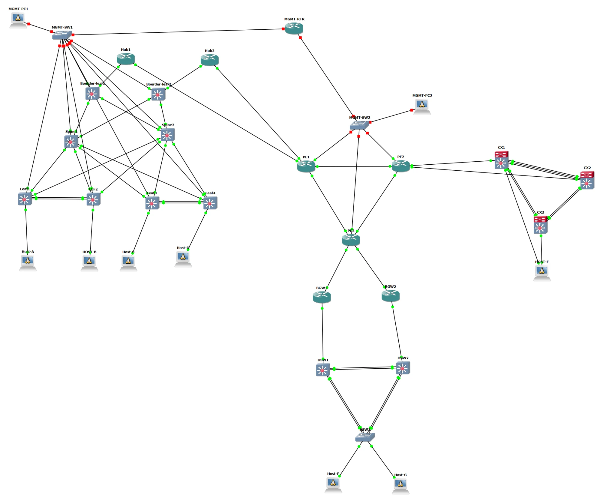
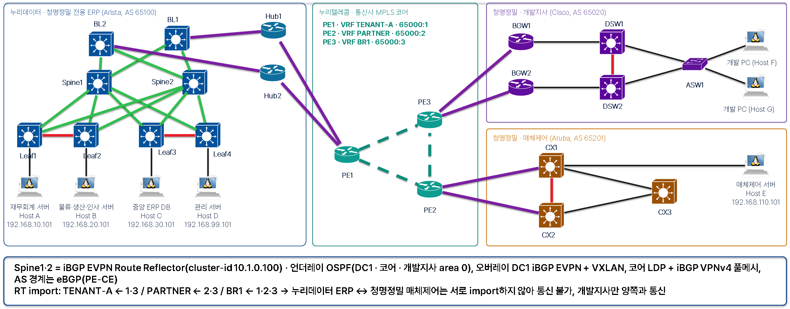

# 프로젝트 요약

## 고객 요구사항 (청명정밀)

청명정밀(고객사)의 요구사항은 아래 3개

| 요청 | 내용 |
|---|---|
| 1 | 청명정밀 BR1 ↔ 누리데이터 DC1 연결 |
| 2 | 청명정밀 DC2 ↔ 청명정밀 BR1 연결 |
| 3 | 누리데이터 DC1 ↔ 청명정밀 DC2는 통신되지 않게 분리 |

## 사업 구조와 담당 기업

- 모기업 **누리텔레콤**이 사업을 수주하고, 자회사 **누리데이터**와 고객사 **청명정밀**이 함께 진행
- **누리텔레콤**: MPLS 코어(PE1~PE3). 사업에 PE를 포함한 이유는 기존 전용회선 계약 만료
- **누리데이터**: DC1(Arista, AS 65100). 임대로 진행한 이유는 청명정밀 전용 신규 사내 ERP 시스템용 서버가 필요하고, 신규 구축 예산 한계와 유지보수 비용을 고려했기 때문
- **청명정밀**: BR1(Cisco, AS 65020), DC2(Aruba, AS 65201). 고객사 망 끝단

## 요청과 구축 범위 매칭

| 요청 | 구간(어디서 어디까지) | 방식 | 담당 |
|---|---|---|---|
| 1. 청명정밀 BR1 ↔ 누리데이터 DC1 | 청명정밀 BGW1·2 → 누리텔레콤 PE3 → PE1 → 누리데이터 Hub1·2 → Border Leaf1·2 | MPLS L3VPN(BR1 VRF 192.168.50.0·60.0/24 ↔ TENANT-A 192.168.10.0·20.0/24), PE-CE eBGP(10.0.60.0/24, 10.0.30.0/24, 10.0.31.0/24) | 청명정밀(BGW), 누리텔레콤(PE3·PE1), 누리데이터(Hub·Border Leaf) |
| 2. 청명정밀 DC2 ↔ 청명정밀 BR1 | 청명정밀 CX1·2 → 누리텔레콤 PE2 → PE3 → 청명정밀 BGW1·2 | MPLS L3VPN(PARTNER 192.168.110.0/24 ↔ BR1 VRF 192.168.50.0·60.0/24), PE-CE eBGP(10.0.20.0/24, 10.0.60.0/24) | 청명정밀(CX·BGW), 누리텔레콤(PE2·PE3) |
| 3. 누리데이터 DC1 ↔ 청명정밀 DC2 분리 | 누리텔레콤 PE1(TENANT-A)과 PE2(PARTNER) | VRF·RT 분리(서로 import하지 않음), BGW prefix-list로 BR1 경유 전달 차단 | 누리텔레콤(PE1·PE2 VRF), 청명정밀(BGW prefix-list) |

## 목표

- DC 2곳과 Branch를 MPLS L3VPN 코어에 PE-CE eBGP로 연결하고, VRF와 RT로 DC1과 DC2를 분리하는 구성을 GNS3에서 구축
- Cisco, Arista, Aruba를 섞어 벤더가 달라도 EVPN-VXLAN, MPLS L3VPN, PE-CE eBGP가 맞물리는지 단계마다 확인
- 설정만 하지 않고 기대 결과를 먼저 적은 뒤 CLI 출력과 Wireshark 패킷으로 대조

## 범위

| 영역 | 기업 | 벤더 | 장비 | 주요 기능 |
|---|---|---|---|---|
| DC1 | 누리데이터(임대) | Arista vEOS, Cisco c7200 | spine 2, leaf 4, border leaf 2, Hub 2 | OSPF 언더레이, EVPN-VXLAN, MLAG, 관리망 ACL |
| MPLS 코어 | 누리텔레콤 | Cisco c7200 | PE1~PE3 | OSPF, LDP, VRF, MP-BGP VPNv4, PE-CE eBGP |
| DC2 | 청명정밀 | Aruba AOS-CX | CX1~CX3 | VSX, 멀티 섀시 LAG, Active Gateway, VRF eBGP |
| Branch (BR1) | 청명정밀 | Cisco c7200, IOSv | BGW 2, DSW 2, ASW 1 | MSTP, EtherChannel, VRRP, OSPF, PE3와 VRF BR1 eBGP |
| 호스트 | Ubuntu Docker Guest | Host A, B, C, D, F, G | 연결 시험, 트래픽 생성 |

- 네트워크 장비 21대, 호스트 6대
- 작업 기간: 2026.10.05 ~ 11.06, 1인 수행
- 환경: GNS3 VM 22GB. 노드별 메모리와 단계별로 켜는 노드는 [리소스 계획](../00-overview/04-resource-plan.md)

논리 구성도(포트 이름 제외)

## 구축 계획 (4주, 시나리오)

고객사 세 곳(누리데이터, 누리텔레콤, 청명정밀)에 두 차례 파견하는 시나리오로 짠 계획. 1차 파견에서 언더레이(기본 설정, 인터페이스 IP, L2, 게이트웨이)를 고객사별로 먼저 구성하고, 2차 파견에서 프로토콜을 의존 관계 순서(서비스 모델 정의 → OSPF → MPLS·LDP → iBGP → VRF → eBGP)로 올림. 실제 작업 일자는 각 verification 문서의 결과 기록을 따르고, 실제 구축 절차는 아래 [구축 순서](#구축-순서)와 `guide/`를 따름. 4주차는 2주(10/26~11/06)

### 1차 파견: 언더레이

| 고객사 | 영역 | 작업 | 확인 |
|---|---|---|---|
| 누리데이터 | DC1 | 링크 연결, 기본 설정(ZTP 끄기), loopback과 /31 IP, MLAG, 호스트 bond | [MLAG](../verification/dc1/02-mlag.md) |
| 누리텔레콤 | MPLS 코어 | PE 기본 설정, 인터페이스 IP(loopback0, 링크, VRF 소속) | [인터페이스 IP](../verification/core/02-interface-ip.md) |
| 청명정밀 | DC2 | CX 기본 설정, 인터페이스 IP(VRF 포함), VSX(ISL, keepalive), VSX LAG, active gateway | [VSX](../verification/dc2/03-vsx.md), [VSX LAG](../verification/dc2/04-vsx-lag.md), [active gateway](../verification/dc2/05-active-gateway.md) |
| 청명정밀 | Branch | 기본 설정, VLAN, MSTP, EtherChannel, SVI와 VRRP | [MSTP, EtherChannel](../verification/br/04-mstp-etherchannel.md), [VRRP, SVI](../verification/br/05-vrrp-svi.md) |

### 2차 파견: 프로토콜 (순서대로)

| 순서 | 프로토콜 | 대상 | 확인 |
|---|---|---|---|
| 0 | 서비스 모델 정의 | EVPN-VXLAN(DC1 가상 네트워크)과 MPLS L3VPN(VRF, RT 분리) 설계. 프로토콜 설정 전에 정함 | [구조와 설계 판단](02-architecture.md) |
| 1 | 언더레이: OSPF | DC1 언더레이, 코어, Branch (DC2는 OSPF 없음) | [DC1](../verification/dc1/01-ospf-underlay.md), [코어](../verification/core/03-ospf.md), [Branch](../verification/br/06-ospf-branch.md) |
| 2 | MPLS와 LDP | 코어 (OSPF가 만든 PE loopback 도달성 위에 레이블 부여, iBGP 전) | [검증](../verification/core/04-mpls-ldp.md) |
| 3 | 제어 플레인: iBGP | DC1 EVPN(spine이 Route Reflector)과 VXLAN, 코어 VPNv4(PE 간) | [EVPN-VXLAN](../verification/dc1/03-evpn-vxlan.md), [VPNv4](../verification/core/06-mp-bgp-vpnv4.md) |
| 4 | 가상 공간 분할: VRF (RD, route-target) | PE1~PE3 (TENANT-A, PARTNER, BR1) | [검증](../verification/core/05-vrf.md) |
| 5 | 외부 연동: eBGP | PE-CE (Hub와 PE1, CX와 PE2, BGW와 PE3) | [코어 PE-CE](../verification/core/07-pe-ce-ebgp.md), [DC1](../verification/dc1/04-dci-hub-ebgp.md), [DC2](../verification/dc2/06-ebgp-pe.md), [Branch](../verification/br/07-pe3-bgw-ebgp.md) |
| 6 | 연결·분리 검증 | 요구사항 1~3, 장애 시험 | [검증 결과](03-verification-results.md) |

### 주차 배정

| 주차 | 기간 | 내용 | 담당 기업 |
|---|---|---|---|
| 1주차 | 10/05~10/09 | 1차 파견: DC1 언더레이(기본 설정, loopback, /31 IP, MLAG, 호스트) | 누리데이터 |
| 2주차 | 10/12~10/16 | 1차 파견: 코어 인터페이스 IP, DC2(VSX, VSX LAG, active gateway), Branch(VLAN, MSTP, EtherChannel, SVI, VRRP) | 누리텔레콤, 청명정밀 |
| 3주차 | 10/19~10/23 | 2차 파견: 서비스 모델 정의, OSPF, MPLS·LDP, iBGP(EVPN, VPNv4), VRF | 누리데이터, 누리텔레콤, 청명정밀 |
| 4주차 | 10/26~11/06 | 2차 파견: eBGP(PE-CE), 연결·분리 검증, 장애 시험, 결과 종합 | 세 고객사, 검증 |

## 구축 순서

고객사 간 순서는 아래 표를 따르고, 장비 안의 세부 절차(순서 번호)는 지역별 가이드(`guide/`)를 따름. 1차 파견은 언더레이, 2차 파견은 프로토콜을 의존 관계 순서(서비스 모델 정의 → OSPF → MPLS·LDP → iBGP → VRF → eBGP)로 올림

| 순서 | 파견 | 내용 | 가이드(지역별 절차 번호) |
|---|---|---|---|
| 0 | - | 사전 준비 | [사전 준비](../guide/00-prerequisites.md) |
| 1 | 1차 | DC1 언더레이: 링크, 기본 설정(ZTP 끄기, multi-agent), MLAG, 호스트 | [DC1](../guide/01-dc1.md) 순서 1, 2, 4, 5 |
| 2 | 1차 | 코어 언더레이: PE 기본 설정, 인터페이스 IP | [코어](../guide/02-core.md) 순서 1, 2 |
| 3 | 1차 | DC2 언더레이: CX 기본 설정, 인터페이스 IP, VSX, VSX LAG, active gateway | [DC2](../guide/03-dc2.md) 순서 1 ~ 5 |
| 4 | 1차 | Branch 언더레이: 기본 설정, VLAN, MSTP, EtherChannel, SVI, VRRP | [Branch](../guide/04-branch.md) 순서 1 ~ 3 |
| 5 | 2차 ⓪ | 서비스 모델 정의: EVPN-VXLAN, MPLS L3VPN | [구조와 설계 판단](02-architecture.md) |
| 6 | 2차 ① | OSPF: DC1 언더레이, 코어, Branch | DC1 순서 3, 코어 순서 3, Branch 순서 4 |
| 7 | 2차 ② | MPLS와 LDP | 코어 순서 4 |
| 8 | 2차 ③ | iBGP: DC1 EVPN-VXLAN, 코어 VPNv4 | DC1 순서 6, 코어 순서 6 |
| 9 | 2차 ④ | VRF (RD, route-target) | 코어 순서 5 |
| 10 | 2차 ⑤ | eBGP: PE-CE (Hub와 PE1, CX와 PE2, BGW와 PE3) | 코어 순서 7, DC2 순서 6, Branch 순서 5, [Hub](../guide/06-hub.md) |
| 11 | 2차 ⑥ | 연결·분리 검증 | DC2 순서 7, Branch 순서 6 |

순서 의존 관계: 6번 OSPF는 2차 파견 전에 루프백과 링크 IP가 있어야 하고(Branch는 SVI가 있어야 LAN이 BGW로 광고됨), 7번 LDP는 6번이 만든 PE loopback 도달성 위에서 동작함. 8번 iBGP는 6번 loopback 도달성이 필요하고, 코어 VPNv4는 7번 LDP가 있어야 의미가 있음. 9번 VRF가 있어야 10번 PE-CE eBGP를 PE의 VRF에 설정할 수 있음

## 문서 체계

- 같은 항목은 `baseline`(기준), `samples`(샘플 컨피그), `verification`(검증)에서 같은 번호를 씀
- 검증 문서는 선행 조건, 확인 명령, 기대 결과, 안 될 때 확인 순서로 쓰고 결과 기록과 캡처를 함께 둠
- 캡처 이미지는 명령 한 줄과 결과를 한 세트로 잘라 저장하고, 대표 프로토콜은 Wireshark 패킷 캡처를 추가([캡처 계획](../00-overview/08-wireshark-capture.md))

## 기술 스택

| 기술 | 적용 위치 | 상세 |
|---|---|---|
| EVPN-VXLAN | DC1 leaf, spine | [기준](../baseline/dc1/05-evpn-vxlan.md), [검증](../verification/dc1/03-evpn-vxlan.md) |
| MLAG, VSX | DC1 leaf 쌍, DC2 CX 쌍 | [DC1 검증](../verification/dc1/02-mlag.md), [DC2 검증](../verification/dc2/03-vsx.md) |
| MPLS L3VPN | PE1~PE3 | [LDP 검증](../verification/core/04-mpls-ldp.md), [VPNv4 검증](../verification/core/06-mp-bgp-vpnv4.md) |
| PE-CE eBGP | Hub-PE1(border leaf 1대1 연결), CX1·2-PE2, BGW-PE3 | [검증](../verification/core/07-pe-ce-ebgp.md) |
| VRF와 RT 분리 | TENANT-A, PARTNER, BR1 | [VRF 검증](../verification/core/05-vrf.md) |
| VRRP, MSTP, EtherChannel | Branch DSW, ASW | [MSTP 검증](../verification/br/04-mstp-etherchannel.md), [VRRP 검증](../verification/br/05-vrrp-svi.md) |
