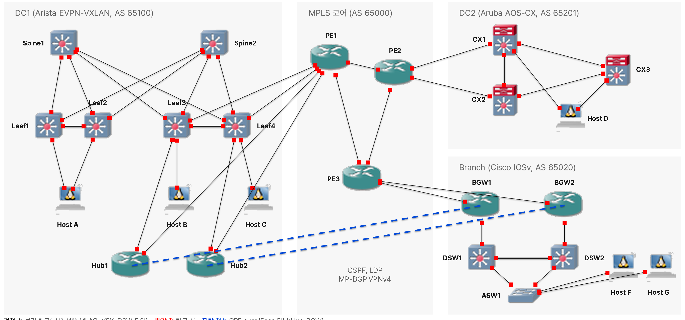

# 프로젝트 요약

## 목표

- DC 2곳과 Branch를 MPLS 코어와 GRE over IPsec 터널로 연결하는 하이브리드 WAN을 GNS3에서 구축
- Cisco, Arista, Aruba를 섞어 벤더가 달라도 EVPN-VXLAN, MPLS L3VPN, PE-CE eBGP, IPsec이 맞물리는지 단계마다 확인
- 설정만 하지 않고 기대 결과를 먼저 적은 뒤 CLI 출력과 Wireshark 패킷으로 대조

## 범위

| 영역 | 벤더 | 장비 | 주요 기능 |
|---|---|---|---|
| DC1 | Arista vEOS, Cisco c7200 | spine 2, leaf 4, Hub 2 | OSPF 언더레이, EVPN-VXLAN, MLAG, 관리망 ACL |
| MPLS 코어 | Cisco c7200 | PE1~PE3 | OSPF, LDP, VRF, MP-BGP VPNv4, PE-CE eBGP, QoS |
| DC2 | Aruba AOS-CX | CX1~CX3 | VSX, 멀티 섀시 LAG, Active Gateway, VRF eBGP |
| Branch | Cisco c7200, IOSv | BGW 2, DSW 2, ASW 1 | MSTP, EtherChannel, VRRP, OSPF, WAN-UL, GRE over IPsec |
| 호스트 | Ubuntu Docker Guest | Host A, B, C, D, F, G | 연결 시험, 트래픽 생성 |

- 네트워크 장비 19대, 호스트 6대
- 작업 기간: 2026.10.21 ~ 10.23(3일), 1인 수행
- 환경: GNS3 VM 22GB. 노드별 메모리와 단계별로 켜는 노드는 [리소스 계획](../00-overview/04-resource-plan.md)

논리 구성도(포트 이름 제외)

## 구축 순서

| 단계 | 내용 | 가이드 |
|---|---|---|
| 0 | 사전 준비 | [사전 준비](../guide/00-prerequisites.md) |
| 1 | DC1 패브릭: OSPF 언더레이, MLAG, EVPN-VXLAN | [DC1](../guide/01-dc1.md) |
| 2 | MPLS 코어와 DC1 연동 | [코어](../guide/02-core.md) |
| 3 | DC2 연동 | [DC2](../guide/03-dc2.md) |
| 4 | Branch와 IPsec | [Branch](../guide/04-branch-ipsec.md) |
| 5 | QoS | [QoS](../guide/05-qos.md) |

## 문서 체계

- 같은 항목은 `baseline`(기준), `samples`(샘플 컨피그), `verification`(검증)에서 같은 번호를 씀
- 검증 문서는 선행 조건, 확인 명령, 기대 결과, 안 될 때 확인 순서로 쓰고 결과 기록과 캡처를 함께 둠
- 캡처 이미지는 명령 한 줄과 결과를 한 세트로 잘라 저장하고, 대표 프로토콜은 Wireshark 패킷 캡처를 추가([캡처 계획](../00-overview/08-wireshark-capture.md))

## 기술 스택

| 기술 | 적용 위치 | 상세 |
|---|---|---|
| EVPN-VXLAN | DC1 leaf, spine | [기준](../baseline/dc1/05-evpn-vxlan.md), [검증](../verification/dc1/03-evpn-vxlan.md) |
| MLAG, VSX | DC1 leaf 쌍, DC2 CX 쌍 | [DC1 검증](../verification/dc1/02-mlag.md), [DC2 검증](../verification/dc2/03-vsx.md) |
| MPLS L3VPN | PE1~PE3 | [LDP 검증](../verification/core/04-mpls-ldp.md), [VPNv4 검증](../verification/core/06-mp-bgp-vpnv4.md) |
| PE-CE eBGP | leaf3·4-PE1, CX1·2-PE2, BGW-PE3 | [검증](../verification/core/07-pe-ce-ebgp.md) |
| GRE over IPsec | Hub-BGW 터널 2개 | [검증](../verification/br/09-ipsec-gre.md) |
| 터널 위 eBGP | Hub-BGW | [검증](../verification/br/10-bgp-over-tunnel.md) |
| VRRP, MSTP, EtherChannel | Branch DSW, ASW | [MSTP 검증](../verification/br/04-mstp-etherchannel.md), [VRRP 검증](../verification/br/05-vrrp-svi.md) |
| QoS (DiffServ) | PE1 | [검증](../verification/core/08-qos.md) |
