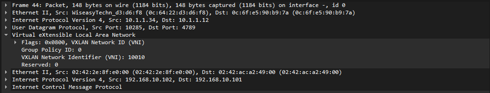
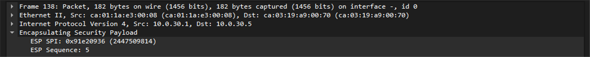
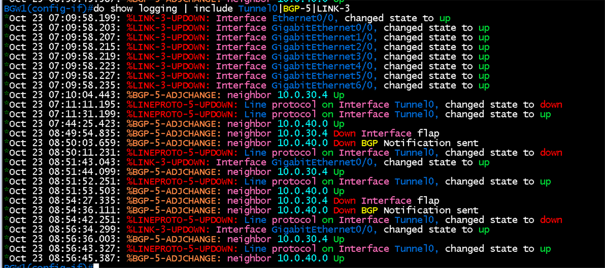
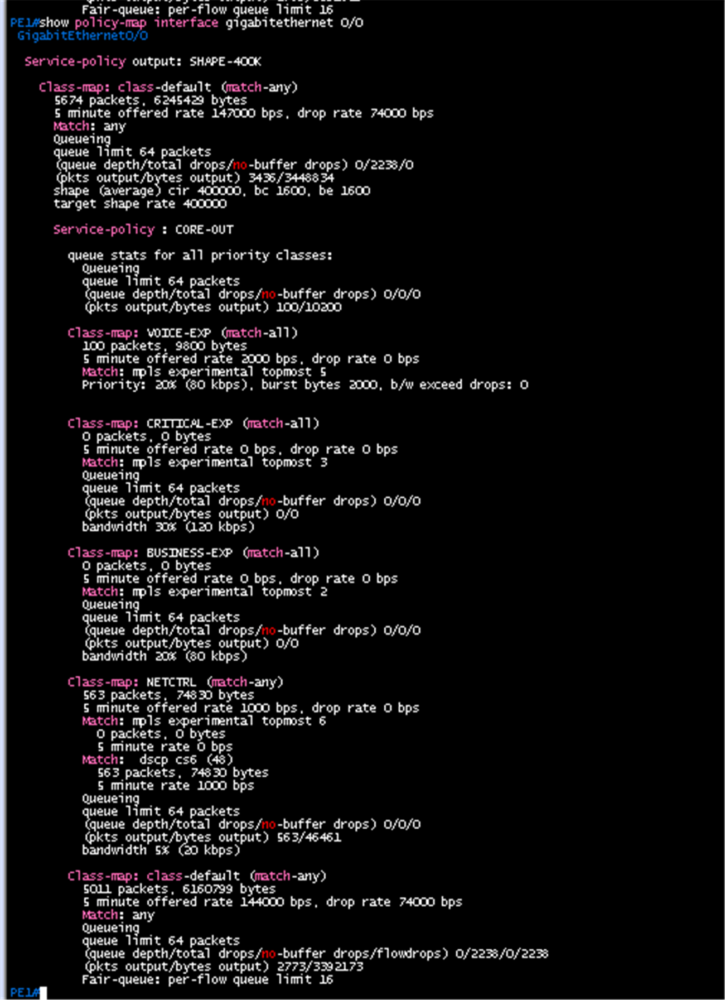

# 검증 결과

기준: 구간별로 기대 결과를 먼저 적고 CLI 출력과 패킷 캡처로 확인. 날짜는 2026-10-22와 2026-10-23

## 구간별 결과

| 구간 | 확인한 것 | 결과 | 상세 |
|---|---|---|---|
| DC1 언더레이 | OSPF 이웃, 타이머, 경로, Hello 캡처 | 성공 (spine 정지 시험은 미실시) | [검증](../verification/dc1/01-ospf-underlay.md) |
| DC1 MLAG | leaf1·2, leaf3·4 쌍, Host A bond | 성공 | [검증](../verification/dc1/02-mlag.md) |
| DC1 EVPN-VXLAN | iBGP EVPN 세션, VNI 10010과 50001, Host A → B(L2VNI), Host A → C(L3VNI) | 성공 (장애 시험 제외) | [검증](../verification/dc1/03-evpn-vxlan.md) |
| MPLS 코어 | OSPF, LDP, VRF, VPNv4, PE-CE eBGP | 성공 | [코어 검증](../verification/core/04-mpls-ldp.md) |
| DC2 | VSX, 멀티 섀시 LAG, Active Gateway, VRF eBGP | 성공 (제한: LAG 위 VLAN 데이터가 이미지 한계로 전달되지 않아 Host D를 CX1에 직접 연결) | [DC2 검증](../verification/dc2/04-vsx-lag.md) |
| Branch L2, L3 | MSTP, EtherChannel, VRRP, OSPF | 성공 | [Branch 검증](../verification/br/04-mstp-etherchannel.md) |
| WAN-UL | PE3-BGW eBGP, Hub-BGW 언더레이 ping | 성공 | [검증](../verification/br/07-wan-ebgp.md) |
| GRE over IPsec | ISAKMP SA, IPsec SA, 터널 2개 up, IKE와 ESP 캡처 | 성공 | [검증](../verification/br/09-ipsec-gre.md) |
| 터널 위 eBGP와 통신 | 이웃 4쌍 Established, Host A ↔ F, F → D | 성공 | [검증](../verification/br/10-bgp-over-tunnel.md) |
| MTU와 MSS | IP 1400 통과, 1428 차단, SYN-ACK MSS 1360 | 성공 (TCP 처리량은 판정에서 제외) | [검증](../verification/br/11-mtu-mss.md) |
| 이중화 장애 시험 | BGW1 WAN 단절 감지와 복구 | 부분 성공 | [검증](../verification/br/12-ipsec-failover.md) |
| QoS | DSCP → TC 매핑, 우선 큐, 혼잡 드롭 분리 | 성공 (카운터와 캡처 기준) | [검증](../verification/core/08-qos.md) |

## 대표 증빙

### EVPN-VXLAN: L2VNI 10010 캡처

외부 UDP 4789, 외부 주소 10.1.1.12 → 10.1.1.34, VNI 10010, 안쪽 ICMP

### IPsec: ESP 패킷

바깥 IP는 Hub와 BGW의 언더레이 주소이고 안쪽 GRE와 BGP는 암호화되어 보이지 않음

### 장애 시험: BGW1 로그 타임라인

| 이벤트 | 1회차 | 2회차 |
|---|---|---|
| shutdown → Hub1 BGP down (hold 만료) | 8.8초 | 8.8초 |
| shutdown → Tunnel0 down | 16.4초 | 14.9초 |
| link up → 터널 위 BGP up | 10.5초 | 11.1초 |

### QoS: 혼잡 중 클래스별 카운터

VOICE-EXP 드롭 0, NETCTRL 드롭 0, class-default 드롭 2238

### Branch ↔ DC 통신

Host F → Host A traceroute가 DSW1, BGW1, 터널 0(10.0.40.0), leaf3을 거쳐 도달

