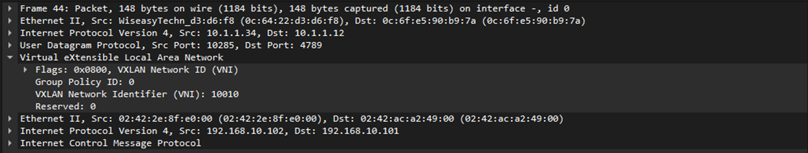
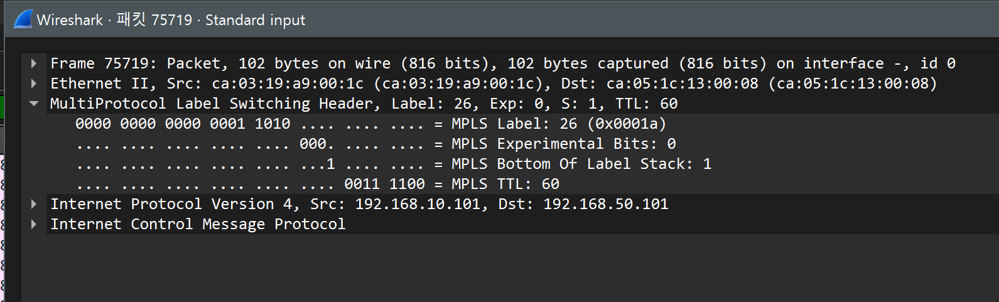
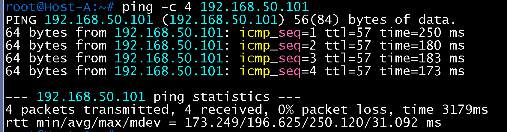

# 검증 결과

기준: 구간별로 기대 결과를 먼저 적고 CLI 출력과 패킷 캡처로 확인. 날짜는 2026-10-22, 2026-10-23, 2026-11-07

## 구간별 결과

| 구간 | 확인한 것 | 결과 | 상세 |
|---|---|---|---|
| DC1 언더레이 | OSPF 이웃, 타이머, 경로, Hello 캡처 | 성공 (spine 정지 시험은 미실시) | [검증](../verification/dc1/01-ospf-underlay.md) |
| DC1 MLAG | leaf1·2, leaf3·4 쌍, Host A bond | 성공 | [검증](../verification/dc1/02-mlag.md) |
| DC1 EVPN-VXLAN | iBGP EVPN 세션, VNI 10010과 50001, Host A → B(L2VNI), Host A → C(L3VNI) | 성공 (장애 시험 제외) | [검증](../verification/dc1/03-evpn-vxlan.md) |
| MPLS 코어 | OSPF, LDP, VRF, VPNv4, PE-CE eBGP | 성공 | [코어 검증](../verification/core/04-mpls-ldp.md) |
| DC2 | VSX, 멀티 섀시 LAG, Active Gateway, VRF eBGP | 성공 (제한: LAG 위 VLAN 데이터가 이미지 한계로 전달되지 않아 Host D를 CX1에 직접 연결) | [DC2 검증](../verification/dc2/04-vsx-lag.md) |
| Branch L2, L3 | MSTP, EtherChannel, VRRP, OSPF | 성공 | [Branch 검증](../verification/br/04-mstp-etherchannel.md) |
| PE-CE와 VRF 분리 | PE1·PE2 이웃, VRF BR1 경로, PE1 - PE3 MPLS 헤더(Label 26, 33), Host A ↔ F, Host D ↔ F | 성공 (최종 구성 화면 증빙 일부 추가 예정) | [PE-CE 검증](../verification/core/07-pe-ce-ebgp.md), [MPLS 검증](../verification/core/04-mpls-ldp.md) |
| DC1 Hub 이중화 장애 시험 | Hub 링크(T1, T1b)와 코어 링크(T2) 차단과 자동 복구 | 성공 (손실 0, 약 8.4초, 약 12.6초) | [Hub 검증](../verification/dc1/04-dci-hub-ebgp.md) |

## 대표 증빙

### EVPN-VXLAN: L2VNI 10010 캡처

외부 UDP 4789, 외부 주소 10.1.1.34 → 10.1.1.12(leaf3·4 → leaf1·2), VNI 10010, 안쪽 ICMP(Host B → Host A)

### MPLS 헤더: PE1 -> PE3 (Host A와 Host F ping)

PE1 `Gi1/0` - PE3 `Gi0/0` 링크, 필터 `mpls`. 직결 링크라 전송 레이블은 PHP로 제거되고 VPN 레이블 1개(Label 26, S=1)만 붙음. PE1의 `show bgp vpnv4 unicast all labels`에서 192.168.50.0의 레이블 26과 일치

### 장애 시험: DC1 Hub 이중화

| 시험 | 내린 링크 | 결과 |
|---|---|---|
| T1 | PE1 `Gi4/0` (PE1 - Hub1) | 300/300 응답, 손실 0 |
| T1b | PE1 `Gi5/0` (PE1 - Hub2) | 258/300 응답, 약 8.4초 손실 후 복구 |
| T2 | PE2 `Gi1/0` (코어 링크) | 237/300 응답, 약 12.6초 손실 후 복구, next hop이 PE1 경유로 바뀜 |

세 시험 모두 링크를 올리면 자동으로 복구됨. 화면 증빙은 추가 예정

### Branch ↔ DC 통신

Host A → Host F ping 4/4 응답(손실 0%). DC1과 DC2는 분리되어 Host A → Host D는 응답이 없는 것이 정상

