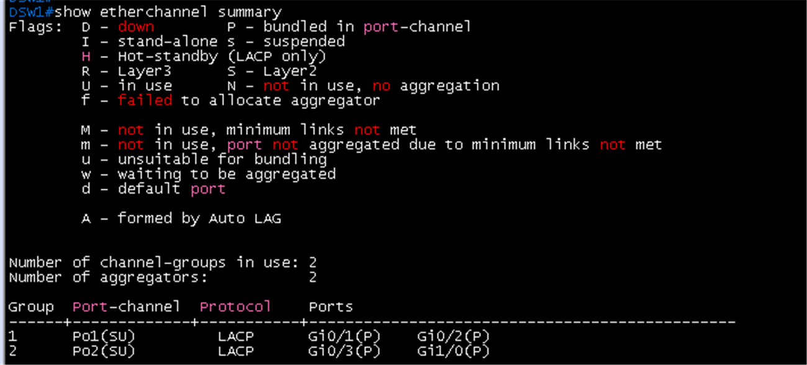
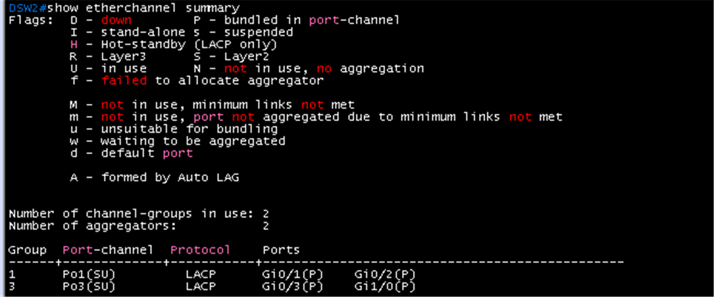
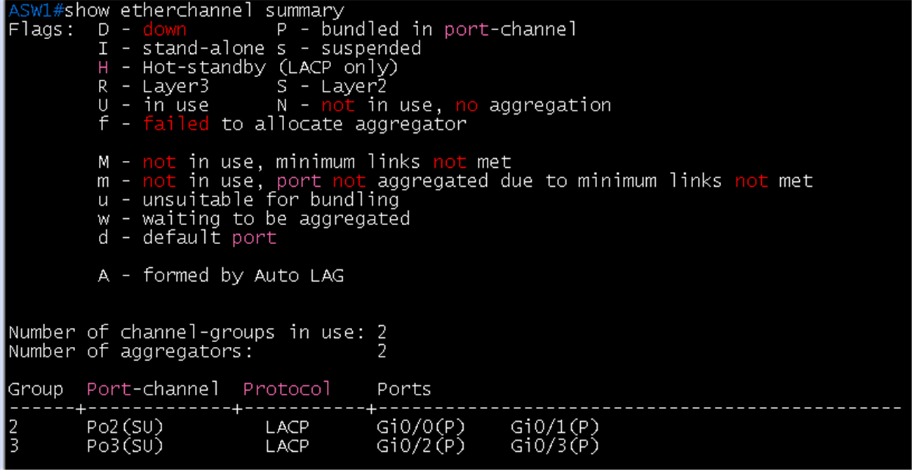
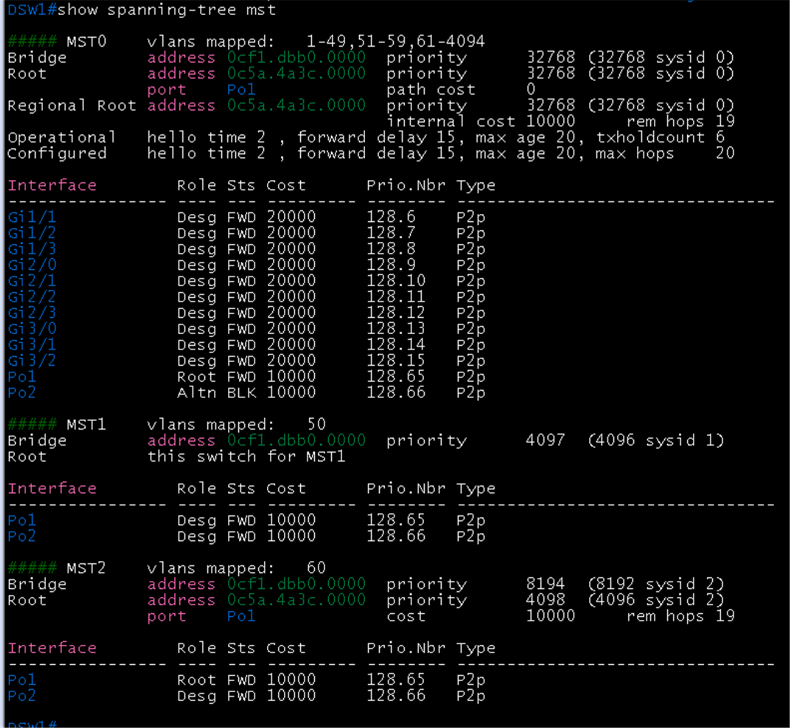
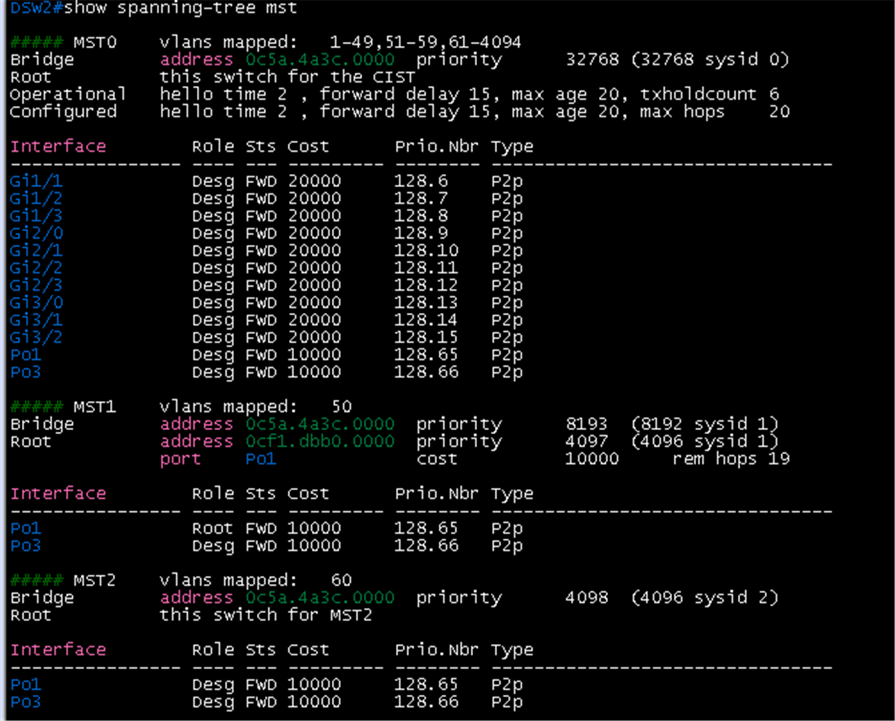
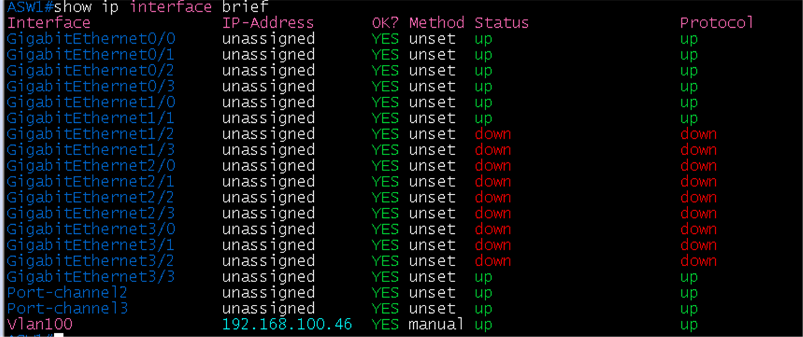
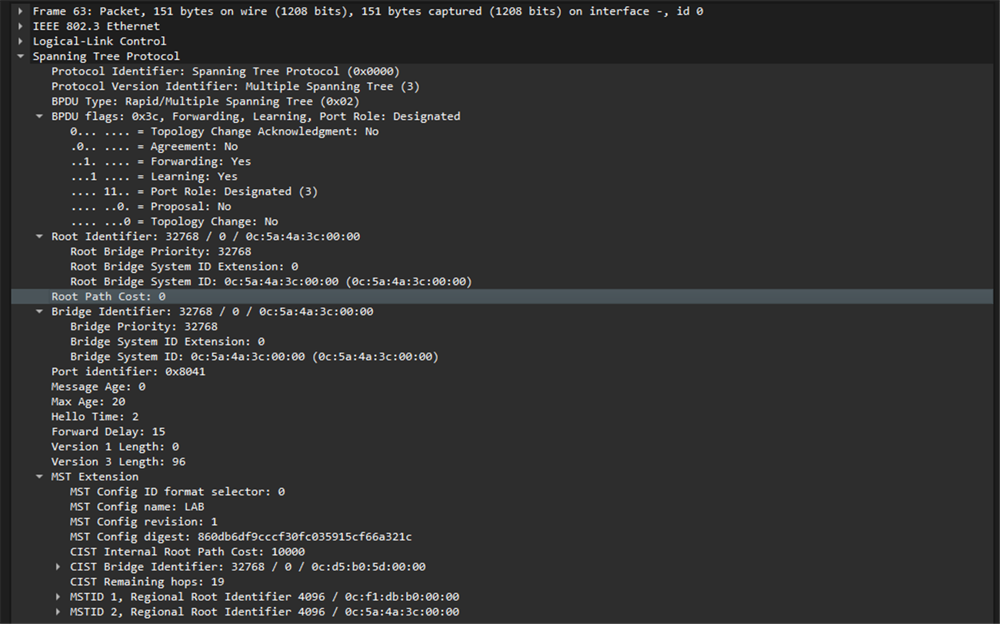

# MSTP와 EtherChannel 검증

**선행 조건**: DSW1, DSW2, ASW1이 켜져 있고 [MSTP와 EtherChannel 샘플](../../samples/br/04-mstp-etherchannel.md)이 적용되어 있어야 함. [기준 문서](../../baseline/br/04-mstp-etherchannel.md).

## 확인 항목

| 순서 | 장비 | 명령 | 기대 결과 | 안 될 때 확인 |
|---|---|---|---|---|
| 1 | DSW1, DSW2, ASW1 | `show etherchannel summary` | Po1, Po2, Po3가 **SU**, 멤버 포트가 **P** | 양쪽 `channel-group` 번호, LACP active, trunk 설정 |
| 2 | 모든 스위치 | `show spanning-tree mst configuration` | region LAB, revision 1, 인스턴스 1=VLAN 50, 2=VLAN 60 (**세 스위치가 같아야 함**) | name, revision, instance 매핑 |
| 3 | DSW1 | `show spanning-tree mst 1` | 이 스위치가 인스턴스 1의 **root** | priority 4096 |
| 4 | DSW2 | `show spanning-tree mst 2` | 이 스위치가 인스턴스 2의 **root** | priority 4096 |
| 5 | ASW1 | `show spanning-tree mst 1`, `show spanning-tree mst 2` | 인스턴스마다 다른 번들이 forwarding, 나머지는 blocking | root 분담 설정 |
| 6 | Host F, Host G | `ping -c 3 <게이트웨이>` | 응답 | VLAN, trunk |
| 7 | DSW1 | `show etherchannel summary`, `show lacp neighbor` | LACP 멤버가 `P`(bundled). 타이머는 기본(30초) | 이 IOSv 이미지는 `lacp rate fast`를 받지 않음 |

## 장애 시험

| 동작 | 기대 결과 |
|---|---|
| Po2 멤버 링크 하나 shut | 번들 유지 (나머지 링크) |
| DSW1 정지 | ASW1이 Po3 경로로 모든 VLAN 통신 유지 (재수렴 시간 기록) |
## 증빙

### EtherChannel (항목 1)

- DSW1 `show etherchannel summary`: **Po1(SU)** Gi0/1(P), Gi0/2(P), **Po2(SU)** Gi0/3(P), Gi1/0(P). Protocol LACP, channel-groups in use 2
- DSW2: **Po1(SU)** Gi0/1(P), Gi0/2(P), **Po3(SU)** Gi0/3(P), Gi1/0(P)
- ASW1: **Po2(SU)** Gi0/0(P), Gi0/1(P), **Po3(SU)** Gi0/2(P), Gi0/3(P)
- 처음 입력했을 때 멤버 포트에 trunk encapsulation이 auto로 남아 `%EC-5-CANNOT_BUNDLE2`로 suspended였으나, 멤버에 port-channel과 같은 trunk 설정(encapsulation dot1q)을 넣은 뒤 모두 `P`로 번들됨. IOSv에서는 `lacp rate fast`가 `% Invalid input`이라 기본(30초)을 씀

### MSTP root 분담 (항목 3, 4)

- DSW1 `show spanning-tree mst`: **MST1**(VLAN 50) Bridge priority **4097**(4096 sysid 1), Root **this switch for MST1**. **MST2**(VLAN 60) Bridge 8194, Root 0c5a.4a3c(DSW2) priority 4098, port **Po1**. MST0(CIST)은 root가 DSW2(0c5a.4a3c, MAC이 더 낮음), Po1 Root FWD, **Po2 Altn BLK**
- DSW2: **MST2** Bridge priority **4098**(4096 sysid 2), Root **this switch for MST2**. **MST1** Root 0cf1.dbb0(DSW1) priority 4097, port Po1. MST0은 **this switch for the CIST**
- 인스턴스 1 root = DSW1, 인스턴스 2 root = DSW2로 설계대로 분담. VRRP master(VLAN 50 = DSW1, VLAN 60 = DSW2)와도 일치
- 한 가지 참고: CIST(MST0) root는 priority가 같아(32768) MAC이 낮은 DSW2임. DSW1을 CIST root로 하려면 `spanning-tree mst 0 priority 4096`을 추가

### ASW1 인스턴스별 blocking (항목 5)

- ASW1 `show spanning-tree mst`: **MST1**(VLAN 50) Root 0cf1.dbb0(DSW1), port **Po2**, **Po2 Root FWD, Po3 Altn BLK**. **MST2**(VLAN 60) Root 0c5a.4a3c(DSW2), port **Po3**, **Po3 Root FWD, Po2 Altn BLK**. MST0은 Root 0c5a.4a3c(DSW2) 방향 Po3이 Root
- 두 번들이 인스턴스별로 서로 반대로 blocking되어 VLAN 단위 부하 분산이 동작. 호스트 포트(`Gi1/0` MST1, `Gi1/1` MST2)는 Desg FWD, P2p Edge
- 이 화면은 파일로 전달되지 않아 이미지를 저장하지 못함. 결과를 위 텍스트로 기록

### ASW1 관리 SVI

- ASW1 `show ip interface brief`: `Vlan100` **192.168.100.46**(manual) up/up, `Gi3/3`, `Gi1/0`, `Gi1/1`, `Po2`, `Po3` up/up. 관리는 `Gi3/3`(access VLAN 100)의 SVI로 함. IOSvL2는 물리 포트에 IP를 줄 수 없어서 VRF 방식 대신 VLAN 100 SVI를 씀

## 패킷 캡처 (Wireshark)

계획표: [08-wireshark-capture.md](../../00-overview/08-wireshark-capture.md). 링크 한 개만 캡처하고, 표시 필터로 패킷 한두 개의 상세 창이 보이게 잘라 images/에 저장

| 확인할 동작 | 캡처 링크 (GNS3 Start capture) | 일으킬 동작 | 표시 필터 | 볼 것 | 상태 |
|---|---|---|---|---|---|
| MSTP BPDU | DSW1 `Gi0/3` - ASW1 `Gi0/0` | 별도 동작 없이 BPDU가 2초마다 오감 | `stp` | MST region name `LAB`, revision 1, 인스턴스별 regional root 우선순위 4096 | 캡처 완료 |

### 캡처 결과: MST BPDU (패킷 63)

- 802.3 Ethernet + LLC 위에 **Spanning Tree Protocol**: Protocol Version **Multiple Spanning Tree (3)**, BPDU Type **Rapid/Multiple Spanning Tree (0x02)**
- BPDU flags 0x3c: **Forwarding Yes, Learning Yes, Port Role Designated**, Proposal/Agreement/Topology Change 없음
- Root Identifier **32768 / 0 / 0c:5a:4a:3c:00:00**(CIST root = DSW2), Root Path Cost 0. Hello Time **2**, Max Age 20, Forward Delay 15. Version 3 Length 96
- **MST Extension**: Config name **LAB**, revision **1**, Config digest `860db6df9cccf30fc035915cf66a321c`(VLAN과 인스턴스 매핑의 해시), CIST Internal Root Path Cost 10000, CIST Bridge Identifier 32768 / 0 / 0c:d5:b0:5d:00:00(이 BPDU를 보낸 ASW1), Remaining hops 19
- **MSTID 1** Regional Root Identifier **4096** / 0c:f1:db:b0:00:00(DSW1), **MSTID 2** Regional Root Identifier **4096** / 0c:5a:4a:3c:00:00(DSW2). 인스턴스별 root 분담이 BPDU 안에도 그대로 실림
- 이 BPDU는 ASW1이 DSW1 방향 Po2 멤버로 내보낸 것(Port Role Designated, ASW1이 CIST root 쪽이 아니라 아래쪽에서 보냄)이고, 세 스위치의 region name, revision, digest가 같아야 같은 region으로 동작

## 결과 기록

| 일시 | 결과 (성공, 실패) | 비고 |
|---|---|---|
| 2026-10-23 | 성공 | 항목 1 완료(Po1~Po3 SU, 멤버 P), 3, 4, 5 완료(인스턴스 1 root DSW1, 인스턴스 2 root DSW2, ASW1은 번들이 인스턴스별로 blocking). 항목 2(`mst configuration`)는 `show spanning-tree mst`의 인스턴스 매핑으로 확인. 항목 6(호스트 ping)은 Host F, G 설정 뒤. 항목 7은 IOSv에서 `lacp rate fast`를 받지 않아 기본(30초) |
