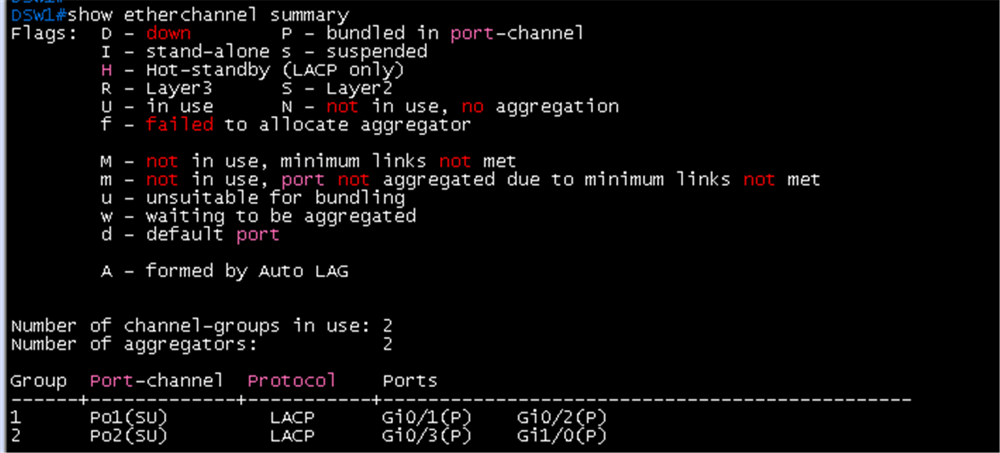
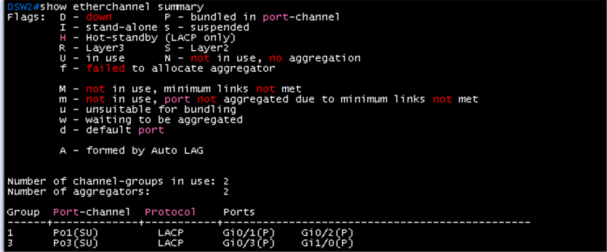
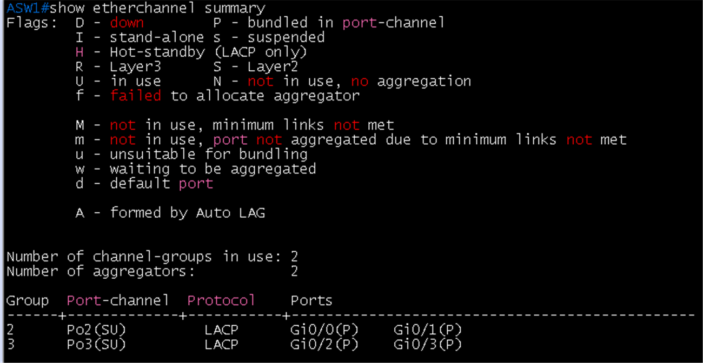
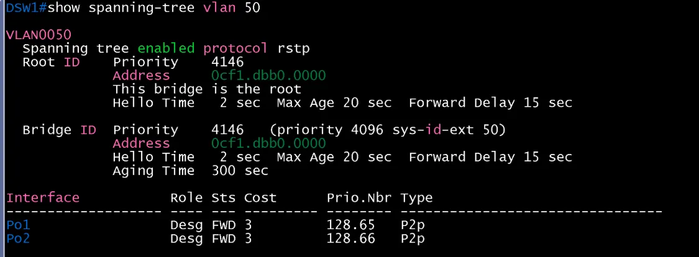
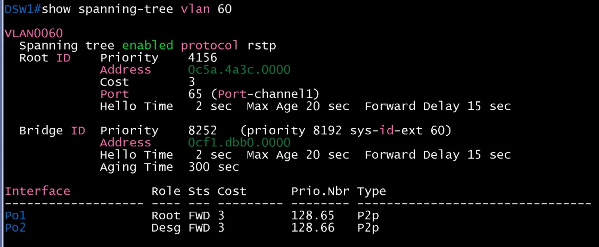
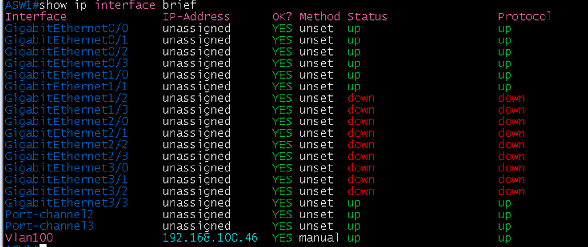

# RSTP(rapid-pvst)와 EtherChannel 검증

**선행 조건**: DSW1, DSW2, ASW1이 켜져 있고 [RSTP와 EtherChannel 샘플](../../samples/br/04-mstp-etherchannel.md)이 적용되어 있어야 함. [기준 문서](../../baseline/br/04-mstp-etherchannel.md).

## 확인 항목

| 순서 | 장비 | 명령 | 기대 결과 | 안 될 때 확인 |
|---|---|---|---|---|
| 1 | DSW1, DSW2, ASW1 | `show etherchannel summary` | Po1, Po2, Po3가 **SU**, 멤버 포트가 **P** | 양쪽 `channel-group` 번호, LACP active, trunk 설정 |
| 2 | 모든 스위치 | `show spanning-tree summary` | 모드 rapid-pvst (**세 스위치가 같아야 함**) | `spanning-tree mode` |
| 3 | DSW1 | `show spanning-tree vlan 50` | 이 브리지가 VLAN 50의 **root** | priority 4096(표시 4146) |
| 4 | DSW1 | `show spanning-tree vlan 60` | VLAN 60의 root는 DSW2, DSW1은 non-root, root port Po1 | DSW2 priority 4096(표시 4156) |
| 5 | ASW1 | `show spanning-tree vlan 50`, `vlan 60` | VLAN마다 다른 번들이 forwarding, 나머지는 blocking | root 분담 설정 |
| 6 | Host F, Host G | `ping -c 3 <게이트웨이>` | 응답 | VLAN, trunk |
| 7 | DSW1 | `show etherchannel summary`, `show lacp neighbor` | LACP 멤버가 `P`(bundled). 타이머는 기본(30초) | 이 IOSv 이미지는 `lacp rate fast`를 받지 않음 |

## 장애 시험

| 동작 | 기대 결과 |
|---|---|
| Po2 멤버 링크 하나 shut | 번들 유지 (나머지 링크) |
| DSW1 정지 | ASW1이 Po3 경로로 모든 VLAN 통신 유지 (재수렴 시간 기록) |
## 증빙

### EtherChannel (항목 1)

- DSW1 `show etherchannel summary`: **Po1(SU)** Gi0/1(P), Gi0/2(P), **Po2(SU)** Gi0/3(P), Gi1/0(P). Protocol LACP, channel-groups in use 2
- DSW2: **Po1(SU)** Gi0/1(P), Gi0/2(P), **Po3(SU)** Gi0/3(P), Gi1/0(P)
- ASW1: **Po2(SU)** Gi0/0(P), Gi0/1(P), **Po3(SU)** Gi0/2(P), Gi0/3(P)
- 처음 입력했을 때 멤버 포트에 trunk encapsulation이 auto로 남아 `%EC-5-CANNOT_BUNDLE2`로 suspended였으나, 멤버에 port-channel과 같은 trunk 설정(encapsulation dot1q)을 넣은 뒤 모두 `P`로 번들됨. IOSv에서는 `lacp rate fast`가 `% Invalid input`이라 기본(30초)을 씀

### VLAN별 root 분담 (항목 3, 4) - 2026-11-14 rapid-pvst 전환 후 재측정

- DSW1 `show spanning-tree vlan 50`: protocol **rstp**, Root ID priority **4146**(4096 + 50), "This bridge is the root", Po1·Po2 모두 Desg FWD
- DSW1 `show spanning-tree vlan 60`: protocol rstp, Root ID priority **4156**(4096 + 60), 주소 0c5a.4a3c.0000(DSW2), root port **Po1**. DSW1 Bridge priority 8252(8192 + 60)로 non-root
- VLAN 50 root = DSW1, VLAN 60 root = DSW2로 설계대로 분담. VRRP master(VLAN 50 = DSW1, VLAN 60 = DSW2)와도 일치. rapid-pvst 전환 전(MSTP)과 같은 root 분담이 유지됨

- 이전 MSTP 기록(MST1 4097, MST2 4098, CIST root DSW2)은 rapid-pvst 전환으로 대체됨

### ASW1 VLAN별 blocking (항목 5)

- rapid-pvst 전환 후 ASW1 `show spanning-tree vlan 50`, `vlan 60` 캡처는 아직 받지 않았음. 받으면 이 자리에 기록(VLAN 50은 Po2 root·Po3 Altn, VLAN 60은 반대)

### ASW1 관리 SVI

- ASW1 `show ip interface brief`: `Vlan100` **192.168.100.46**(manual) up/up, `Gi3/3`, `Gi1/0`, `Gi1/1`, `Po2`, `Po3` up/up. 관리는 `Gi3/3`(access VLAN 100)의 SVI로 함. IOSvL2는 물리 포트에 IP를 줄 수 없어서 VRF 방식 대신 VLAN 100 SVI를 씀

## 패킷 캡처 (Wireshark)

- 이전 MST BPDU 캡처(패킷 63, region LAB)는 MSTP 구성의 기록이라 현재 rapid-pvst 구성에는 맞지 않음. rapid-pvst BPDU(Protocol Version Rapid Spanning Tree 2, VLAN별 PVST+ 형식)는 필요하면 `stp` 필터로 DSW1 `Gi0/3` - ASW1 `Gi0/0` 링크에서 다시 캡처

## 결과 기록

| 일시 | 결과 (성공, 실패) | 비고 |
|---|---|---|
| 2026-10-23 | 성공 | 항목 1 완료(Po1~Po3 SU, 멤버 P), 3, 4, 5 완료(인스턴스 1 root DSW1, 인스턴스 2 root DSW2, ASW1은 번들이 인스턴스별로 blocking). 항목 2(`mst configuration`)는 `show spanning-tree mst`의 인스턴스 매핑으로 확인. 항목 6(호스트 ping)은 Host F, G 설정 뒤. 항목 7은 IOSv에서 `lacp rate fast`를 받지 않아 기본(30초) |
| 2026-11-14 | 성공 | rapid-pvst 전환 후 항목 2, 3, 4 완료(DSW1 VLAN 50 root, VLAN 60 root는 DSW2). 항목 5(ASW1)는 캡처 예정 |
