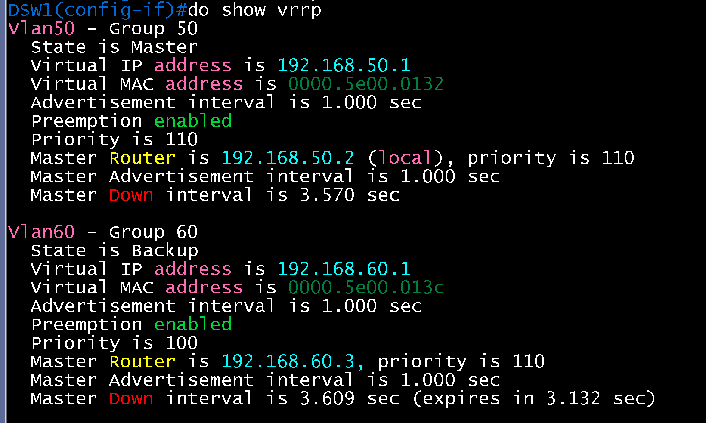
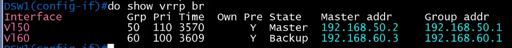
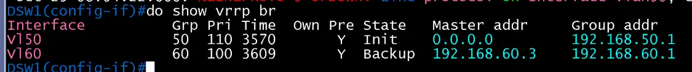
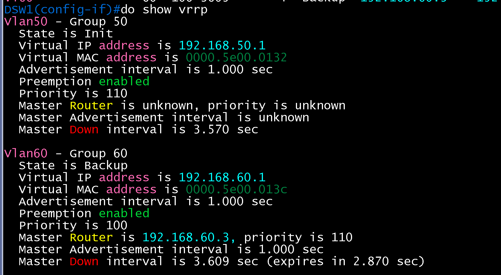
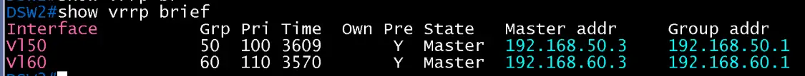
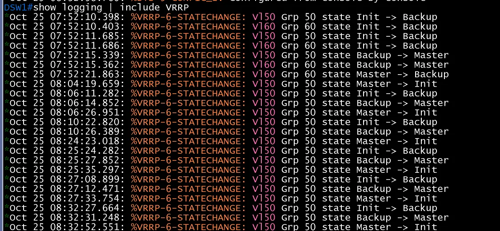
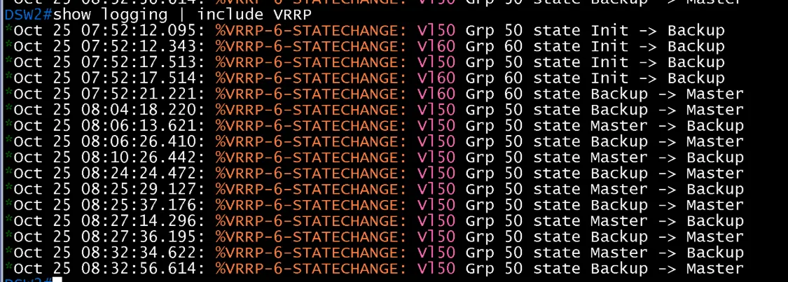
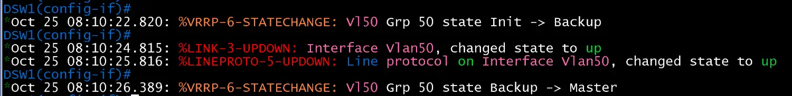

# SVI와 VRRP 검증

**선행 조건**: [MSTP와 EtherChannel 검증](04-mstp-etherchannel.md)이 끝나 있고 [VRRP 샘플](../../samples/br/05-vrrp-svi.md)이 적용되어 있어야 함. [기준 문서](../../baseline/br/05-vrrp-svi.md).

## 확인 항목

| 순서 | 장비 | 명령 | 기대 결과 | 안 될 때 확인 |
|---|---|---|---|---|
| 1 | DSW1, DSW2 | `show vrrp brief` | VLAN 50은 DSW1이 **Master**, VLAN 60은 DSW2가 **Master** | priority, preempt, VIP |
| 2 | Host F | `ping -c 3 192.168.50.1` | VIP 응답 | VLAN 50, 호스트 게이트웨이 |
| 3 | Host G | `ping -c 3 192.168.60.1` | VIP 응답 | VLAN 60 |

## 증빙

### VRRP (항목 1)

- DSW1 `show vrrp brief`: **Vl50** Grp 50, Pri **110**, Y(preempt), **Master**, Master addr 192.168.50.2, Group addr 192.168.50.1. **Vl60** Grp 60, Pri 100, **Backup**, Master addr 192.168.60.3, Group addr 192.168.60.1
- DSW2: **Vl50** Pri 100, **Backup**, Master addr 192.168.50.2. **Vl60** Pri **110**, **Master**, Master addr 192.168.60.3
- VLAN 50은 DSW1, VLAN 60은 DSW2가 master로 설계대로. MSTP root(인스턴스 1 = DSW1, 인스턴스 2 = DSW2)와 같은 장비로 맞춰져 경로가 꼬이지 않음

| DSW1 | DSW2 |
|---|---|
|  |  |

### 호스트 ping (항목 2, 3)

- Host F `ping -c 3 192.168.50.1`: 3개 중 3개 응답, TTL 255 (master DSW1이 응답)
- Host G `ping -c 3 192.168.60.1`: 3개 중 3개 응답, TTL 255 (master DSW2가 응답)
- 화면: [Host F](../host/images/01-gateway/host-f-gateway.png), [Host G](../host/images/01-gateway/host-g-gateway.png)

## 패킷 캡처 (Wireshark)

계획표: [08-wireshark-capture.md](../../00-overview/08-wireshark-capture.md). 링크 한 개만 캡처하고, 표시 필터로 패킷 한두 개의 상세 창이 보이게 잘라 images/에 저장

| 확인할 동작 | 캡처 링크 (GNS3 Start capture) | 일으킬 동작 | 표시 필터 | 볼 것 | 상태 |
|---|---|---|---|---|---|
| VRRP Advertisement | DSW1 `Gi0/1` - DSW2 `Gi0/1` | 별도 동작 없이 master가 1초마다 광고 | `vrrp` | 224.0.0.18, VRID 50(priority 110)과 VRID 60(priority 110은 DSW2), VIP 192.168.50.1 | 캡처 완료 (VRID 50) |

### 캡처 결과: VRRP Advertisement (패킷 94, VRID 50)

- Ethernet Src **00:00:5e:00:01:32**(`IETF-VRRP-VRID_32`, VRRP 가상 MAC 뒤 `32`는 VRID 50의 16진수), Dst **01:00:5e:00:00:12**(224.0.0.18 멀티캐스트). 트렁크 링크라 **802.1Q VLAN ID 50** 태그가 붙음
- IPv4 Src **192.168.50.2**(DSW1 SVI), Dst **224.0.0.18**, TTL **255**, Protocol **VRRP (112)**, DSCP CS6
- VRRP **Version 2, Packet type 1 (Advertisement)**, Virtual Rtr ID **50**, Priority **110**, Addr Count 1, Auth Type No Authentication, Adver Int **1**(초), IP Address **192.168.50.1**(VIP)
- DSW1이 VLAN 50 master(priority 110)로 1초마다 광고를 보내고, DSW2(priority 100)는 광고를 받는 backup이라 보내지 않음. 앞의 `show vrrp brief`와 같은 결과

## 장애 시험

| 동작 | 기대 결과 |
|---|---|
| DSW1 정지 | VLAN 50의 master가 DSW2로 넘어가고 Host F ping 유지 |
| DSW1 복구 | preempt로 다시 DSW1이 master |

### 정지 시험 결과 (DSW1 VLAN 50 SVI shutdown)

- 방법: DSW1 `interface vlan 50`에 `shutdown`(정지), `no shutdown`(복구)을 반복. 장비 로그는 `show logging | include VRRP`로 수집
- 정지 전(DSW1): VLAN 50 `Master`, Priority 110, Master Down interval **3.570초**. VLAN 60은 `Backup`(Master 192.168.60.3)

| DSW1 정지 전 상세 | DSW1 정지 전 요약 |
|---|---|
|  |  |

- 정지 후(DSW1): VLAN 50 State **Init**, `Master Router is unknown`. VLAN 60은 변동 없음

| DSW1 정지 후 요약 | DSW1 정지 후 상세 |
|---|---|
|  |  |

- 전환(DSW2): VLAN 50 **Master**(Pri 100, Master addr 192.168.50.3), VLAN 60 Master(Pri 110) 유지

**정지 전환 시간 (장비 로그, 2026-10-25 UTC)**

| 시험 | DSW1 `Master -> Init` | DSW2 `Backup -> Master` | 차이 |
|---|---|---|---|
| 1 | 08:04:19.659 | 08:04:18.220 | -1.44초 |
| 2 | 08:06:26.951 | 08:06:26.410 | -0.54초 |
| 3 | 08:24:23.018 | 08:24:24.472 | +1.45초 |
| 4 | 08:25:35.297 | 08:25:37.176 | +1.88초 |
| 5 | 08:27:33.754 | 08:27:36.195 | +2.44초 |
| 6 | 08:32:52.551 | 08:32:56.614 | +4.06초 |

- 1, 2회는 DSW2 로그가 DSW1보다 앞서 있어 두 장비의 로그 시각 오차(1 ~ 2초)가 있음을 보여 줌. 따라서 정지 전환 시간은 **약 1.5 ~ 4초 범위**로 기록하고 한 값으로 단정하지 않음
- 로그: DSW1, DSW2 모두 `show logging | include VRRP`

| DSW1 로그 | DSW2 로그 |
|---|---|
|  |  |

**Wireshark 한계 (이 랩 환경)**

- VRRP 광고의 내용(Priority 110/100, VRID 50, VIP 192.168.50.1, 광고 간격 1초)은 캡처로 확인됨(위 "캡처 결과" 참고)
- 전환 **시각**은 Wireshark로 확정하지 못함. GNS3 캡처 창의 시각이 장비 로그와 70 ~ 85초까지 어긋났고, DSW2 쪽 캡처에는 VLAN 50과 VLAN 60 광고가 동시에 약 3초씩 멈추는 공백이 시험과 무관하게 약 1분마다 반복되어 캡처 경로 지연으로 판단함
- DSW1 쪽 캡처(`DSW1 Gi0/1 - DSW2 Gi0/1`)의 광고 공백(약 254.7초)은 정지 구간의 길이와 규모가 맞지만 시각은 장비 로그와 맞지 않음

**정지 구간 사용자 영향(ping)**

- Host F `ping -D 192.168.50.1`을 정지 구간과 함께 측정한 값은 **확보하지 못함**. 첫 시도(정지와 복구를 함께 포함, 298초)는 294개 중 38개 손실(+9 errors)이었으나 두 전환이 섞인 값이고 원인이 확인되지 않아 정식 값으로 쓰지 않음
- 이후 두 번의 ping(`stop.txt`)은 시험 구간 밖에서 실행되어 손실이 seq 1(시작 때 첫 패킷)과 일반 손실 1개뿐임

### 복구 시험 결과 (DSW1 VLAN 50 SVI no shutdown)

DSW1 로그(2026-10-25):

| 시각 | 로그 | 의미 |
|---|---|---|
| 08:10:22.820 | `VRRP-6-STATECHANGE: Vl50 Grp 50 state Init -> Backup` | `no shutdown` 직후 VRRP 시작 |
| 08:10:24.815 | `LINK-3-UPDOWN: Interface Vlan50, changed state to up` | SVI 링크 up (약 2.0초 뒤) |
| 08:10:25.816 | `LINEPROTO-5-UPDOWN: ... Vlan50, changed state to up` | line protocol up |
| 08:10:26.389 | `VRRP-6-STATECHANGE: Vl50 Grp 50 state Backup -> Master` | preempt로 master 복귀 |

- `no shutdown`(Init -> Backup)부터 Master 복귀까지 **약 3.57초**(3.569초). line protocol up에서 Master까지는 약 0.57초
- 해석: master 복귀 시간이 Master Down interval(3.570초)과 같은 값으로 나옴. preempt가 즉시 일어난 것인지, 광고를 받지 못해 타이머가 만료된 것인지는 이 로그만으로 구분되지 않아 DSW1이 priority 110 광고를 재개하는 Wireshark 캡처가 필요함

- 남은 항목: DSW2 첫 광고의 Time 열이 보이는 Wireshark 캡처, 복구 구간의 Host F ping 손실, DSW1 Master 복귀 후 `show vrrp brief`

## 결과 기록

| 일시 | 결과 (성공, 실패) | 비고 |
|---|---|---|
| 2026-10-23 | 성공 | 항목 1 ~ 3 완료. VLAN 50 master = DSW1, VLAN 60 master = DSW2, Host F, G가 VIP에 응답. 장애 시험은 보류 |
| 2026-10-25 | 부분 성공 | DSW1 VLAN 50 SVI shutdown 후 DSW2가 master 인계(`show vrrp brief`), 복구 시 preempt로 DSW1 master 복귀(로그 3.569초), 복구 구간 ping 손실 3개. 정지 구간 단절 시간은 미확정(첫 시도 손실 38개), DSW2 광고가 캡처에서 보이지 않음 |
