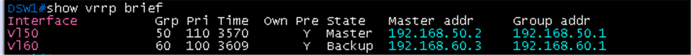
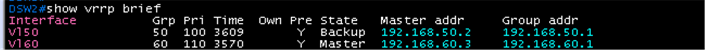
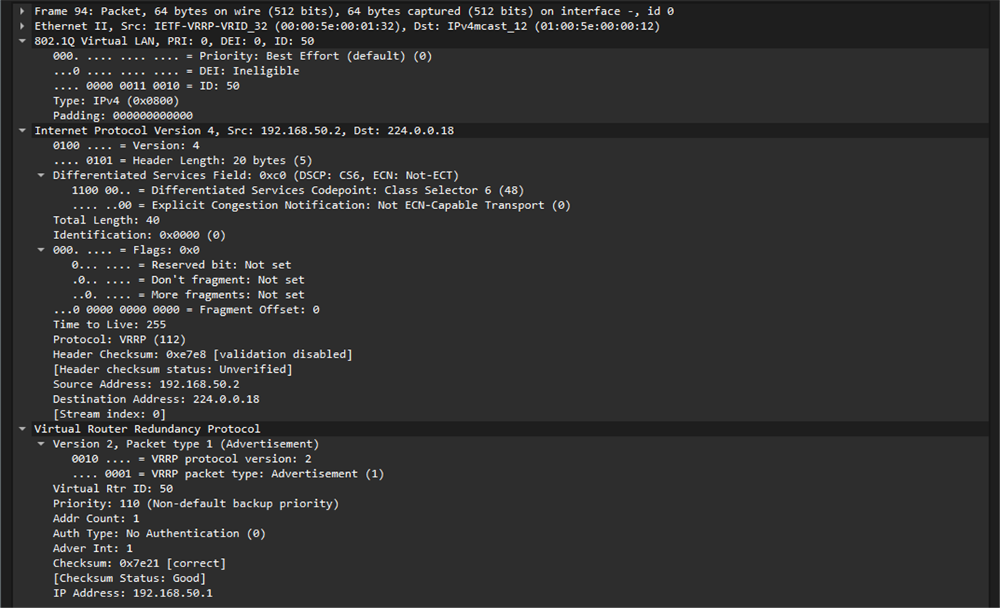

# SVI와 VRRP 검증

**선행 조건**: [MSTP와 EtherChannel 검증](04-mstp-etherchannel.md)이 끝나 있고 [VRRP 샘플](../../samples/br/05-vrrp-svi.md)이 적용되어 있어야 함. [기준 문서](../../baseline/br/05-vrrp-svi.md).

## 확인 항목

| 순서 | 장비 | 명령 | 기대 결과 | 안 될 때 확인 |
|---|---|---|---|---|
| 1 | DSW1, DSW2 | `show vrrp brief` | VLAN 50은 DSW1이 **Master**, VLAN 60은 DSW2가 **Master** | priority, preempt, VIP |
| 2 | Host F | `ping -c 3 192.168.50.1` | VIP 응답 | VLAN 50, 호스트 게이트웨이 |
| 3 | Host G | `ping -c 3 192.168.60.1` | VIP 응답 | VLAN 60 |

## 증빙

### VRRP (항목 1)

- DSW1 `show vrrp brief`: **Vl50** Grp 50, Pri **110**, Y(preempt), **Master**, Master addr 192.168.50.2, Group addr 192.168.50.1. **Vl60** Grp 60, Pri 100, **Backup**, Master addr 192.168.60.3, Group addr 192.168.60.1
- DSW2: **Vl50** Pri 100, **Backup**, Master addr 192.168.50.2. **Vl60** Pri **110**, **Master**, Master addr 192.168.60.3
- VLAN 50은 DSW1, VLAN 60은 DSW2가 master로 설계대로. MSTP root(인스턴스 1 = DSW1, 인스턴스 2 = DSW2)와 같은 장비로 맞춰져 경로가 꼬이지 않음

| DSW1 | DSW2 |
|---|---|
|  |  |

### 호스트 ping (항목 2, 3)

- Host F `ping -c 3 192.168.50.1`: 3개 중 3개 응답, TTL 255 (master DSW1이 응답)
- Host G `ping -c 3 192.168.60.1`: 3개 중 3개 응답, TTL 255 (master DSW2가 응답)
- 화면: [Host F](../host/images/01-gateway/host-f-gateway.png), [Host G](../host/images/01-gateway/host-g-gateway.png)

## 패킷 캡처 (Wireshark)

계획표: [08-wireshark-capture.md](../../00-overview/08-wireshark-capture.md). 링크 한 개만 캡처하고, 표시 필터로 패킷 한두 개의 상세 창이 보이게 잘라 images/에 저장

| 확인할 동작 | 캡처 링크 (GNS3 Start capture) | 일으킬 동작 | 표시 필터 | 볼 것 | 상태 |
|---|---|---|---|---|---|
| VRRP Advertisement | DSW1 `Gi0/1` - DSW2 `Gi0/1` | 별도 동작 없이 master가 1초마다 광고 | `vrrp` | 224.0.0.18, VRID 50(priority 110)과 VRID 60(priority 110은 DSW2), VIP 192.168.50.1 | 캡처 완료 (VRID 50) |

### 캡처 결과: VRRP Advertisement (패킷 94, VRID 50)

- Ethernet Src **00:00:5e:00:01:32**(`IETF-VRRP-VRID_32`, VRRP 가상 MAC 뒤 `32`는 VRID 50의 16진수), Dst **01:00:5e:00:00:12**(224.0.0.18 멀티캐스트). 트렁크 링크라 **802.1Q VLAN ID 50** 태그가 붙음
- IPv4 Src **192.168.50.2**(DSW1 SVI), Dst **224.0.0.18**, TTL **255**, Protocol **VRRP (112)**, DSCP CS6
- VRRP **Version 2, Packet type 1 (Advertisement)**, Virtual Rtr ID **50**, Priority **110**, Addr Count 1, Auth Type No Authentication, Adver Int **1**(초), IP Address **192.168.50.1**(VIP)
- DSW1이 VLAN 50 master(priority 110)로 1초마다 광고를 보내고, DSW2(priority 100)는 광고를 받는 backup이라 보내지 않음. 앞의 `show vrrp brief`와 같은 결과

## 장애 시험

| 동작 | 기대 결과 |
|---|---|
| DSW1 정지 | VLAN 50의 master가 DSW2로 넘어가고 Host F ping 유지 |
| DSW1 복구 | preempt로 다시 DSW1이 master |

## 결과 기록

| 일시 | 결과 (성공, 실패) | 비고 |
|---|---|---|
| 2026-10-23 | 성공 | 항목 1 ~ 3 완료. VLAN 50 master = DSW1, VLAN 60 master = DSW2, Host F, G가 VIP에 응답. 장애 시험은 보류 |
