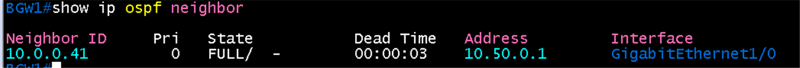
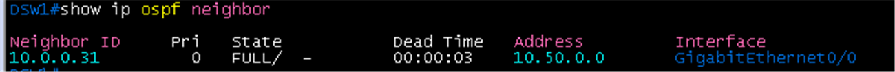
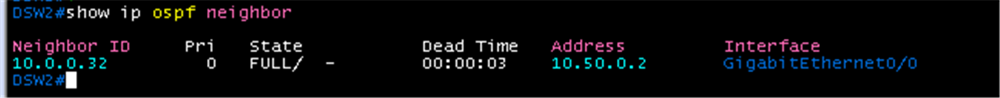
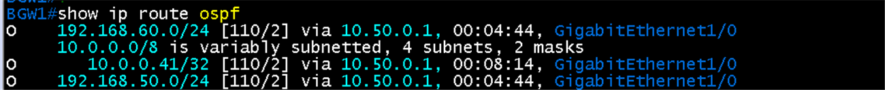
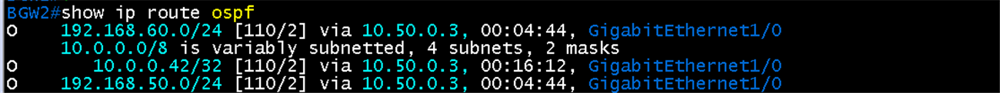
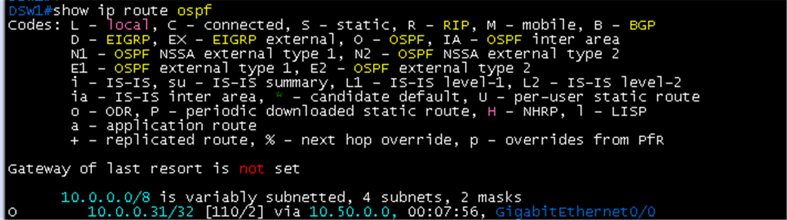
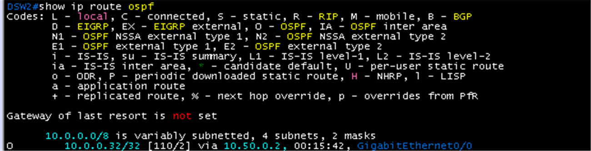

# Branch OSPF 검증

**선행 조건**: BGW1, BGW2, DSW1, DSW2가 켜져 있고 [Branch OSPF 샘플](../../samples/br/06-ospf-branch.md)이 적용되어 있어야 함. [기준 문서](../../baseline/br/06-ospf-branch.md).

## 확인 항목

| 순서 | 장비 | 명령 | 기대 결과 | 안 될 때 확인 |
|---|---|---|---|---|
| 1 | BGW1 | `show ip ospf neighbor` | DSW1이 **FULL** (타이머 Hello 1, Dead 4는 `show ip ospf interface gigabitethernet1/0`) | 링크 IP(/31), area, 양쪽 같은 타이머 |
| 2 | BGW2 | `show ip ospf neighbor` | DSW2가 **FULL** | 같은 점검 |
| 3 | DSW1 | `show ip route ospf` | BGW 방향 경로가 보임 | 광고 네트워크 |
| 4 | DSW1 | `ping 10.0.0.31` | BGW1 Loopback0 응답 | 라우팅 |

## 증빙

### BGW와 DSW 이웃 (FULL)

- BGW1 `show ip ospf neighbor`: 이웃 **10.0.0.41**(DSW1), State **FULL/ -**, Dead Time 00:00:03(타이머 hello 1 / dead 4 적용), Address 10.50.0.1, `GigabitEthernet1/0`
- BGW2: 이웃 **10.0.0.42**(DSW2), FULL/ -, Address 10.50.0.3
- DSW1 `show ip ospf neighbor`: 이웃 **10.0.0.31**(BGW1), FULL/ -, Address 10.50.0.0, `GigabitEthernet0/0`
- DSW2: 이웃 **10.0.0.32**(BGW2), FULL/ -, Address 10.50.0.2

| BGW1 | BGW2 |
|---|---|
|  |  |

| DSW1 | DSW2 |
|---|---|
|  |  |

### 경로

- BGW1 `show ip route ospf`: 192.168.50.0/24, 192.168.60.0/24(**O**, via 10.50.0.1)와 DSW1 loopback 10.0.0.41/32(O, via 10.50.0.1). DSW SVI 서브넷을 OSPF로 배움
- BGW2: 같은 두 LAN과 10.0.0.42/32가 **O**, via 10.50.0.3
- DSW1 `show ip route ospf`: BGW1 loopback **10.0.0.31/32**(O, [110/2], via 10.50.0.0)
- DSW2: BGW2 loopback **10.0.0.32/32**(O, via 10.50.0.2)
- DSW1에는 BGW2(10.0.0.32), DSW2에는 BGW1(10.0.0.31) 경로가 없음. BGW-DSW 쌍별로 OSPF가 분리되어 있고(DSW1-DSW2는 L2 트렁크뿐, SVI는 passive), 각 BGW가 두 LAN을 모두 알게 되므로 문제는 아님

## 결과 기록

| 일시 | 결과 (성공, 실패) | 비고 |
|---|---|---|
| 2026-10-23 | 성공 | 항목 1, 2 완료(BGW1-DSW1, BGW2-DSW2 FULL, Dead Time 3초), 항목 3 완료(DSW에서 BGW loopback O, BGW에서 두 LAN과 DSW loopback O). 항목 4(ping)는 미실행. DSW에서 DC 경로를 받는 방식(default 또는 재분배)은 BGP 구성 뒤 결정 |
