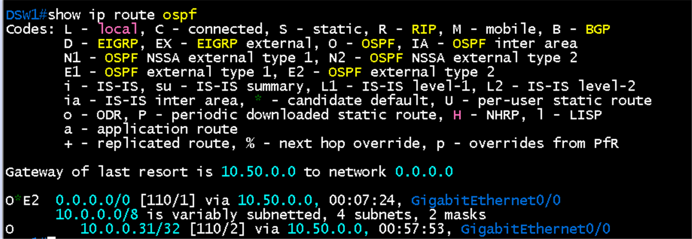
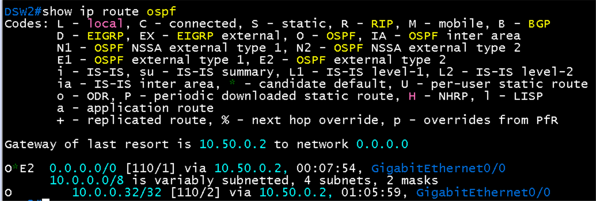

# PE3 - BGW eBGP (VRF BR1) 검증

**선행 조건**: [Branch OSPF 검증](06-ospf-branch.md)이 끝나 있고 [BGW 샘플](../../samples/br/07-pe3-bgw-ebgp.md)이 적용되어 있어야 함. PE3 쪽은 [코어 PE-CE 검증](../core/07-pe-ce-ebgp.md). [기준 문서](../../baseline/br/07-pe3-bgw-ebgp.md).

## 확인 항목

| 순서 | 장비 | 명령 | 기대 결과 | 안 될 때 확인 |
|---|---|---|---|---|
| 1 | BGW1 | `ping 10.0.60.0` (BGW2는 `10.0.60.2`) | PE3 응답 | `Gi0/0.100` 주소, dot1q 100, PE3 서브인터페이스 VRF BR1 |
| 2 | BGW1 | `show ip bgp summary` | PE3(10.0.60.0, AS 65000)가 **Established**, State/PfxRcd가 숫자(DC1, DC2 경로) | AS 번호, PE3 쪽 이웃 설정 |
| 3 | PE3 | `show ip bgp vpnv4 vrf BR1 summary` | BGW1(10.0.60.1), BGW2(10.0.60.3)가 AS 65020, **Established**, PfxRcd 2 (192.168.50.0, 192.168.60.0) | 같은 점검 |
| 4 | BGW1 | `show ip bgp neighbors 10.0.60.0 \| include hold` | `hold time is 9, keepalive interval is 3 seconds` | 양쪽 `timers 3 9` |
| 5 | BGW1 | `show ip bgp neighbors 10.0.60.0 advertised-routes` | **192.168.50.0/24, 192.168.60.0/24만** 광고 | `prefix-list BR-TO-PARTNER out` |
| 6 | BGW1 | `show ip bgp` | 192.168.10.0/24, 192.168.20.0/24(DC1)와 192.168.110.0/24(DC2)가 PE3(10.0.60.0)에서 옴 | `prefix-list PARTNER-TO-BR in`, PE3 VRF BR1 import RT(65000:1, 65000:2) |
| 7 | DSW1, DSW2 | `show ip route ospf` | `O*E2 0.0.0.0/0`이 BGW 방향(DSW1은 10.50.0.0, DSW2는 10.50.0.2)으로 보임 | BGW OSPF `default-information originate always` |

## 패킷 캡처 (Wireshark)

| 캡처 링크 | 표시 필터 | 볼 것 |
|---|---|---|
| PE3 `Gi2/0` - BGW1 `Gi0/0` | `bgp` | AS 65000과 65020, Hold Time 9, UPDATE에 192.168.50.0/24, 192.168.60.0/24 |

## 증빙

### DSW의 default route (항목 7)

- DSW1 `show ip route ospf`: Gateway of last resort **10.50.0.0**, **`O*E2 0.0.0.0/0 [110/1] via 10.50.0.0`**, `GigabitEthernet0/0`. BGW1 loopback 10.0.0.31/32도 O
- DSW2: Gateway of last resort **10.50.0.2**, **`O*E2 0.0.0.0/0 [110/1] via 10.50.0.2`**. BGW2 loopback 10.0.0.32/32
- BGW의 `default-information originate always`로 DSW가 default를 받음. DC 경로가 BGP로 BGW까지만 와도 Host F, G가 BGW 방향으로 나갈 수 있음

### 최종 구성 증빙

항목 1 ~ 6과 패킷 캡처는 최종 구성(VRF BR1)에서 다시 확인한 화면을 추가해야 함. 이전 구성(WAN-UL)에서 찍은 화면은 삭제함

## 결과 기록

| 일시 | 결과 (성공, 실패) | 비고 |
|---|---|---|
| 2026-10-23 | 성공 | 이전 구성(WAN-UL)에서 항목 7(DSW default route) 확인. 이 항목은 최종 구성에서도 같음 |
| 2026-11-07 | 확인 필요 | 최종 구성(VRF BR1)에서 항목 1 ~ 6 재확인 후 기록. 양방향 ping(DC1 ↔ BR1, DC2 ↔ BR1)은 통과 |
