# PE3 - BGW eBGP (WAN-UL) 검증

**선행 조건**: [Branch OSPF 검증](06-ospf-branch.md)이 끝나 있고 [BGW 샘플](../../samples/br/07-wan-ebgp.md)이 적용되어 있어야 함. PE3 쪽은 [코어 PE-CE 검증](../core/07-pe-ce-ebgp.md) 항목 6~8. [기준 문서](../../baseline/br/07-wan-ebgp.md).

## 확인 항목

| 순서 | 장비 | 명령 | 기대 결과 | 안 될 때 확인 |
|---|---|---|---|---|
| 1 | BGW1 | `ping 10.0.30.4` (BGW2는 `10.0.30.6`) | PE3 응답 | 링크 IP, `Gi0/0` up |
| 2 | BGW1 | `show ip bgp summary` | PE3(AS 65000)가 **Established**, State/PfxRcd가 숫자(PE1 쪽 언더레이 경로) | AS 번호, PE3 쪽 이웃 설정 |
| 3 | PE3 | `show bgp vpnv4 unicast vrf WAN-UL summary` | BGW1(10.0.30.5), BGW2(10.0.30.7)가 AS 65020, **Established** | 같은 점검 |
| 4 | BGW1 | `show ip route 10.0.30.1` | PE3에서 받은 경로(`B`), Hub1 링크 10.0.30.0/31 | PE1, PE3 `redistribute connected` |
| 5 | BGW1 | `show ip bgp neighbors 10.0.30.4 \| include hold` | `hold time is 9, keepalive interval is 3 seconds` | 양쪽 `timers 3 9` |
| 6 | BGW1 | `show ip bgp neighbors 10.0.30.4 advertised-routes` | 광고 경로 **없음** | `prefix-list NONE out` |
| 7 | DSW1, DSW2 | `show ip route ospf` | `O*E2 0.0.0.0/0`이 BGW 방향(DSW1은 10.50.0.0, DSW2는 10.50.0.2)으로 보임 | BGW OSPF `default-information originate always` |

## 패킷 캡처 (Wireshark)

BGP는 코어 구간의 대표 캡처([core 06 검증](../core/06-mp-bgp-vpnv4.md))로 대체하고, 이 구간은 캡처하지 않음

## 증빙

### BGW와 PE3 이웃 (항목 2)

- BGW1 `show ip bgp summary`: router identifier **10.0.1.31**, local AS **65020**, 이웃 **10.0.30.4**(PE3) AS **65000**, Up/Down 00:03:16, State/PfxRcd **4**. BGP table 4 network entries, 4 path entries
- BGW2: router identifier **10.0.1.32**, 이웃 **10.0.30.6**(PE3) AS 65000, Up/Down 00:01:12, PfxRcd **4**
- PE3에서 4개 경로를 받음: PE1 쪽 언더레이 10.0.30.0/31, 10.0.30.2/31과 PE3 직결 링크 10.0.30.4/31, 10.0.30.6/31
- 처음에 BGW2의 `address-family`에 이웃 주소를 `10.0.30.4`(BGW1용)로 잘못 넣어 `% Specify remote-as or peer-group commands first`가 나왔고, `10.0.30.6`으로 고쳐 세션이 올라옴. 입력 중 `% Warning: A hold time of less than 20 seconds`는 `timers 3 9` 때문에 나오는 안내로 설계값

| BGW1 | BGW2 |
|---|---|
| 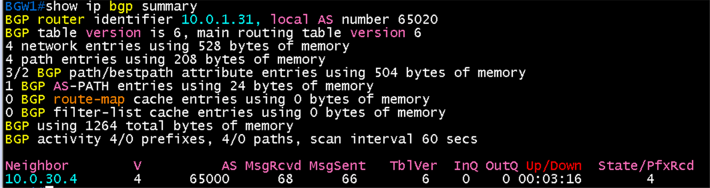 | 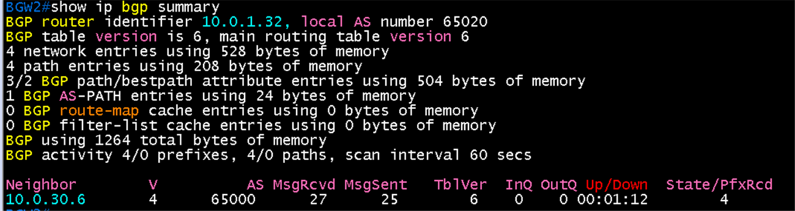 |

### PE3 쪽 이웃 (항목 3)

- PE3 `show bgp vpnv4 unicast vrf WAN-UL summary`: router identifier **10.0.1.13**, local AS 65000, 이웃 **10.0.30.5**(BGW1)와 **10.0.30.7**(BGW2)이 AS **65020**, Up/Down 00:11:09, 00:08:59, State/PfxRcd **0**
- PfxRcd 0: BGW가 PE3로 광고하는 경로가 없는 것이 맞음(`prefix-list NONE out`). BGW가 받은 경로 4개(PfxRcd 4)와 서로 대칭

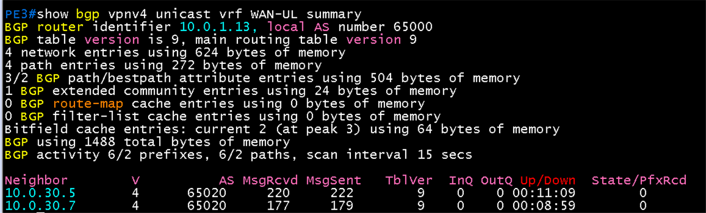

### Hub 링크 주소 경로 (항목 4)

- BGW1 `show ip route 10.0.30.1`: Routing entry for **10.0.30.0/31**, Known via **"bgp 65020"**, distance 20, metric 0, **Tag 65000**, type external, from **10.0.30.4**, AS Hops 1. Hub1 링크 주소로 가는 경로를 PE3에서 BGP로 배움

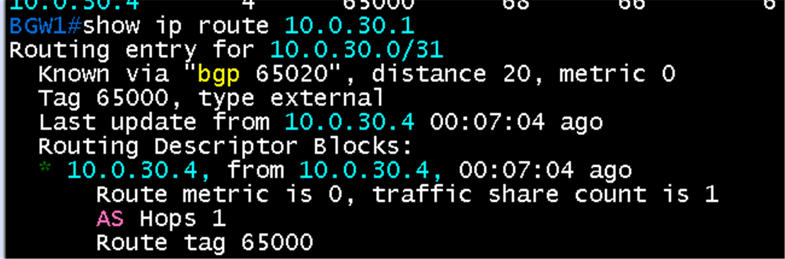

### 광고 경로와 타이머 (항목 5, 6)

- BGW1 `show ip bgp neighbors 10.0.30.4 advertised-routes`: **Total number of prefixes 0**. `prefix-list NONE out`으로 PE3에 아무것도 광고하지 않음
- BGW1 `show ip bgp neighbors 10.0.30.4 | include hold`: **hold time is 9, keepalive interval is 3 seconds**, 설정값(Configured)도 9와 3

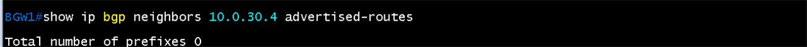

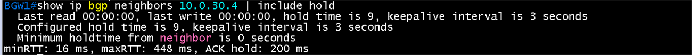

### DSW의 default route (항목 7)

- DSW1 `show ip route ospf`: Gateway of last resort **10.50.0.0**, **`O*E2 0.0.0.0/0 [110/1] via 10.50.0.0`**, `GigabitEthernet0/0`. BGW1 loopback 10.0.0.31/32도 O
- DSW2: Gateway of last resort **10.50.0.2**, **`O*E2 0.0.0.0/0 [110/1] via 10.50.0.2`**. BGW2 loopback 10.0.0.32/32
- BGW의 `default-information originate always`로 DSW가 default를 받음. DC 경로가 BGP로 BGW까지만 와도 Host F, G가 BGW 방향으로 나갈 수 있음

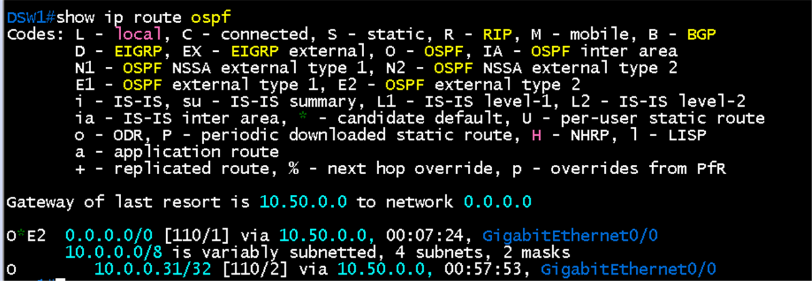

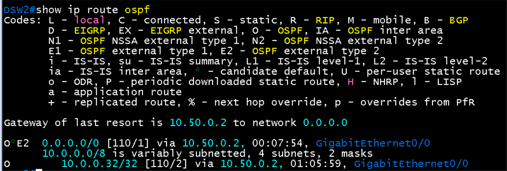

### Hub와 BGW 사이 언더레이 (터널 전 도달성)

- Hub1 `ping 10.0.30.5 source gigabitethernet 0/0`: source 10.0.30.1, **5/5**, 128/158/212 ms
- BGW1 `ping 10.0.30.1 source gigabitethernet 0/0`: source 10.0.30.5, **5/5**, 100/144/184 ms
- Hub의 정적 경로(`10.0.30.5/32` via 10.0.30.0), PE1과 PE3의 VPNv4 경로 교환, BGW의 PE3 eBGP가 모두 맞아 양방향 도달이 됨. 터널(IPsec, GRE)을 만들 수 있는 조건이 갖춰짐

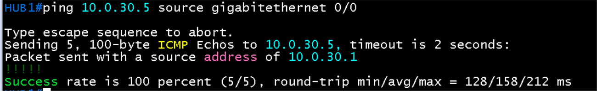

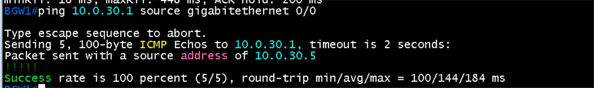

- Hub2 `ping 10.0.30.7 source gigabitethernet 0/0`: source 10.0.30.3, **5/5**, 116/129/144 ms
- BGW2 `ping 10.0.30.3 source gigabitethernet 0/0`: source 10.0.30.7, **5/5**, 72/90/96 ms
- 두 번째 쌍(Hub2 ↔ BGW2)도 양방향 도달

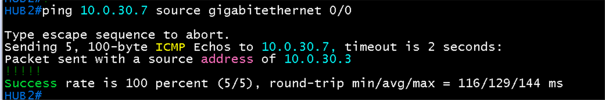

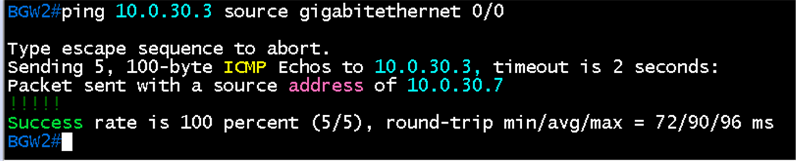

## 결과 기록

| 일시 | 결과 (성공, 실패) | 비고 |
|---|---|---|
| 2026-10-23 | 성공 | 항목 2 ~ 7과 언더레이 ping(Hub1 ↔ BGW1, Hub2 ↔ BGW2 모두 5/5) 완료(PE3와 Established, Hub1 링크 경로 B, 타이머 9와 3, 광고 경로 0, DSW에 `O*E2 0.0.0.0/0`). Hub1 ↔ BGW1 언더레이 ping 5/5. 항목 3 완료(PE3에서 BGW1, BGW2 Established, PfxRcd 0). 처음에 VRF 이름을 `WAL-UL`로 잘못 입력해 `%Unknown VRF`가 나왔고 `WAN-UL`로 다시 확인. |
