# GRE over IPsec 검증 (IKE SA, IPsec SA, GRE 터널)

**선행 조건**: [Branch OSPF 검증](06-ospf-branch.md), 코어의 WAN-UL 도달성([코어 PE-CE 검증](../core/07-pe-ce-ebgp.md) 항목 6~11), Hub의 정적 경로가 확인되어 있어야 함. 터널 설정은 [IPsec 샘플](../../samples/br/09-ipsec-gre.md), 값은 [기준 문서](../../baseline/br/09-ipsec-gre.md), 키는 [키 관리](../../baseline/br/08-ipsec-keys.md)를 따름

이 c7200 이미지는 IKEv2가 없어서 IKEv1(ISAKMP)로 확인. 세 단계(IKE SA, IPsec SA, GRE 터널)를 순서대로 확인

## 1. IKE(ISAKMP) SA

| 순서 | 장비 | 명령 | 기대 결과 | 안 될 때 확인 |
|---|---|---|---|---|
| 1 | Hub1 | `ping 10.0.30.5 source gigabitethernet 0/0` | BGW1 언더레이 주소 응답 (터널 전 도달성) | WAN-UL VRF, PE 경로, Hub 정적 경로 |
| 2 | Hub1 | `show crypto isakmp sa` | 상태 **QM_IDLE**, 상대 10.0.30.5 | 아래 문제 해결 |
| 3 | Hub1 | `show crypto isakmp policy` | 설계한 policy(AES-256, **SHA-1**, pre-share, group 14)가 보임 | 양쪽 policy 일치 |
| 4 | Hub2 | `show crypto isakmp sa` | BGW2(10.0.30.7)와 **QM_IDLE** | 같은 점검 |

### 문제 해결

| 증상 | 확인 |
|---|---|
| SA가 생기지 않음 | 1) 언더레이 ping, 2) `crypto isakmp key`의 상대 주소, 3) 양쪽 `crypto isakmp policy` 일치 |
| `MM_NO_STATE`, `MM_KEY_EXCH`에서 멈춤 | 암호화, 해시, DH 그룹 불일치이거나 **사전 공유 키 불일치**. 양쪽 값을 같게 한 뒤 `clear crypto isakmp` |
| 해시나 그룹 명령이 거부됨 | 이 이미지는 ISAKMP `hash sha256`을 지원하지 않으므로 `hash sha`를 쓰고, 양쪽 policy가 같은지 확인 |
| 원인이 안 보임 | `debug crypto isakmp`로 협상 과정을 확인(끝나면 `undebug all`) |

## 2. IPsec SA

| 순서 | 장비 | 명령 | 기대 결과 | 안 될 때 확인 |
|---|---|---|---|---|
| 1 | Hub1 | `show crypto ipsec sa` | 인바운드, 아웃바운드 ESP SA가 있고 **transport 모드** | transform-set, `mode transport` |
| 2 | Hub1 | `show crypto session` | 상태 **UP-ACTIVE** | ISAKMP SA 먼저 확인 |
| 3 | Hub1 | 터널로 ping을 보내고 `show crypto ipsec sa` 반복 | `#pkts encaps`와 `#pkts decaps`가 **증가** | `tunnel protection` 적용 여부 |
| 4 | Hub2 | `show crypto session` | UP-ACTIVE | 같은 점검 |

## 3. GRE 터널

| 순서 | 장비 | 명령 | 기대 결과 | 안 될 때 확인 |
|---|---|---|---|---|
| 1 | Hub1, BGW1 | `show interface tunnel0` | **up/up**, source와 destination이 설계값과 같음 | tunnel source, destination 주소 |
| 2 | Hub1 | `ping 10.0.40.1` | BGW1 터널 주소 응답 | IPsec SA, 라우팅 |
| 3 | Hub2, BGW2 | `show interface tunnel1` | **up/up** | 같은 점검 |
| 4 | Hub2 | `ping 10.0.40.3` | BGW2 터널 주소 응답 | 같은 점검 |

## 증빙

### IKE SA (1번 항목 2, 4)

- Hub1 `show crypto isakmp sa`: dst **10.0.30.5**, src **10.0.30.1**, state **QM_IDLE**, conn-id 1001, status **ACTIVE**
- Hub2: dst **10.0.30.7**, src **10.0.30.3**, **QM_IDLE**, conn-id 1001, **ACTIVE**
- Tunnel0(Hub1 ↔ BGW1)과 Tunnel1(Hub2 ↔ BGW2) 모두 키가 맞아 ISAKMP SA가 맺어짐

| Hub1 (Tunnel0) | Hub2 (Tunnel1) |
|---|---|
| 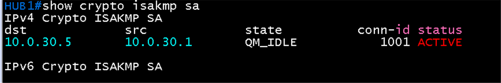 | 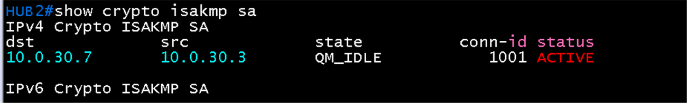 |

### IPsec SA (2번 항목 1, 3)

- BGW1 `show crypto ipsec sa`(interface Tunnel0, crypto map tag `Tunnel0-head-0`, local addr 10.0.30.5): local ident **10.0.30.5/32, protocol 47(GRE)**, remote ident 10.0.30.1/32, current_peer **10.0.30.1 port 500**
- `#pkts encaps 5, encrypt 5, digest 5`, `#pkts decaps 5, decrypt 5, verify 5`, 오류와 압축 실패 0
- transform **esp-256-aes esp-sha-hmac**, in use settings **{Transport}**, PFS N, DH group none
- inbound esp spi **0x91E20936 (2447509814)**, outbound esp spi 0xF2BE6C7 (254535367), 둘 다 Status **ACTIVE**, key lifetime 4454776 kB / 3371초
- ping 5개를 보낸 결과(encaps 5, decaps 5)와 일치. 보호 대상이 GRE(47)라서 GRE 터널 전체가 암호화됨

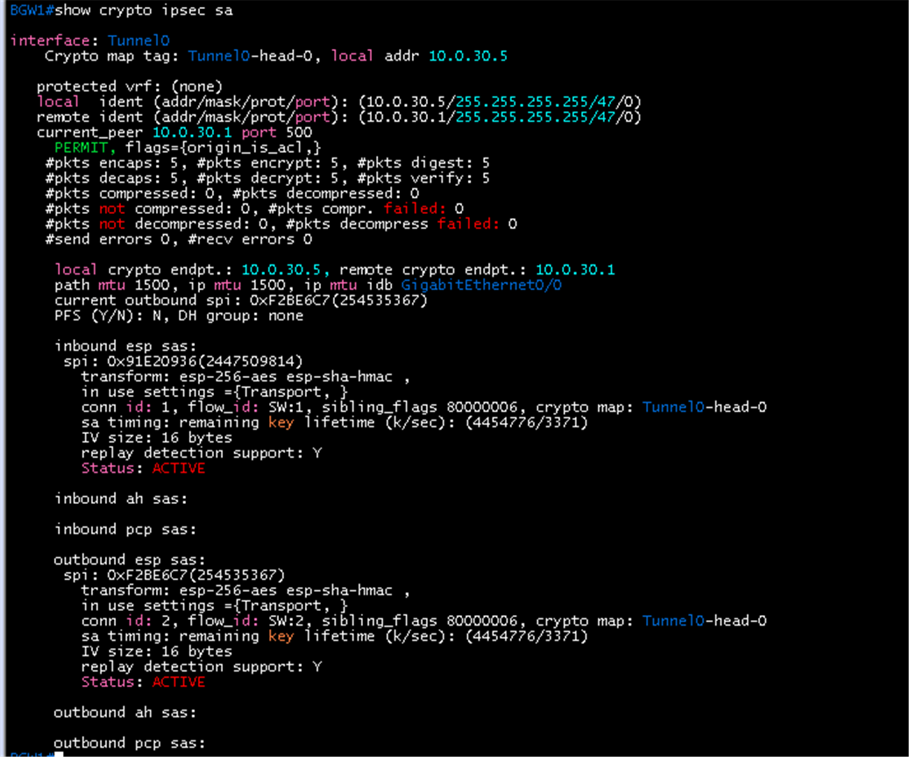

### 세션 상태 (2번 항목 2, 4)

- Hub1 `show crypto session`: Interface **Tunnel0**, Session status **UP-ACTIVE**, Peer **10.0.30.5 port 500**, IKE SA local 10.0.30.1/500 remote 10.0.30.5/500 **Active**, IPSEC FLOW **permit 47 host 10.0.30.1 host 10.0.30.5**, Active SAs **2**(inbound와 outbound), origin crypto map
- Hub2: Interface **Tunnel1**, **UP-ACTIVE**, Peer **10.0.30.7 port 500**, IPSEC FLOW **permit 47 host 10.0.30.3 host 10.0.30.7**, Active SAs 2

| Hub1 (Tunnel0) | Hub2 (Tunnel1) |
|---|---|
| 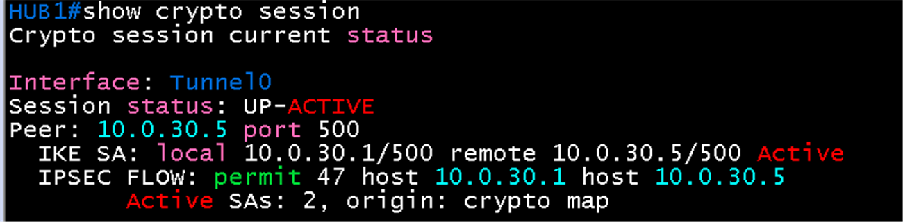 | 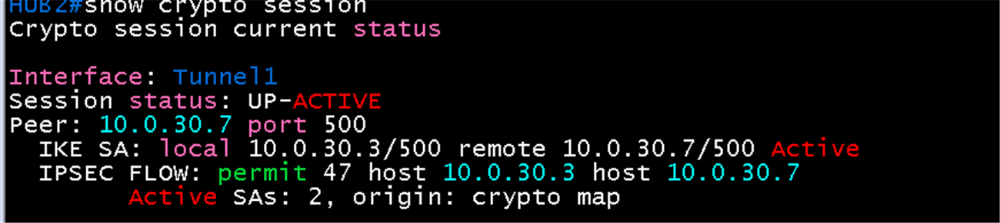 |

### IPsec SA: Tunnel1 (Hub2 ↔ BGW2)

- Hub2 `show crypto ipsec sa`(Tunnel1, local addr 10.0.30.3): ident **10.0.30.3 ↔ 10.0.30.7, protocol 47**, `#pkts encaps 5, decaps 5`, 오류 0, transform **esp-256-aes esp-sha-hmac**, **Transport**, inbound spi **0xBD30F9D0 (3174103504)**, outbound spi **0x8CEAF6DF (2364208863)**, Status ACTIVE
- BGW2(local addr 10.0.30.7): ident 10.0.30.7 ↔ 10.0.30.3, `#pkts encaps 5, decaps 5`, inbound spi **0x8CEAF6DF**, outbound spi **0xBD30F9D0**
- 양쪽 SPI가 서로 반대로 맞음: Hub2의 inbound(0xBD30F9D0)가 BGW2의 outbound, Hub2의 outbound(0x8CEAF6DF)가 BGW2의 inbound. Tunnel0(BGW1)과 같은 패턴

| Hub2 | BGW2 |
|---|---|
| 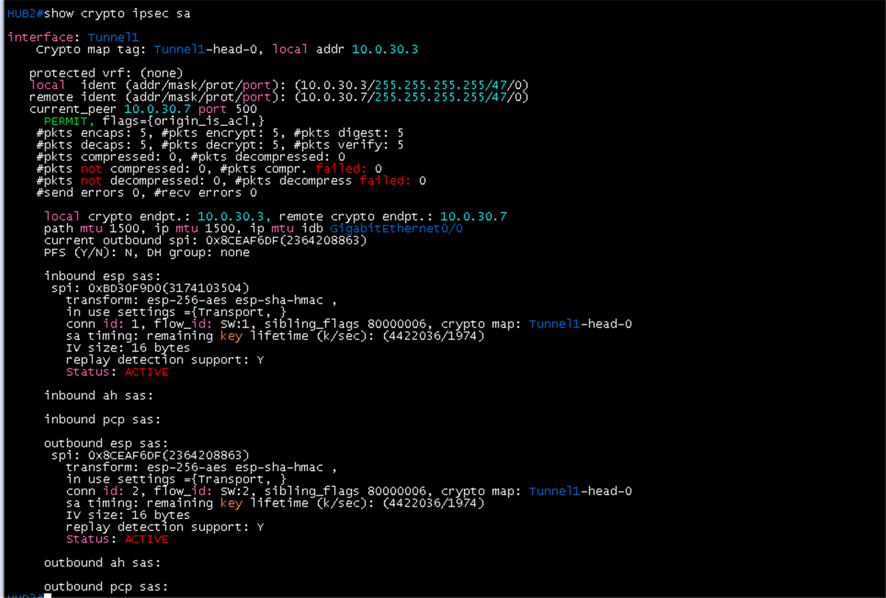 | 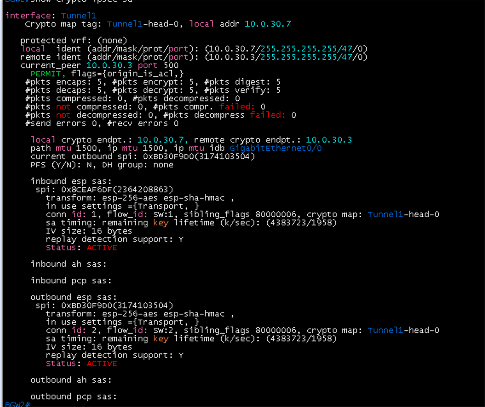 |

### GRE 터널 (3번 항목 1~4)

- BGW2 `show interface tunnel 1`: **Tunnel1 is up, line protocol is up**, Description GRE-over-IPsec-to-HUB2, **10.0.40.3/31**, source 10.0.30.7, destination 10.0.30.3, GRE/IP, IPsec profile `IPSEC-PROF`, 5 packets input/output 620 bytes

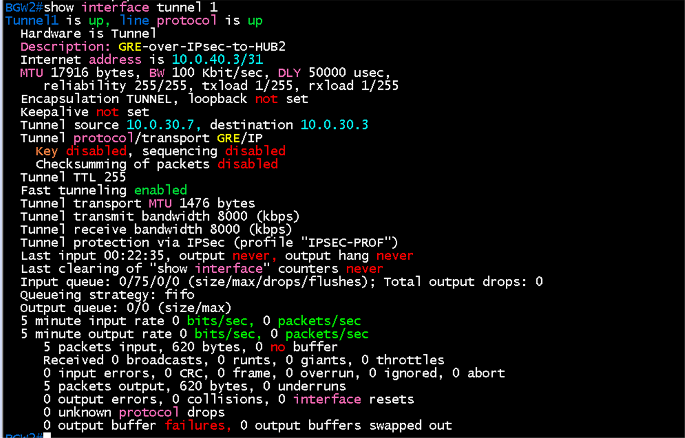

- Hub1 `show interface tunnel 0`: **Tunnel0 is up, line protocol is up**, Description GRE-over-IPsec-to-BGW1, Internet address **10.0.40.0/31**, Tunnel source 10.0.30.1, destination 10.0.30.5, protocol/transport **GRE/IP**, **Tunnel protection via IPSec (profile "IPSEC-PROF")**, Tunnel transport MTU 1476, 5 packets input/output 620 bytes(패킷당 124바이트 = ICMP 100 + IP 20 + GRE 4)
- BGW1 `show interface tunnel 0`: **up/up**, Description GRE-over-IPsec-to-HUB1, **10.0.40.1/31**, source 10.0.30.5, destination 10.0.30.1, IPsec profile `IPSEC-PROF`, 5 packets input/output 620 bytes
- Hub2 `show interfaces tunnel 1`: **Tunnel1 is up, line protocol is up**, Description GRE-over-IPsec-to-BGW2, **10.0.40.2/31**, source 10.0.30.3, destination 10.0.30.7, IPsec profile `IPSEC-PROF`. 이 화면은 ping 전이라 packets input/output 0
- Hub1 `ping 10.0.40.1`: **5/5**, 96/117/192 ms. Hub2 `ping 10.0.40.3`: **5/5**, 124/128/144 ms

| Hub1 Tunnel0 | BGW1 Tunnel0 |
|---|---|
| 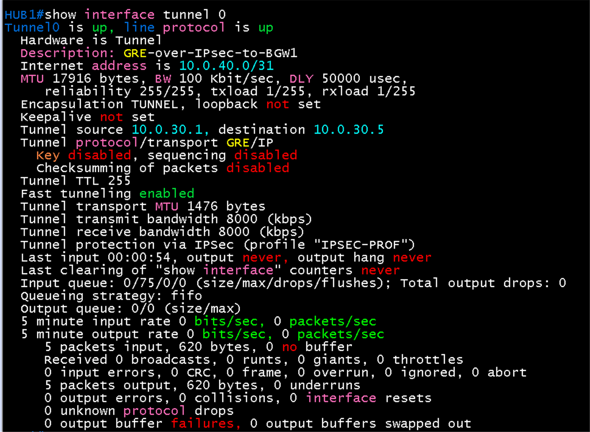 | 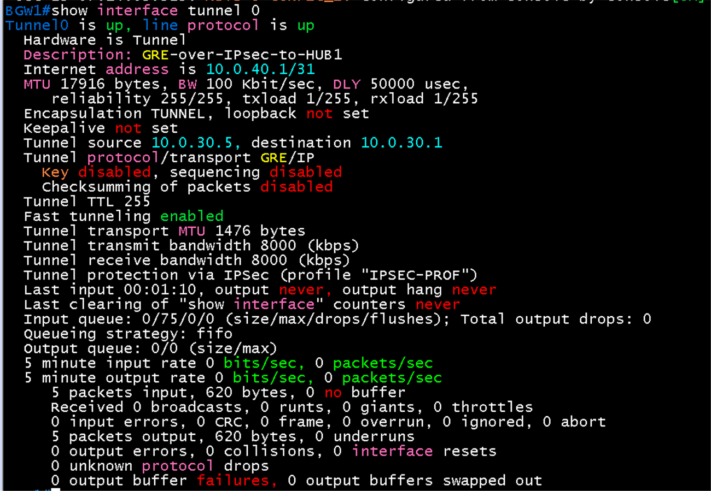 |

| Hub2 Tunnel1 | Hub1 터널 ping | Hub2 터널 ping |
|---|---|---|
| 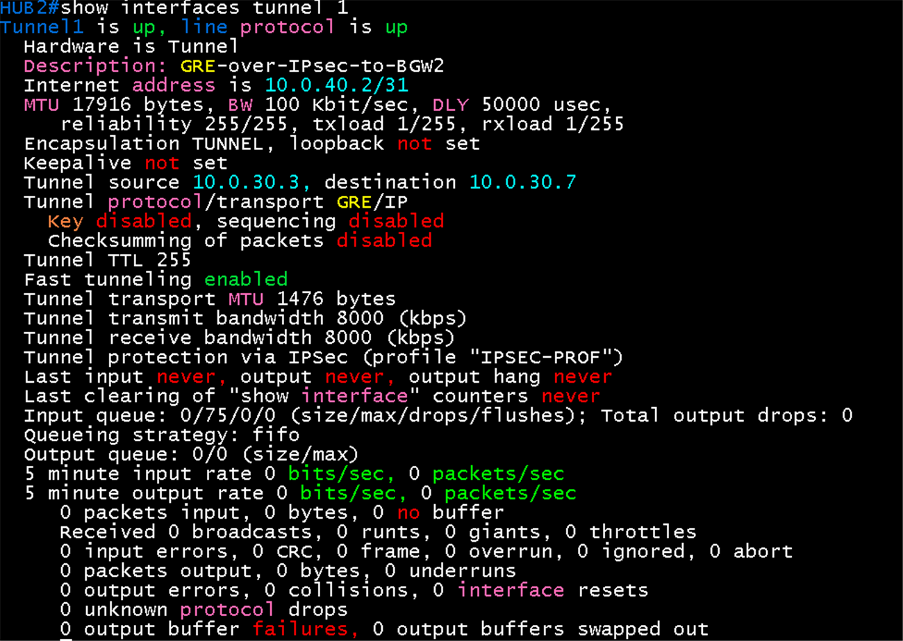 | 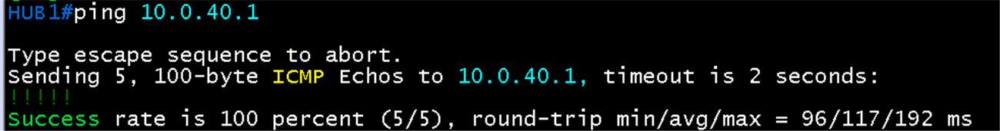 | 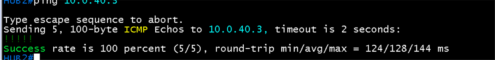 |

## 패킷 캡처 (Wireshark)

계획표: [08-wireshark-capture.md](../../00-overview/08-wireshark-capture.md). 링크 한 개만 캡처하고, 표시 필터로 패킷 한두 개의 상세 창이 보이게 잘라 images/에 저장

| 확인할 동작 | 캡처 링크 (GNS3 Start capture) | 일으킬 동작 | 표시 필터 | 볼 것 | 상태 |
|---|---|---|---|---|---|
| IKE 협상 (IKEv1) | Hub1 `Gi0/0` - PE1 `Gi4/0` | `clear crypto isakmp`(문법은 `?`로 확인) | `isakmp` | Main Mode 메시지 교환(UDP 500), SPI 쌍, Quick Mode, DPD | 캡처 완료 (Main Mode, Quick Mode, Informational) |
| IPsec 데이터 (ESP) | 같은 링크 | 터널로 ping | `esp` | ESP 패킷만 보이고 안쪽(GRE, BGP)은 암호화되어 보이지 않음 | 캡처 완료 |

### 캡처 결과: ESP (패킷 138)

- Ethernet Src ca:01:1a:e3:00:08, Dst ca:03:19:a9:00:70, IPv4 Src **10.0.30.1**(Hub1), Dst **10.0.30.5**(BGW1), Length 182, Protocol **ESP**
- **Encapsulating Security Payload**: **ESP SPI 0x91e20936 (2447509814)**, **ESP Sequence 5**. 그 뒤는 암호화되어 GRE, ICMP 내용이 보이지 않음
- SPI 0x91E20936은 BGW1 `show crypto ipsec sa`의 **inbound esp spi 0x91E20936**과 같음. Hub1이 보낸 ESP 패킷이 BGW1의 inbound SA로 복호화됨을 확인
- Sequence 5는 터널 ping 5번째 패킷과 맞음. 외부 IP 헤더는 UDP 500이 아니라 IP 프로토콜 50(ESP)

### 캡처 결과: IKE 협상 (Hub1 10.0.30.1 ↔ BGW1 10.0.30.5)

세 패킷 모두 UDP **500 → 500**, ISAKMP Version **1.0**, 같은 **Initiator SPI `c5d23e5d8360a7d8`**, **Responder SPI `e0d5c38f7df9a783`**. 하나의 ISAKMP SA 위에서 오가는 메시지

| 패킷 | 방향 | Exchange type | 내용 |
|---|---|---|---|
| 22 | BGW1 → Hub1 | **Identity Protection (Main Mode) (2)** | Next payload Identification(5), Flags **Encryption: Encrypted**, Message ID 0x00000000, Length 76, Encrypted Data 48 bytes. Main Mode의 인증 단계(메시지 5와 6)로, 신원(ID)과 해시를 암호화해서 교환 |
| 25 | Hub1 → BGW1 | **Quick Mode (32)** | Next payload Hash(8), Encrypted, Message ID 0xcb976471, Length 60, Encrypted Data 32 bytes. ISAKMP SA 위에서 IPsec SA를 협상하는 마지막 단계 |
| 28 | BGW1 → Hub1 | **Informational (5)** | Next payload Hash(8), Encrypted, Message ID 0xb00799c5, Length 92, Encrypted Data 64 bytes. 패킷 25(48.2초) 뒤 약 10초(58.0초)에 나온 메시지로, 설정한 DPD(`crypto isakmp keepalive 10 3 periodic`) 주기와 같음 |

- **Main Mode**(Identity Protection)이므로 IKEv1 Aggressive Mode가 아닌 표준 협상. 신원이 암호화되어 있음
- SPI 쌍이 세 패킷에서 같아서 ISAKMP SA 하나로 Quick Mode와 DPD가 이어짐
- 인증 이후 내용(ID, 해시)은 암호화되어 있어 AES-256, SHA, group 14 같은 제안은 이 패킷에서는 보이지 않음. 제안은 협상 앞부분(메시지 1, 2)의 SA payload에 평문으로 있고 `show crypto isakmp policy`와 `show crypto isakmp sa`로도 확인
- 패킷 28의 Informational 메시지는 약 10초 간격으로 반복되면 DPD(R-U-THERE와 ACK)가 동작한다는 증거. 같은 간격으로 계속 오가는지 `isakmp` 필터로 한 번 더 보면 확정됨

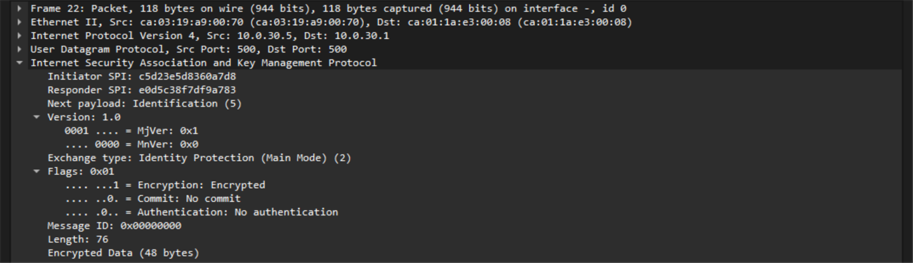

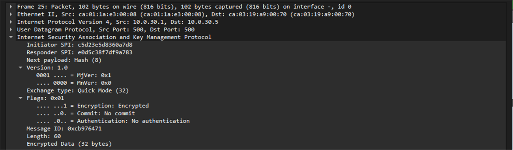

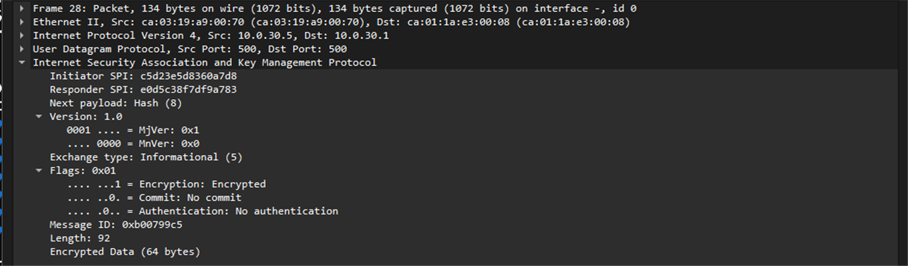

## 결과 기록

| 일시 | 결과 (성공, 실패) | 비고 |
|---|---|---|
| 2026-10-23 | 성공 (Tunnel0, Tunnel1 up) | IKE: Hub1, Hub2 모두 QM_IDLE, ACTIVE. IPsec: BGW1에서 transport, esp-256-aes + esp-sha-hmac, encaps 5와 decaps 5, SA ACTIVE. GRE: Tunnel0(Hub1, BGW1)과 Tunnel1(Hub2) up/up, 터널 ping 5/5 두 개. Wireshark: IKE Main Mode, Quick Mode, Informational(DPD로 추정)와 ESP 패킷(SPI가 BGW1 inbound SA와 일치). `show crypto session`(Hub1, Hub2 UP-ACTIVE), Tunnel1의 IPsec SA(Hub2, BGW2 encaps 5 / decaps 5, SPI가 서로 반대로 대응), BGW2 Tunnel1 up/up까지 모두 확인 완료. 이 문서의 확인 항목은 모두 통과 |
