# 터널 위 eBGP 검증

**선행 조건**: [GRE over IPsec 검증](09-ipsec-gre.md)이 끝나 있고 [터널 위 eBGP 샘플](../../samples/br/10-bgp-over-tunnel.md)이 적용되어 있어야 함. [기준 문서](../../baseline/br/10-bgp-over-tunnel.md).

## 확인 항목

| 순서 | 장비 | 명령 | 기대 결과 | 안 될 때 확인 |
|---|---|---|---|---|
| 1 | Hub1, Hub2, BGW1, BGW2 | `show ip bgp summary` | 터널 이웃이 **Established** (Hub1 ↔ BGW1, Hub2 ↔ BGW2) | AS 번호, 터널 주소 |
| 2 | Hub1 | `show ip route 192.168.50.0` | Branch LAN 경로가 BGP로 보임, next-hop BGW1(10.0.40.1) | BGW의 광고 설정 |
| 3 | Hub1 | `show ip route 192.168.60.0` | 같은 방식으로 보임. Hub는 터널이 하나라 next-hop은 하나(Hub1은 10.0.40.1, Hub2는 10.0.40.3). 두 터널 ECMP는 DC1 쪽(leaf3, leaf4)에서 확인 | BGW의 `network` |
| 4 | BGW1 | `show ip bgp neighbors 10.0.40.0 advertised-routes` | 192.168.50.0, 192.168.60.0만 광고 (`10.0.30.x` 없음) | `prefix-list NO-UNDERLAY` |
| 5 | Hub1 | `show ip bgp neighbors 10.0.40.1 advertised-routes` | DC1, DC2 경로만 광고 (`10.0.30.x` 없음) | 같은 점검 |
| 6 | Hub1, Hub2, BGW1, BGW2 | `show ip bgp neighbors <터널 이웃> \| include hold` | `hold time is 9, keepalive interval is 3 seconds` | 양쪽 `timers 3 9` |
| 7 | BGW1 | `show ip route 192.168.10.0` | DC1 경로가 BGP로 보임, next-hop Hub1(10.0.40.0) | Hub의 광고 |
| 8 | Host A | `ping -c 3 192.168.50.101` | Host F 응답 (DC1에서 Branch로) | PE, Hub, leaf3 경로 |
| 9 | Host F | `ping -c 3 192.168.10.101` | Host A 응답 (Branch에서 DC1로) | 반대 방향 경로, DSW의 default |

## 증빙

### 이웃 Established (항목 1)

- Hub1 `show ip bgp summary`: router identifier **10.0.1.21**, local AS **65010**, 이웃 **10.0.31.0**(leaf3, AS 65100) Up 00:29:58 PfxRcd **7**, 이웃 **10.0.40.1**(BGW1, AS **65020**) Up 00:00:21 PfxRcd **2**
- Hub2: router identifier **10.0.1.22**, 이웃 10.0.31.2(leaf4) PfxRcd 7, 이웃 **10.0.40.3**(BGW2, AS 65020) Up 00:00:33 PfxRcd **2**
- BGW1: router identifier **10.0.1.31**, local AS **65020**, 이웃 **10.0.30.4**(PE3, AS 65000) Up 00:34:42 PfxRcd 4, 이웃 **10.0.40.0**(Hub1, AS **65010**) Up 00:00:21 PfxRcd **7**
- BGW2: router identifier **10.0.1.32**, 이웃 10.0.30.6(PE3) PfxRcd 4, 이웃 **10.0.40.2**(Hub2, AS 65010) Up 00:00:33 PfxRcd **7**
- Hub는 BGW에서 Branch LAN 2개(192.168.50.0/24, 60.0/24)를 받고, BGW는 Hub에서 7개(DC1 192.168.10.0/24, 20.0/24, DC2 192.168.110.0/24와 링크 /31 4개)를 받음

| Hub1 | Hub2 |
|---|---|
| 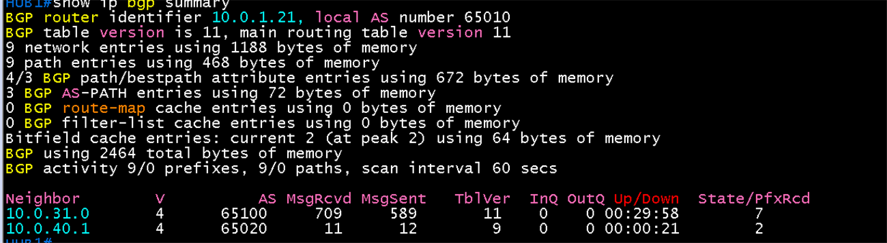 | 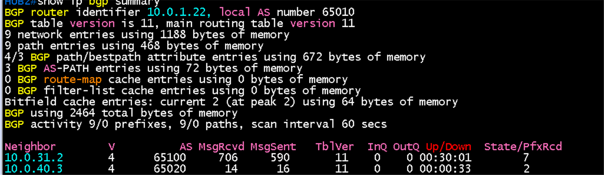 |

| BGW1 | BGW2 |
|---|---|
| 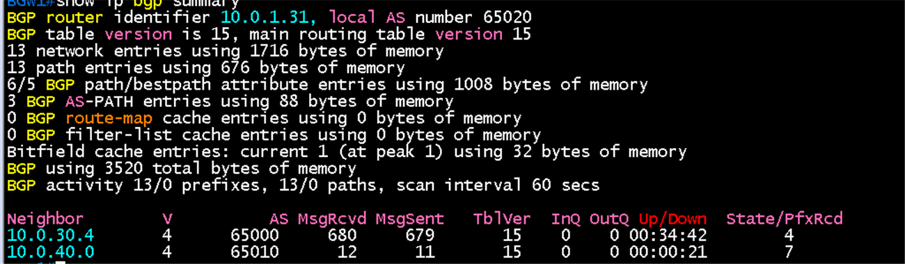 | 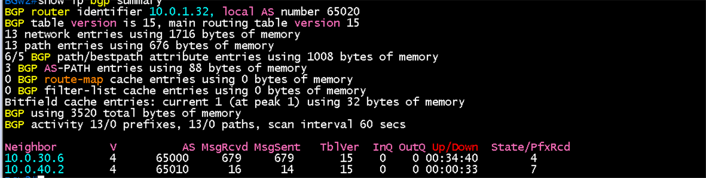 |

### Branch LAN 경로 (항목 2, 3)

- Hub1 `show ip route 192.168.50.0`: Routing entry for **192.168.50.0/24**, Known via **"bgp 65010"**, distance 20, metric 2, **Tag 65020**, type external, from/next-hop **10.0.40.1**, AS Hops 1
- Hub1 `show ip route 192.168.60.0`: **192.168.60.0/24**, bgp 65010, distance 20, metric 2, next-hop **10.0.40.1**
- metric 2는 BGW1이 DSW에서 OSPF로 배운 경로 비용(2)을 MED로 광고한 값

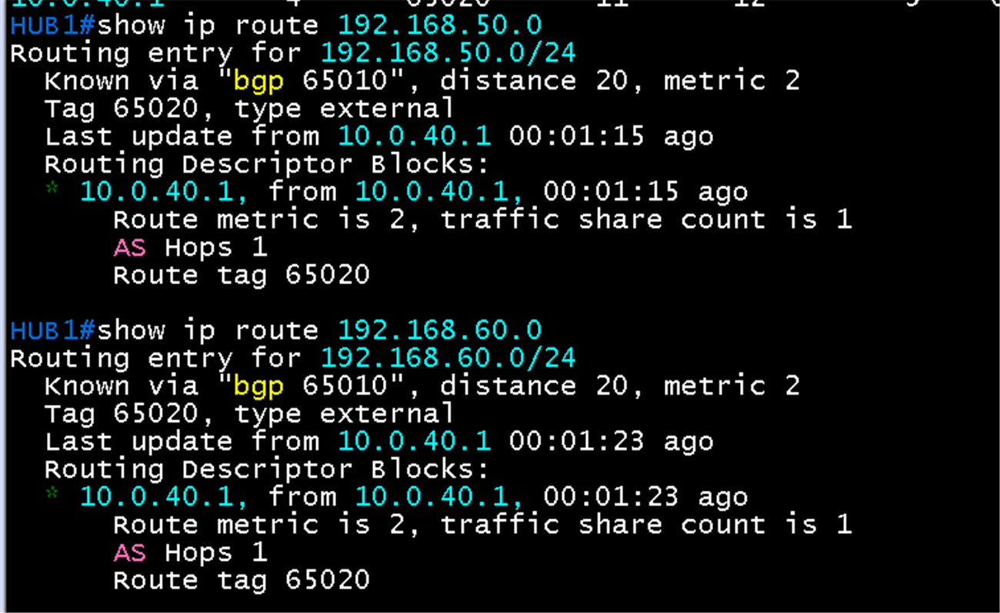

### 광고 경로와 재귀 경로 방지 (항목 4, 5)

- BGW1 `show ip bgp neighbors 10.0.40.0 advertised-routes`: **192.168.50.0, 192.168.60.0** 두 개만(Next Hop 10.50.0.1, Metric 2, Weight 32768, Path `i`). **Total number of prefixes 2**. PE3에서 받은 언더레이 `10.0.30.0/31` 등은 광고되지 않음(`prefix-list NO-UNDERLAY out`)
- Hub1 `show ip bgp neighbors 10.0.40.1 advertised-routes`: 7개. `10.0.20.0/31`(65100 i), `10.0.20.4/31`과 `10.0.20.6/31`(65100 65000 65201 ?), `10.0.31.0/31`(RIB-failure `r>`), **192.168.10.0, 192.168.20.0**(65100 i), **192.168.110.0**(65100 65000 65201 ?). **`10.0.30.x` 없음**
- 192.168.110.0(DC2)이 경로 `65100 65000 65201`로 Hub까지 와서 Branch에 전달됨. DC1과 DC2 경로를 모두 광고
- 참고: `10.0.20.x`와 `10.0.31.0/31` 링크 서브넷도 광고됨. 동작에는 문제가 없지만 필요 없다고 판단되면 out 필터에서 막을 수 있음(`10.0.31.0/31`의 `r`은 Hub가 직결로 가진 주소라 RIB-failure로 표시된 것)

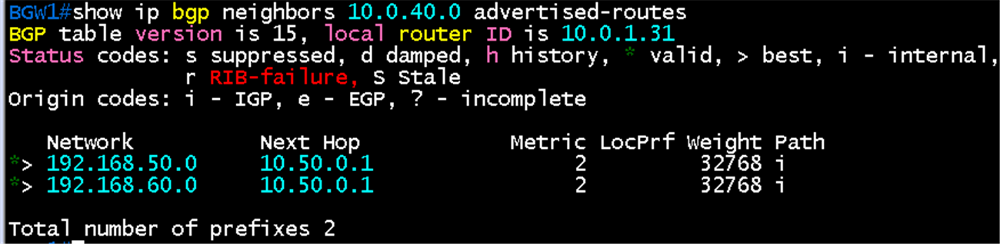

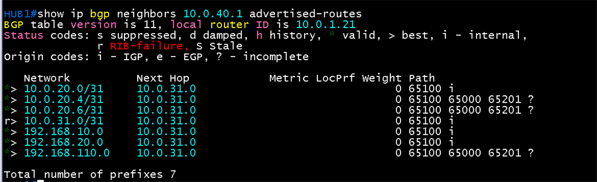

### 타이머 (항목 6)

- Hub1 `show ip bgp neighbors 10.0.40.1 | include hold`, Hub2(10.0.40.3), BGW1(10.0.40.0), BGW2(10.0.40.2): 모두 **hold time is 9, keepalive interval is 3 seconds**, 설정값(Configured)도 9와 3

| Hub1 | Hub2 |
|---|---|
| 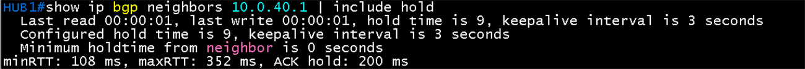 | 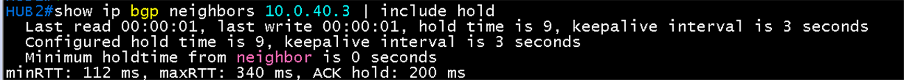 |

| BGW1 | BGW2 |
|---|---|
| 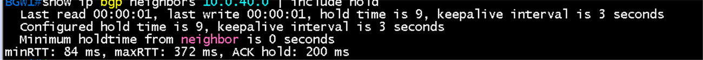 | 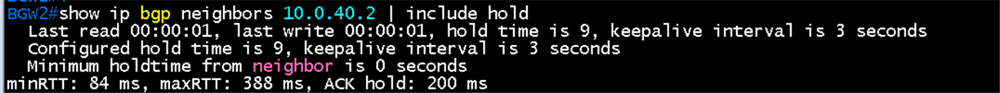 |

### DC1 경로와 양방향 통신 (항목 7 ~ 9)

- BGW1 `show ip route 192.168.10.0`: **B 192.168.10.0/24 [20/0] via 10.0.40.0**(Hub1 터널 주소)와 **B 192.168.10.101/32 [20/0] via 10.0.40.0**. /32는 Host A가 트래픽을 보낸 뒤 leaf3이 호스트 경로로 광고한 것
- Host A -> Host F `ping -c 3 192.168.50.101`: 3개 중 3개 응답, TTL 59 ([화면](../host/images/03-connectivity/host-a-ping-host-f.png))
- Host F -> Host A: `traceroute -n 192.168.10.101`이 DSW1(192.168.50.2), BGW1(10.50.0.0), **터널(10.0.40.0)**, leaf3(10.0.31.0), 192.168.10.1을 거쳐 Host A(192.168.10.101)에 도달 ([화면](../host/images/03-connectivity/host-f-traceroute-host-a.png)). 양방향 경로가 모두 성립
- Host F -> Host D(DC2) `ping -c 3 192.168.110.101`도 3개 중 3개 응답, TTL 57 ([화면](../host/images/03-connectivity/host-f-ping-host-d.png))

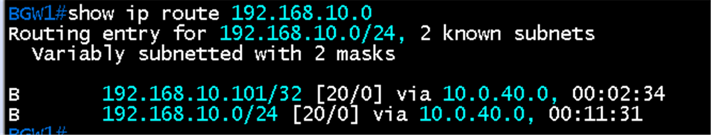

## 패킷 캡처 (Wireshark)

터널 위 BGP는 ESP로 암호화되어 캡처해도 내용이 보이지 않음. BGP는 코어 구간의 대표 캡처([core 06 검증](../core/06-mp-bgp-vpnv4.md))로 대체하고 이 구간은 캡처하지 않음

## 결과 기록

| 일시 | 결과 (성공, 실패) | 비고 |
|---|---|---|
| 2026-10-23 | 성공 | 항목 1~9 완료. Hub1, Hub2, BGW1, BGW2의 터널 이웃이 모두 Established, Hub가 Branch LAN 2개를 BGP로 받고, BGW가 DC1, DC2 경로 7개를 받음. 광고에 `10.0.30.x` 없음, 타이머 9와 3. BGW1이 DC1 경로를 터널로 학습하고 Host A ↔ Host F 양방향, Host F → Host D 통신 확인. 두 번째 터널(Hub2 ↔ BGW2)은 Host G의 traceroute로 데이터 통신을 확인했고 장애 전환은 [IPsec 이중화 장애 시험](12-ipsec-failover.md)에서 시험 |
