# MTU와 MSS 검증

**선행 조건**: [터널 위 eBGP 검증](10-bgp-over-tunnel.md)이 끝나 있어야 함. [기준 문서](../../baseline/br/09-ipsec-gre.md).

GRE와 IPsec 오버헤드 때문에 큰 패킷이 터널에서 잘릴 수 있어서, 터널 MTU를 줄이고 MSS를 맞춤.

## 확인 항목

| 순서 | 장비 | 명령 | 기대 결과 | 안 될 때 확인 |
|---|---|---|---|---|
| 1 | Host F | `ping -c 3 -M do -s 1372 192.168.10.101` | **성공** (IP 패킷 1400바이트, 터널 MTU 이하) | 터널 MTU |
| 2 | Host F | `ping -c 3 -M do -s 1400 192.168.10.101` | **실패**, `Frag needed and DF set (mtu = 1400)` (IP 패킷 1428바이트, 조각화 불가) | `ip mtu 1400` |
| 3 | Hub1 | `show ip interface tunnel 0 \| include MTU` | `MTU is 1400 bytes` (`show interface`의 MTU 17916은 인터페이스 값이라 `ip mtu`와 다름) | `ip mtu 1400` |
| 4 | Host F -> Host A | Wireshark `tcp.flags.syn == 1` (Host F - ASW1 링크, `iperf3 -c 192.168.10.101 -t 3`로 연결 생성) | SYN은 MSS 1460, SYN-ACK는 **MSS 1360** | `ip tcp adjust-mss 1360` |

- `-M do`는 DF 비트를 켜서 조각화를 금지하는 옵션이고, ICMP 데이터 크기에 헤더 28바이트(IP 20 + ICMP 8)를 더한 값이 IP 패킷 크기
- 항목 2에서 실패해야 정상. 오버헤드 때문에 터널을 통과하지 못하는 크기를 터널 MTU가 막는다는 증거

## 증빙

### 터널 MTU 경계 (항목 1, 2)

- `-s 1372`: `PING ... 1372(1400) bytes of data`, **1380 bytes from 192.168.10.101** 3개 중 3개 응답(TTL 59, 약 186 ~ 254 ms)
- `-s 1400`: `1400(1428) bytes of data`, 첫 패킷에 **`From 10.50.0.0 icmp_seq=1 Frag needed and DF set (mtu = 1400)`**. `10.50.0.0`은 BGW1이 DSW1 쪽 인터페이스 주소로 보낸 ICMP. 이후 두 패킷은 Host F가 학습한 경로 MTU 때문에 보내기 전에 `local error: message too long, mtu=1400`. 3개 중 0개 응답
- 터널 MTU 1400이 설정대로 동작하여 1400바이트까지 통과하고 1428바이트는 BGW1에서 차단되며, 호스트가 경로 MTU를 1400으로 학습

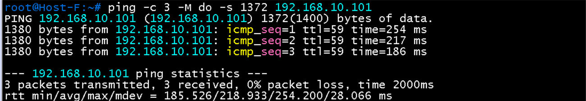

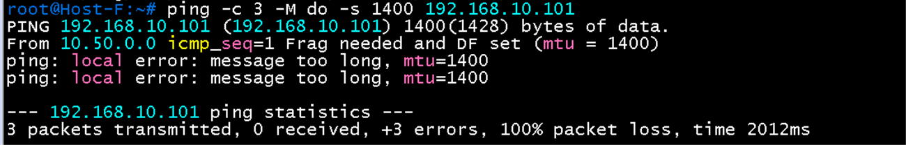

### MSS 설정 (항목 4의 설정 확인)

- Hub1 `show running-config interface tunnel 0 | include mss`: **`ip tcp adjust-mss 1360`**. 터널 MTU 1400에서 IP와 TCP 헤더 40바이트를 뺀 값
- Host F에서 `iperf3 -c 192.168.10.101 -t 10`은 `unable to connect to server - Connection refused`. Host A에서 서버(`iperf3 -s`)를 띄우지 않아서 나온 오류이며 터널 문제가 아님

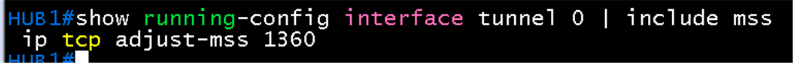

### iperf3 TCP 전송 (항목 4)

- Host A `iperf3 -s`, Host F `iperf3 -c 192.168.10.101 -t 10`: 연결(제어 연결과 데이터 연결)은 맺어짐
- 송신 쪽 구간별 전송량은 **0.00 Bytes**, 재전송(Retr) 합계 **27**, `Cwnd` 1.32 ~ 2.63 KBytes(약 1 ~ 2 세그먼트). 수신 쪽(Host A)에는 마지막 구간(10.00-10.21초)에 **55.3 KBytes**가 한꺼번에 도착, 평균 44.3 Kbits/sec
- `Cwnd` 1.32 KBytes는 세그먼트 1개 크기(MSS 1360에서 TCP 타임스탬프 12바이트를 뺀 1348바이트)와 일치하므로 MSS가 1360으로 줄어든 것으로 보임
- 데이터가 전송 시간 내내 막혀 있다가 끝난 뒤에 도착하므로 **MTU 오류(큰 패킷만 영구 차단)보다 경로의 큰 지연과 혼잡**(재전송 타임아웃으로 cwnd가 줄어든 상태)에 가까운 증상. 앞의 traceroute에서도 일부 홉 지연이 1초 이상이었음. 확정이 아니라 추정이며 아래 시험으로 구분하고, 최종 판단은 아래의 터널 없는 TCP 시험에서 랩 환경 한계로 정리

| 구분 시험 | 명령 | 해석 |
|---|---|---|
| 속도 제한 TCP | Host F `iperf3 -c 192.168.10.101 -t 10 -b 200k` | 정상 전송되면 MTU/MSS는 문제없고 대역폭이 병목 |
| 크기별 손실 | Host F `ping -c 50 -i 0.2 -s 1372 -M do 192.168.10.101`와 `-s 56` | 큰 패킷만 손실되면 크기 문제, 둘 다 손실되면 혼잡 |
| 장비 부하 | Hub1, BGW1 `show processes cpu \| include CPU` (iperf3 실행 중) | CPU 사용률이 높으면 소프트웨어 암호화가 병목 |

**구분 시험 결과 (2026-10-23)**

- 크기별 손실: `ping -c 50 -i 0.2 -s 1372 -M do`와 `-s 56` 모두 **50개 중 50개 응답, 손실 0%**. 지연은 약 140 ~ 300 ms이고 가끔 1초 안팎으로 튐(최대 1094 ms). 큰 패킷만 손실되는 증상은 없음
- 속도 제한: `iperf3 -c 192.168.10.101 -t 10 -b 200k`도 송신 쪽 전송량 0.00 Bytes, 재전송이 구간마다 발생, Host A에는 9 ~ 10초 구간에 22.4 KBytes만 도착. **대역폭이 병목이 아님**
- 정리: 1400바이트 ICMP는 손실 없이 통과하는데 TCP 데이터만 지연되거나 유실되므로 크기 문제와 대역폭 문제는 모두 가능성이 낮아짐. 흐름(5-tuple)에 따라 다른 경로를 타는 문제(ECMP, 비대칭 경로, 두 번째 터널), 또는 TCP 버스트에 대한 장비 처리 문제를 확인해야 함. 이후 터널 카운터, UDP, 터널 없는 TCP 시험으로 구분(아래)

**터널 카운터와 UDP 시험 (2026-10-23)**

| 장비 | 터널 | packets input | packets output |
|---|---|---|---|
| Hub1 | tunnel 0 | **52** (38198 bytes) | 39 (4402 bytes) |
| BGW1 | tunnel 0 | 40 (2514 bytes) | **52** (40887 bytes) |
| Hub2 | tunnel 1 | 38 | 38 |
| BGW2 | tunnel 1 | 44 | 44 |

- BGW1이 보낸 52개를 Hub1이 52개 받음. **터널에서 손실 없음**. 데이터(Host F -> Host A)는 터널 0만 사용하고 터널 1은 BGP 유지 패킷 수준(5분 평균 0 packets/sec)
- UDP `iperf3 -c 192.168.10.101 -u -b 200k -t 10`: **0/186 손실(0%)**, 수신 197 Kbits/sec, jitter 27.7 ms. 약 1.3 KB 데이터그램은 손실 없이 통과
- 결론: 경로, 터널, 터널 MTU, 두 번째 터널은 원인이 아님. ICMP와 UDP는 되고 **TCP 데이터만** 지연되는 증상. 호스트 쪽(TCP 오프로드, 컨테이너 가상 NIC)이나 TCP 전용 처리를 확인해야 함(중간 결론). 아래 터널 없는 TCP 시험에서 같은 증상이 나와 랩 환경 한계로 최종 정리

| Hub1 | BGW1 |
|---|---|
| 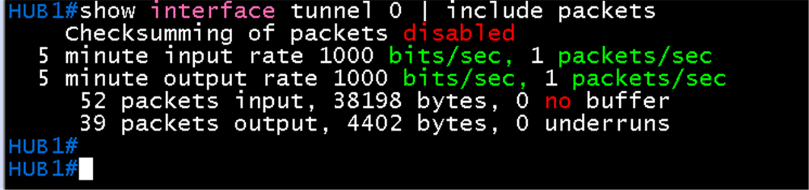 | 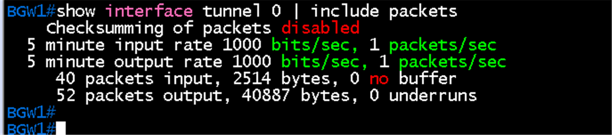 |

| Hub2 | BGW2 |
|---|---|
| 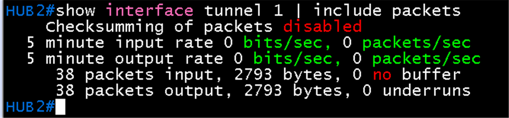 | 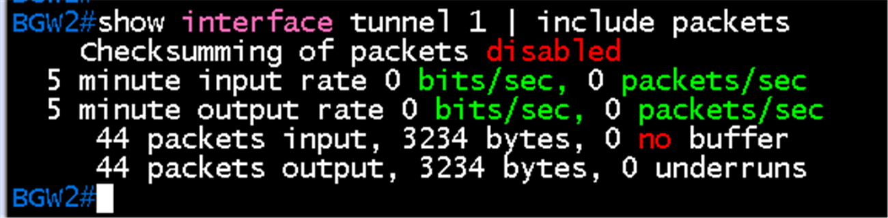 |

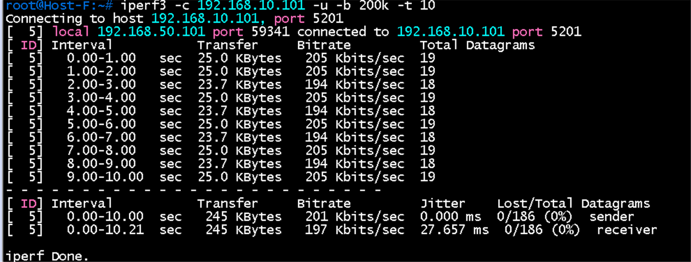

**터널을 거치지 않는 TCP 시험 (Host F -> Host G, 2026-10-23)**

- `iperf3 -c 192.168.60.101 -t 10`: 평균 **944 Kbits/sec**, 재전송 **109**, 1초 단위로 0 Bytes 구간이 반복(3 ~ 4초, 5 ~ 6초, 8 ~ 9초). Host G(수신) 쪽도 같은 구간이 0 Bytes
- Branch 안에서(ASW1, DSW 경유, 터널 없음)도 TCP가 끊기며 재전송이 많음. 따라서 **터널, MTU, MSS가 원인이 아니고** Branch 스위치와 호스트 에뮬레이션이 TCP 버스트를 처리하지 못하는 환경 한계로 판단. UDP 저속과 ping은 정상
- Host의 `ethtool`은 설치되어 있지 않아(`command not found`) 오프로드 설정은 확인하거나 끌 수 없었음
- 이 랩에서는 TCP 처리량 시험(iperf3 TCP)을 MTU/MSS의 합격 기준으로 쓰지 않음. 항목 4는 TCP SYN의 MSS 값을 Wireshark로 보는 방식으로 바꿈. QoS 시험도 UDP 저속 전송과 정책 카운터로 확인

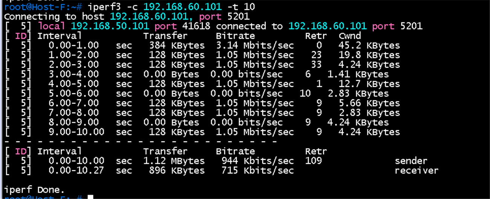

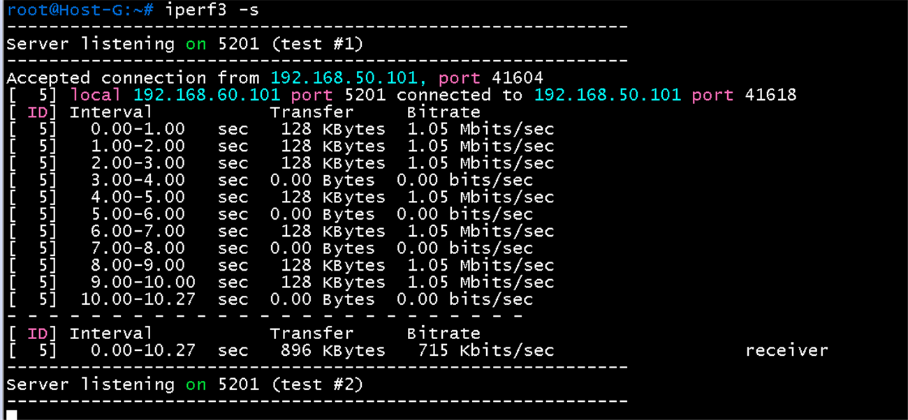

### 캡처 결과: TCP SYN-ACK의 MSS (항목 4, 패킷 33)

- 캡처 링크 Host F - ASW1, 필터 `tcp.flags.syn == 1`. 패킷 33: Src **192.168.10.101**(Host A) -> Dst **192.168.50.101**(Host F), TCP Src Port 5201, Flags **0x012 (SYN, ACK)**
- Options: **Maximum segment size: 1360 bytes**, SACK permitted, Timestamps, Window scale 11. 정보 줄에도 `MSS=1360`
- Host A는 자기 인터페이스 MTU 1500이면 MSS 1460을 광고하므로 **경로(BGW1 tunnel 0의 `ip tcp adjust-mss 1360`)가 1460을 1360으로 줄인 것**. MSS 클램핑 동작 확인
- 같은 SYN-ACK가 패킷 36(0.38초 뒤)에 한 번 더 보임. Host A가 SYN-ACK를 다시 보낸 것으로, 앞의 TCP 지연 증상과 같은 맥락. MSS 값은 동일
- Host F가 보낸 SYN(MSS 1460)은 이번 화면에 없음. SYN-ACK만으로 클램핑이 확인되어 생략

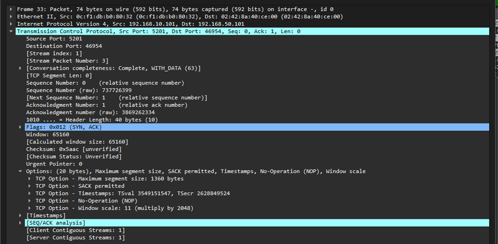

### Hub1 터널 MTU 표시 (항목 3 참고)

- Hub1 `show interface tunnel 0 | include MTU`: **MTU 17916 bytes**, **BW 100 Kbit/sec**, DLY 50000 usec, **Tunnel transport MTU 1476 bytes**
- 17916은 GRE 터널 인터페이스의 기본 MTU이고 `ip mtu 1400`은 `show ip interface`에서 보임. 1476은 언더레이 1500에서 GRE 오버헤드 24를 뺀 값
- **BW 100 Kbit/sec**는 터널 기본값. 라우팅과 QoS(퍼센트 기준 큐잉)에 쓰이므로 QoS 단계에서 `bandwidth`를 설정할 때 같이 정함

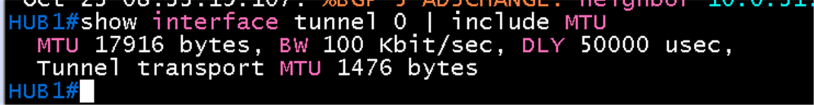

- Hub1 `show ip interface tunnel 0 | include MTU`: **`MTU is 1400 bytes`**. `ip mtu 1400` 적용 확인 (항목 3)

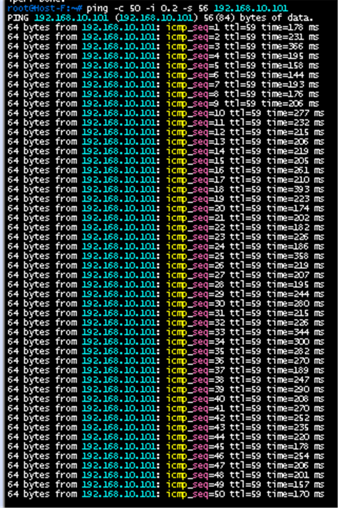

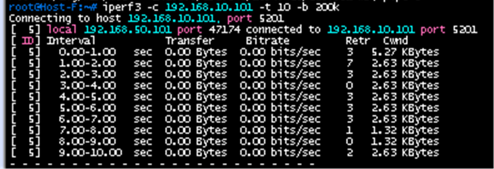

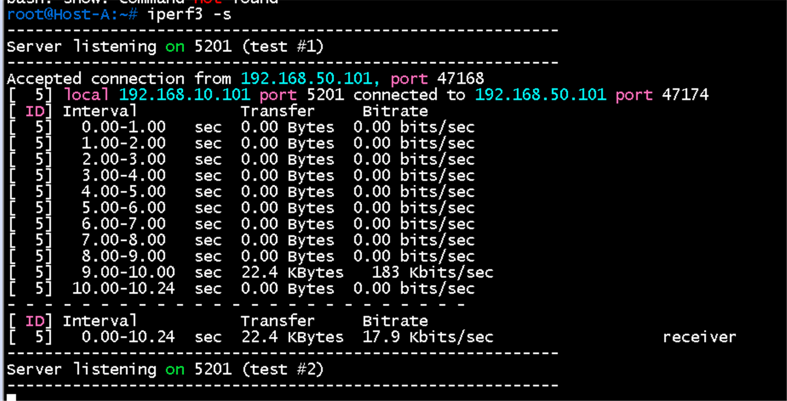

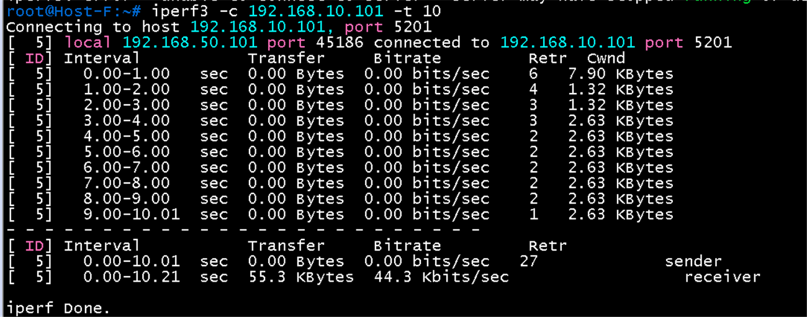

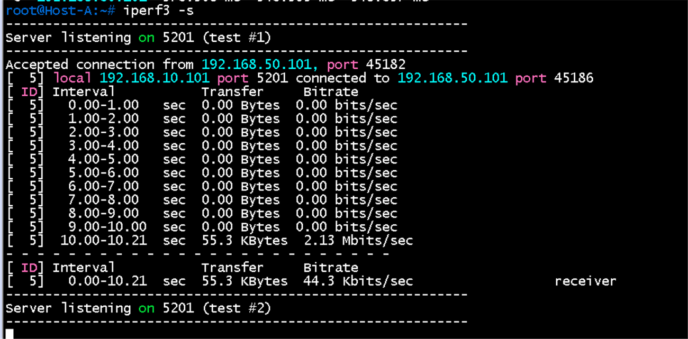

## 문제 해결

| 증상 | 확인 |
|---|---|
| ping은 되는데 TCP 큰 전송이 멈춤 | MSS clamping(`ip tcp adjust-mss`) 적용 여부, 터널 MTU |

## 결과 기록

| 일시 | 결과 (성공, 실패) | 비고 |
|---|---|---|
| 2026-10-23 | 성공 | 항목 1, 2 완료(1400바이트 통과, 1428바이트는 `Frag needed ... mtu = 1400`). MSS 설정(`adjust-mss 1360`) 확인. 항목 4 완료(SYN-ACK MSS 1360 캡처). TCP 처리량(iperf3)은 터널 없는 Branch 안에서도 끊겨 랩 환경 한계로 판단하고 합격 기준에서 제외. 항목 3 완료(`show ip interface tunnel 0`에서 `MTU is 1400 bytes`). 항목 1 ~ 4 모두 완료 |
