# IPsec 이중화 장애 시험

**선행 조건**: [터널 위 eBGP 검증](10-bgp-over-tunnel.md)과 [MTU 검증](11-mtu-mss.md)이 끝나 있어야 함

## 구조 확인

- DSW1과 DSW2는 SVI(VLAN 50, 60)를 OSPF passive로 두어 서로 OSPF 인접이 없음. DSW1의 default는 BGW1 하나, DSW2의 default는 BGW2 하나뿐
- Host F(VLAN 50, VRRP master DSW1)의 나가는 길은 DSW1 -> BGW1 -> 터널 0 -> Hub1, Host G(VLAN 60, master DSW2)는 DSW2 -> BGW2 -> 터널 1 -> Hub2로 예상됨. 들어오는 길은 DC1 leaf3, leaf4가 어느 Hub를 고르는지에 따라 정해짐
- BGW는 WAN 상태와 상관없이 `default-information originate always`로 default를 계속 내려보냄. BGW 한쪽의 WAN이 끊겨도 해당 DSW는 default를 잃지 않는 구조이므로 이 점을 시험으로 확인

## 사전 확인 (정상 상태의 경로)

| 순서 | 장비 | 명령 | 확인할 것 |
|---|---|---|---|
| 1 | Host F | `traceroute -n 192.168.10.101` | 터널 0 경유(10.0.40.1 BGW1, 10.0.40.0 Hub1) |
| 2 | Host G | `traceroute -n 192.168.10.101` | 터널 1 경유(BGW2, Hub2)인지 확인 |
| 3 | DSW1, DSW2 | `show ip route 0.0.0.0` | default가 각각 BGW1(10.50.0.0), BGW2(10.50.0.2) 하나 |
| 4 | leaf3, leaf4 | `show ip route vrf TENANT-A 192.168.50.0` | 192.168.50.0/24 next-hop이 Hub1, Hub2 중 어느 쪽인지 |

## 증빙: 사전 확인 (정상 상태, 2026-10-23)

- Host F `traceroute -n 192.168.10.101`: **192.168.50.2**(DSW1) -> **10.50.0.0**(BGW1) -> **10.0.40.0**(Hub1 터널 0) -> **10.0.31.0**(leaf3) -> Host A. **터널 0** 경유
- Host G `traceroute -n 192.168.10.101`: **192.168.60.3**(DSW2) -> **10.50.0.2**(BGW2) -> **10.0.40.2**(Hub2 터널 1) -> **10.0.31.2**(leaf4) -> 192.168.10.1 -> Host A. **터널 1** 경유. 터널 1에 실제 데이터가 흐르는 것을 처음 확인
- DSW1 `show ip route 0.0.0.0`: `O*E2`, next-hop **10.50.0.0**(BGW1, from 10.0.0.31) **하나뿐**. DSW2: next-hop **10.50.0.2**(BGW2, from 10.0.0.32) 하나뿐
- leaf3 `show ip route vrf TENANT-A 192.168.50.0`: `B E 192.168.50.0/24 [200/0] via 10.0.31.1`(Hub1)만. leaf4: `via 10.0.31.3`(Hub2)만. 각 leaf는 자기 쪽 Hub 하나만 경로로 보유
- 정리: Branch는 VLAN 50(Host F)이 터널 0, VLAN 60(Host G)이 터널 1로 나가는 VLAN별 분담 구조. DSW1과 DSW2는 서로의 default를 모름

| 화면 | 이미지 |
|---|---|
| Host F traceroute | 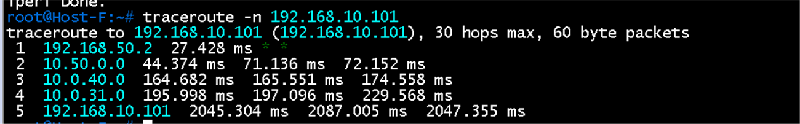 |
| Host G traceroute | 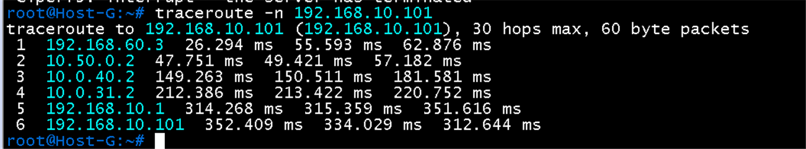 |
| DSW1 default | 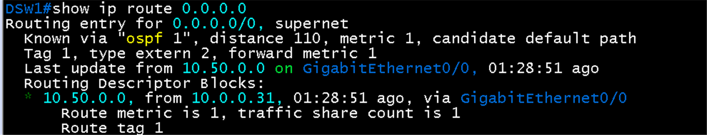 |
| DSW2 default | 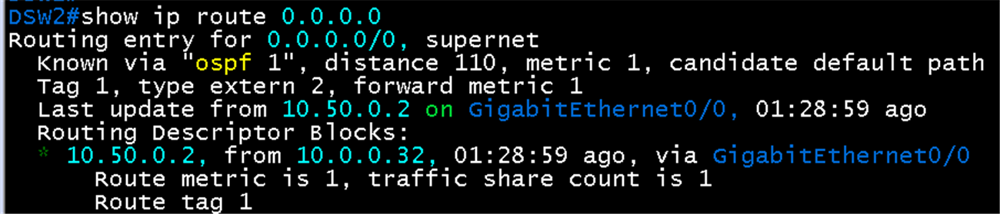 |
| leaf3 경로 | 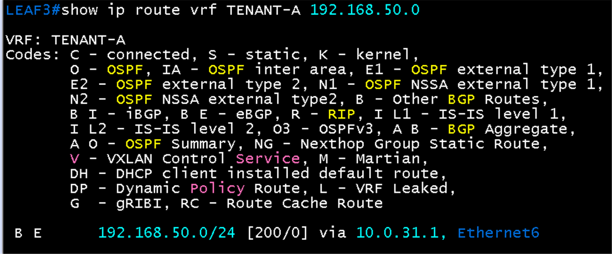 |
| leaf4 경로 | 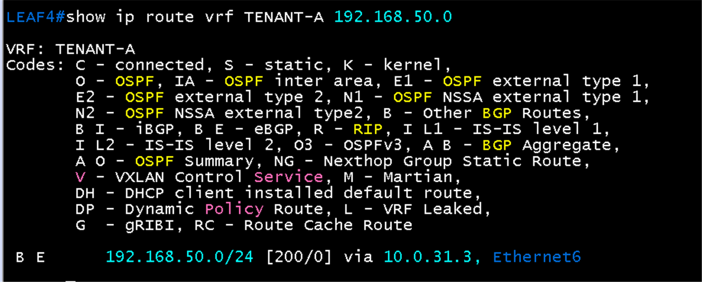 |

## 증빙: BGW1 `Gi0/0` shutdown 후 (2026-10-23 08:50)

- BGW1 로그: `%LINEPROTO-5-UPDOWN: Line protocol on Interface Tunnel0, changed state to down`. BGW1 `show ip bgp summary`: 이웃 **10.0.30.4**(PE3)와 **10.0.40.0**(Hub1) 모두 **Idle**
- Hub1 `show ip route 192.168.50.0`: **`% Network not in table`**. 터널 0이 끊겨 Branch LAN 경로가 사라짐
- Hub2 `show ip route 192.168.50.0`: 여전히 `bgp 65010`, next-hop **10.0.40.3**(BGW2). 터널 1은 영향 없음
- DSW1 `show ip route 0.0.0.0`: **여전히 `O*E2` via 10.50.0.0**(BGW1). BGW1의 `default-information originate always` 때문에 WAN이 끊겨도 default가 유지됨. Host F의 나가는 트래픽이 BGW1에서 막히는 구조(ping 통계는 아래 1차 시험 총계)

| BGW1 BGP | Hub1 경로 |
|---|---|
| 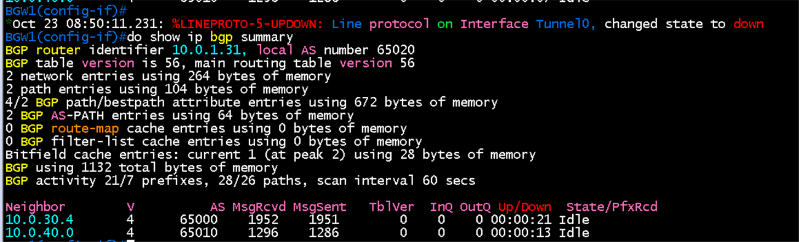 | 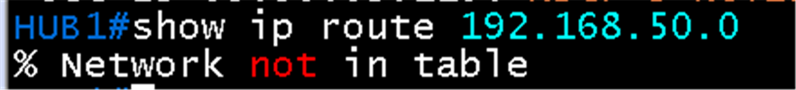 |

| Hub2 경로 | DSW1 default |
|---|---|
| 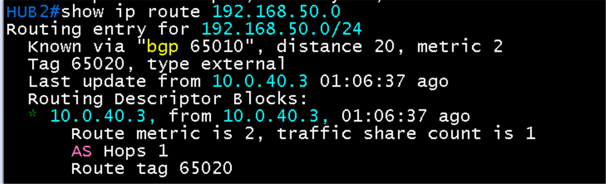 | 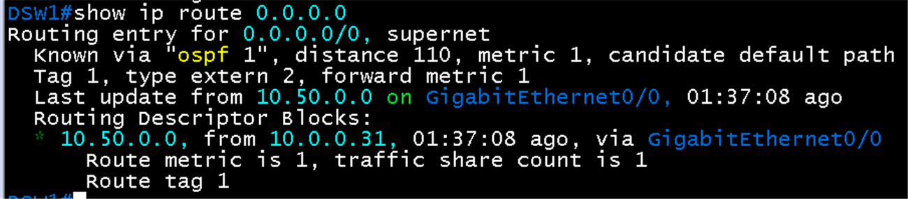 |

### 1차 시험의 ping 통계 (총계, 시점 구분 없음)

| 방향 | 송신 | 수신 | 오류 | 손실 | 시간 |
|---|---|---|---|---|---|
| Host F -> Host A | 784 | 192 | +547 | 75.5% | 157.9 s |
| Host G -> Host A | 784 | 212 | 없음 | 73.0% | 161.6 s |
| Host A -> Host F | 641 | 60 | +62 | 90.6% | 132.3 s |

- Host F -> Host A: 오류 547건은 ICMP 도달 불가 응답으로, BGW1이 경로를 잃은 뒤 버린 것으로 보임. 예측한 **나가는 방향 단절**과 일치
- Host A -> Host F: 손실 90.6%와 오류 62건. 터널 0 단절 후 leaf3이 경로를 잃고 **Hub2 쪽으로 우회하지 못한** 것으로 보임
- Host G -> Host A: 터널 1을 쓰는데도 **손실 73%**. 예상과 다름. 돌아오는 길(Host A -> Host G)이 leaf3 -> Hub1 -> 터널 0을 타서 끊겼거나 랩 부하일 수 있어 구분 필요
- 총계는 장애 전, 중, 복구 후를 모두 포함해 끊긴 시간을 알 수 없음. 시각 기록(`ping -D`)을 남겨 다시 시험

| Host F -> Host A | Host G -> Host A | Host A -> Host F |
|---|---|---|
| 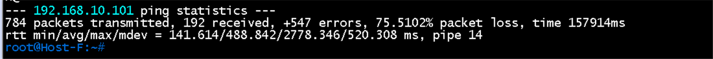 | 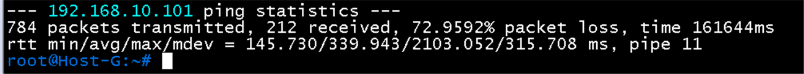 | 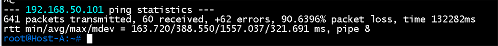 |

### 1차 시험의 복구

- BGW1 `Gi0/0`에서 `no shutdown`(08:51:43, 아래 로그 타임라인 참고) 뒤 `show ip bgp summary`: 이웃 **10.0.30.4**(PE3) Up/Down **00:01:37** PfxRcd 4, **10.0.40.0**(Hub1) Up/Down **00:01:28** PfxRcd **8**. 두 세션 모두 Established로 복구. Hub1 세션이 PE3 세션보다 약 9초 늦게 올라옴(터널 재설정 후 BGP). 화면의 `%SYS-5-CONFIG_I` 08:53:21은 설정 모드를 나온 시각이고 복구 시각이 아님
- Hub1에서 받는 경로가 7개에서 8개로 늘어남. 앞서 Host A가 트래픽을 보내 learned된 호스트 경로(/32)가 추가된 것으로 보이며 미확인

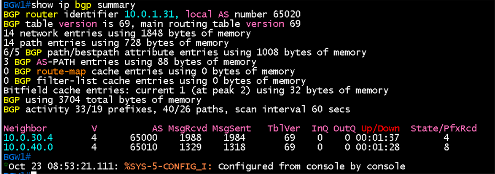

### 2차 시험의 DC1 leaf 경로 (BGW1 장애 중)

- leaf3 `show ip route vrf TENANT-A 192.168.60.0`: **경로 없음**(`Gateway of last resort is not set`). Hub1(터널 0)을 잃어 Branch LAN 경로가 사라지고 대체 경로가 없음
- leaf4 같은 명령: `B E 192.168.60.0/24 [200/0] via 10.0.31.3`(Hub2). 터널 1 경로는 유지
- leaf2 `show ip route vrf TENANT-A 192.168.50.0`: `B I 192.168.50.0/24 [200/0] via VTEP **10.1.1.34** VNI 50001`. leaf1, leaf2는 Branch 경로를 **leaf3과 leaf4가 함께 쓰는 VTEP 10.1.1.34**로 보냄([leaf3.eos](../../configs/dc1/leaf3.eos), [leaf4.eos](../../configs/dc1/leaf4.eos)의 Loopback 주소)
- 해석: 10.1.1.34로 간 패킷이 leaf3에 닿으면 경로가 없어 버려지고 leaf4에 닿으면 Hub2로 나감. leaf4가 광고하는 경로도 같은 VTEP 주소라 leaf3은 자기 경로로 보고 leaf4로 넘기지 못하는 구조로 추정. 따라서 흐름에 따라 일부만 끊김(Host G의 부분 손실과 부합). 확정은 leaf3의 EVPN 경로 확인 필요
- 참고: 이 시험에서 Host A는 목적지를 자기 주소(192.168.10.101)로 입력해 무효. 다시 시험 필요

| leaf3 | leaf4 | leaf2 |
|---|---|---|
| 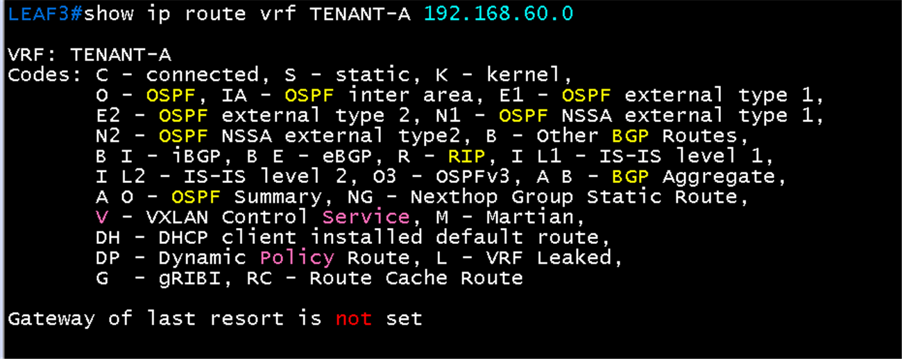 | 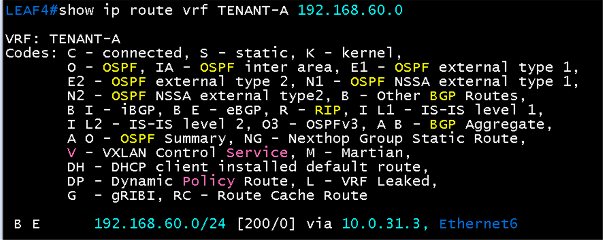 | 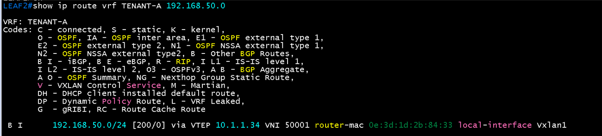 |

### BGW1 로그 타임라인 (두 번의 시험)

`show logging | include Tunnel0|BGP-5|LINK-3`

| 이벤트 | 1차 | 2차 | 간격 (1차, 2차) |
|---|---|---|---|
| `Gi0/0` shutdown (PE3 이웃 `Down Interface flap`) | 08:49:54.8 | 08:54:27.3 | 기준 |
| Hub1 BGP **Down** (hold time 만료, Notification sent) | 08:50:03.7 | 08:54:36.1 | **8.8초, 8.8초** |
| Tunnel0 line protocol **down** | 08:50:11.2 | 08:54:42.3 | 16.4초, 14.9초 |
| `Gi0/0` `no shutdown` (link up) | 08:51:43.0 | 08:56:34.3 | 기준 |
| PE3 BGP **Up** | 08:51:44.1 | 08:56:36.0 | 1.1초, 1.7초 |
| Tunnel0 line protocol **up** (IKE, IPsec 재설정) | 08:51:52.3 | 08:56:43.3 | 9.2초, 9.0초 |
| Hub1 BGP **Up** | 08:51:53.5 | 08:56:45.4 | **10.5초, 11.1초** |

- 장애 감지: BGP hold 9초가 터널 단절을 먼저 알림(약 8.8초). 터널 인터페이스 down은 DPD 후 약 15 ~ 16초
- 복구: 링크가 올라오고 약 10 ~ 11초 뒤 터널 위 BGP까지 복구. 두 번 모두 비슷해 재현됨
- 화면에서 `07:09`는 장비 부팅, `07:11`은 처음 터널 설정 때의 down과 up

## 시험 순서

| 순서 | 동작 | 기대 결과 | 기록 |
|---|---|---|---|
| 1 | Host F에서 `ping -i 0.2 192.168.10.101`, Host A에서 `ping -i 0.2 192.168.50.101` 지속 | 응답 유지 | |
| 2 | BGW1 `Gi0/0`(PE3 방향) shutdown | 터널 0 down, BGW1과 Hub1의 BGP 이웃 down. Host A -> Host F는 Hub2, BGW2 쪽으로 돌아 복구되는지, Host F -> Host A는 DSW1이 default를 유지하므로 복구되지 않는지 확인 | 끊긴 시간: |
| 3 | Hub1 `show ip route 192.168.50.0`, Hub2 `show ip route 192.168.50.0` | Hub1에서는 경로 소멸, Hub2에서는 BGW2를 next-hop으로 보유 | |
| 4 | BGW1 `Gi0/0` 복구 | 터널 0 재설정(IKE, IPsec), eBGP Established, 양방향 ping 복구 | 복구 시간: |
| 5 | Hub1 정지 | leaf3과 터널 0이 사라져도 leaf4, Hub2, 터널 1로 통신 유지 | 끊긴 시간: |

## 확인 명령

- `show crypto isakmp sa`, `show crypto session` (SA 재설정)
- `show ip bgp summary` (세션 상태)
- `show ip route 0.0.0.0` (DSW, default 유지 여부)

## 결과 기록

| 일시 | 결과 (성공, 실패) | 비고 |
|---|---|---|
| 2026-10-23 | 부분 성공 (현재 구조의 한계로 기록) | BGW1 `Gi0/0` shutdown 시험 2회. 장애 감지는 BGP hold 9초(실측 8.8초), 터널 down 15 ~ 16초, 복구는 link up 후 터널 BGP까지 10 ~ 11초로 재현. 단, 이중화는 완전하지 않음: (1) Host F -> Host A는 장애 내내 복구되지 않음(DSW1의 default가 `always`로 BGW1에 고정, 손실 75%와 오류 547건), (2) Host A -> Host F와 Host G -> Host A는 일부 흐름만 끊김(leaf3, leaf4가 공유 VTEP 10.1.1.34를 써 leaf3이 Hub1을 잃으면 leaf4로 넘기지 못함). 호스트별 끊긴 시간(시각 기록)은 미측정. Hub1 정지 시험(항목 5)은 생략 |

## 한계와 개선 후보 (적용하지 않음)

- Branch: BGW의 `default-information originate always`를 조건부로 바꾸고, DSW1과 DSW2가 SVI에서 OSPF 인접을 맺어 한쪽 BGW 장애 시 다른 DSW로 default가 넘어가게 함
- DC1: leaf3과 leaf4가 VRF TENANT-A 안에서 iBGP로 연결해 한쪽 Hub를 잃으면 다른 leaf로 경로를 넘기게 함
- 위 개선은 QoS 이후에 별도 작업으로 진행하고, 적용 후 같은 시험을 시각 기록과 함께 다시 수행
