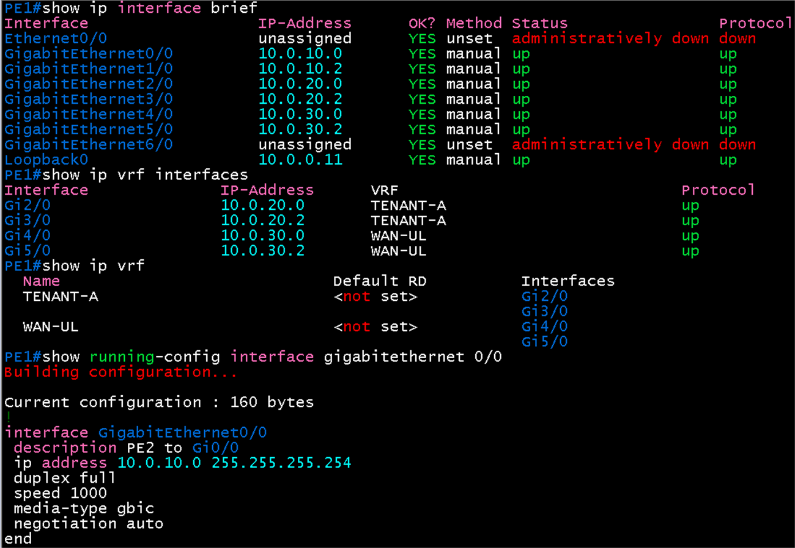
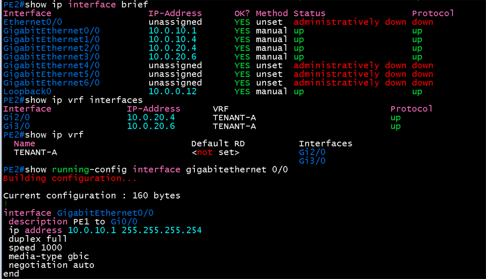
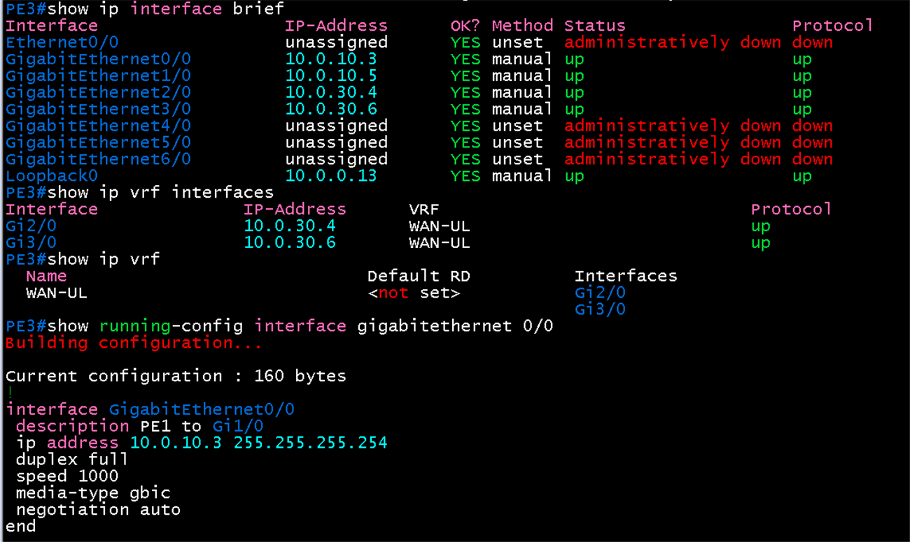

# 인터페이스 IP 검증 (PE1~PE3)

**선행 조건**: PE1~PE3의 기본 설정과 인터페이스 IP 입력이 끝나 있어야 함

기준 문서: [02-ip.md](../../baseline/core/02-ip.md) / 샘플: [02-ip.md](../../samples/core/02-ip.md) / [06-vlan-ip-plan.md](../../00-overview/06-vlan-ip-plan.md) / [07-ip-port-matrix.md](../../00-overview/07-ip-port-matrix.md)

## 공통 확인 명령

| 순서 | 명령 | 확인 내용 |
|---|---|---|
| 1 | `show ip interface brief` | global 인터페이스와 loopback0의 IP, Status `up`, Protocol `up` |
| 2 | `show ip vrf interfaces` | VRF에 속한 인터페이스의 IP와 VRF 이름 |
| 3 | `show running-config interface gigabitethernet 0/0` | 한 인터페이스의 설정 원문 (포트마다 반복) |
| 4 | `show ip vrf` | 정의된 VRF 이름 (rd는 VPNv4 단계 전이라 `<not set>`) |
| 5 | `ping <상대 IP>` | global 링크 도달성 |
| 6 | `ping vrf <VRF 이름> <상대 IP>` | VRF 링크 도달성 (상대 장비 설정 후) |

`show ip interface brief`는 VRF에 속한 인터페이스도 IP를 보여주지만 VRF 이름은 보여주지 않음. VRF 소속은 `show ip vrf interfaces`로 확인함

## PE1

| 인터페이스 | 기대 IP | VRF | 상대 | 상대 IP |
|---|---|---|---|---|
| loopback0 | 10.0.0.11/32 | global | - | - |
| gigabitethernet0/0 | 10.0.10.0/31 | global | PE2 Gi0/0 | 10.0.10.1 |
| gigabitethernet1/0 | 10.0.10.2/31 | global | PE3 Gi0/0 | 10.0.10.3 |
| gigabitethernet4/0 | 10.0.30.0/31 | TENANT-A | Hub1 Gi0/0 | 10.0.30.1 |
| gigabitethernet5/0 | 10.0.30.2/31 | TENANT-A | Hub2 Gi0/0 | 10.0.30.3 |

```
show ip interface brief
show ip vrf interfaces
ping 10.0.10.1
ping 10.0.10.3
ping vrf TENANT-A 10.0.30.1
ping vrf TENANT-A 10.0.30.3
```

## PE2

| 인터페이스 | 기대 IP | VRF | 상대 | 상대 IP |
|---|---|---|---|---|
| loopback0 | 10.0.0.12/32 | global | - | - |
| gigabitethernet0/0 | 10.0.10.1/31 | global | PE1 Gi0/0 | 10.0.10.0 |
| gigabitethernet1/0 | 10.0.10.4/31 | global | PE3 Gi1/0 | 10.0.10.5 |
| gigabitethernet2/0 | 10.0.20.4/31 | PARTNER | CX1 1/1/1 | 10.0.20.5 |
| gigabitethernet3/0 | 10.0.20.6/31 | PARTNER | CX2 1/1/1 | 10.0.20.7 |

```
show ip interface brief
show ip vrf interfaces
ping 10.0.10.0
ping 10.0.10.5
ping vrf PARTNER 10.0.20.5
ping vrf PARTNER 10.0.20.7
```

## PE3

| 인터페이스 | 기대 IP | VRF | 상대 | 상대 IP |
|---|---|---|---|---|
| loopback0 | 10.0.0.13/32 | global | - | - |
| gigabitethernet0/0 | 10.0.10.3/31 | global | PE1 Gi1/0 | 10.0.10.2 |
| gigabitethernet1/0 | 10.0.10.5/31 | global | PE2 Gi1/0 | 10.0.10.4 |
| gigabitethernet2/0.100 | 10.0.60.0/31 | BR1 | BGW1 Gi0/0.100 | 10.0.60.1 |
| gigabitethernet3/0.100 | 10.0.60.2/31 | BR1 | BGW2 Gi0/0.100 | 10.0.60.3 |

```
show ip interface brief
show ip vrf interfaces
ping 10.0.10.2
ping 10.0.10.4
ping vrf BR1 10.0.60.1
ping vrf BR1 10.0.60.3
```

## 확인 범위

| 구간 | 지금 확인 가능 여부 |
|---|---|
| PE1 - PE2, PE1 - PE3, PE2 - PE3 (global) | 가능 (PE 3대 설정 완료) |
| PE1 - Hub1, Hub2 (TENANT-A) | Hub 설정 후 |
| PE2 - CX1, CX2 (PARTNER) | CX1, CX2의 1/1/1 설정 후 |
| PE3 - BGW1, BGW2 (BR1) | BGW 설정 후 |

## 증빙

### PE1

`show ip interface brief`, `show ip vrf interfaces`, `show ip vrf`, `show running-config interface gigabitethernet 0/0` 출력
- 이 화면은 이전 구성(leaf 직결, WAN-UL)에서 찍은 것. 최종 구성은 Gi0/0, Gi1/0, Gi2/0, Gi5/0만 사용하고 Gi2/0, Gi5/0은 VRF TENANT-A 소속(Hub1, Hub2). Gi2/0, Gi3/0, Gi6/0은 미사용
- 최종 구성 화면으로 교체 필요



### PE2

- Gi0/0 10.0.10.1, Gi1/0 10.0.10.4, Gi2/0 10.0.20.4, Gi3/0 10.0.20.6이 up/up, loopback0 10.0.0.12
- 최종 구성에서는 VRF PARTNER에 Gi2/0, Gi3/0이 소속(화면은 이전 이름 TENANT-A로 찍힘, 교체 필요)
- Gi4/0 ~ Gi6/0은 미사용



### PE3

- Gi0/0 10.0.10.3, Gi1/0 10.0.10.5가 up/up, loopback0 10.0.0.13
- 이 화면은 이전 구성(WAN-UL)에서 찍은 것. 최종 구성은 VRF BR1에 Gi2/0.100(10.0.60.0), Gi3/0.100(10.0.60.2)이 소속. 화면 교체 필요
- Gi4/0 ~ Gi6/0은 미사용



## 결과 기록

| 일시 | 장비 | 결과 (성공, 실패) | 비고 |
|---|---|---|---|
| 2026-10-22 | PE1 | 성공 | IP, VRF 소속, description 문서와 일치. ping은 아직 미실시 |
| 2026-10-22 | PE2 | 성공 | 상동 |
| 2026-10-22 | PE3 | 성공 | 상동 |
