# OSPF 검증

**선행 조건**: [인터페이스 IP 검증](02-interface-ip.md)이 끝나 있고 [OSPF 샘플](../../samples/core/03-ospf.md)이 PE1~PE3에 적용되어 있어야 함

기준 문서: [03-ospf.md](../../baseline/core/03-ospf.md) / 샘플: [03-ospf.md](../../samples/core/03-ospf.md)

## 확인 항목

| 순서 | 장비 | 명령 | 기대 결과 | 안 될 때 확인 |
|---|---|---|---|---|
| 1 | PE1~PE3 | `show ip ospf neighbor` | 이웃 2개가 **FULL** (point-to-point라 State 뒤에 `-`) | 링크 IP, `ip ospf 1 area 0`, 양쪽 같은 타이머, 인터페이스 up |
| 2 | PE1~PE3 | `show ip ospf interface gigabitethernet 0/0` | Network Type **POINT_TO_POINT**, Hello **1**, Dead **4** | `ip ospf network point-to-point`, 타이머 |
| 3 | PE1~PE3 | `show ip protocols` | `Passive Interface(s)`에 **Loopback0**. (`show ip ospf interface`의 loopback 항목은 Network Type LOOPBACK, stub Host로만 나오고 passive 문구는 없음) | `passive-interface loopback 0` |
| 4 | PE1 | `show ip route ospf` | PE2, PE3 Loopback0(10.0.0.12/32, 10.0.0.13/32)와 PE2 - PE3 링크(10.0.10.4/31)가 **O**로 보임 | 루프백 광고 |
| 5 | PE1~PE3 | `ping <다른 PE loopback0> source loopback 0` | 응답 (자기 주소는 대상이 아님: PE1, PE3는 10.0.0.12, PE2는 10.0.0.11) | 라우팅 |
| 6 | PE1~PE3 | `show ip protocols` | router-id가 loopback0 주소(10.0.0.11 ~ 10.0.0.13) | `router-id` |

## 장애 시험

장애 시험은 모든 구축이 끝난 뒤 진행

| 동작 | 기대 결과 |
|---|---|
| PE1 - PE2 링크 shut | PE3를 거쳐 우회하고 PE2 loopback0 경로가 유지됨 |

### 장애 시험 결과 (2026-10-25, PE1 `Gi0/0` shutdown)

- 방법: Host A에서 `ping -D 192.168.110.101`(Host D)을 걸고 PE1 `interface GigabitEthernet0/0`에 `shutdown`. 같은 UTC 시간축으로 PE1 로그와 ping 시각을 맞춤

| 시각(UTC) | 출처 | 사건 |
|---|---|---|
| 08:14:05.283 | PE1 로그 | OSPF 이웃 10.0.0.12 FULL -> DOWN(Interface down or detached) |
| 08:14:05.335 | PE1 로그 | LDP 이웃 10.0.0.12:0 DOWN(Interface not operational) |
| 08:14:05.751 | Host A ping | 마지막 정상 응답(seq 12, 161 ms, ttl 59) |
| 08:14:07.259 / 08:14:08.259 | PE1 로그 | Gi0/0 administratively down, line protocol down |
| 08:14:11.7 ~ 08:14:15.8 | Host A ping | leaf 192.168.10.1에서 `Destination Net Unreachable`(seq 18, 20, 21, 22) |
| 08:14:16.975 | Host A ping | 복구 첫 응답(seq 23, 198 ms, **ttl 58**) |

- 손실: seq 13 ~ 22의 10개, 마지막 정상 응답에서 첫 복구 응답까지 **약 11.2초**
- 우회 확인: 복구 뒤 ttl이 59에서 **58**로 줄고 rtt가 100 ~ 160 ms에서 150 ~ 230 ms로 늘어, **PE3를 거치는 우회 경로**로 바뀌었음
- BGP 세션: PE1 로그에 장애 시각 이후 `%BGP-5-ADJCHANGE`가 **없음**. PE1 - PE2(10.0.0.12) iBGP 세션은 루프백 기반이라 링크가 끊겨도 **유지됨**(PE1 부팅 직후 07:51:35.559에 Up된 뒤 변동 없음)
- 11초 지연의 원인은 이 로그만으로는 확정할 수 없음. 세션 리셋이 아니므로 IGP 재수렴(SPF 지연)과 BGP next-hop 추적 지연으로 PE2 경유 VPN 경로가 잠시 무효화되어 leaf로 경로가 철회된 것으로 추정(미확인, `show ip ospf`의 SPF 타이머와 `show run | include nexthop`로 확인 예정)

| Host A ping | PE1 shutdown 로그 | PE1 전체 로그 |
|---|---|---|
| 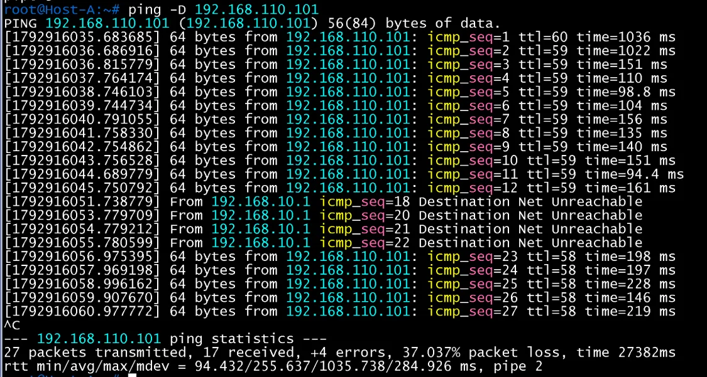 | 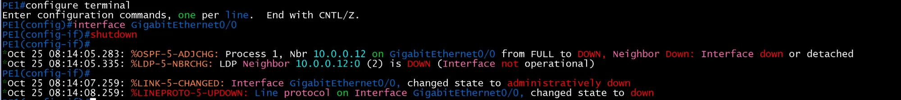 | 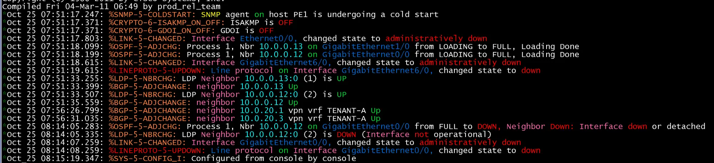 |

- 2회차(같은 날 08:19 UTC)는 BGP 세션 리셋을 동반해 약 47.5초 단절. 시간축, 라벨 [16, 23] 캡처, SPF 타이머(Initial 5000 ms)는 [06-mp-bgp-vpnv4.md](06-mp-bgp-vpnv4.md)의 장애 시험 결과 참고
- 남은 항목: 복구(`no shutdown`) 시험

## 증빙

`show ip ospf neighbor`, `show ip route ospf` 출력

### PE1

- 이웃 PE3(10.0.0.13, Gi1/0), PE2(10.0.0.12, Gi0/0) 2개가 **FULL/ -** (point-to-point), Dead Time 00:00:03(Dead 4초 설정과 일치)
- PE2 loopback 10.0.0.12/32는 Gi0/0, PE3 loopback 10.0.0.13/32는 Gi1/0 직결로 학습
- PE2 - PE3 링크 10.0.10.4/31은 두 경로(cost 2)로 학습

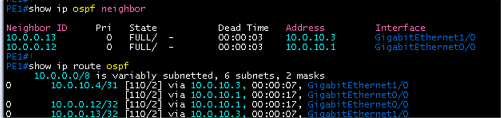

### PE2

- 이웃 PE3(Gi1/0), PE1(Gi0/0) 2개가 FULL/ -
- 10.0.0.11/32는 Gi0/0, 10.0.0.13/32는 Gi1/0, PE1 - PE3 링크 10.0.10.2/31은 두 경로

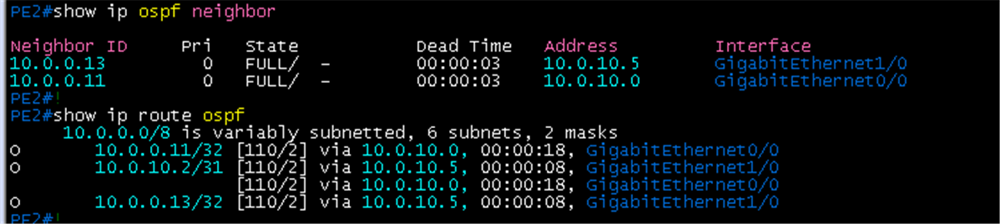

### PE3

- 이웃 PE2(Gi1/0), PE1(Gi0/0) 2개가 FULL/ -
- 10.0.0.11/32는 Gi0/0, 10.0.0.12/32는 Gi1/0, PE1 - PE2 링크 10.0.10.0/31은 두 경로

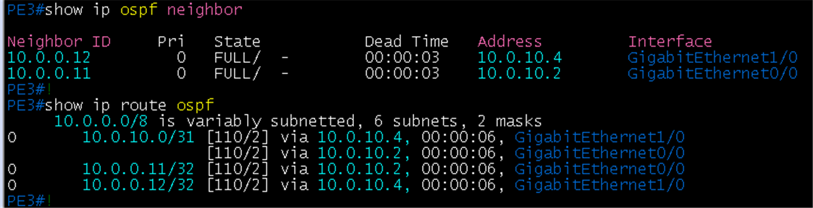

### OSPF 인터페이스 (`show ip ospf interface`)

- 세 장비 모두 Loopback0: Network Type **LOOPBACK**, Cost 1, router-id가 loopback0 주소(PE1 10.0.0.11, PE2 10.0.0.12, PE3 10.0.0.13), `Enabled by interface config`
- Gi0/0과 Gi1/0: Network Type **POINT_TO_POINT**, Cost 1, Timer **Hello 1, Dead 4**, Neighbor Count 1, Adjacent (Gi0/0과 Gi1/0 각각 상대 PE)
- PE1 Gi0/0은 PE2(10.0.0.12), PE2 Gi0/0은 PE1(10.0.0.11), PE3 Gi0/0은 PE1(10.0.0.11)과 Adjacent

Gi1/0

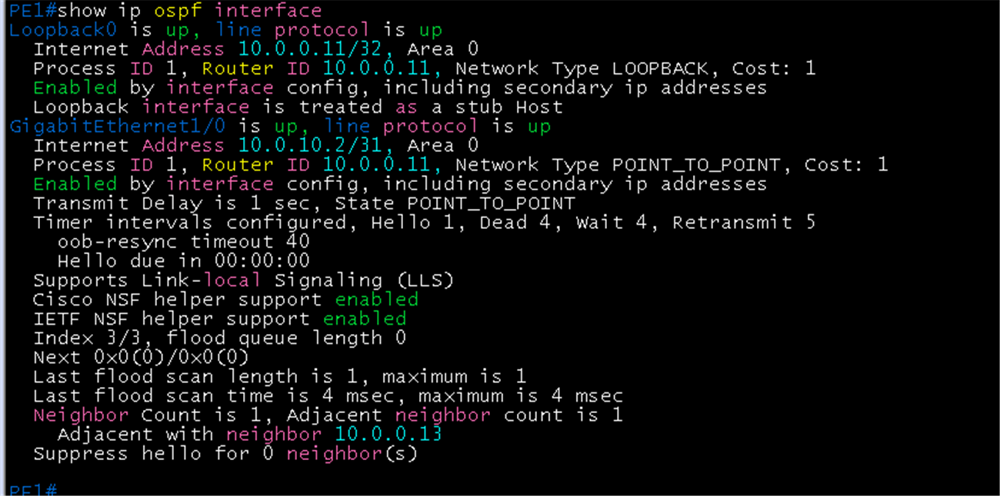

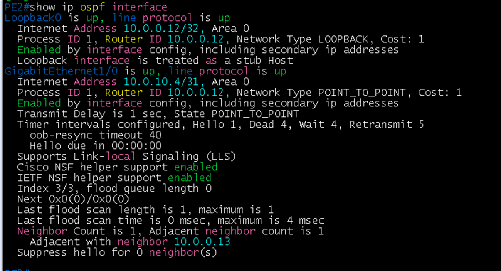

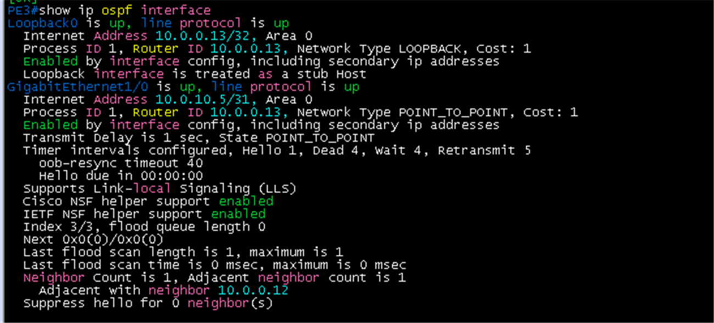

Gi0/0 (`show ip ospf interface gigabitethernet 0/0`)

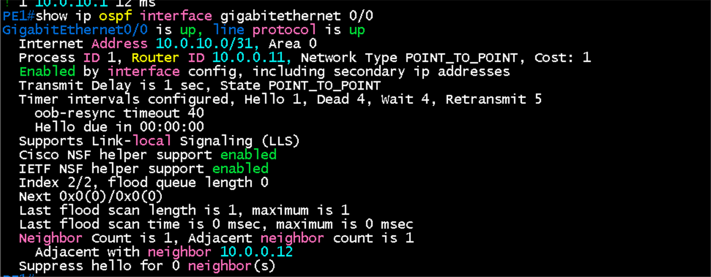

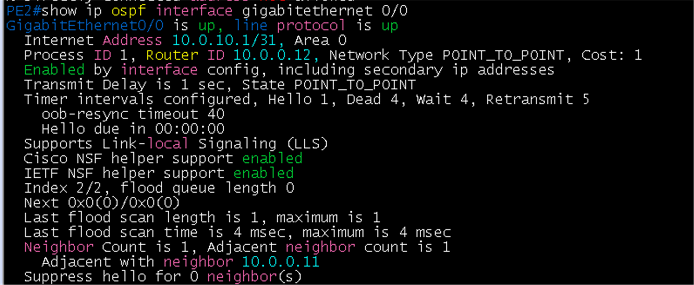

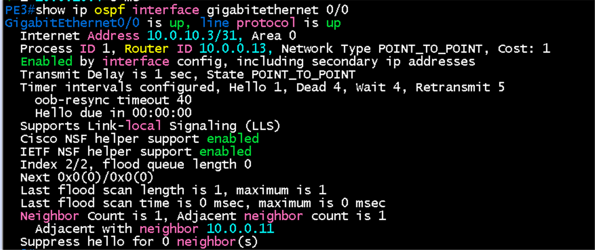

### OSPF 프로토콜 (`show ip protocols`)

- Router ID가 loopback0 주소와 같음, Maximum path 4
- `Routing on Interfaces Configured Explicitly (Area 0)`: Loopback0, Gi1/0, Gi0/0 (인터페이스 방식으로 area 0 지정)
- `Passive Interface(s)`: **Loopback0** 하나만
- Routing Information Sources에 다른 두 PE의 router-id가 보임

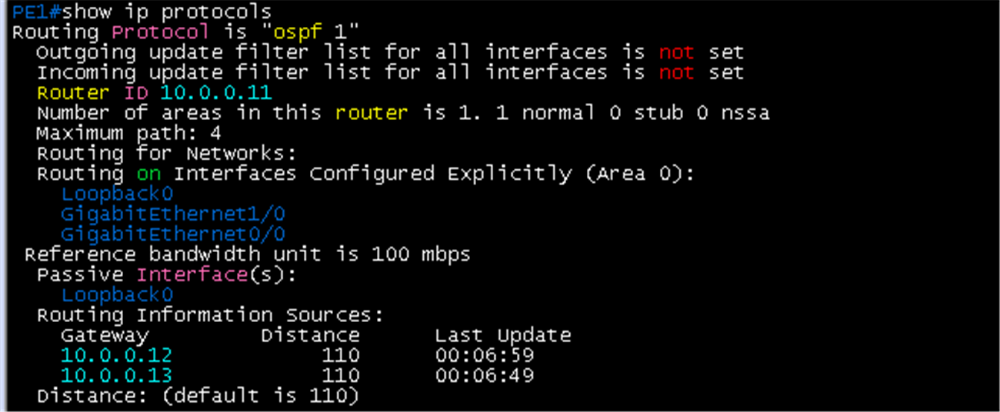

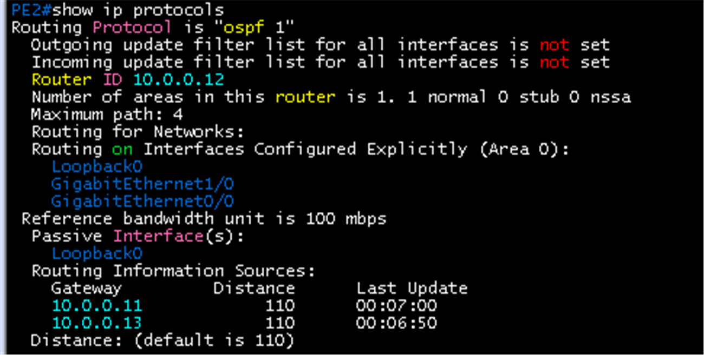

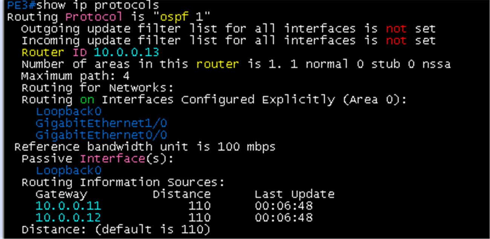

### loopback ping

- PE1에서 `ping 10.0.0.12 source loopback 0`: 5/5, 4/25/36 ms
- PE2에서 `ping 10.0.0.11 source loopback 0`: 5/5, 8/33/64 ms
- PE3에서 `ping 10.0.0.12 source loopback 0`: 5/5, 12/44/64 ms (두 번째 실행 4/39/64 ms)

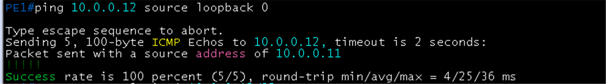

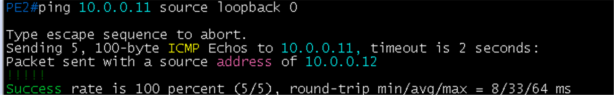

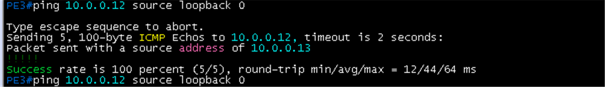

## 패킷 캡처 (Wireshark)

계획표: [08-wireshark-capture.md](../../00-overview/08-wireshark-capture.md). 링크 한 개만 캡처하고, 표시 필터로 패킷 한두 개의 상세 창이 보이게 잘라 images/에 저장. 캡처한 동작(어떤 명령으로 일으켰는지)을 설명에 남김

| 확인할 동작 | 캡처 링크 (GNS3 Start capture) | 일으킬 동작 | 표시 필터 | 볼 것 | 상태 |
|---|---|---|---|---|---|
| OSPF hello | PE1 `Gi0/0` - PE2 `Gi0/0` | PE2 Gi0/0을 shutdown 후 no shutdown (이웃 형성 과정 포함) | `ospf.msg.hello`, 전체는 `ospf` | Source Router 10.0.0.11, Hello Interval **1**, Dead Interval **4**, Network Mask /31, Active Neighbor 목록. 이웃 형성 순서는 Hello, DB Description, LS Request, LS Update | 캡처 완료 (아래) |

### 캡처 결과: OSPF Hello

- 링크 PE1 `Gi0/0` - PE2 `Gi0/0`, 패킷 21(PE2가 보낸 Hello). Src 10.0.10.1, Dst **224.0.0.5**(OSPF 멀티캐스트)
- OSPF Header: Version 2, Message Type Hello, Source OSPF Router **10.0.0.12**, Area ID **0.0.0.0**, Auth Type Null
- Hello Packet: Network Mask **255.255.255.254**(/31), Hello Interval **1**, Router Dead Interval **4**, Router Priority 1, **Designated Router 0.0.0.0**(point-to-point라 DR 없음), Active Neighbor **10.0.0.11**(PE1)
- LLS Data Block이 붙어 있음 (Cisco 확장)

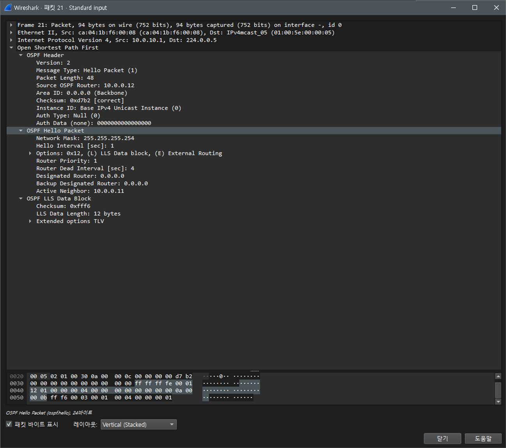

## 결과 기록

| 일시 | 장비 | 결과 (성공, 실패) | 비고 |
|---|---|---|---|
| 2026-10-22 | PE1 | 성공 | 항목 1 ~ 6 모두 완료 |
| 2026-10-22 | PE2 | 성공 | 항목 1 ~ 6 모두 완료 (ping은 PE1 대상) |
| 2026-10-22 | PE3 | 성공 | 항목 1 ~ 6 모두 완료 |