# MPLS와 LDP 검증

**선행 조건**: [OSPF 검증](03-ospf.md)이 끝나 있고 [MPLS와 LDP 샘플](../../samples/core/04-mpls-ldp.md)이 PE1~PE3에 적용되어 있어야 함

기준 문서: [04-mpls-ldp.md](../../baseline/core/04-mpls-ldp.md) / 샘플: [04-mpls-ldp.md](../../samples/core/04-mpls-ldp.md)

## 확인 항목

| 순서 | 장비 | 명령 | 기대 결과 | 안 될 때 확인 |
|---|---|---|---|---|
| 1 | PE1~PE3 | `show mpls interfaces` | Gi0/0, Gi1/0의 LDP가 **Yes**. VRF 인터페이스(Gi2/0 ~ 5/0)는 없음 | 인터페이스의 `mpls ip` |
| 2 | PE1~PE3 | `show mpls ldp neighbor` | 이웃 2개가 **Oper** 상태, 이웃 주소가 loopback0(10.0.0.x) | OSPF FULL, loopback0 도달성, `mpls ldp router-id loopback 0 force` |
| 3 | PE1 | `show mpls ldp discovery` | 코어 링크 2개에서 Hello 수신 | 링크, `mpls ip` |
| 4 | PE1 | `show mpls ldp bindings` | PE2, PE3 loopback0 prefix에 local, remote 레이블이 있음 | LDP 세션 |
| 5 | PE1 | `show mpls forwarding-table` | 10.0.0.12/32, 10.0.0.13/32의 Outgoing Label이 `Pop Label`(PHP), 직결 링크로 나감 | LDP, IGP 경로 |
| 6 | PE1 | `ping 10.0.0.12 source loopback 0` | 응답 | 라우팅 |
| 7 | PE1 | `traceroute mpls ipv4 10.0.0.12/32` | 레이블 경로가 PE2까지 이어짐 | LDP 바인딩 |

## 증빙

`show mpls interfaces`, `show mpls ldp neighbor`, `show mpls forwarding-table` 출력

### PE1

- Gi0/0, Gi1/0의 LDP가 **Yes**, Operational **Yes**. VRF 인터페이스는 없음
- 이웃 10.0.0.12(PE2), 10.0.0.13(PE3)가 **Oper**, Local LDP Ident 10.0.0.11:0, TCP 646 세션이 loopback0 주소끼리 연결
- 전달 테이블: 10.0.0.12/32는 Gi0/0, 10.0.0.13/32는 Gi1/0으로 **Pop Label**(PHP)

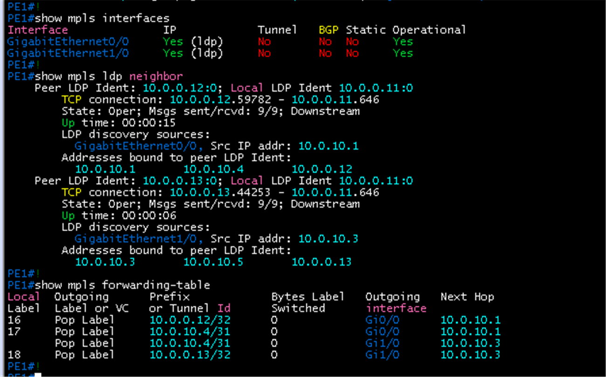

### PE2

- Gi0/0, Gi1/0 LDP Yes, 이웃 10.0.0.11, 10.0.0.13 Oper (Local LDP Ident 10.0.0.12:0)
- 전달 테이블: 10.0.0.11/32는 Gi0/0, 10.0.0.13/32는 Gi1/0으로 Pop Label

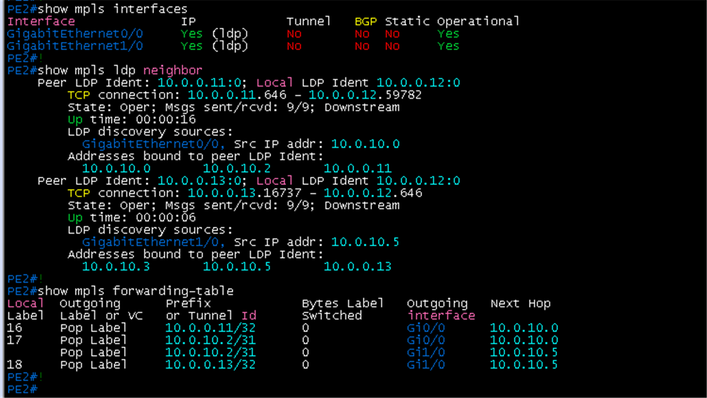

### PE3

- Gi0/0, Gi1/0 LDP Yes, 이웃 10.0.0.11, 10.0.0.12 Oper (Local LDP Ident 10.0.0.13:0)
- 전달 테이블: 10.0.0.12/32는 Gi1/0, 10.0.0.11/32는 Gi0/0으로 Pop Label

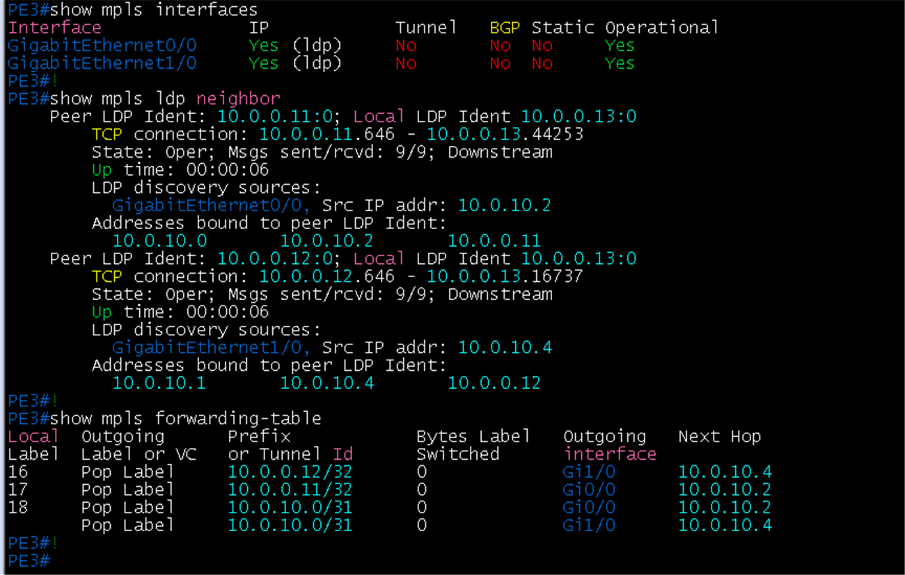

### LDP discovery (`show mpls ldp discovery`)

- 세 장비 모두 Gi0/0, Gi1/0이 `(ldp): xmit/recv`(Hello를 보내고 받음)
- 각 인터페이스 아래 상대의 LDP Id가 loopback0 주소로 표시: PE1은 10.0.0.12(Gi0/0), 10.0.0.13(Gi1/0), PE2는 10.0.0.11(Gi0/0), 10.0.0.13(Gi1/0), PE3은 10.0.0.11(Gi0/0), 10.0.0.12(Gi1/0)

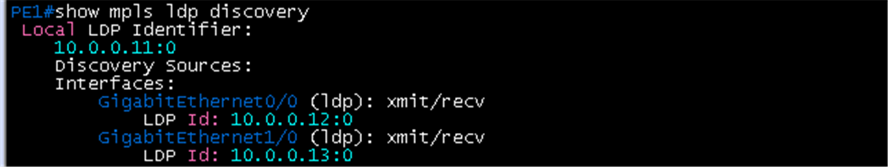

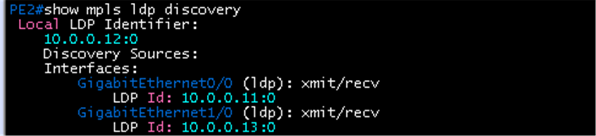

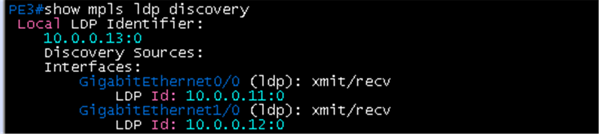

### LDP bindings (`show mpls ldp bindings`)

- 자기 loopback의 local binding은 **imp-null**, 상대가 광고한 자기 loopback의 remote binding도 상대 쪽에서 imp-null(PHP)
- 다른 PE loopback의 local label이 `show mpls forwarding-table`의 Local Label과 같음 (PE1: 10.0.0.12/32 레이블 16, 10.0.0.13/32 레이블 18)
- 링크 prefix(10.0.10.0/31 등)도 binding이 있음

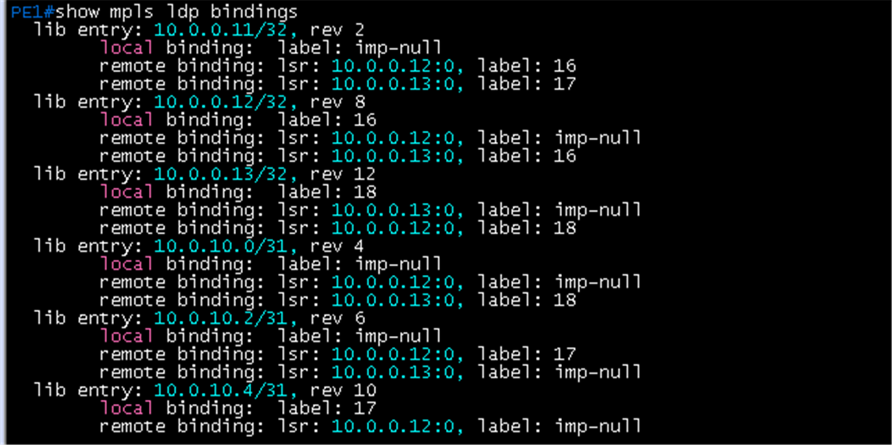

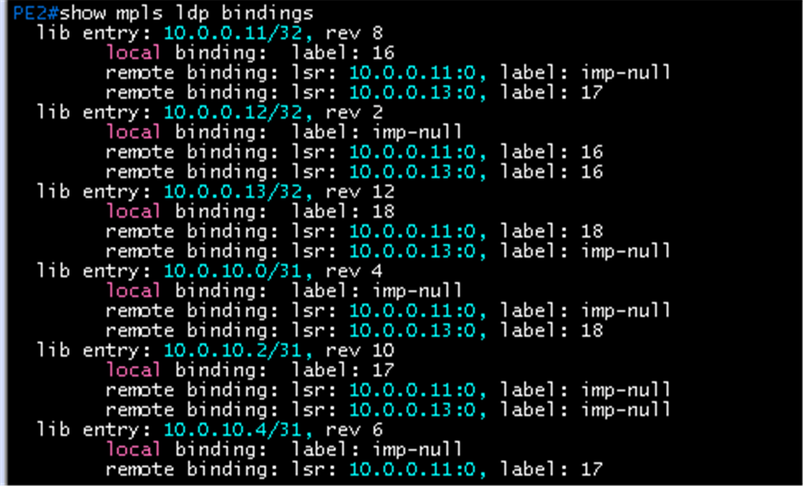

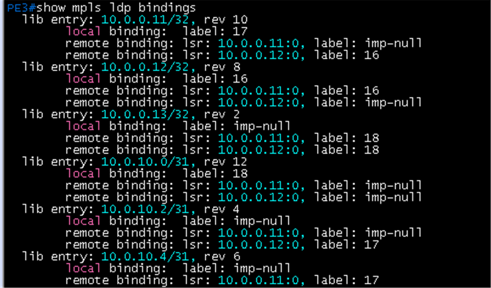

### MPLS traceroute

- PE1에서 `traceroute mpls ipv4 10.0.0.12/32`: hop 0 10.0.10.0 `[Labels: implicit-null Exp: 0]`, hop 1 10.0.10.1(PE2) 12 ms
- PE2에서 `traceroute mpls ipv4 10.0.0.11/32`: hop 0 10.0.10.1 `[Labels: implicit-null Exp: 0]`, hop 1 10.0.10.0(PE1) 12 ms
- PE3에서 `traceroute mpls ipv4 10.0.0.12/32`: hop 0 10.0.10.5 `[Labels: implicit-null Exp: 0]`, hop 1 10.0.10.4(PE2) 8 ms
- 바깥 레이블이 implicit-null이라 PHP가 적용됨. 자기 주소를 대상으로 하면 `% Directly connected address not allowed`가 나오므로 다른 PE를 대상으로 실행

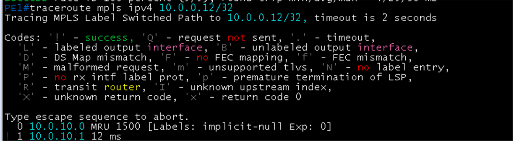

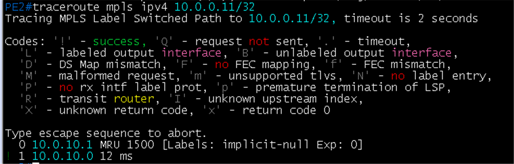

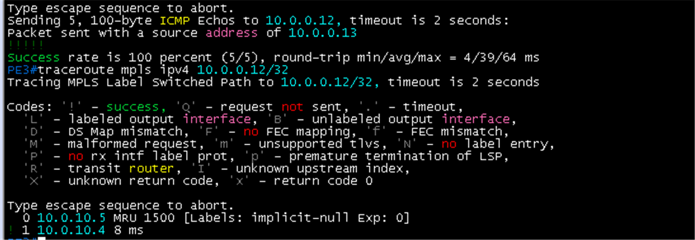

## 패킷 캡처 (Wireshark)

계획표: [08-wireshark-capture.md](../../00-overview/08-wireshark-capture.md). 링크 한 개만 캡처하고, 표시 필터로 패킷 한두 개의 상세 창이 보이게 잘라 images/에 저장. 캡처한 동작(어떤 명령으로 일으켰는지)을 설명에 남김

| 확인할 동작 | 캡처 링크 (GNS3 Start capture) | 일으킬 동작 | 표시 필터 | 볼 것 | 상태 |
|---|---|---|---|---|---|
| LDP 세션 | PE1 `Gi0/0` - PE2 `Gi0/0` | `clear mpls ldp neighbor *` | `ldp` | Hello(UDP 646), 이후 TCP 646 세션, Initialization, Label Mapping(10.0.0.x/32) | 캡처 완료 (Hello, Initialization, Label Mapping) |
| MPLS 라벨 스택 | PE1 `Gi0/0` - PE2 `Gi0/0` | DC1과 DC2 호스트 사이 ping (Host D에서 Host A, DC2 eBGP 구성 뒤) | `mpls` | 직결 링크라 PHP로 바깥 전송 라벨은 이미 제거되어 **VPN 라벨 1개**만 보임(TC 값 포함). 라벨 2개(전송 + VPN)는 직결 링크가 끊겨 PE3를 거치는 우회 경로에서만 보이므로 장애 시험 때 캡처 | 캡처 완료 (VPN 라벨 1개). 우회 시 라벨 2개 [16, 23]은 [06-mp-bgp-vpnv4.md](06-mp-bgp-vpnv4.md)의 장애 시험 결과(프레임 1733)에 기록. 패킷 상세:  |

### 캡처 결과: LDP Hello

- 링크 PE1 `Gi0/0` - PE2 `Gi0/0`, 패킷 19. Src 10.0.10.1, Dst **224.0.0.2**(all routers 멀티캐스트), **UDP Src와 Dst 포트 646**
- LDP: Version 1, LSR ID **10.0.0.12**(LDP router-id), Label Space ID 0, Hello Message
- Common Hello Parameters: **Hold Time 15**(링크 Hello 기본값), Targeted Hello는 `Link Hello`(직결 링크)
- IPv4 Transport Address **10.0.0.12**: 이후 TCP 646 세션의 주소가 loopback0임을 확인(`mpls ldp router-id loopback 0 force`의 효과)
- 이 화면은 UDP Hello 단계이며, TCP 646 세션과 Label Mapping은 별도 캡처 필요(`clear mpls ldp neighbor *` 직후)

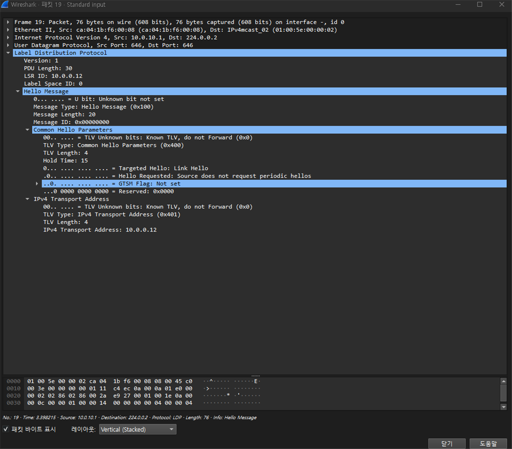

### 캡처 결과: LDP Initialization과 Label Mapping (clear mpls ldp neighbor * 직후)

- **Initialization Message**(패킷 5284): TCP 출발 51137, 목적 **646**, Src **10.0.0.12**, Dst **10.0.0.11**. loopback0끼리 TCP 세션을 맺음(transport address가 큰 쪽인 PE2가 먼저 연결). LSR ID 10.0.0.12, Session Protocol Version 1, **Session KeepAlive Time 180**, Label Advertisement Discipline **Downstream Unsolicited**, Loop Detection Disabled, Receiver LSR Identifier 10.0.0.11
- **Label Mapping**(패킷 5287, 같은 TCP 세션): Keep Alive Message 1개, **Address Message**(10.0.10.1, 10.0.10.4, 10.0.0.12: PE2가 가진 인터페이스 주소), 이어서 **Label Mapping Message 6개**. 펼친 마지막 항목은 FEC element와 **Generic Label 18**. show mpls ldp bindings에서 PE2의 10.0.0.13/32 local label이 18이었던 것과 맞음(FEC element를 펼치면 prefix까지 확인 가능)
- 즉 순서는 Hello(UDP 646, 224.0.0.2) -> Initialization(TCP 646) -> Keep Alive와 Address -> Label Mapping
- LDP 타이머는 기본값(링크 Hello hold 15초, 세션 KeepAlive 180초)이며 별도로 줄이지 않음. 링크 장애 감지는 인터페이스 down과 IGP가 담당

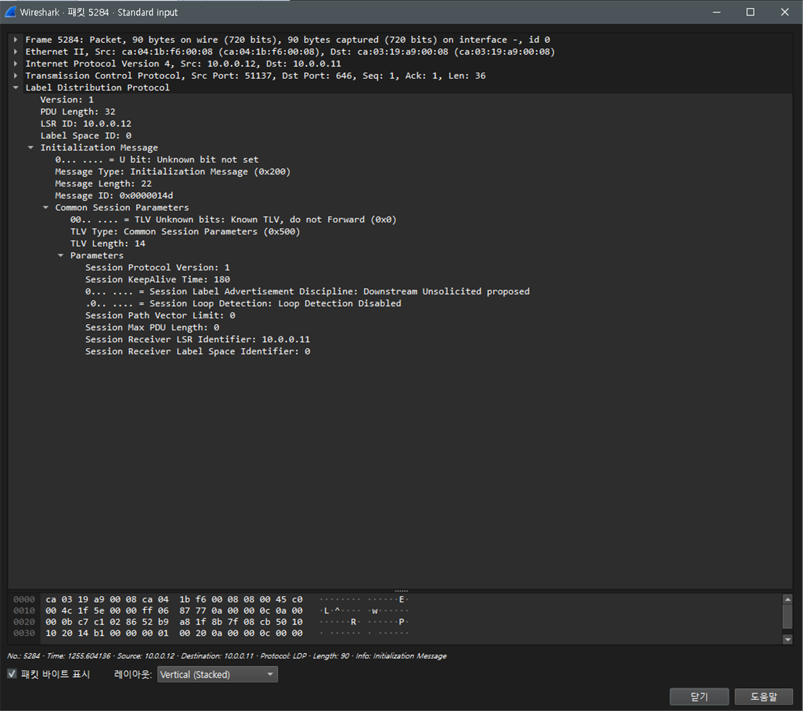

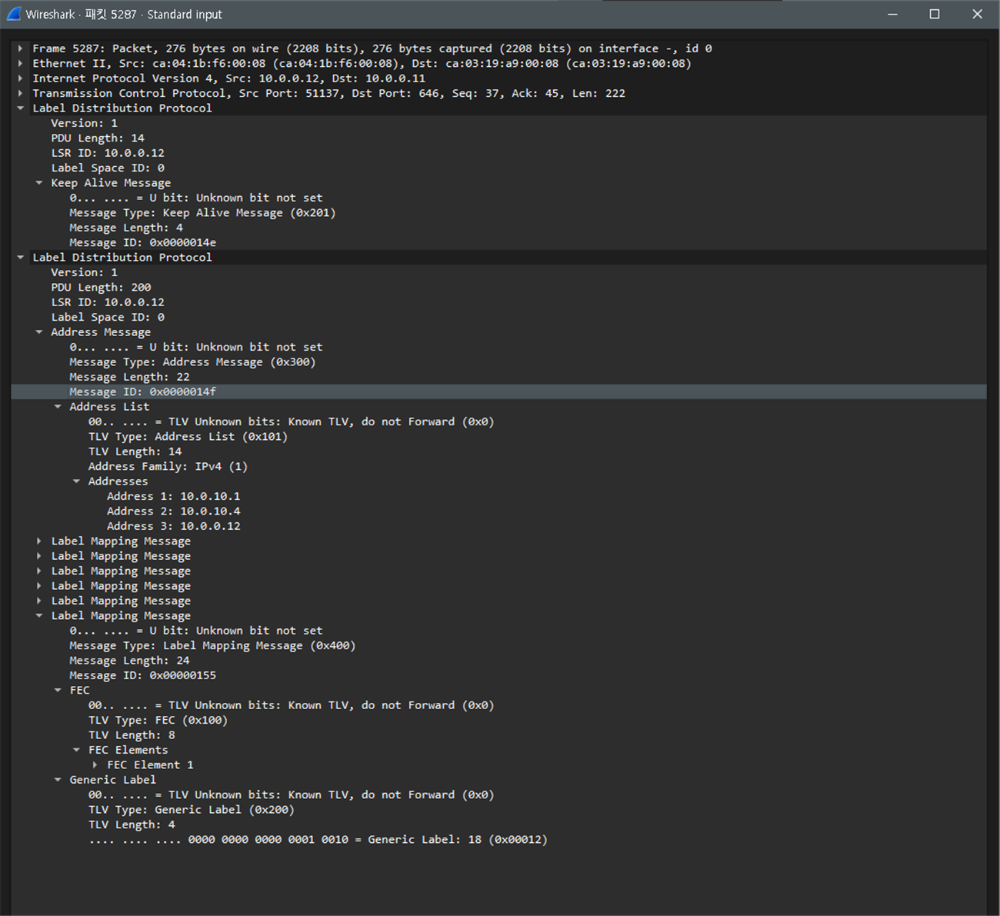

### 캡처 결과: MPLS 라벨 스택 (Host D에서 Host A로 ping)

- 링크 PE1 `Gi0/0` - PE2 `Gi0/0`, 필터 `mpls`, 동작은 Host D `ping -c 3 192.168.10.101`. 요청 3개와 응답 3개(패킷 36~48)가 모두 MPLS로 잡힘
- 패킷 36(Echo request, Host D 192.168.110.101 → Host A 192.168.10.101): Ethernet Src `ca:04:1b:f6:00:08`(PE2 Gi0/0), Dst `ca:03:19:a9:00:08`(PE1 Gi0/0), 그 위에 **MultiProtocol Label Switching Header 하나**: **Label 23, Exp 0, S 1, TTL 62**
- **S 비트가 1**이라 이 라벨이 스택의 맨 아래(VPN 라벨)이고, 라벨이 하나뿐임. PE1과 PE2 사이는 직결 링크라 PHP로 전송 라벨이 이미 제거되어 있음
- MPLS TTL 62는 IP TTL(요청 62)과 같음. Host D(64)에서 CX1(63), PE2(62)로 내려오는 값이 그대로 복사됨 (uniform 모델)
- Exp 0: QoS 단계([QoS](08-qos.md)) 적용 전이라 TC 값이 기본 0. QoS 뒤에는 이 값이 바뀌는지 확인
- 이 라벨 23은 PE1의 `show bgp vpnv4 unicast all labels`에서 **192.168.10.101/32**(Host A 호스트 경로, next-hop leaf3·leaf4)의 In label **23**과 일치. 즉 PE1이 이 경로에 붙여 PE2에 광고한 VPN 라벨이고, PE2가 이 라벨을 붙여 PE1로 보낸 것
- 같은 출력의 다른 경로: 192.168.10.0은 20, 192.168.20.0은 19, 10.0.20.0/31은 21, 10.0.20.2/31은 22(In label). 192.168.110.0은 `nolabel/20`(PE2가 광고한 out label 20), 10.0.20.4/31은 `nolabel/19`, 10.0.20.6/31은 `nolabel/21`

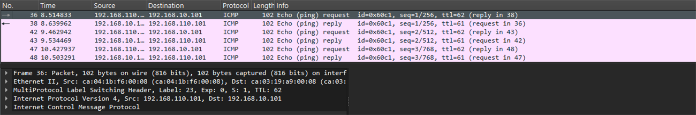

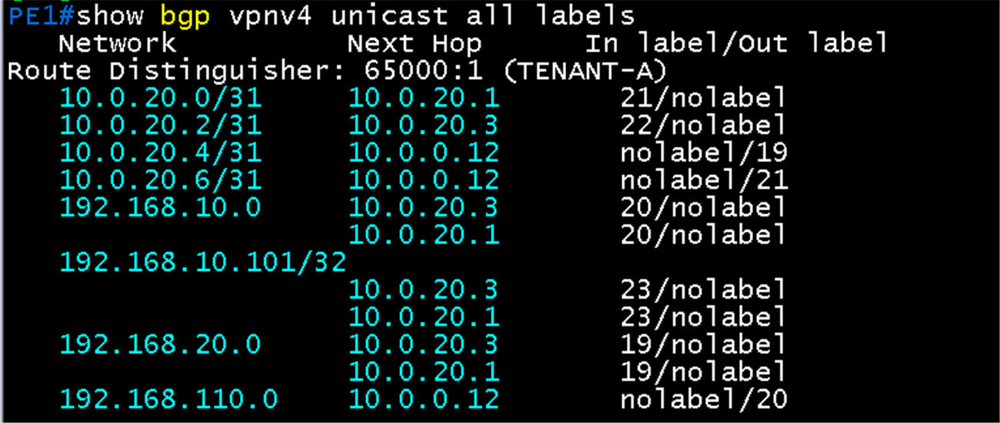

## 결과 기록

| 일시 | 장비 | 결과 (성공, 실패) | 비고 |
|---|---|---|---|
| 2026-10-22 | PE1 | 성공 | 항목 1 ~ 7 모두 완료 (6 ping은 [OSPF 검증](03-ospf.md)) |
| 2026-10-22 | PE2 | 성공 | 항목 1 ~ 7 모두 완료 (traceroute는 PE1 대상) |
| 2026-10-22 | PE3 | 성공 | 항목 1 ~ 7 모두 완료 |