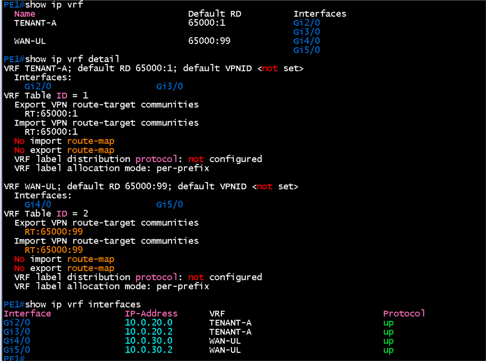
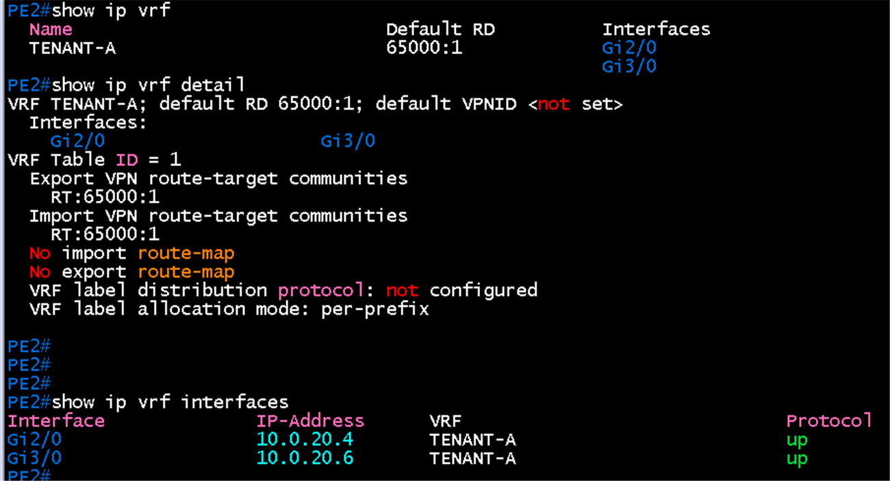
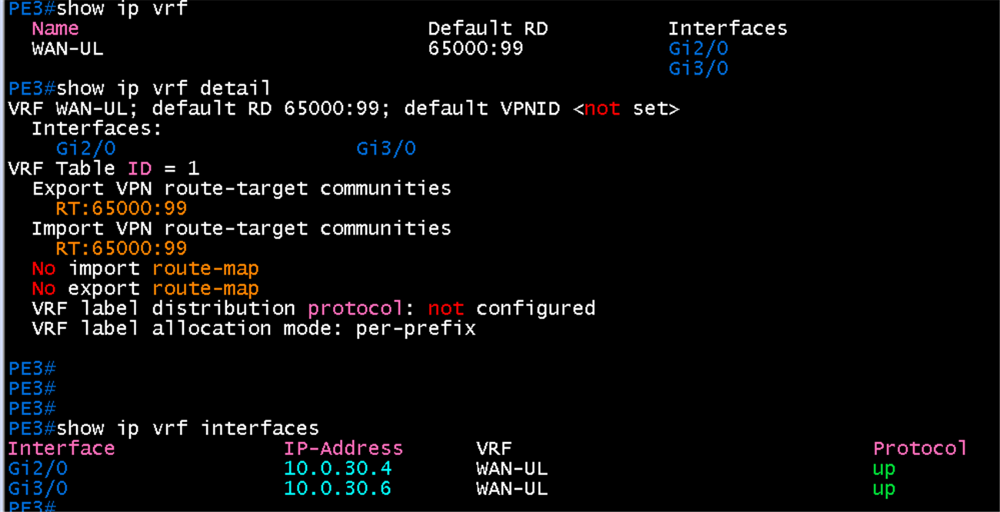

# VRF 검증

**선행 조건**: [인터페이스 IP 검증](02-interface-ip.md)이 끝나 있고 [VRF 샘플](../../samples/core/05-vrf.md)이 적용되어 있어야 함

기준 문서: [05-vrf.md](../../baseline/core/05-vrf.md) / 샘플: [05-vrf.md](../../samples/core/05-vrf.md)

## 확인 항목

| 순서 | 장비 | 명령 | 기대 결과 | 안 될 때 확인 |
|---|---|---|---|---|
| 1 | PE1 | `show ip vrf` | TENANT-A(RD 65000:1), WAN-UL(RD 65000:99)과 소속 인터페이스(Gi2/0, Gi3/0, Gi4/0, Gi5/0) | `rd` 입력, `ip vrf forwarding` |
| 2 | PE2 | `show ip vrf` | TENANT-A(RD 65000:1)만, Gi2/0, Gi3/0 소속 | 같은 점검 |
| 3 | PE3 | `show ip vrf` | WAN-UL(RD 65000:99)만, Gi2/0, Gi3/0 소속 | 같은 점검 |
| 4 | PE1~PE3 | `show ip vrf detail` | Export, Import route-target이 TENANT-A는 65000:1, WAN-UL은 65000:99 | `route-target both` |
| 5 | PE1~PE3 | `show ip vrf interfaces` | VRF 링크의 IP와 VRF 이름, Protocol up | [인터페이스 IP 검증](02-interface-ip.md) |

## 증빙

`show ip vrf`, `show ip vrf detail`, `show ip vrf interfaces` 출력

### PE1

- TENANT-A: RD **65000:1**, Gi2/0, Gi3/0 소속, Export와 Import RT 65000:1
- WAN-UL: RD **65000:99**, Gi4/0, Gi5/0 소속, Export와 Import RT 65000:99
- VRF Table ID 1, 2. `show ip vrf interfaces`에서 4개 인터페이스의 IP(10.0.20.0, 10.0.20.2, 10.0.30.0, 10.0.30.2)와 VRF 이름, Protocol up

### PE2

- TENANT-A만 정의: RD 65000:1, Gi2/0, Gi3/0 소속, Export와 Import RT 65000:1
- Gi2/0 10.0.20.4, Gi3/0 10.0.20.6, Protocol up

### PE3

- WAN-UL만 정의: RD 65000:99, Gi2/0, Gi3/0 소속, Export와 Import RT 65000:99
- Gi2/0 10.0.30.4, Gi3/0 10.0.30.6, Protocol up

## 결과 기록

| 일시 | 장비 | 결과 (성공, 실패) | 비고 |
|---|---|---|---|
| 2026-10-22 | PE1 | 성공 | 항목 1, 4, 5 완료. TENANT-A, WAN-UL의 RD와 RT가 설계값과 일치 |
| 2026-10-22 | PE2 | 성공 | 항목 2, 4, 5 완료. TENANT-A만 있음 |
| 2026-10-22 | PE3 | 성공 | 항목 3, 4, 5 완료. WAN-UL만 있음 |