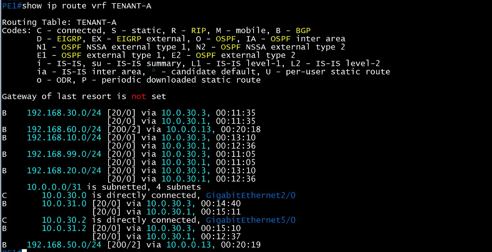
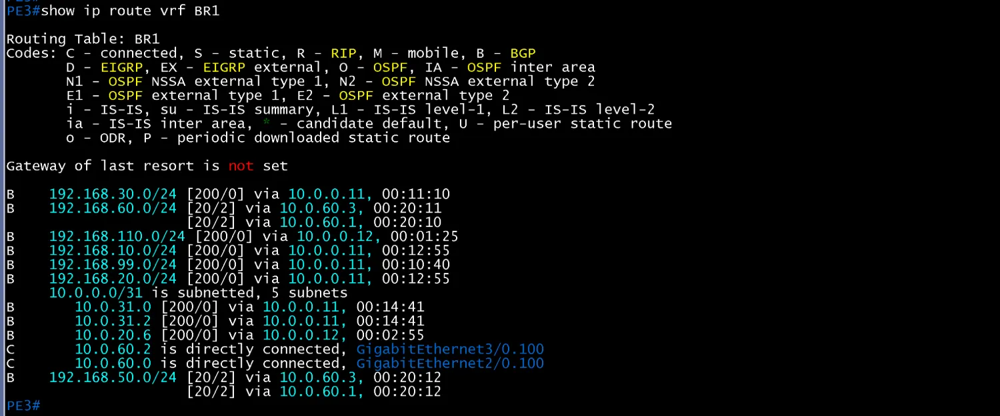

# VRF 검증

**선행 조건**: [인터페이스 IP 검증](02-interface-ip.md)이 끝나 있고 [VRF 샘플](../../samples/core/05-vrf.md)이 적용되어 있어야 함

기준 문서: [05-vrf.md](../../baseline/core/05-vrf.md) / 샘플: [05-vrf.md](../../samples/core/05-vrf.md)

## 확인 항목

| 순서 | 장비 | 명령 | 기대 결과 | 안 될 때 확인 |
|---|---|---|---|---|
| 1 | PE1 | `show ip vrf` | TENANT-A(RD 65000:1)와 소속 인터페이스(Gi2/0, Gi5/0) | `rd` 입력, `ip vrf forwarding` |
| 2 | PE2 | `show ip vrf` | PARTNER(RD 65000:2)와 Gi2/0, Gi3/0 소속 | 같은 점검 |
| 3 | PE3 | `show ip vrf` | BR1(RD 65000:3)과 Gi2/0.100, Gi3/0.100 소속 | 같은 점검 |
| 4 | PE1~PE3 | `show ip vrf detail` | Export RT는 TENANT-A 65000:1, PARTNER 65000:2, BR1 65000:3. Import RT는 TENANT-A가 65000:1과 65000:3, PARTNER가 65000:2와 65000:3, BR1이 65000:1, 65000:2, 65000:3 | `route-target export`, `route-target import` |
| 5 | PE1~PE3 | `show ip vrf interfaces` | VRF 링크의 IP와 VRF 이름, Protocol up | [인터페이스 IP 검증](02-interface-ip.md) |

## 증빙

이전 구성(VRF WAN-UL 포함)에서 찍은 화면은 삭제함. 최종 구성(TENANT-A, PARTNER, BR1)의 `show ip vrf`, `show ip vrf detail` 화면은 추가해야 함

PE1에서 확인한 최종 구성 동작(2026-11-07): `show bgp vpnv4 unicast all labels`에 RD 65000:1(TENANT-A)과 RD 65000:3(BR1)이 함께 보이고 192.168.50.0/24, 192.168.60.0/24가 두 RD에 같은 레이블 26, 27로 들어 있음. BR1 경로를 TENANT-A가 import한다는 증거

## 결과 기록

| 일시 | 장비 | 결과 (성공, 실패) | 비고 |
|---|---|---|---|
| 2026-10-22 | PE1 | 성공 | 항목 1, 4, 5 완료. TENANT-A, WAN-UL의 RD와 RT가 설계값과 일치 |
| 2026-10-22 | PE2 | 성공 | 항목 2, 4, 5 완료. TENANT-A만 있음 |
| 2026-10-22 | PE3 | 성공 | 항목 3, 4, 5 완료. WAN-UL만 있음 |

## 2026-11-14 새 DC1 대역 확인

- PE1 `show ip route vrf TENANT-A`: 192.168.10·20·30·99.0/24가 Hub1·Hub2 next hop(10.0.30.1, 10.0.30.3)으로 보임. 192.168.110.0/24(DC2)는 없음
- PE3 `show ip route vrf BR1`: 같은 DC1 대역 4개가 PE1(10.0.0.11)에서 도착. 192.168.110.0/24는 PE2(10.0.0.12)에서 도착
- PE3 BR1 VRF에 접속 링크 대역 10.0.20.6(PE2–CX2)이 PE2에서 온 경로로 보였음. 서비스 대역은 아니지만 BR1에 접속 링크 대역이 노출되는 점은 확인만 하고 필터링하지 않음

