# MP-BGP VPNv4 검증

**선행 조건**: [MPLS와 LDP 검증](04-mpls-ldp.md), [VRF 검증](05-vrf.md)이 끝나 있고 [VPNv4 샘플](../../samples/core/06-mp-bgp-vpnv4.md)이 적용되어 있어야 함

기준 문서: [06-mp-bgp-vpnv4.md](../../baseline/core/06-mp-bgp-vpnv4.md) / 샘플: [06-mp-bgp-vpnv4.md](../../samples/core/06-mp-bgp-vpnv4.md)

## 확인 항목

| 순서 | 장비 | 명령 | 기대 결과 | 안 될 때 확인 |
|---|---|---|---|---|
| 1 | PE1~PE3 | `show bgp vpnv4 unicast all summary` | 이웃 2개가 **Established**, router-id가 10.0.1.x | loopback0 도달성, `update-source loopback 0`, `send-community extended` |
| 2 | PE1~PE3 | `show bgp vpnv4 unicast all neighbors <상대 loopback0> \| include hold` | `Hold time is 9`, `keepalive interval is 3 seconds` | `neighbor ... timers 3 9` (양쪽 같은 값) |
| 3 | PE1 | `show bgp vpnv4 unicast all` | 다른 PE의 VRF 경로가 RT와 함께 보임 (PE-CE 구성 뒤) | RT import/export |

## 증빙

`show bgp vpnv4 unicast all summary`, `show bgp vpnv4 unicast all neighbors <상대 loopback0> | include hold` 출력

### PE1

- router identifier **10.0.1.11**, local AS 65000
- 이웃 10.0.0.12(PE2), 10.0.0.13(PE3) 모두 AS 65000(iBGP), State/PfxRcd가 숫자(0)라 **Established**. PE-CE 경로가 아직 없어 받은 prefix는 0
- 이웃 10.0.0.12의 hold time **9**, keepalive interval **3**초 (Configured도 같은 값)

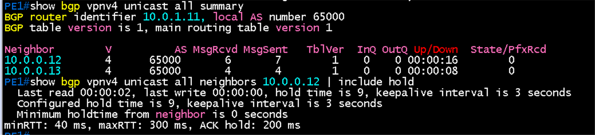

### PE2

- router identifier **10.0.1.12**, 이웃 10.0.0.11, 10.0.0.13 Established, PfxRcd 0
- hold 확인은 이웃이 아닌 자기 주소(10.0.0.12)로 실행되어 결과가 없음. PE1, PE3 쪽에서 확인한 값으로 대체하고, PE2는 `neighbors 10.0.0.11 | include hold`로 다시 확인 가능

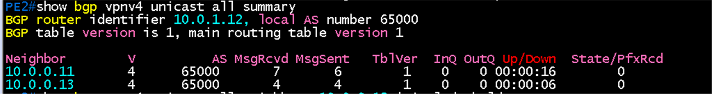

### PE3

- router identifier **10.0.1.13**, 이웃 10.0.0.11, 10.0.0.12 Established, PfxRcd 0
- 이웃 10.0.0.12의 hold time 9, keepalive interval 3초 (Configured도 같은 값)

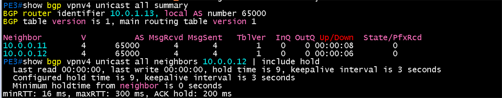

### VPNv4 경로 전달 (PE-CE 구성 뒤)

- PE2에서 show ip route vrf TENANT-A: 192.168.10.0/24, 192.168.20.0/24가 **B [200/0] via 10.0.0.11**(PE1 loopback0), iBGP VPNv4로 학습 (DC1 경로가 코어를 통해 전달됨)
- PE1과 leaf를 잇는 링크 서브넷 10.0.20.0/31, 10.0.20.2/31도 같은 방식으로 학습됨. leaf의 
edistribute connected가 링크 /31까지 광고하기 때문이며 동작에는 문제없음
- PE2 자신의 CX 링크 10.0.20.4, 10.0.20.6은 직결(C)

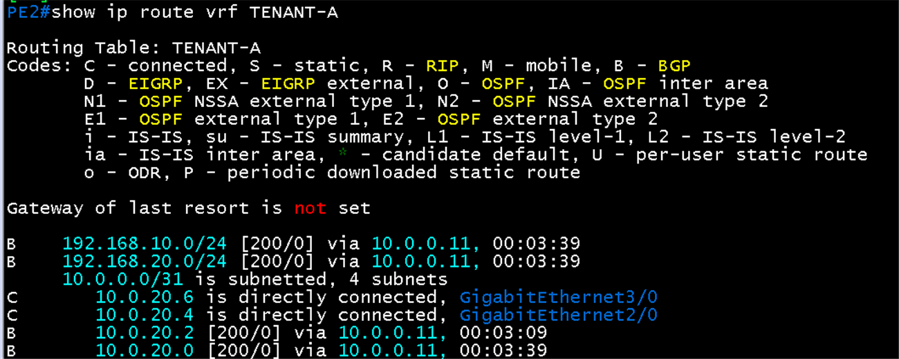

## 패킷 캡처 (Wireshark)

계획표: [08-wireshark-capture.md](../../00-overview/08-wireshark-capture.md). 링크 한 개만 캡처하고, 표시 필터로 패킷 한두 개의 상세 창이 보이게 잘라 images/에 저장. 캡처한 동작(어떤 명령으로 일으켰는지)을 설명에 남김

| 확인할 동작 | 캡처 링크 (GNS3 Start capture) | 일으킬 동작 | 표시 필터 | 볼 것 | 상태 |
|---|---|---|---|---|---|
| VPNv4 iBGP 세션 | PE1 `Gi0/0` - PE2 `Gi0/0` | `clear ip bgp vpnv4 unicast *` (문법은 `?`로 확인) | `bgp` | OPEN: AS 65000, Hold Time **9**, BGP Identifier **10.0.1.11**(OSPF router-id와 다름), Capability에 AFI 1 / SAFI 128(VPNv4). 출발·목적이 loopback0(10.0.0.11, 10.0.0.12) | 캡처 완료 (KEEPALIVE, OPEN, AFI 1 / SAFI 128 확인) |
| BGP keepalive 주기 | 같은 링크 | 그대로 대기 | `bgp.type == 4` | 약 3초마다 KEEPALIVE | 같은 캡처에서 필터만 변경 |
| VPNv4 경로 광고 | 같은 링크 | PE-CE 구성 뒤 세션 재시작 | `bgp.type == 2` | UPDATE의 MP_REACH_NLRI에 VPNv4, RD 65000:1과 Route Target 65000:1, VPN 레이블 | 같은 캡처에서 필터만 변경 (07 이후) |

### 캡처 결과: BGP KEEPALIVE

- 링크 PE1 `Gi0/0` - PE2 `Gi0/0`, 패킷 2673. Src **10.0.0.12**, Dst **10.0.0.11**(loopback0끼리), **TCP Dst 포트 179**(Src 63883)
- BGP: Marker 모두 ff, Length 19, Type **KEEPALIVE Message (4)**
- 이 화면은 KEEPALIVE입니다. 간격(3초)은 패킷 목록의 Time 열에서 확인

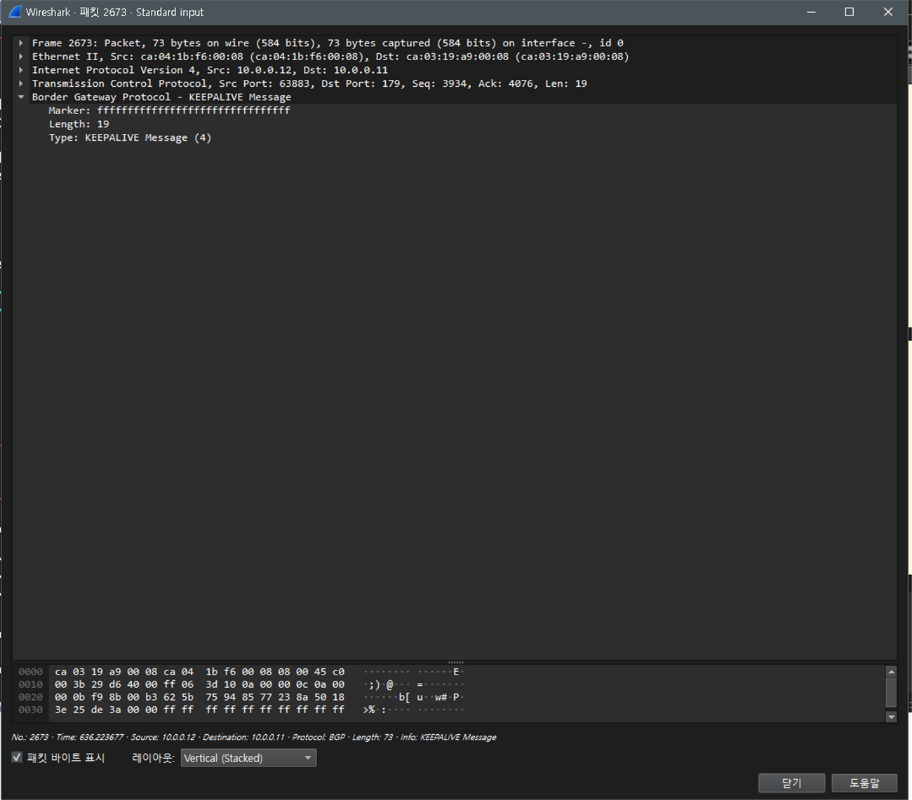

### 캡처 결과: BGP OPEN

- 링크 PE1 `Gi0/0` - PE2 `Gi0/0`, 패킷 4147(세션 재시작 직후). Src **10.0.0.12**(PE2), Dst **10.0.0.11**(PE1), TCP Dst 포트 **179**(Src 21254)
- BGP OPEN Message: Version 4, **My AS 65000**, **Hold Time 9**, **BGP Identifier 10.0.1.12**(PE2의 BGP router-id, OSPF router-id 10.0.0.12와 다름), Optional Parameters Length 24
- 설계값(AS 65000, Hold 9, BGP router-id 10.0.1.x)과 일치. Optional Parameters 안의 Multiprotocol Capability(AFI 1, SAFI 128 = VPNv4)는 접힌 상태라, 해당 줄을 펼쳐 한 번 더 캡처하면 완성

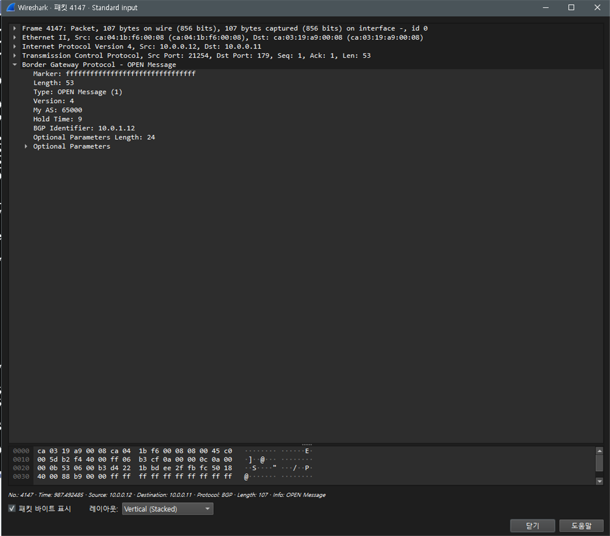

- PE1이 보낸 OPEN(패킷 4148): Src **10.0.0.11**, Dst 10.0.0.12, TCP Src 포트 **179**(PE1이 서버 역할), My AS 65000, Hold Time 9, **BGP Identifier 10.0.1.11**(PE1의 BGP router-id). 두 PE의 OPEN을 합쳐 양쪽 AS, Hold Time, router-id가 모두 확인됨
- Optional Parameters 펼침: 첫 번째 Capability가 **Multiprotocol extensions capability**, **AFI IPv4 (1)**, **SAFI Labeled VPN Unicast (128)**. 즉 VPNv4 주소 패밀리를 협상. 4번째는 4-octet AS number capability(AS 65000)
- 설계한 주소 패밀리(vpnv4)와 send-community extended 구성이 OPEN 협상에 반영됨

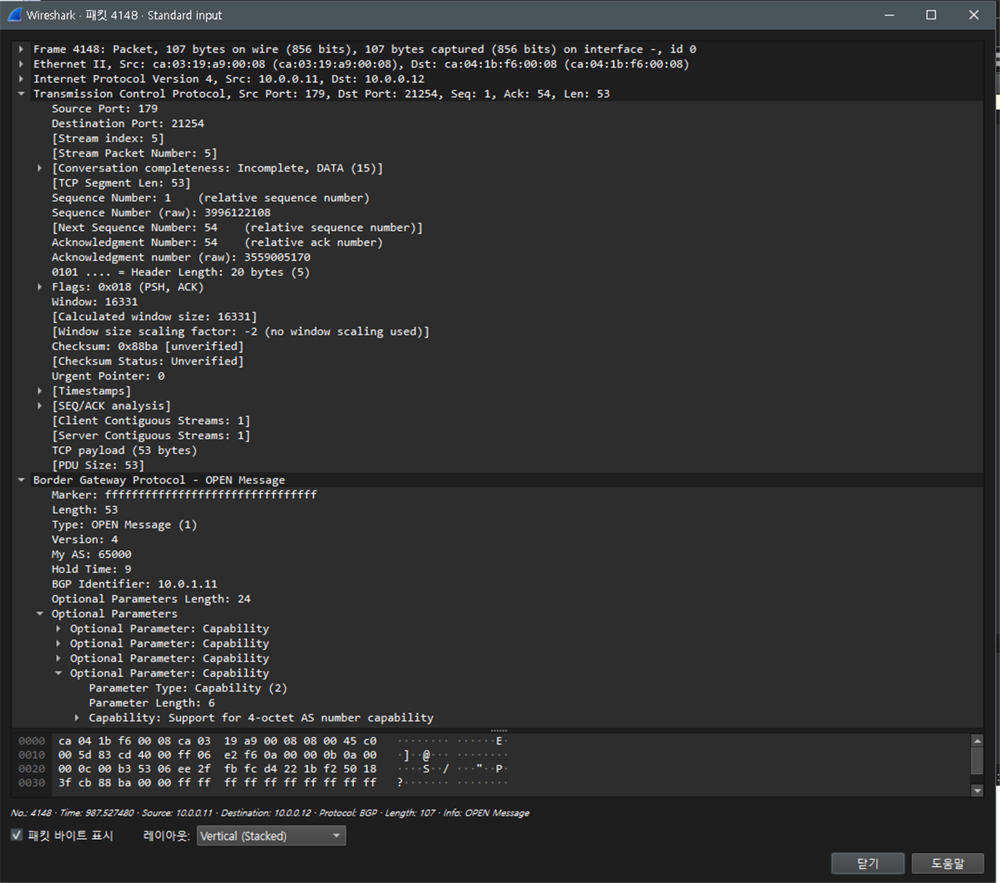

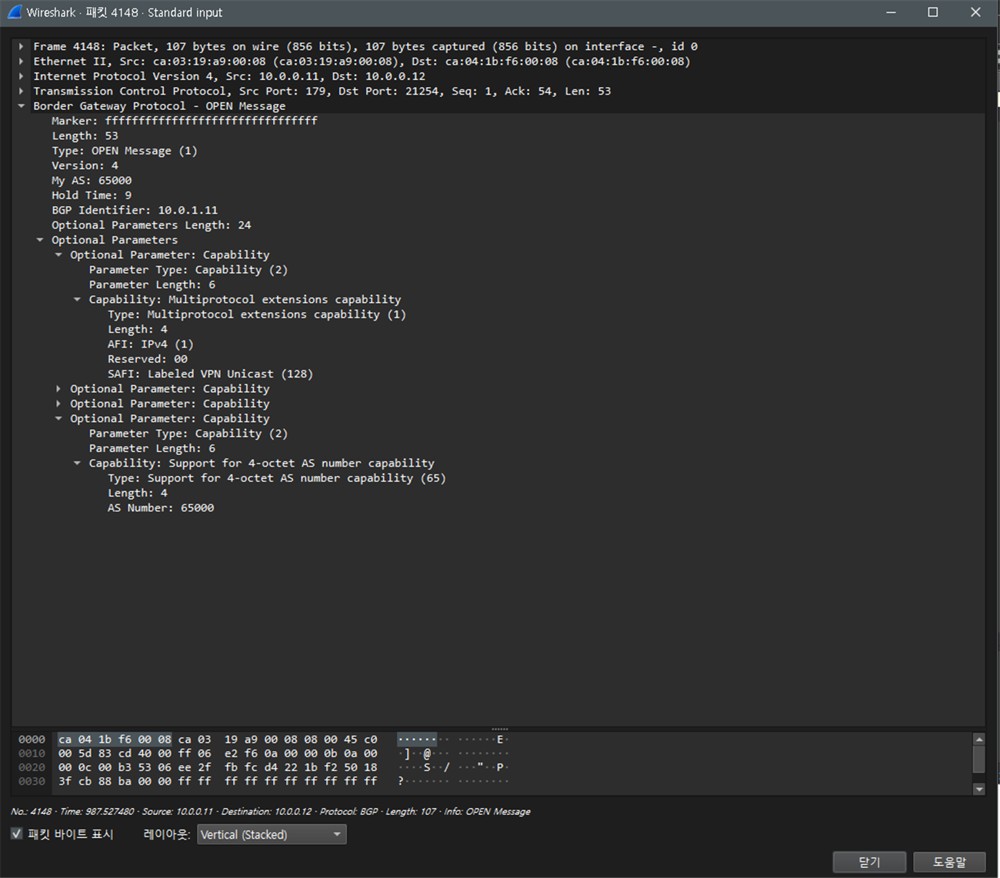

## 장애 시험 결과: PE1 - PE2 직결 링크 정지 (2026-10-25)

PE1 `GigabitEthernet0/0`(PE2 직결)을 `shutdown`하고 Host A -> Host D `ping -D 192.168.110.101`을 유지. Host A와 PE의 시각은 PC 시계(캡처 파일)와 PE1 로그(UTC)로 대조함

**시험 전 상태 (PE1)**

- LDP 이웃 10.0.0.13(Gi1/0), 10.0.0.12(Gi0/0) 모두 Oper, Up time 00:21:36
- `10.0.0.12/32`는 OSPF로 `10.0.10.1` via **Gi0/0**, metric 2
- `show ip bgp vpnv4 vrf TENANT-A 192.168.110.0`: next-hop 10.0.0.12(metric 3), `mpls labels in/out nolabel/23`
- iBGP 10.0.0.12 Up 00:27:21, 10.0.0.13 Up 00:27:24. OSPF SPF: Initial delay **5000 ms**, Hold 10000 ms, Max wait 10000 ms. BGP scan interval **15초**

| LDP와 경로 | BGP와 SPF |
|---|---|
| 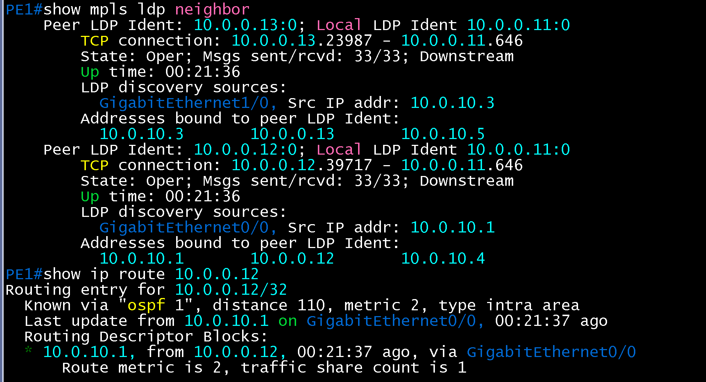 | 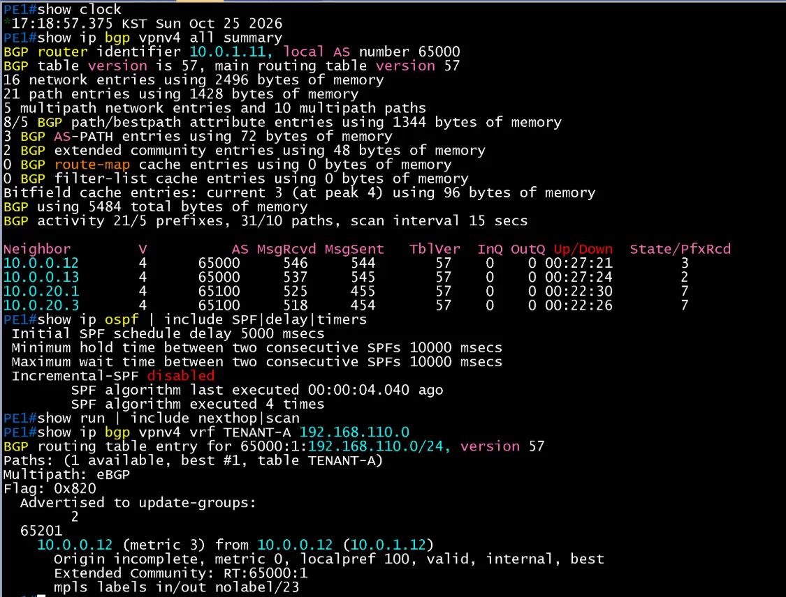 |

**2회차 시간축 (UTC)**

| 시각 | 출처 | 사건 | 경과 |
|---|---|---|---|
| 08:19:51.063 | PE1 로그 | `shutdown`. OSPF 이웃 10.0.0.12 FULL -> DOWN | 0 |
| 08:19:51.075 | PE1 로그 | LDP 이웃 10.0.0.12:0 DOWN | +0.01초 |
| 08:19:51.454 | 캡처(PE1 - PE2) | 직결 링크의 마지막 ICMP 응답(seq 9) | +0.4초 |
| 08:19:57.655 | PE1 로그 | `BGP neighbor 10.0.0.12 Down, Peer closed the session` | +6.6초 |
| 08:19:58.290 | 캡처(PE1 - PE3) | **PE2(10.0.0.12) -> PE1 BGP NOTIFICATION, Major error Hold Timer Expired (4)**, 이어서 FIN | +7.2초 |
| 08:20:20.063 | PE1 로그 | `BGP neighbor 10.0.0.12 Up` (캡처상 PE1이 08:20:20.663에 OPEN 전송) | +29.0초 |
| 08:20:35.859 | 캡처(PE1 - PE3, 프레임 1733) | PE3를 거친 첫 ICMP 요청(seq 53), **MPLS 라벨 2개 [16, 23]** | +44.8초 |
| 08:20:39.002 | 캡처(PE1 - PE3, 프레임 1772) | 첫 ICMP 응답(seq 56), 라벨 [29] | +47.9초 |

- 직결 링크의 마지막 응답(08:19:51.454)부터 PE3 경유 첫 응답(08:20:39.002)까지 **약 47.5초**. ping 요약은 92개 전송, 46개 수신, 손실 50%이고 손실 46개(seq 10 ~ 55)가 이 구간과 일치함
- BGP 세션은 **hold timer 만료(PE2가 보낸 NOTIFICATION)로 리셋**. 링크 정지 후 IGP 재수렴 동안 KEEPALIVE가 hold 9초 이상 오가지 못한 결과로 보임
- PE3 경유 경로가 쓰이기 시작한 것은 BGP Up(08:20:20) 뒤 약 15초 지난 08:20:35.9임. 설정된 BGP scan interval(15초)과 크기가 맞으나 이 로그만으로는 원인을 확정하지 못함
- 우회 전후 라벨: 직결 링크는 요청 [23], 응답 [29]이고, PE3 경유 링크의 요청은 **[16, 23]**(전송 라벨 16 + VPN 라벨 23), 응답은 [29]. 전송 라벨 16이 새로 붙어 라벨이 2개가 됨(`04-mpls-ldp.md` 약속 항목)

| Host A ping | PE1 로그 | PE1 - PE3 캡처(ICMP) |
|---|---|---|
| 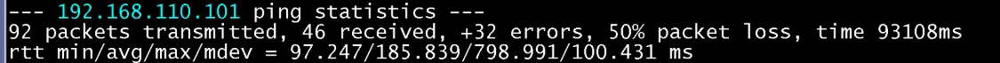 | 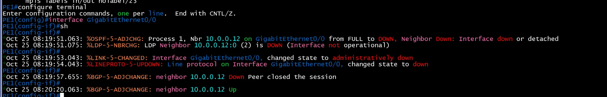 | 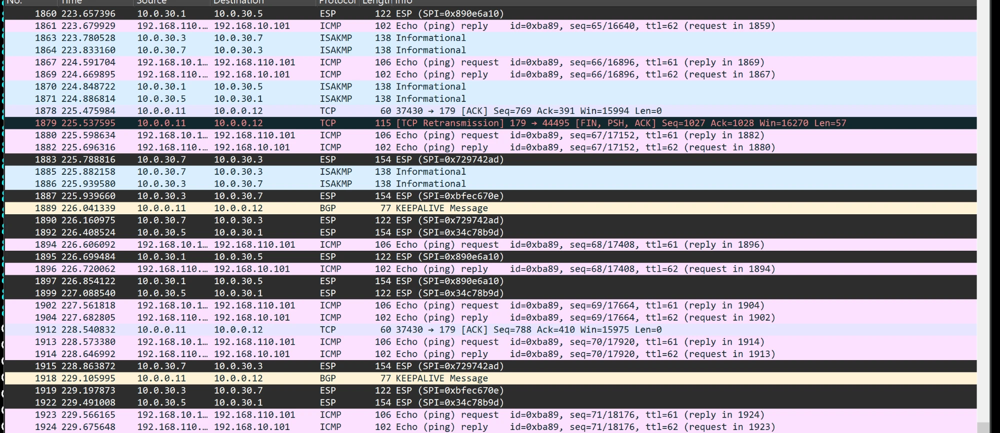 |

| PE1 - PE2 캡처(OSPF dead 4초) | BGP FIN 캡처 |
|---|---|
| 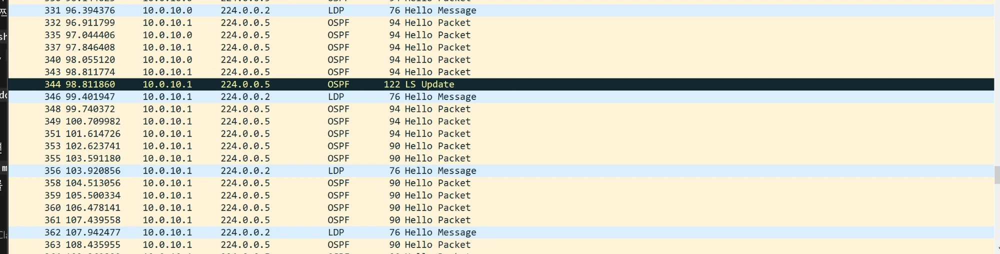 | 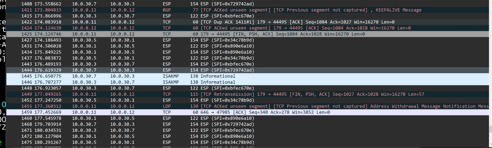 |

- 프레임 1733(PE3 경유 첫 요청) 상세: Label **16**(Exp 0, S 0, TTL 61) + Label **23**(Exp 0, S 1, TTL 61), IP 192.168.10.101 -> 192.168.110.101, ICMP Echo request seq 53

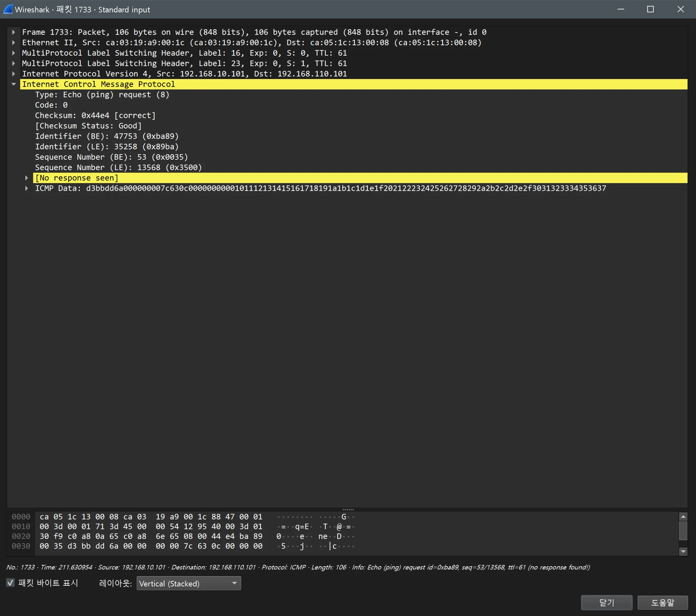

**1회차(08:14 UTC)와의 차이**

| 항목 | 1회차 | 2회차 |
|---|---|---|
| 단절 | 마지막 응답에서 복구 응답까지 약 11.2초 (손실 10개) | 약 47.5초 (손실 46개) |
| BGP 세션 | PE1 로그에 Down 없음(유지) | 6.6초 뒤 hold timer 만료로 Down, 29.0초 뒤 Up |
| 우회 확인 | ttl 59 -> 58 | 라벨 [16, 23], ttl 변화 |

- 같은 장애에서도 BGP hold(9초)를 넘기면 세션이 리셋되어 단절이 4배로 길어졌음. 이 랩의 타이머(OSPF SPF 지연 5초, BGP hold 9초, BGP scan 15초) 조합이 결과를 가르는 것으로 보이며, 어느 타이머가 얼마를 차지했는지는 추가 확인이 필요함(복구 시험 미실시)

## 장애 시험 결과: 3회차 정지와 복구 (2026-10-25)

같은 링크(PE1 `Gi0/0`)를 장비 재부팅 없이 `shutdown`한 뒤 PE3 경유가 안정된 것을 확인하고, 이어서 `no shutdown`으로 복구함. 시각은 PE1 로그(UTC)와 Host A `ping -D`(epoch를 UTC로 환산)

**3회차 정지 (09:27:46 UTC)**

| 시각(UTC) | 출처 | 사건 | 경과 |
|---|---|---|---|
| 09:27:46.815 | PE1 로그 | `shutdown`. OSPF 이웃 10.0.0.12 FULL -> DOWN (LDP는 +0.03초) | 0 |
| 09:27:52.97 | `show ip route 10.0.0.12`(`Last update 00:01:22 ago`에서 환산) | `10.0.0.12/32`가 OSPF로 PE3 방향(`10.0.10.3` via `Gi1/0`, metric 3)으로 바뀜 | +6.2초 |
| 09:27:53.491 | PE1 로그 | `BGP neighbor 10.0.0.12 Down, Peer closed the session` | +6.7초 |
| 09:28:12.831 | PE1 로그 | `BGP neighbor 10.0.0.12 Up` | +26.0초 |
| 09:28:18.798 | Host A ping | 첫 응답(seq 18, ttl 58) | +32.0초 |

- Host A ping은 09:28:00에 시작. seq 1 ~ 16은 `Destination Net Unreachable`(leaf 192.168.10.1), seq 18부터 40까지 **23개 연속 응답**(ttl 58, 손실 없음). 요약: 40개 전송, 23 수신, +13 errors, 42.5%
- 1 ~ 3회차 정지 비교

| 항목 | 1회차(08:14) | 2회차(08:19) | 3회차(09:27) |
|---|---|---|---|
| IGP 경로 PE3 전환 | 확인 안 함 | 약 +6초 | +6.2초 |
| BGP 세션 | 유지(Down 로그 없음) | +6.6초 Down, +29.0초 Up | +6.7초 Down, +26.0초 Up |
| 데이터 복구 | 약 11.2초 | +44.8초 ~ 47.9초 | +32.0초 |

- 3회 중 2회는 BGP hold(9초) 만료로 세션이 리셋되어 IGP 수렴(약 6초)보다 훨씬 긴 단절이 발생. 데이터 복구 시각은 BGP Up 뒤 6 ~ 16초가 더 걸려 시험마다 다르며, BGP scan interval(15초)과 크기가 비슷하나 확정하지 못함

| 정지 로그 | Host A ping | PE1 경로(PE3 경유) | BGP 요약 |
|---|---|---|---|
| 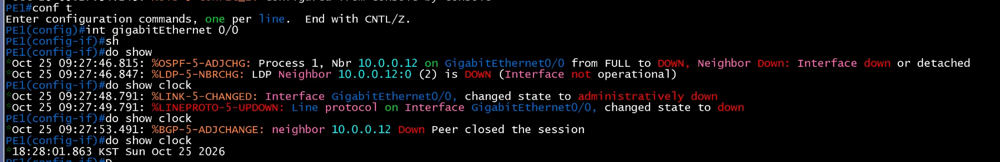 | 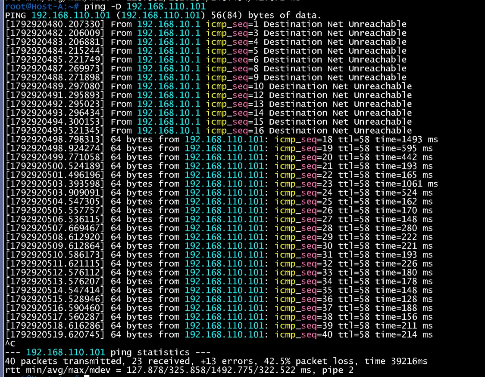 | 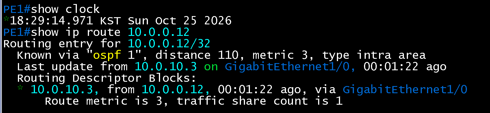 | 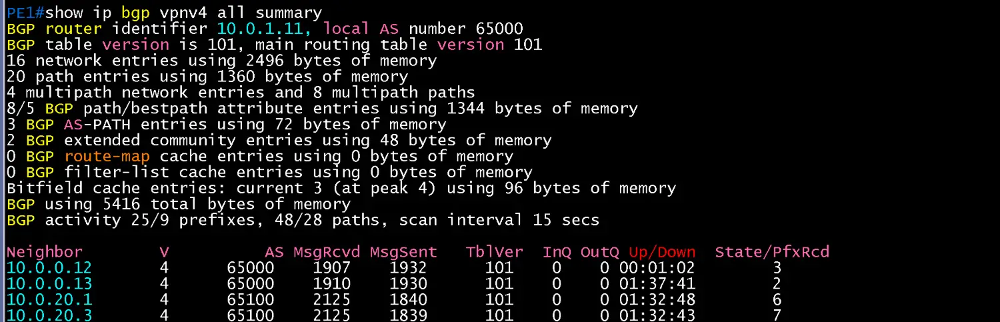 |

**복구 (`no shutdown`, 09:31 UTC)**

| 시각(UTC) | 출처 | 사건 |
|---|---|---|
| 09:31:31.845 | Host A ping | 시작. PE3 경유 응답(ttl 58) |
| 09:31:45.155 | PE1 로그 | OSPF 이웃 10.0.0.12 LOADING -> FULL |
| 09:31:46.983 / 47.983 | PE1 로그 | `Gi0/0` link up, line protocol up (로그가 늦게 찍힘) |
| 09:31:47.5 | `show ip route 10.0.0.12`(`Last update 00:00:44 ago`에서 환산) | 경로가 직결 `Gi0/0`(`10.0.10.1`, metric 2)으로 돌아옴 |
| 09:31:49.887 | PE1 로그 | LDP 이웃 10.0.0.12:0 UP |
| 09:31:50.745 -> 51.716 | Host A ping | 응답 ttl이 **58에서 59로** 바뀜(seq 20 -> 21). 직결 경로로 전환 |

- ping 요약: **31개 전송, 31 수신, 손실 0%**, 평균 rtt 202 ms(최대 868 ms)
- BGP 세션 10.0.0.12는 복구 중 리셋 없이 유지(Up/Down 00:04:38은 09:28:12 Up부터의 시간)
- PE3 경유에서 직결로 바뀌는 구간(seq 20 -> 21)에서도 응답이 끊기지 않음. 정지 때 32 ~ 47초 단절된 것과 대비되어 **복구는 무중단, 정지는 장시간 단절**
- 정리: 링크 복구는 OSPF FULL 후 약 2.4초에 경로가 돌아오고 LDP UP 후 약 1초에 데이터가 직결로 전환되어 손실이 없음. 단절의 원인은 링크가 끊길 때 BGP가 리셋되는 정지 쪽에 있음

| 복구 ping | 복구 로그 | 복구 후 BGP 요약 | 복구 후 경로 |
|---|---|---|---|
| 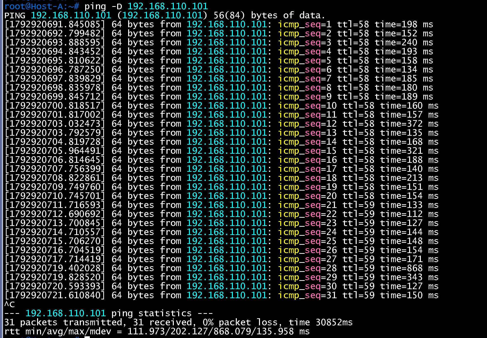 | 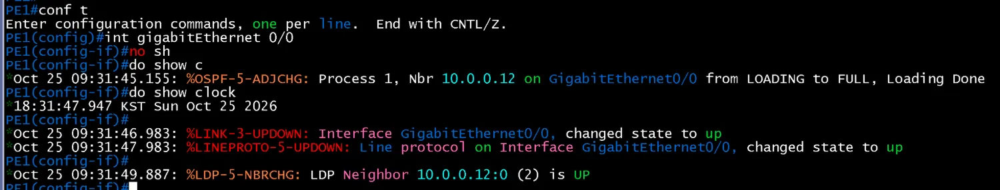 | 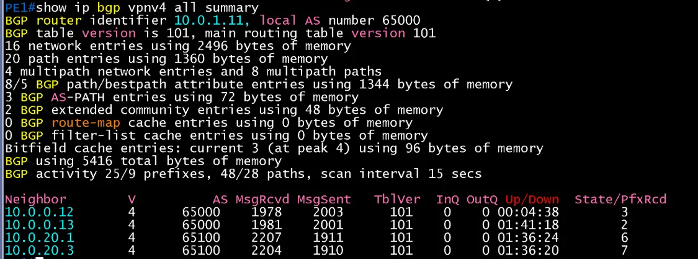 | 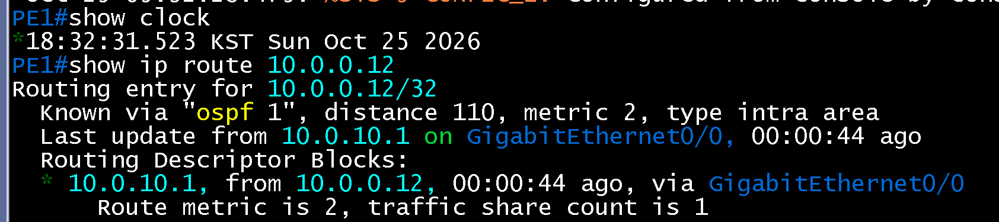 |

| 전체 로그 |
|---|
| 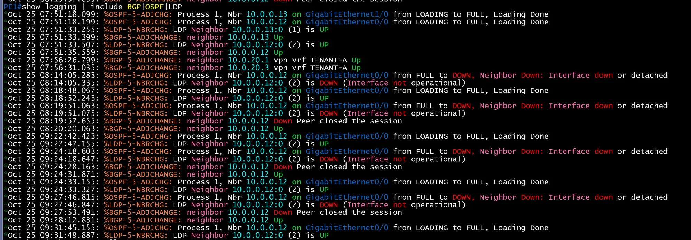 |

## 결과 기록

| 일시 | 장비 | 결과 (성공, 실패) | 비고 |
|---|---|---|---|
| 2026-10-22 | PE1 | 성공 | 항목 1, 2 완료. 3(`show bgp vpnv4 unicast all`)은 PE-CE 구성 뒤 확인 |
| 2026-10-22 | PE2 | 성공 | 항목 1 완료. PE1에서 받은 VPNv4 경로가 PE2 VRF 경로에 보임(항목 3 확인). 2(hold)는 상대 주소로 다시 확인 필요 |
| 2026-10-22 | PE3 | 성공 | 항목 1, 2 완료. 3은 PE-CE 구성 뒤 확인 |
| 2026-10-25 | PE1 | 성공 (정지, 복구) | PE1 - PE2 링크 정지 3회, 복구 1회. 3회 중 2회 BGP 리셋, 정지 시 단절 11 ~ 47초, 복구는 손실 0 |
