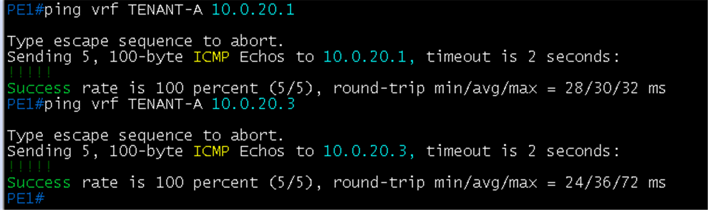
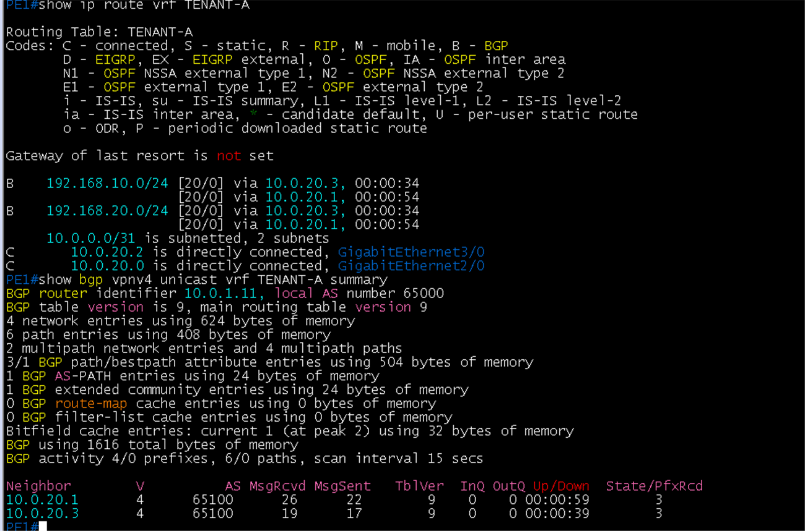
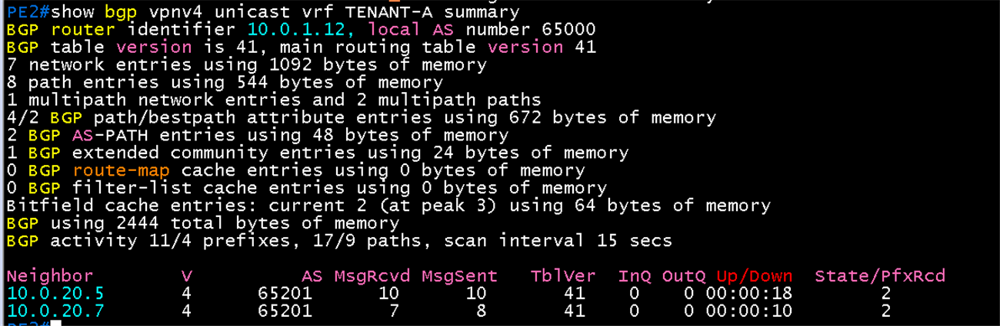
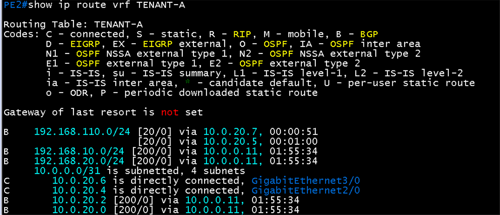
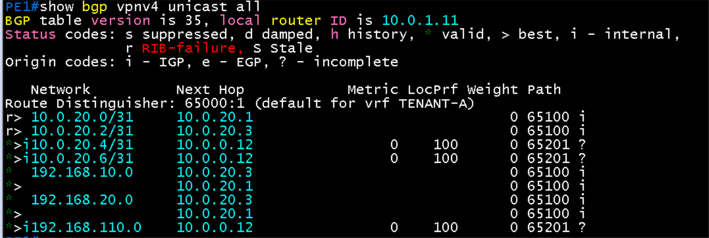
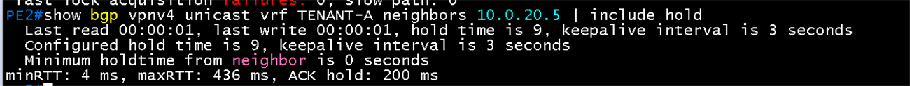
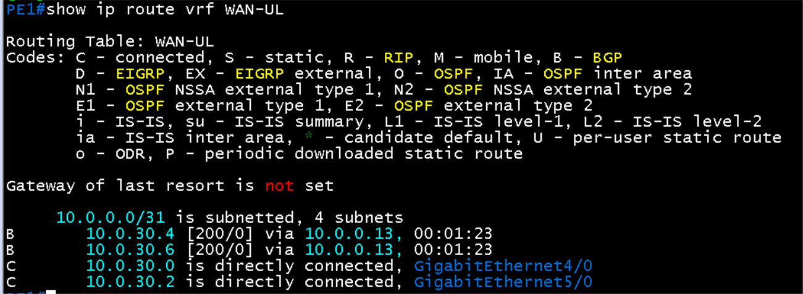
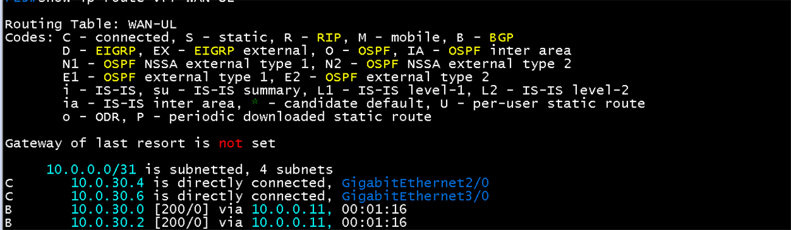
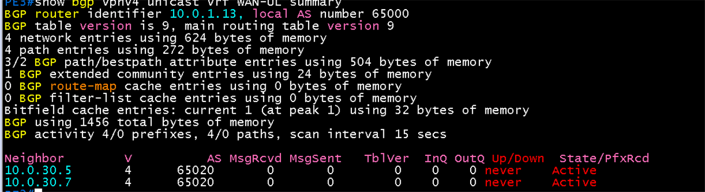
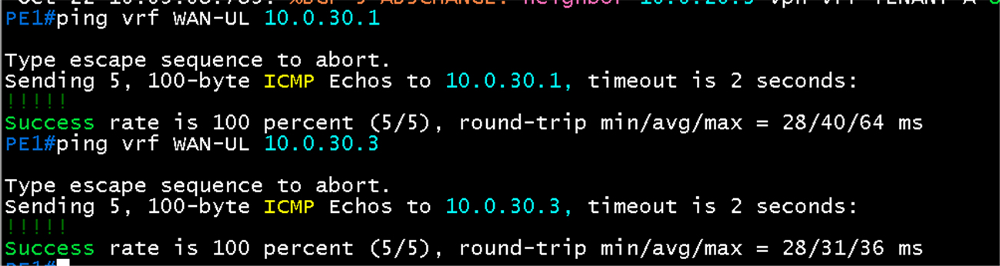

# PE-CE eBGP 검증

**선행 조건**: [VRF와 VPNv4 검증](06-mp-bgp-vpnv4.md)이 끝나 있고, 고객 쪽(leaf3, leaf4, CX1, CX2)이 설정되어 있어야 함. [기준 문서](../../baseline/core/07-pe-ce-ebgp.md).

## 확인 항목

| 순서 | 장비 | 명령 | 기대 결과 | 안 될 때 확인 |
|---|---|---|---|---|
| 1 | PE1 | `show bgp vpnv4 unicast vrf TENANT-A summary` | leaf3, leaf4(65100)가 **Established** | 링크 IP, AS, 상대 설정 |
| 2 | PE2 | `show bgp vpnv4 unicast vrf TENANT-A summary` | CX1, CX2(65201)가 **Established** | 같은 점검 |
| 3 | PE1 | `ping vrf TENANT-A 10.0.20.1` | leaf3 응답 | VRF 인터페이스 |
| 4 | PE1 | `ping vrf WAN-UL 10.0.30.1` | Hub1 응답 (WAN-UL) | WAN-UL VRF |
| 5 | PE1 | `show bgp vpnv4 unicast vrf TENANT-A neighbors <CE 주소> \| include hold` | `Hold time is 9`, `keepalive interval is 3 seconds` | PE와 CE 양쪽 `timers 3 9` |
| 6 | PE3 | `show bgp vpnv4 unicast vrf WAN-UL summary` | BGW1(10.0.30.5), BGW2(10.0.30.7)가 AS 65020, **Established** | 링크 IP, AS 65020, BGW 쪽 `router bgp 65020` |
| 7 | PE1 | `show ip route vrf WAN-UL` | 직결 10.0.30.0/31, 10.0.30.2/31(C)과 PE3에서 온 10.0.30.4/31, 10.0.30.6/31(**B [200/0]** via 10.0.0.13) | PE1, PE3 `redistribute connected` |
| 8 | PE3 | `show ip route vrf WAN-UL` | 직결 10.0.30.4/31, 10.0.30.6/31(C)과 PE1에서 온 10.0.30.0/31, 10.0.30.2/31(**B [200/0]** via 10.0.0.11) | 같은 점검 |
| 9 | Hub1, Hub2 | `ping 10.0.30.5 source gigabitethernet 0/0` (Hub2는 `10.0.30.7`) | BGW 터널 주소 응답 | Hub 정적 경로, PE1 VRF 경로 |
| 10 | BGW1, BGW2 | `ping 10.0.30.1 source gigabitethernet 0/0` (BGW2는 `10.0.30.3`) | Hub 터널 주소 응답 | BGW의 eBGP 수신 경로(`show ip route 10.0.30.1`) |
| 11 | PE3 | `show bgp vpnv4 unicast vrf WAN-UL neighbors 10.0.30.5 \| include hold` | `Hold time is 9`, `keepalive interval is 3 seconds` | PE3와 BGW 양쪽 `timers 3 9` |

- 6 ~ 8번은 PE3와 BGW가 설정된 뒤, 9번은 Hub까지, 10번은 BGW까지 설정된 뒤 확인. WAN-UL 구간은 PE1 - Hub는 정적, PE3 - BGW는 eBGP로 [구역별 방식](../../baseline/core/07-pe-ce-ebgp.md)을 씀

## 증빙: DC1 구간 (PE1 - leaf3, leaf4)

### PE1 ping

- `ping vrf TENANT-A 10.0.20.1`(leaf3) 5/5, 28/30/32 ms
- `ping vrf TENANT-A 10.0.20.3`(leaf4) 5/5, 24/36/72 ms

### PE1 경로와 BGP 요약

- `show ip route vrf TENANT-A`: 192.168.10.0/24, 192.168.20.0/24가 **B [20/0]**, next-hop 10.0.20.1(leaf3)과 10.0.20.3(leaf4) 두 개 (ECMP, `maximum-paths 2`). 링크 10.0.20.0/31, 10.0.20.2/31은 직결(C)
- `show bgp vpnv4 unicast vrf TENANT-A summary`: router identifier 10.0.1.11, 이웃 10.0.20.1, 10.0.20.3이 AS 65100, **State/PfxRcd 3**(Established, 각각 prefix 3개 수신: VLAN 10, 20 서브넷과 PE1 링크 /31)
- 2 multipath network entries, 4 multipath paths

## 증빙: DC2 구간 (PE2 - CX1, CX2)

### PE2 BGP 요약

- `show bgp vpnv4 unicast vrf TENANT-A summary`: router identifier 10.0.1.12, 이웃 10.0.20.5(CX1), 10.0.20.7(CX2)가 AS 65201, **State/PfxRcd 2**(Established, 각각 prefix 2개 수신: 192.168.110.0/24와 CX 링크 /31)
- 1 multipath network entries, 2 multipath paths

### PE2 경로

- `show ip route vrf TENANT-A`: 192.168.110.0/24가 **B [20/0]**, next-hop 10.0.20.7(CX2)과 10.0.20.5(CX1) 두 개 (ECMP, `maximum-paths 2`)
- 192.168.10.0/24, 192.168.20.0/24는 **B [200/0] via 10.0.0.11**(PE1, iBGP VPNv4): DC1 경로를 코어에서 받음
- 링크 10.0.20.4/31, 10.0.20.6/31은 직결(C)

### PE1에서 DC2 경로 수신

- `show bgp vpnv4 unicast all`, RD 65000:1: 192.168.110.0이 next-hop **10.0.0.12**(PE2), LocPrf 100, 경로 `65201 ?`(DC2에서 온 경로). 10.0.20.4/31, 10.0.20.6/31도 PE2에서 수신
- 10.0.20.0/31, 10.0.20.2/31은 `r>`(RIB-failure): PE1이 직결로 이미 가진 주소라 BGP 경로가 라우팅 테이블에 못 들어간 것이고 정상
- DC1 경로(192.168.10.0, 192.168.20.0)는 leaf3·4(10.0.20.1, .3, AS 65100)에서 받은 로컬 경로 (`*>`)

### PE2 타이머

- `show bgp vpnv4 unicast vrf TENANT-A neighbors 10.0.20.5 | include hold`: **hold time is 9, keepalive interval is 3 seconds**, 설정값(Configured)도 9와 3

## 증빙: WAN-UL 구간 (PE1 - Hub, PE3 - BGW)

### PE1, PE3 WAN-UL 경로 교환 (Hub, BGW 구성 전)

- PE1 `show ip route vrf WAN-UL`: 직결 10.0.30.0/31(Gi4/0), 10.0.30.2/31(Gi5/0)과 PE3에서 온 **10.0.30.4/31, 10.0.30.6/31(B [200/0] via 10.0.0.13)**
- PE3 `show ip route vrf WAN-UL`: 직결 10.0.30.4/31(Gi2/0), 10.0.30.6/31(Gi3/0)과 PE1에서 온 **10.0.30.0/31, 10.0.30.2/31(B [200/0] via 10.0.0.11)**
- 양쪽 PE가 `redistribute connected`로 자기 직결 링크를 VPNv4(RD 65000:99)에 실어 상대 PE의 VRF로 전달함. PE1 - Hub는 정적 방식이라 PE1에는 BGP 이웃이 없음

### PE3 BGW 이웃 (BGW 구성 전)

- `show bgp vpnv4 unicast vrf WAN-UL summary`: router identifier 10.0.1.13, 이웃 10.0.30.5, 10.0.30.7(AS 65020)이 **Active**, Up/Down never, 수신 0. BGW가 아직 없어서 정상
- 4 network entries(직결 2개와 PE1 경로 2개)

### PE1에서 Hub ping (항목 4)

- `ping vrf WAN-UL 10.0.30.1`(Hub1): 5/5, 28/40/64 ms. `ping vrf WAN-UL 10.0.30.3`(Hub2): 5/5, 28/31/36 ms
- PE1 - Hub 링크는 정적 방식이라 BGP 이웃 없이 직결 링크로 확인. Hub 쪽 정적 경로와 leaf eBGP는 [DC1 Hub 검증](../dc1/04-dci-hub-ebgp.md)

BGW 구성 뒤 이웃이 Established로 바뀐 화면과 BGW ping 화면은 해당 장비 설정 뒤 추가

## 패킷 캡처 (Wireshark)

계획표: [08-wireshark-capture.md](../../00-overview/08-wireshark-capture.md). 링크 한 개만 캡처하고, 표시 필터로 패킷 한두 개의 상세 창이 보이게 잘라 images/에 저장. 캡처한 동작(어떤 명령으로 일으켰는지)을 설명에 남김

| 확인할 동작 | 캡처 링크 (GNS3 Start capture) | 일으킬 동작 | 표시 필터 | 볼 것 | 상태 |
|---|---|---|---|---|---|
| PE-CE eBGP (DC1) | PE1 `Gi2/0` - leaf3 `ethernet5` | `clear ip bgp vpnv4 unicast vrf TENANT-A *` (문법은 `?`로 확인) | `bgp` | OPEN: AS 65000과 65100, Hold Time **9**, BGP Identifier(PE1 10.0.1.11, leaf3 VRF router-id **10.1.2.13**), UPDATE에 192.168.10.0/24, 192.168.20.0/24 | 생략 (BGP는 [06 검증](06-mp-bgp-vpnv4.md)의 대표 캡처로 대체) |
| PE-CE eBGP (DC2) | PE2 `Gi2/0` - CX1 `1/1/1` | DC2 구성 뒤 세션 재시작 | `bgp` | AS 65000과 65201, Hold Time 9 | 생략 (같은 이유) |

## 결과 기록

| 일시 | 결과 (성공, 실패) | 비고 |
|---|---|---|
| 2026-10-22 | 성공 (DC1 구간) | 항목 1, 3 완료. leaf3, leaf4 두 이웃 Established, ECMP 확인. 항목 4(WAN-UL)는 해당 구간 구성 뒤 확인 |
| 2026-10-22 | 부분 성공 (WAN-UL 구간) | 항목 4(PE1에서 Hub1, Hub2 ping 5/5), 7, 8 완료. PE1과 PE3가 WAN-UL 직결 링크를 VPNv4로 교환(B [200/0] via 10.0.0.13, 10.0.0.11). 항목 6(BGW 이웃)은 Active 상태로 BGW 구성 대기, 9~11번은 Hub, BGW 구성 뒤 확인 |
| 2026-10-22 | 성공 (DC2 구간) | 항목 2, 5 완료. PE2 이웃 CX1(10.0.20.5), CX2(10.0.20.7) Established(AS 65201, 각 prefix 2개), 192.168.110.0/24 ECMP(next-hop .5, .7), PE1이 PE2(10.0.0.12) 경유 DC2 경로 수신, hold 9와 keepalive 3 확인 |