# 코어 관리망과 접속 제한 검증

**선행 조건**: MGMT-SW2, MGMT-RTR, 관리 PC(MGMT-PC2)가 구성되어 있고 PE1~3에 관리 VRF와 접속 제한이 적용되어 있어야 함. PE와 라우터에는 RSA 키를 만들어 SSH를 켜 둠

기준 문서: [08-mgmt.md](../../baseline/core/08-mgmt.md)

## 확인 항목

| 순서 | 장비 | 명령 | 기대 결과 | 안 될 때 확인 |
|---|---|---|---|---|
| 1 | MGMT-SW2 | `show vlan brief`, `show ip interface brief` | VLAN 910에 Gi0/0~0/2, Gi3/2, Gi3/3, `Vlan910` 10.9.1.2 up | 포트 access VLAN |
| 2 | PE1~3 | `show ip route vrf MGMT` | `C 10.9.1.0/24 Gi6/0`, `S* 0.0.0.0/0 via 10.9.1.1` | `ip vrf forwarding` 후 IP 재입력 |
| 3 | PE1~3 | `show ip ssh` | `SSH Enabled - version 2.0` | RSA 키 생성 |
| 4 | MGMT-PC2 | PE1~3, MGMT-RTR(10.9.1.1)에 SSH(호환 옵션) | 로그인 | `access-class`, CoPP 허용 규칙 |
| 5 | MGMT-PC1 | PE1~3에 SSH | **연결 실패**(`No route to host`, MGMT-RTR `ACL-DC1-IN`) | 라우터 인터페이스 ACL |
| 6 | MGMT-SW2 | `ssh -l admin 10.9.1.11` | **시간 초과**(허용 대역 밖, CoPP drop) | CoPP 차단 클래스 |
| 7 | PE1 | `show policy-map control-plane` | `CM-MGMT-ALLOW` conformed 증가, 6번 후 `CM-MGMT-DENY` packets 증가 | CoPP 적용 |
| 8 | PE1~3 | `show ip ospf neighbor`, `show mpls ldp neighbor`, `show bgp vpnv4 unicast all summary` | OSPF FULL, LDP Oper, VPNv4 Established 유지 | 관리 VRF가 코어에 영향 없는지 |

## 증빙 (2026-11-14)

### 관리 스위치와 라우터

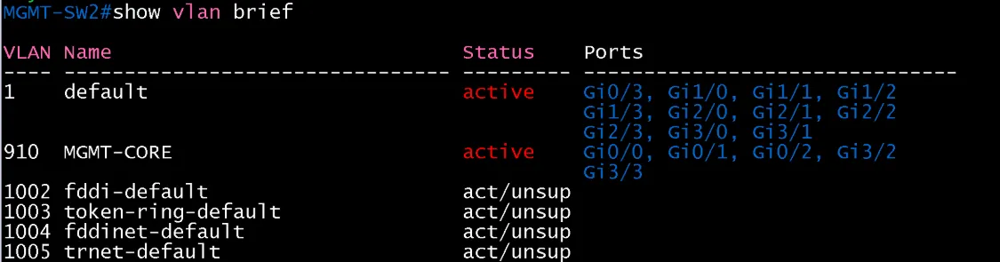

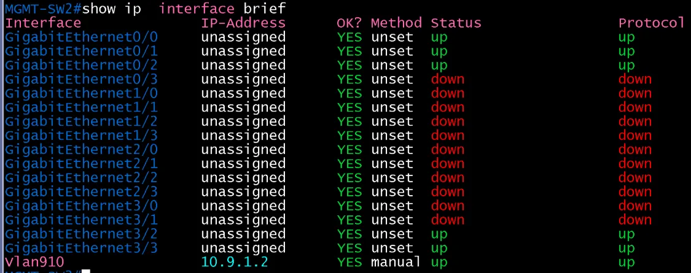

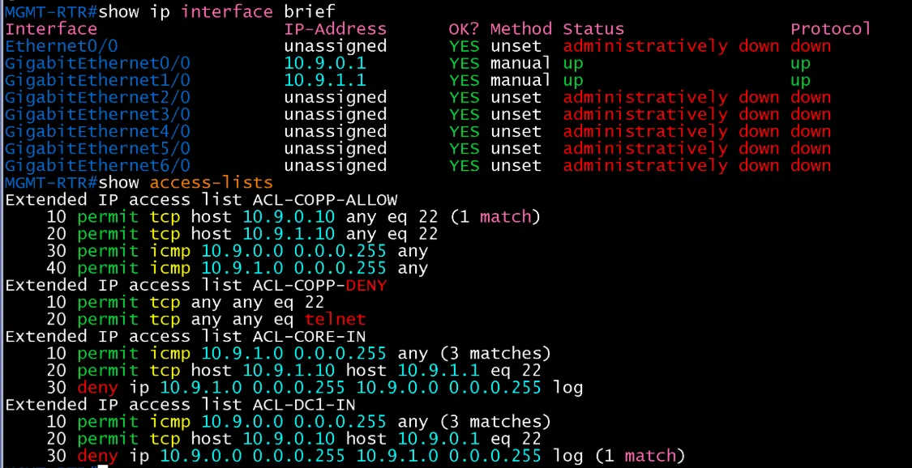

- MGMT-SW2의 VLAN 910에 PE1~3, RTR, PC2가 속하고 `Vlan910` 10.9.1.2가 up/up. MGMT-RTR `Gi0/0` 10.9.0.1, `Gi1/0` 10.9.1.1 up/up

### PE 관리 VRF 경로

| 장비 | 화면 |
|---|---|
| PE1 | 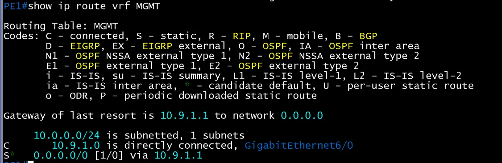 |
| PE2 | 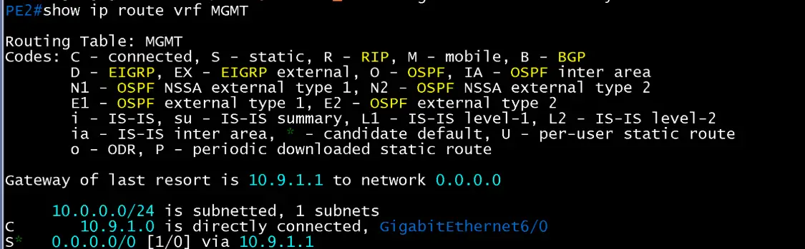 |
| PE3 | 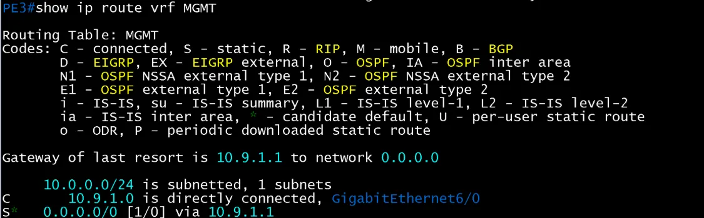 |

- 세 대 모두 `C 10.9.1.0/24 Gi6/0`, `S* 0.0.0.0/0 via 10.9.1.1`

### SSH: 서버 켜기와 접속

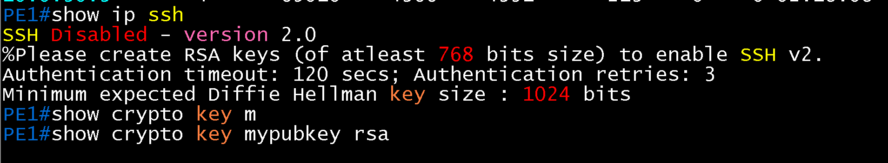

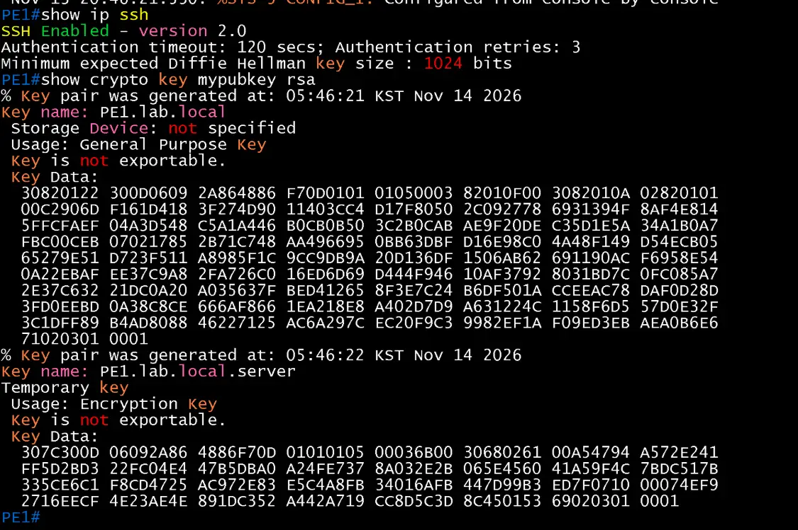

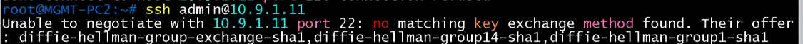

- 처음에는 RSA 키가 없어 `SSH Disabled`. 키 생성 후 `SSH Enabled - version 2.0`. 호환 옵션 없이 접속하면 `no matching key exchange method found`

| 출발 | 대상 | 화면 |
|---|---|---|
| MGMT-PC2 | PE1 | 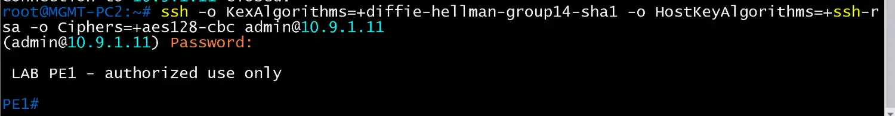 |
| MGMT-PC2 | PE2 | 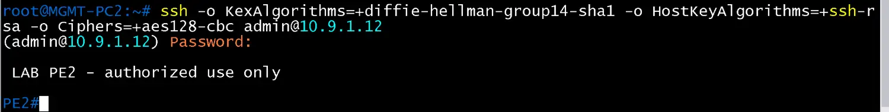 |
| MGMT-PC2 | PE3 | 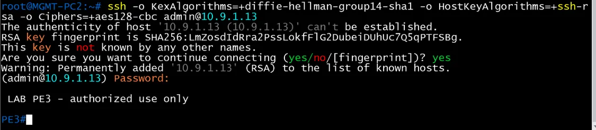 |
| MGMT-PC2 | MGMT-RTR | 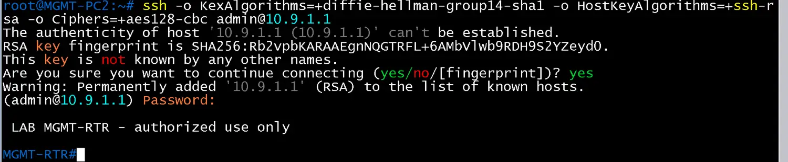 |
| MGMT-PC1 | MGMT-RTR | 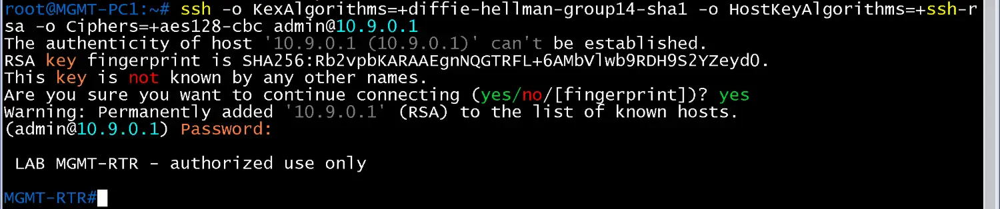 |

- 관리 PC2는 PE1~3과 라우터에, 관리 PC1은 라우터에 로그인. 호환 옵션(`KexAlgorithms`, `HostKeyAlgorithms`, `Ciphers`) 사용

### 차단 확인

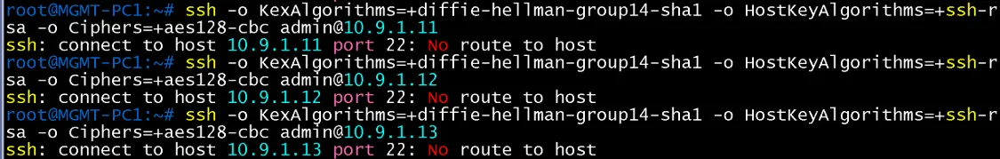

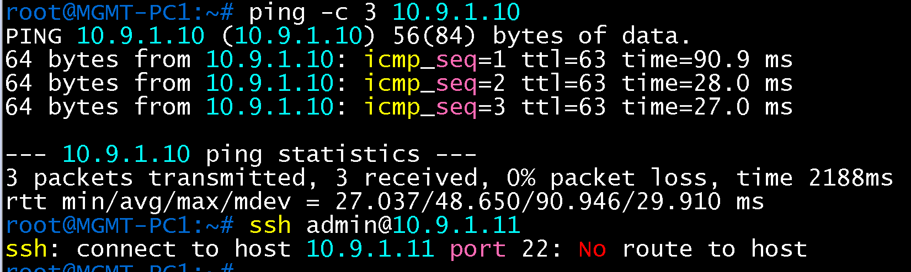

- MGMT-PC1에서 PE1~3로 SSH는 `No route to host`(MGMT-RTR `ACL-DC1-IN`의 deny), PC1 → PC2 ping은 응답(TTL 63, 라우터 경유)
- MGMT-SW2(10.9.1.2)에서 PE1로 SSH는 시간 초과(허용 대역 밖)

### 접속 제한 카운터

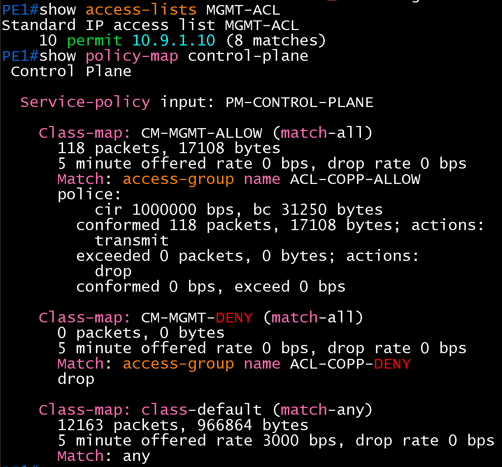

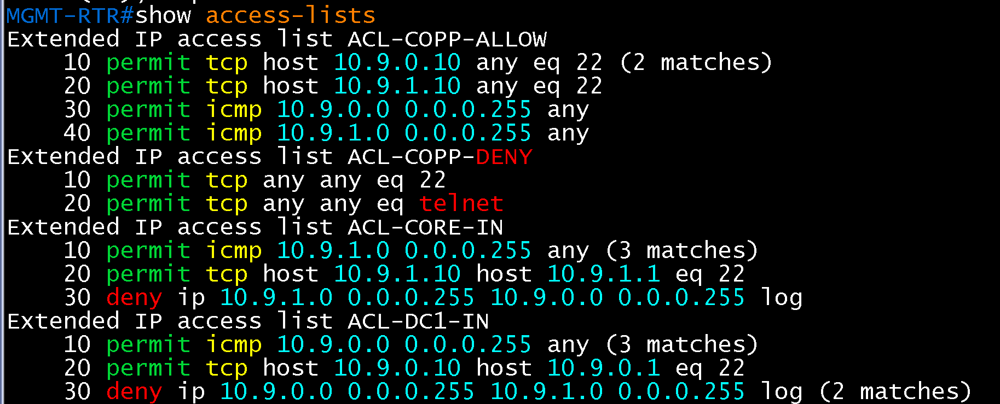

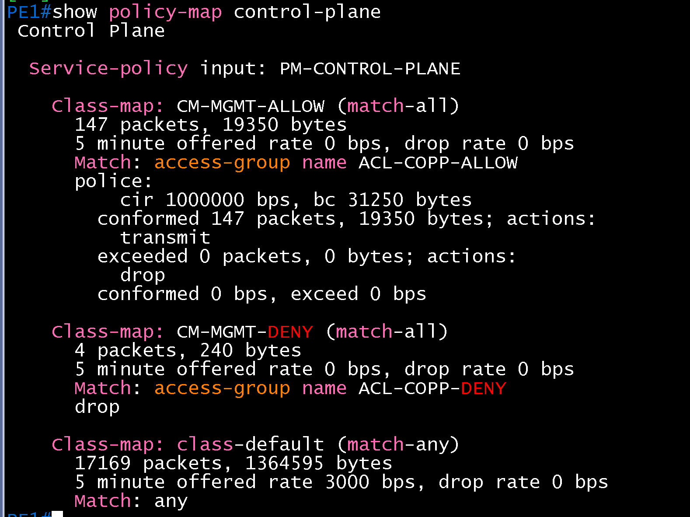

| 장비 | CoPP 화면 |
|---|---|
| PE2 | 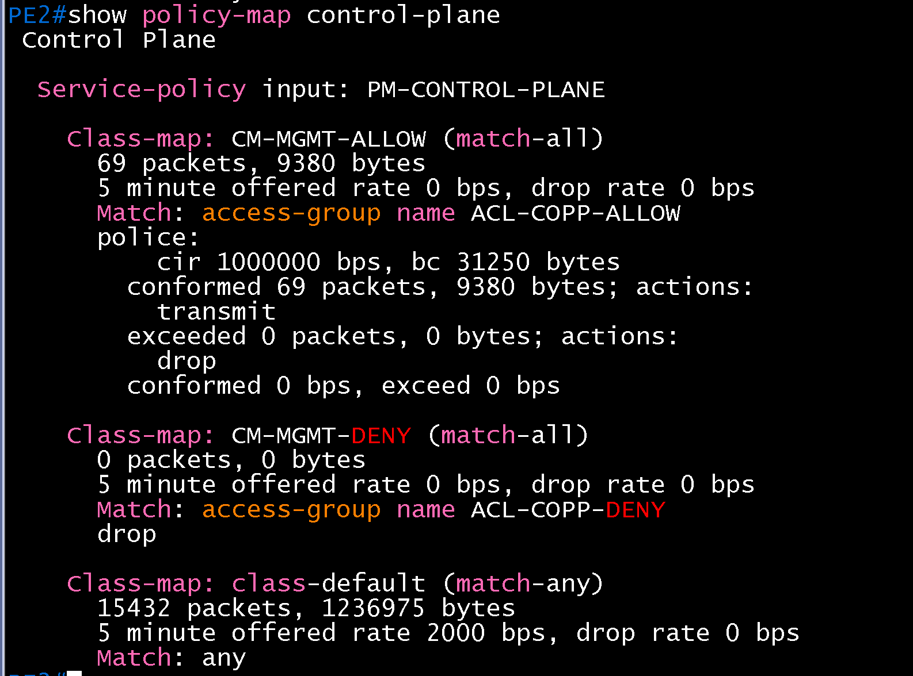 |
| PE3 | 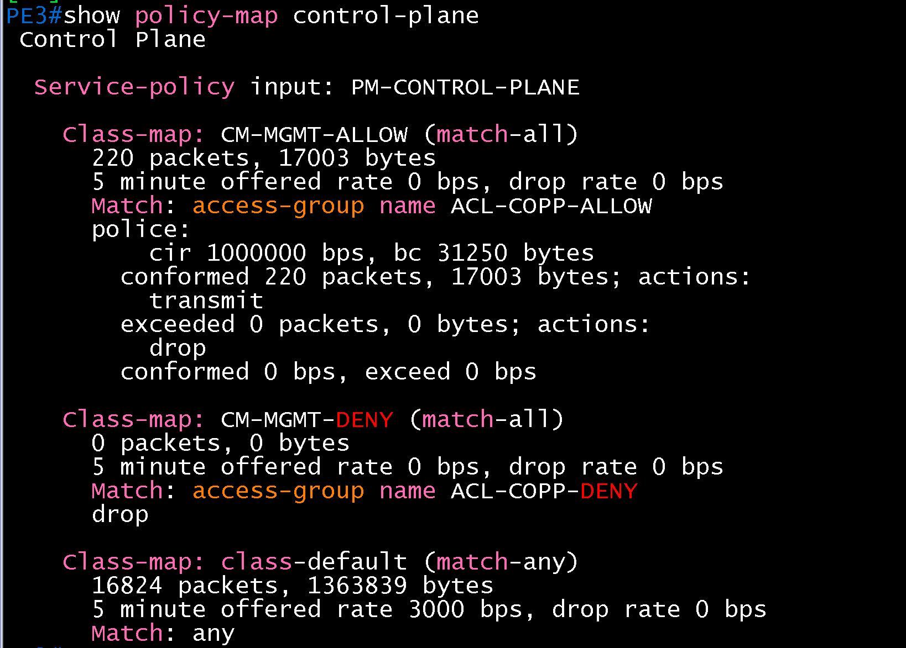 |

- PE1 `MGMT-ACL`의 `permit 10.9.1.10` match 증가, `CM-MGMT-ALLOW` conformed(exceeded 0). MGMT-SW2 시도 후 `CM-MGMT-DENY`가 0에서 4 packets로 증가
- PE2, PE3는 `CM-MGMT-ALLOW` conformed, `CM-MGMT-DENY`는 0(차단 시험은 PE1에서만 함)
- MGMT-RTR `ACL-DC1-IN`의 deny(log)에 match, ICMP 허용 줄에 match

### 코어 서비스 유지 (OSPF, LDP, VPNv4)

| 장비 | OSPF | LDP |
|---|---|---|
| PE1 | 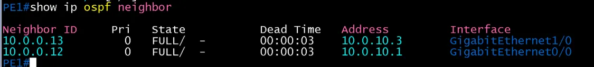 | 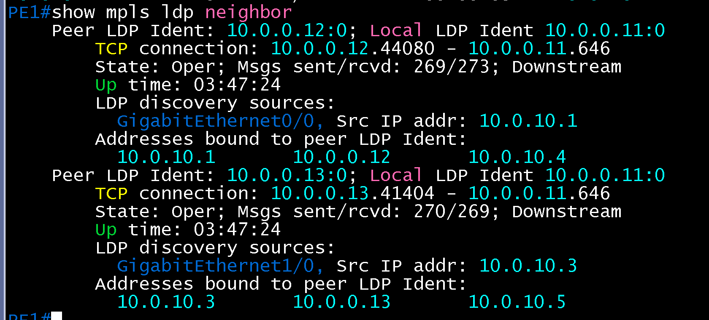 |
| PE2 | 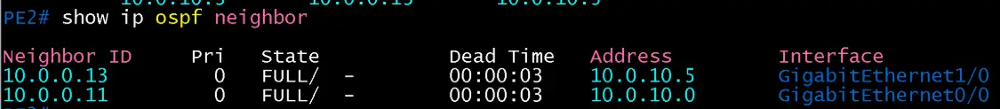 | 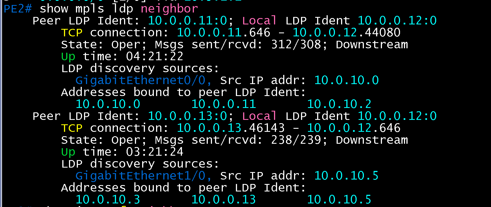 |
| PE3 | 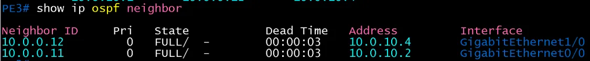 | 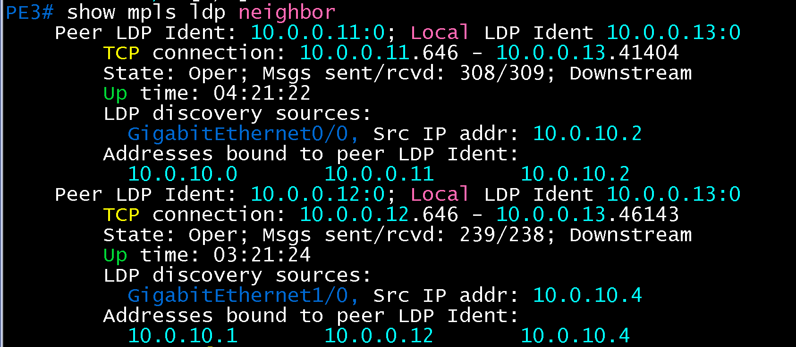 |

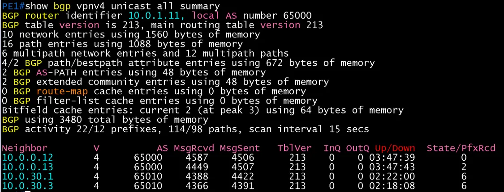

- 세 대 모두 OSPF 이웃 2개 FULL, LDP 이웃 2개 Oper. PE1 VPNv4 이웃 4개 Established. 관리 VRF 추가 후에도 코어 서비스에 영향 없음. PE2, PE3의 VPNv4는 확인 전

## 결과 기록

| 일시 | 결과 (성공, 실패) | 비고 |
|---|---|---|
| 2026-11-14 | 성공 (PE1~3, MGMT-SW2, MGMT-RTR) | 관리 접속, 경계 차단, CoPP 허용·차단(PE1), OSPF·LDP 유지 확인. PE2·PE3 VPNv4와 장비 저장은 확인 전 |
