# QoS 검증

**선행 조건**: 코어와 DC 연동(2단계 이후)이 끝나 있고 [QoS 샘플](../../samples/core/08-qos.md)이 준비되어 있어야 함. 호스트 도구는 [iperf와 DSCP](../../samples/host/03-iperf-dscp.md). [기준 문서](../../baseline/core/08-qos.md).

## 사전 측정: 경로 용량과 MTU (2026-10-23)

정책을 걸기 전에 Host A -> Host D 경로의 용량을 측정함

- `ping -c 3 -M do -s 1372 192.168.110.101`(IP 패킷 1400바이트): 3개 중 3개 응답, TTL 59. `-s 1450`(IP 패킷 1478바이트): **100% 손실**. 큰 패킷은 이 경로를 지나지 못함(DC1 VXLAN 50바이트와 MTU 1500 때문으로 추정, 위치 미확정)
- 처음 시도한 `iperf3 -u -b 1M/2M/5M`(기본 크기 데이터그램, 약 1450바이트)는 수신 쪽이 0 Bytes라 무효. 데이터그램 크기를 줄여 다시 측정
- UDP 1Mbit/sec(`-l 1200`): Host D 수신 평균 **749Kbit/sec**, 손실 104/1038(**10%**), 초당 수신량이 220Kbit/sec ~ 1.2Mbit/sec로 크게 흔들림. 손실은 전송 마지막 구간에 몰림
- UDP 2Mbit/sec(`-l 1200`): 수신 평균 **1.13Mbit/sec**, 손실 662/1974(**34%**)
- 결론: **경로 용량 약 1Mbit/sec**. shaping은 400Kbit/sec, 혼잡 트래픽은 UDP 800Kbit/sec로 정함
- 데이터그램 총수로 시험 구분: 1038개는 1M, 1974개는 2M 시험

| 큰 패킷 경계 (1400바이트) | 큰 패킷 경계 (1478바이트) |
|---|---|
| 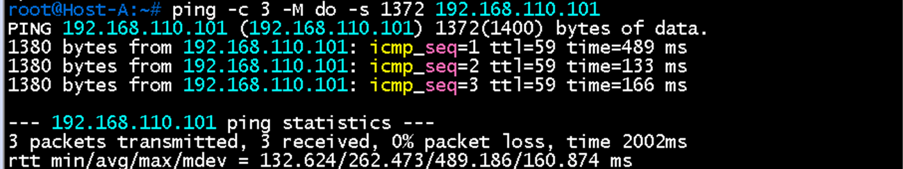 | 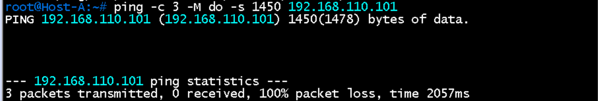 |

| UDP 1Mbit/sec | UDP 2Mbit/sec |
|---|---|
| 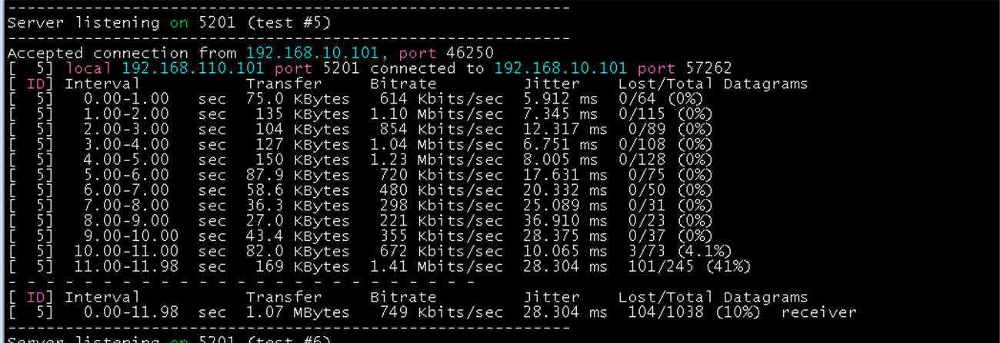 | 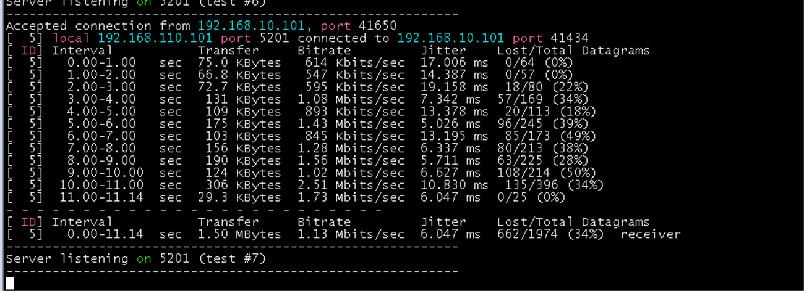 |

## 시험 순서

모든 시험은 Host A -> Host D(`192.168.110.101`), 서버는 Host D에서 `iperf3 -s`. 혼잡 트래픽은 별도 창에서 UDP, EF 프로브는 다른 창에서 ping

| 순서 | 상태 | PE1 `Gi0/0` 출구 정책 | 동작 | 기대 결과 |
|---|---|---|---|---|
| 1 | 혼잡 없음 | 없음 | EF 프로브: `ping -Q 184 -c 100 -i 0.2 192.168.110.101` | 지연이 낮고 손실 0 (기준값 기록) |
| 2 | 혼잡, 정책 없음 | `SHAPE-ONLY` | `iperf3 -c 192.168.110.101 -u -b 800k -l 1200 -t 60`을 흘리며 EF 프로브 | 지연이 늘고 손실 발생 |
| 3 | 혼잡, 정책 적용 | `SHAPE-400K` | 같은 조건에서 EF 프로브 | EF 지연과 손실이 **2번보다 크게 개선** |
| 4 | 카운터 | `SHAPE-400K` | `show policy-map interface gigabitethernet 0/0` | VOICE-EXP 클래스에 패킷이 집계되고 class-default에 드롭이 있음 |
| 5 | DSCP, TC 매핑 | `SHAPE-400K` | PE1 `Gi0/0` 링크 캡처, 필터 `mpls.exp == 5` | EF 프로브가 TC 5, 안쪽 DSCP 46 |

시험 중 `show ip bgp summary`로 이웃이 Established인지 확인(부하로 BGP가 끊기면 시험을 다시 함)

## 증빙: EF 프로브 (1회차, 2026-10-23)

`ping -Q 184 -i 0.2 192.168.110.101` (두 번 모두 100개를 채우지 않고 73개에서 중단)

| 구분 | 송신 / 수신 | 손실 | 지연 최소 / 평균 / 최대 | mdev |
|---|---|---|---|---|
| 정책 적용 전 | 73 / 72 | 1.37% | 90.2 / **491.7** / 2243.9 ms | 569.2 ms |
| 정책 적용 후 | 73 / 71 | 2.74% | 98.5 / **241.4** / 1577.6 ms | 288.2 ms |

- 평균 지연 491.7 -> 241.4 ms(약 51% 감소), 최대 2244 -> 1578 ms, 지연 변동(mdev) 569 -> 288 ms로 개선
- 손실은 1개와 2개 차이(73개 중)라 의미 있는 차이가 아님
- 한계: 혼잡 없음 기준값은 이후 5개로 측정했고(아래 상태 1), 이 랩은 정책 없이도 지연이 크게 튀어 1회 결과만으로는 부족. 같은 조건으로 반복하고 `show policy-map interface`의 클래스 카운터로 EF가 우선 큐를 탔는지 함께 확인해야 함
- 정책 적용 전의 PE1 `Gi0/0` 상태(정책 없음 또는 `SHAPE-ONLY`)와 혼잡 트래픽 동시 전송 여부는 불명(이후 상태 2, 3을 조건을 정해 다시 측정)

| 정책 적용 전 | 정책 적용 후 |
|---|---|
| 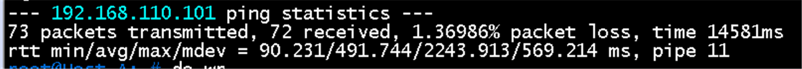 | 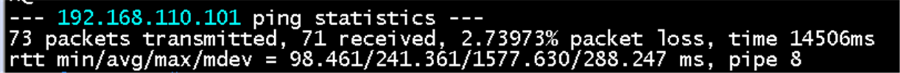 |

## 증빙: PE1 정책 카운터 (1회차 직후)

- 입구 `show policy-map interface gigabitethernet 2/0`: `PE-IN`의 **VOICE**(`dscp ef (46)`) **73 packets**, `mpls experimental imposition 5` **Packets marked 73**. 나머지 클래스는 0, class-default 109 packets. EF 프로브 73개가 모두 TC 5로 매핑됨
- 출구 `show policy-map interface gigabitethernet 0/0`: `SHAPE-400K`(shape average 400000) 아래 `CORE-OUT`. **VOICE-EXP 73 packets, 7154 bytes**(`match mpls experimental topmost 5`, priority 20% = 80 kbps, `b/w exceed drops: 0`). 입구 73과 일치하므로 EF 프로브가 **DSCP 46 -> TC 5 -> 우선 큐**로 처리됨(항목 4의 매핑과 분류 확인)
- 그러나 class-default는 **266 packets, 34552 bytes**(평균 약 130바이트, 드롭 0)뿐이고 5분 평균 1000 bps. 800Kbit/sec UDP(1200바이트)를 60초 보내면 수천 개가 집계되어야 하므로, **이 회차의 EF 프로브에는 혼잡 UDP가 이 인터페이스를 지나지 않았음**. 정책 적용 후의 평균 지연 241 ms는 혼잡이 없는 상태의 값으로 보이며, 앞 표의 "개선"은 정책 효과로 단정할 수 없음
- 따라서 혼잡 시험은 UDP가 PE1 `Gi0/0`을 지나는 것을 카운터로 확인하며 다시 해야 함

| 출구 (Gi0/0) | 입구 (Gi2/0) |
|---|---|
| 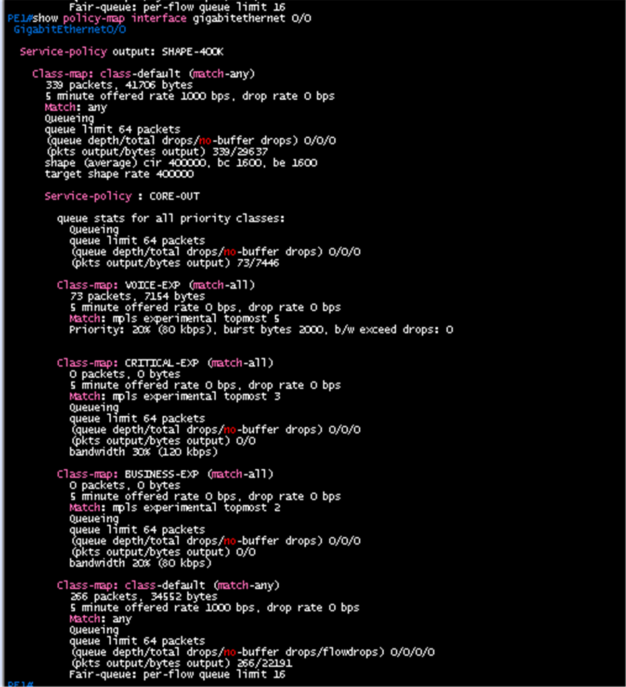 | 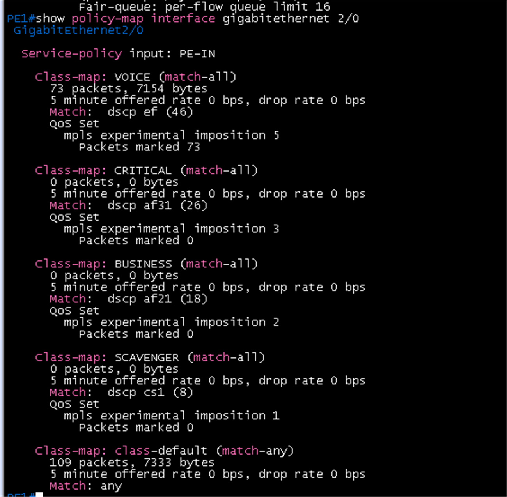 |

## 증빙: 혼잡 트래픽을 흘린 상태 (상태 3, `SHAPE-400K`, 2회차)

- 혼잡 트래픽: Host A -> Host D `iperf3 -u -b 800k -l 1200 -t 60`. Host D 수신 요약: **2.67 MBytes, 362 Kbit/sec, Lost/Total 2617/4951 (53%)**, jitter 6195 ms, 순서가 바뀐 데이터그램 2050개. 800Kbit/sec를 보냈는데 수신이 shaping 값(400Kbit/sec) 부근이고 절반이 손실되어 **PE1 출구 shaping이 혼잡을 만들고 있음**
- EF 프로브(같은 시간): `ping -Q 184 -c 100 -i 0.2`: **100개 중 100개 응답, 손실 0%**, 지연 최소 90.7 / 평균 **156.1** / 최대 875.4 ms, mdev 112.9 ms
- 같은 링크에서 best-effort UDP는 53%를 잃고 EF는 0%를 잃음. 우선 큐가 EF를 혼잡에서 보호한 것으로 보임(이후 PE1 카운터로 확인함, 아래 상태 3 카운터 참고)
- 앞 1회차(혼잡 UDP가 정책을 지나지 않은 상태)의 평균 241 ms보다 혼잡 중인데도 평균이 낮음. 이 랩의 지연이 원래 크게 튀므로 정책 없음 상태와 같은 조건으로 비교 필요

| Host D UDP 수신 | EF 프로브 |
|---|---|
| 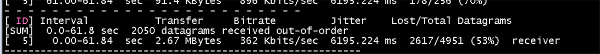 | 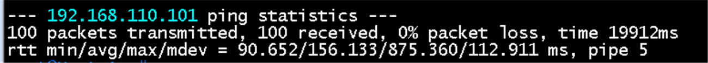 |

### 상태 3의 PE1 카운터 (혼잡 시험 직후)

- 출구 `show policy-map interface gigabitethernet 0/0`: 부모 `class-default` **7860 packets**, `queue depth/total drops/no-buffer drops` **0/2098/0**, 출력 5762 packets. 자식 `CORE-OUT`:
  - **VOICE-EXP 173 packets, 16954 bytes**, priority 20%(80 kbps), `b/w exceed drops: 0`, 우선 큐 드롭 **0/0/0**
  - CRITICAL-EXP, BUSINESS-EXP 0 packets (이 시험에 해당 트래픽 없음)
  - `class-default` **7687 packets, 6362933 bytes**, 드롭 **0/2098/0/2098**(flowdrops 2098), 출력 5589 packets, `Fair-queue: per-flow queue limit 16`
- 입구 `show policy-map interface gigabitethernet 2/0`: **VOICE 173 packets, Packets marked 173**(`mpls experimental imposition 5`), `class-default` 5843 packets
- 직전 카운터(혼잡 전)는 VOICE-EXP 73, class-default 266, 드롭 0이었음. 이번 시험으로 **VOICE-EXP +100(EF 프로브 100개)**, **class-default +7421 packets와 드롭 2098**
- 해석: EF 프로브 100개는 **전부 우선 큐를 타고 드롭 0**, best-effort UDP는 shaping 아래 per-flow 큐(한도 16)에서 2098개 드롭. 정책이 설계대로 클래스를 나누고 혼잡 손실을 best-effort 쪽에 몰아줌
- 참고: 카운터는 장비 부팅 이후 누적이라 Host D의 손실(2617)과 일치하지 않음(shaper 드롭 외에 다른 손실 포함 또는 누적 범위 차이)

| 출구 (Gi0/0) | 입구 (Gi2/0) |
|---|---|
| 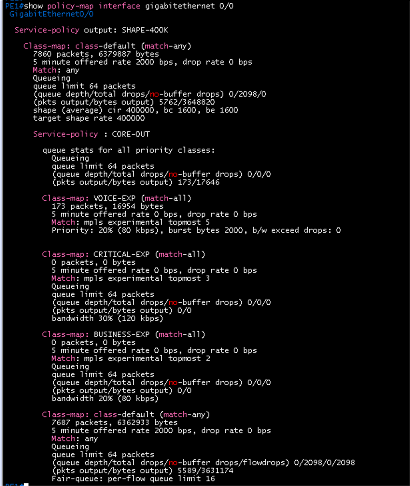 | 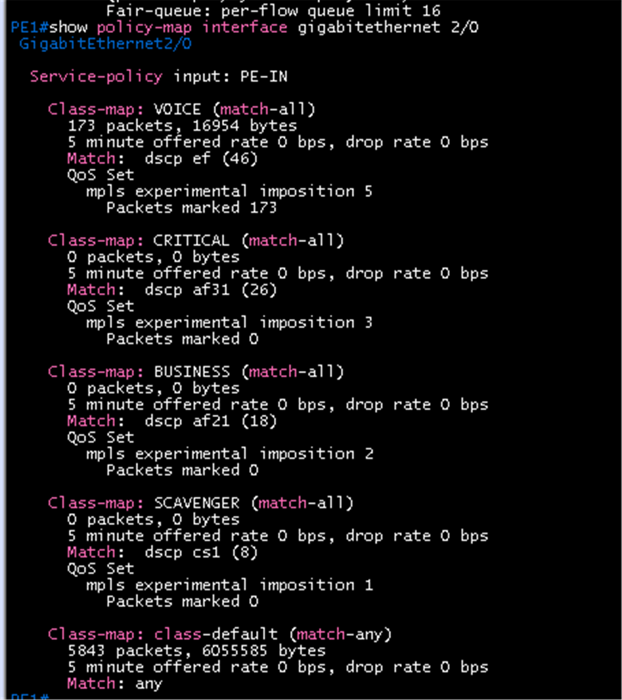 |

## 증빙: 상태 2 (`SHAPE-ONLY`, 혼잡)

- PE1 `show policy-map interface gigabitethernet 0/0`: `Service-policy output: SHAPE-ONLY`, `class-default` **3061 packets, 3414415 bytes**, 5분 평균 offered 76000 bps, **drop rate 40000 bps**, `queue depth/total drops/no-buffer drops` **0/1370/0**, 출력 1691 packets. shape average 400000. 큐 클래스가 없어 모든 트래픽이 한 큐
- Host D UDP 수신: 70.98초 동안 **1.52 MBytes, 180 Kbit/sec, Lost/Total 1385/2717 (51%)**, jitter 34.2 ms. shaper 드롭 1370과 수신 손실 1385가 거의 같아 **손실은 PE1 출구 shaping에서 발생**
- **PE1 BGP 세션이 끊김**: `%BGP-5-ADJCHANGE: neighbor 10.0.0.12 Down Peer closed the session`(09:43:38.9) 후 `Up`(09:44:01.5), **약 22.6초** 단절. 10.0.0.12는 PE2. 상태 2에서는 모든 트래픽이 한 큐라 혼잡 UDP 뒤에서 BGP 유지 패킷이 밀리거나 드롭된 것으로 보임. 상태 3(`SHAPE-400K`)의 같은 시험에서는 끊기지 않았음(1회씩이라 우연일 수 있음)
- 영향: 이 22초 동안 Host A -> Host D 경로(VPNv4)가 끊겼을 가능성이 높고, 수신 구간이 전송 구간보다 길게 나온 것(70.98초)도 같은 이유로 추정. 상태 2의 EF 프로브는 이 단절에 오염될 수 있어 아래 4회차에서 다시 측정함. 이 회차의 ping 통계는 없음
- 개선 후보: 라우팅 프로토콜(BGP, OSPF, LDP)이 만드는 제어 트래픽(DSCP CS6, TC 6)을 `CORE-OUT`에 별도 클래스로 두어 최소 대역폭 보장

| Host D UDP 수신 | PE1 정책 카운터와 BGP 로그 |
|---|---|
| 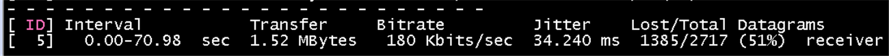 | 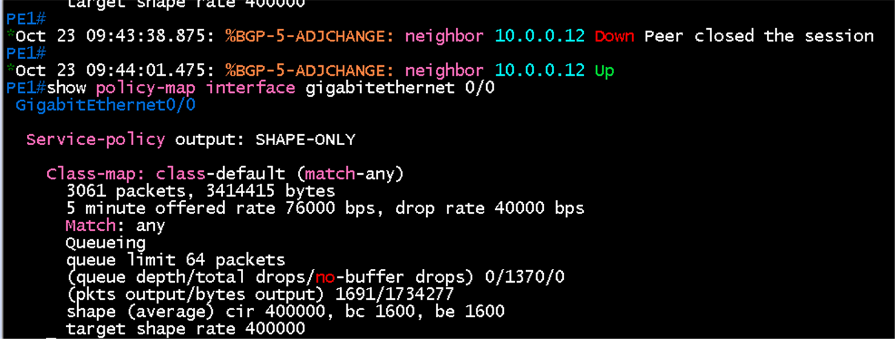 |

## 증빙: 상태 3 + `NETCTRL` (`SHAPE-400K`, 3회차)

- PE1 `show policy-map interface gigabitethernet 0/0`(정책을 새로 붙인 뒤 이번 시험만 집계):
  - 부모 `class-default` 5674 packets, offered 147000 bps, **drop rate 74000 bps**, `queue depth/total drops/no-buffer drops` **0/2238/0**
  - **VOICE-EXP 100 packets, 9800 bytes**, 우선 큐 드롭 **0**, `b/w exceed drops: 0`
  - **NETCTRL 563 packets, 74830 bytes**, 드롭 **0/0/0**. 분류는 `match dscp cs6` 563개로 잡힘(`mpls experimental topmost 6`은 0개: PE2와 직접 연결이라 라벨 없이 나감)
  - 자식 `class-default` 5011 packets, **드롭 2238**(flowdrops 2238), 출력 2773 packets
- EF 프로브: `ping -Q 184 -c 100 -i 0.2`: **100개 중 100개 응답, 손실 0%**, 지연 최소 87.9 / 평균 **304.8** / 최대 2300.4 ms, mdev 447.5 ms
- Host D UDP 수신: **363 Kbit/sec, Lost/Total 2609/4912 (53%)**, jitter 2313 ms, 순서가 바뀐 데이터그램 2064개
- 시험 중 BGP는 끊기지 않음(로그 없음)
- 해석: 혼잡 드롭 2238개가 **전부 class-default**에서 나고 **VOICE-EXP와 NETCTRL의 드롭은 0**. 정책이 EF와 제어 트래픽을 혼잡에서 보호함. 그러나 EF 지연은 2회차(평균 156 ms, 최대 875 ms)보다 크게 나옴. 같은 상태에서 회차마다 평균이 2배 차이 나므로 **이 랩의 지연 변동이 크다는 뜻**이고, 상태 간 비교는 반복 평균으로 해야 함. 우선 큐를 지난 EF가 PE1에서 지연되었다기보다 PE1 밖 에뮬레이션 구간의 지연일 가능성이 큼(확정 아님)

| PE1 정책 카운터 | EF 프로브 | Host D UDP 수신 |
|---|---|---|
|  | 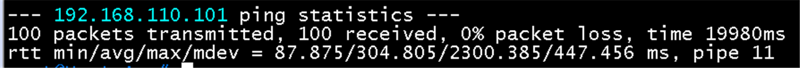 | 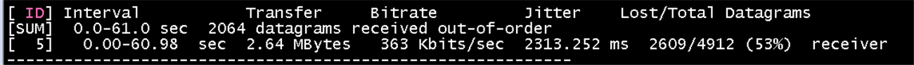 |

## 증빙: 상태 2 재시험 (`SHAPE-ONLY`, 4회차)

- PE1 `show policy-map interface gigabitethernet 0/0`: `Service-policy output: SHAPE-ONLY`, `class-default` **5179 packets, 6058995 bytes**, offered 159000 bps, **drop rate 79000 bps**, 총 드롭 **0/2408/0**, 출력 2771 packets
- EF 프로브: `ping -Q 184 -c 100 -i 0.2`: **100개 중 100개 응답, 손실 0%**, 지연 최소 89.9 / 평균 **529.1** / 최대 2425.4 ms, mdev 663.6 ms
- Host D UDP 수신: **349 Kbit/sec, Lost/Total 2724/5000 (54%)**, jitter 20.7 ms. 드롭 2408과 수신 손실 2724가 같은 규모
- 이번에는 BGP 로그를 받지 못함(끊김 여부 미확인)
- 비교: EF 평균 지연은 상태 2가 **529 ms**, 상태 3이 **156 ms와 305 ms**(2회). 최대 지연은 상태 2가 2425 ms, 상태 3이 875 ms와 2300 ms. 손실은 모두 0%. 평균은 상태 3이 낮지만 최대는 비슷하고 상태 3의 회차 편차(156 대 305)가 상태 2와의 차이에 가까워 **정책 효과를 지연만으로 단정하기는 어려움**. 확실한 증거는 클래스별 드롭(상태 3은 VOICE-EXP와 NETCTRL 드롭 0)
- 상태 2에서 EF 손실이 없었던 이유: ICMP 100개는 혼잡 UDP 사이에서 큐에 자리가 있을 때 들어가 운 좋게 모두 통과했을 가능성. 이 랩은 지연 변동이 커서 반복해도 단정하기 어려움

| PE1 정책 카운터 | EF 프로브 | Host D UDP 수신 |
|---|---|---|
| 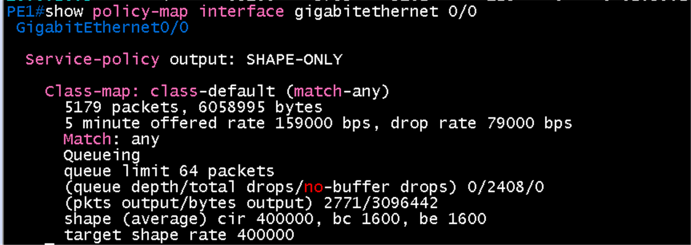 | 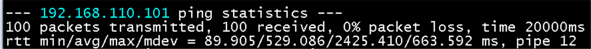 |  |

## 증빙: 상태 1 (혼잡 없음, 출구 정책 없음)

- PE1 `Gi0/0`에서 `no service-policy output SHAPE-ONLY`로 출구 정책을 뗌
- Host A `ping -Q 184 -c 5 192.168.110.101`: **5개 중 5개 응답, 손실 0%**, 지연 최소 120.0 / 평균 **154.6** / 최대 197.5 ms, mdev 33.5 ms (5개뿐이라 참고값)
- 정리: 혼잡이 없을 때의 EF 지연은 약 120 ~ 200 ms. 상태 3의 평균 156 ms(2회차)는 이 값과 같은 수준이고, 상태 2의 529 ms와 상태 3의 305 ms(3회차)는 이보다 큼. 이 랩의 지연 바닥이 이미 높음(경로 에뮬레이션)

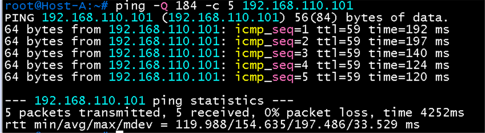

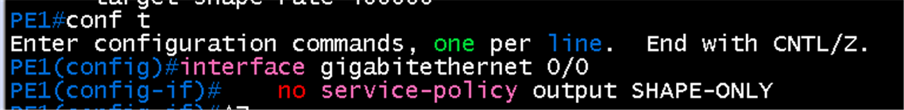

## 캡처 결과: MPLS TC 5 (항목 5)

- 캡처 링크 코어 링크(PE1 - PE2), 일으킨 동작 `ping -Q 184`, 필터 `mpls.exp == 5`
- 패킷 75(Echo request): `MultiProtocol Label Switching Header, Label: 20, Exp: 5, S: 1, TTL: 61`, IP **192.168.10.101 -> 192.168.110.101**, ICMP Echo (ping) request, id 0x7813, seq 5
- 패킷 70(Echo reply): `Label: 29, Exp: 5, S: 1, TTL: 62`, IP **192.168.110.101 -> 192.168.10.101**, Echo (ping) reply. Request frame 69, 응답 시간 56.1 ms
- 두 방향 모두 **Exp 5**. EF(DSCP 46)가 입구 정책으로 TC 5에 매핑되었고, 반대 방향의 응답도 TC 5. 응답 방향(PE2 입구)에는 `PE-IN`을 걸지 않았는데도 5이므로 **DSCP 상위 3비트가 TC로 기본 복사**되는 동작을 확인(기준 문서의 설명과 일치)
- 라벨 값(20, 29)은 LDP가 PE1과 PE2 사이에 나눈 transport 라벨이고 S=1이라 라벨이 하나(PHP 구간)

| Echo request (패킷 75) | Echo reply (패킷 70) |
|---|---|
| 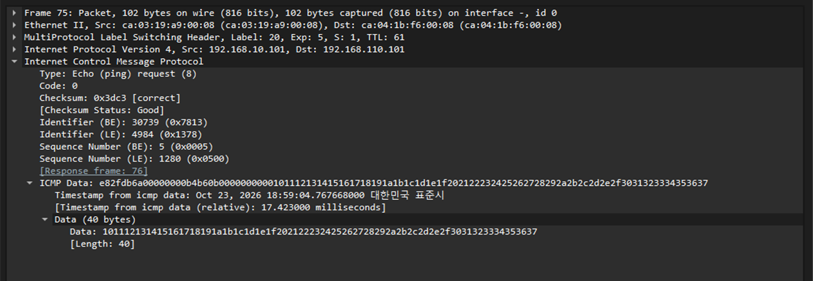 | 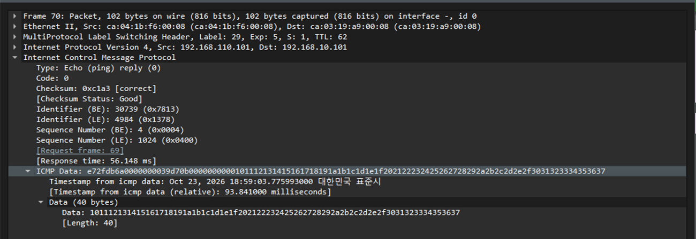 |

## 결과 기록

| 상태 | 평균 지연 | 손실 | 비고 |
|---|---|---|---|
| 혼잡 없음 (출구 정책 없음) | 154.6 ms (최대 197.5 ms) | 0% (0/5) | 5개 측정, 참고값 |
| 혼잡, 정책 없음 | 491.7 ms (최대 2243.9 ms) | 1.37% (1/73) | 1회차. 조건 불명(참고만) |
| 혼잡, 정책 적용 | 241.4 ms (최대 1577.6 ms) | 2.74% (2/73) | 1회차. 혼잡 UDP가 정책을 지나지 않음(카운터). 이후 3회차로 재측정 |
| 혼잡 중 정책 적용 (2회차, UDP 800K 동시) | 156.1 ms (최대 875.4 ms) | 0% (0/100) | UDP는 53% 손실, 수신 362 Kbit/sec. PE1 카운터: VOICE-EXP 드롭 0, class-default 드롭 2098 |
| 혼잡 중 정책 적용 + NETCTRL (3회차, UDP 800K 동시) | 304.8 ms (최대 2300.4 ms) | 0% (0/100) | UDP 53% 손실. VOICE-EXP 드롭 0, NETCTRL 드롭 0, class-default 드롭 2238. 2회차와 지연 차이가 커 반복 필요 |
| 혼잡, `SHAPE-ONLY` (4회차, UDP 800K 동시) | 529.1 ms (최대 2425.4 ms) | 0% (0/100) | UDP 54% 손실, 드롭 2408(큐 하나). BGP 로그 미확인 |
| 매핑 확인 (입구 DSCP 46 -> TC 5, 출구 VOICE-EXP) | | | 성공 (73/73) |

## 결론 (2026-10-23)

이 랩은 지연이 회차마다 크게 변동하므로(같은 상태에서 평균 156 ms와 305 ms) 평균 지연으로 비교하지 않고 **확인 항목 기준**으로 판정함

| 확인 항목 | 근거 | 결과 |
|---|---|---|
| 입구 매핑 | `PE-IN`의 VOICE 73 packets, `Packets marked 73`(DSCP 46 -> TC 5) | 성공 |
| MPLS TC | 캡처에서 Echo request와 reply 모두 `Exp: 5` (기본 복사 포함) | 성공 |
| EF 우선 처리 | 혼잡 중 `VOICE-EXP` 100 packets, 드롭 0, `b/w exceed drops: 0` | 성공 |
| 혼잡 손실의 분리 | 드롭 2238개가 모두 `class-default`, EF 프로브 손실 0% (100/100) | 성공 |
| 제어 트래픽 보호 | `NETCTRL` 563 packets, 드롭 0. 큐가 하나뿐인 상태 2에서는 PE1-PE2 BGP가 22초 끊긴 적이 있음 | 성공 (상태 2의 단절은 1회 관찰) |
| shaping 동작 | 800Kbit/sec를 보내면 수신 약 350 ~ 360Kbit/sec, 손실 약 53% | 성공 |

- 지연 개선은 판정에 쓰지 않음: 상태 2의 EF 평균 529 ms, 상태 3의 156 ms와 305 ms, 혼잡 없음 155 ms(5개). 방향은 일관되지만 회차 편차가 개선 폭과 비슷해 결론으로 쓰기 어려움
- 적용 범위: PE1 한 방향(Host A -> Host D). PE2, PE3와 Branch 쪽, 반대 방향에는 정책이 없음
- 최종 상태: PE1 `Gi0/0` 출구는 `SHAPE-400K`로 복구해 둠. 시험용 shaping이라 운영 설정이 아님
