# OSPF underlay 검증

**선행 조건**: spine1, spine2, leaf1~leaf4가 켜져 있고 [OSPF underlay 샘플](../../samples/dc1/05-ospf-underlay.md)이 적용되어 있어야 함

기준 문서: [03-ospf-underlay.md](../../baseline/dc1/03-ospf-underlay.md)

## 확인 항목

| 순서 | 장비 | 명령 | 기대 결과 | 안 될 때 확인 |
|---|---|---|---|---|
| 1 | leaf1~leaf4 | `show ip ospf neighbor` | spine1, spine2 두 이웃이 모두 **FULL** | 링크 IP(/31), ip ospf area, 포트 연결 |
| 2 | spine1, spine2 | `show ip ospf neighbor` | leaf 4대가 모두 **FULL** | 같은 점검 |
| 3 | leaf1 | `show ip route ospf` | 다른 leaf의 Loopback0, Loopback1이 **경로 2개**(spine1, spine2)로 보임 | ECMP: maximum-paths |
| 4 | leaf1 | `ping 10.1.0.14 source loopback0` | 응답 (leaf4 Loopback0) | 라우팅 테이블, 방화벽 |
| 5 | 모든 노드 | `show ip ospf interface brief` | 링크 인터페이스가 point-to-point이고 **Hello 1, Dead 4**(`show ip ospf interface ethernet1`). **spine은 loopback0, ethernet1~4, leaf는 loopback0, loopback1, ethernet1~2만** 나옴 | ip ospf network point-to-point, 인터페이스의 ip ospf area |
| 6 | 링크 인터페이스 | `show interfaces Ethernet1 switchport`, `show ip interface brief` | `Switchport: Disabled`, 주소가 보이고 **up/up** | `ip routing`이 켜져 있는지(`show running-config | include ip routing`)와 `no switchport` 적용. 경고가 떴어도 결과가 이 상태면 정상 |
| 7 | 모든 노드 | `show ip ospf interface loopback0`, leaf는 `loopback1`도 | passive로 표시되고 이웃 없음 | router ospf 1의 passive-interface |

## 장애 시험

| 동작 | 기대 결과 |
|---|---|
| spine1 정지 | leaf의 경로가 spine2 하나로 줄고 통신은 유지됨 |

## 사전 확인: 링크 IP (OSPF 전, 2026-10-22)

OSPF를 넣기 전에 spine과 leaf 사이 /31 링크 주소가 맞는지 확인한 결과. 필요한 부분만 크롭하여 수록

| 장비 | 화면 | 볼 곳 |
|---|---|---|
| spine1 | 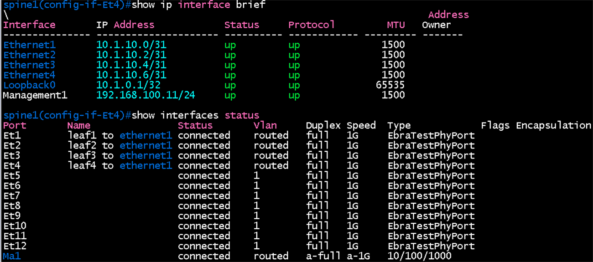 | Ethernet1~4 (10.1.10.0, .2, .4, .6 /31), Loopback0 10.1.0.1/32가 up/up, Et1~4가 routed |
| spine2 | 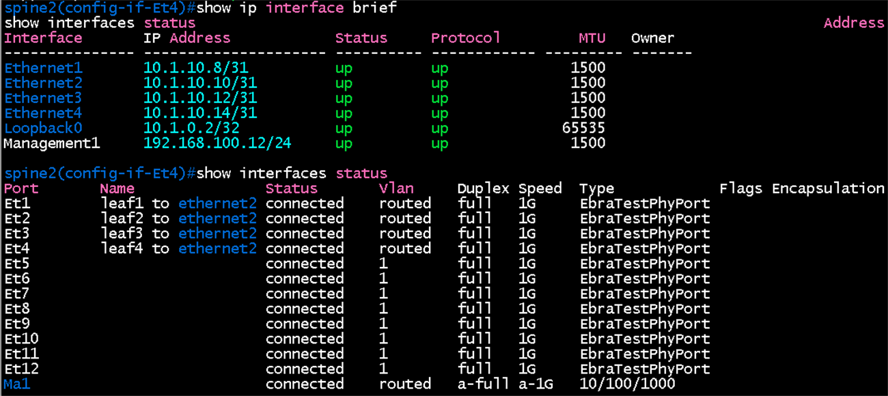 | Ethernet1~4 (10.1.10.8, .10, .12, .14 /31), Loopback0 10.1.0.2/32가 up/up |

| 출발 | 대상 | 화면 |
|---|---|---|
| spine1 | leaf3 (10.1.10.5) | 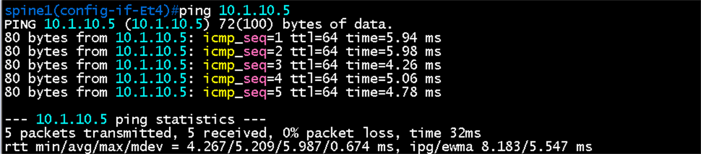 |
| spine1 | leaf1 (10.1.10.1), leaf2 (10.1.10.3) | 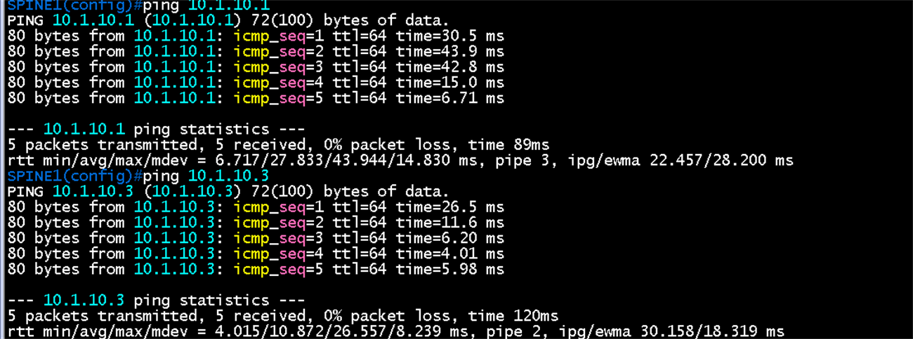 |
| spine2 | leaf3 (10.1.10.13) | 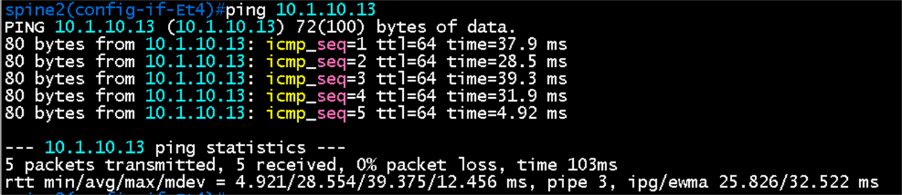 |
| spine2 | leaf3 (10.1.10.13), leaf1 (10.1.10.9) | 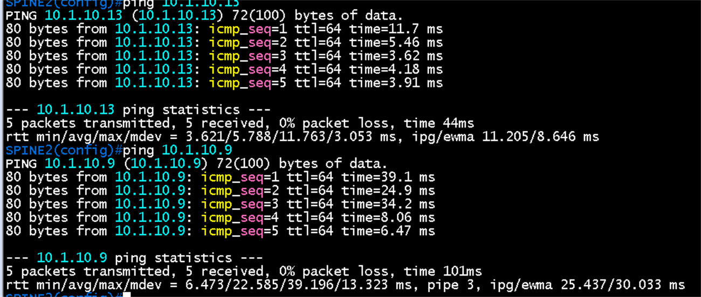 |
| spine1 | leaf4 (10.1.10.7) | 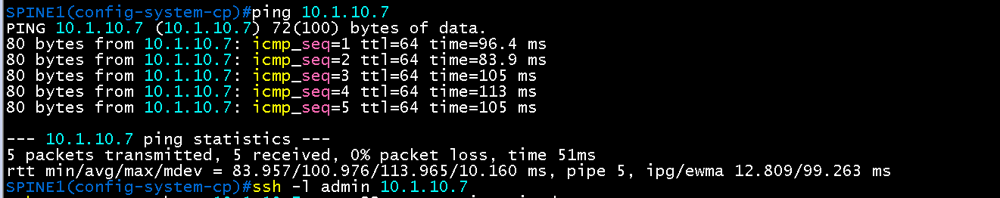 |
| spine2 | leaf2 (10.1.10.11), leaf4 (10.1.10.15) | 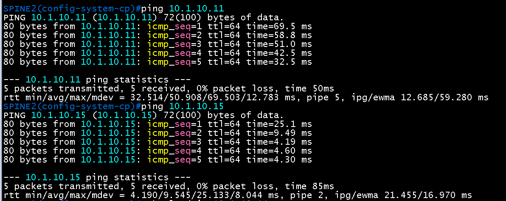 |

- 링크 8개(spine1, spine2 각 leaf1~4)를 모두 확인됨
- 모두 5개 중 5개 응답, 손실 0%. 지연은 장비 부하에 따라 4ms에서 100ms 사이로 달라짐(vEOS 특성).

## 증빙 (OSPF 적용 후, 2026-10-22)

hello 1초, dead 4초 타이머로 spine1, spine2, leaf1~4에 OSPF를 적용한 뒤의 화면. 필요한 부분만 크롭하여 수록

### 1. 이웃 FULL과 타이머 (항목 1, 2, 5)

| 장비 | 화면 | 볼 곳 |
|---|---|---|
| leaf1 | 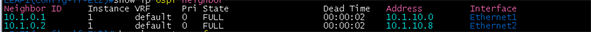 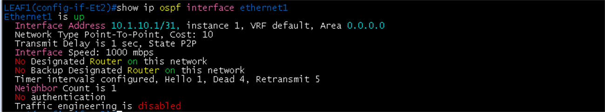 | spine1(10.1.0.1), spine2(10.1.0.2)가 **FULL**, Point-To-Point, **Hello 1, Dead 4**, Neighbor Count 1 |
| leaf2 | 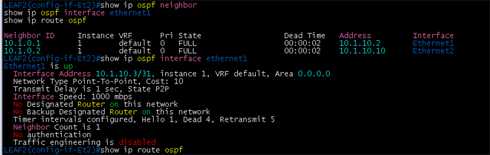 | 같은 내용 (이웃 주소 10.1.10.2, 10.1.10.10) |
| leaf3 | 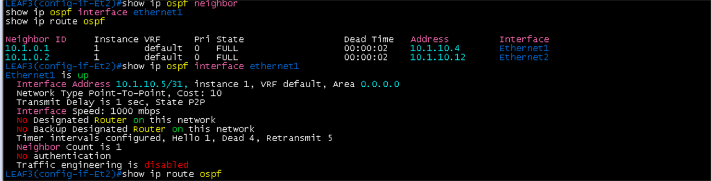 | 같은 내용 (이웃 주소 10.1.10.4, 10.1.10.12) |
| leaf4 | 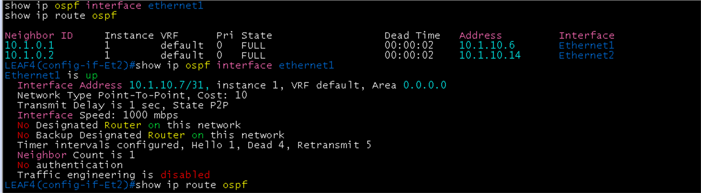 | 같은 내용 (이웃 주소 10.1.10.6, 10.1.10.14) |
| spine2 | 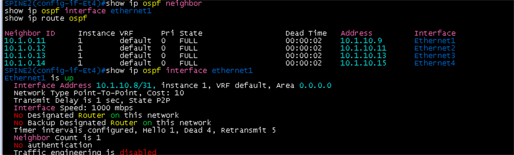 | leaf 4대(10.1.0.11 ~ 10.1.0.14)가 모두 **FULL**, Hello 1, Dead 4 |
| spine1 | 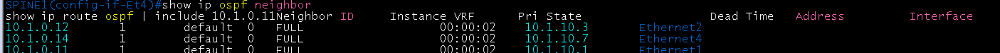 | leaf 4대가 모두 **FULL**, `10.1.0.11/32` 경로가 보임 |

- spine1에서 leaf1(10.1.0.11)이 처음에는 `LOADING`으로 보였다가 다시 확인하자 `FULL`이 되었음. 적용 직후 잠깐 나타난 일시적인 상태였음
- leaf1에서 `10.1.0.11/32`가 OSPF 경로로 보이지 않는 것은 정상. leaf1 자신의 `loopback0`이라 연결된 경로(connected)로 잡힘.

### 2. 경로와 ECMP (항목 3)

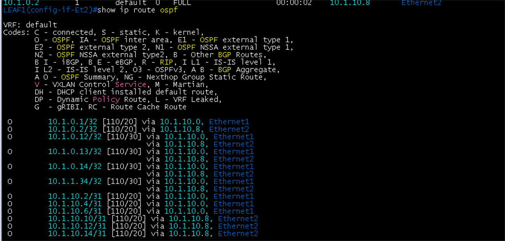

- 다른 leaf의 `loopback0`(10.1.0.12 ~ 10.1.0.14)과 `loopback1`(VTEP 10.1.1.34)이 경로 **2개**(spine1 `10.1.10.0` 경유 `ethernet1`, spine2 `10.1.10.8` 경유 `ethernet2`)로 보임
- spine의 `loopback0`(10.1.0.1, 10.1.0.2)은 각각 직접 연결된 spine 방향 경로 1개

### 3. loopback0 간 도달성 (항목 4)

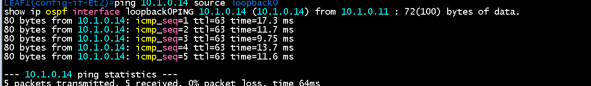

- `ping 10.1.0.14 source loopback0`(leaf1 -> leaf4)이 5개 중 5개 응답, 손실 0%. `ttl=63`은 spine 한 대를 거쳤다는 뜻

### 4. loopback은 passive (항목 7)

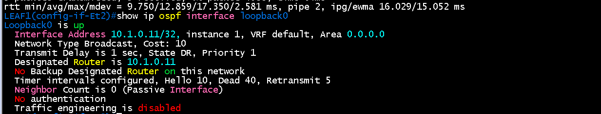

- `loopback0`이 OSPF에 들어 있고(Area 0.0.0.0) **Neighbor Count is 0 (Passive Interface)** 로 표시됨
- Network Type이 Broadcast로 나오는 것은 EOS가 loopback을 그렇게 표시하기 때문이고, 이웃이 없는 passive 인터페이스라 영향이 없음. /32 주소는 그대로 광고됨
- Hello 10, Dead 40은 loopback에 타이머를 따로 주지 않은 기본값이며, passive라 hello를 보내지 않으므로 의미가 없음. 타이머 1/4는 링크 인터페이스에만 적용
## 패킷 캡처 (Wireshark)

### OSPF Hello (spine1 `ethernet1` - leaf1 `ethernet1` 링크)

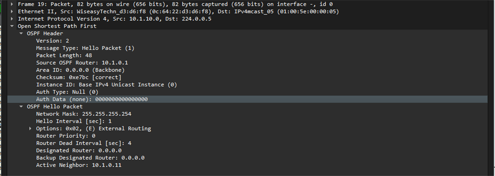

- 표시 필터 `ospf.msg.hello`, Frame 19. spine1(Source OSPF Router `10.1.0.1`, 출발 `10.1.10.0`)이 OSPF 멀티캐스트 `224.0.0.5`로 보낸 Hello
- **Hello Interval 1초, Router Dead Interval 4초**: 설정한 타이머가 실제 패킷에 담겨 나감
- Network Mask `255.255.255.254`(/31), Area `0.0.0.0`(Backbone), Auth Type Null
- Designated Router, Backup Designated Router가 `0.0.0.0`. point-to-point 링크라 DR 선출이 없음
- Active Neighbor `10.1.0.11`: spine1이 이 링크의 leaf1을 이웃으로 인식하고 있음
## 결과 기록

| 일시 | 결과 (성공, 실패) | 비고 |
|---|---|---|
| 2026-10-22 | 진행 중 (OSPF 이웃, 타이머, 경로, 도달성 확인) | 항목 1~5, 7 확인(항목 7은 leaf1 loopback0 기준, 나머지 장비 loopback도 같은 설정). Wireshark Hello 확인. 장애 시험(spine1 정지)은 남음 |
