# MLAG 검증

**선행 조건**: spine과 leaf가 켜져 있고 leaf 쌍의 Et3-4(peer-link)가 연결되어 있어야 함. **OSPF underlay와는 독립적이라 OSPF 전에 해도 됨.** [MLAG 샘플](../../samples/dc1/06-mlag.md)이 leaf1/leaf2, leaf3/leaf4에 적용되어 있어야 함

기준 문서: [04-mlag.md](../../baseline/dc1/04-mlag.md)

## 확인 항목

| 순서 | 장비 | 명령 | 기대 결과 | 안 될 때 확인 |
|---|---|---|---|---|
| 1 | leaf1, leaf3 | `show mlag` | state **Active**, negotiation status **Connected**, peer-link **Up** | domain-id, peer-address, Vlan4094 IP, peer-link 포트채널 |
| 2 | leaf1, leaf3 | `show mlag config-sanity` | 구성 불일치(inconsistencies) 없음 | 양쪽 설정 값 비교 |
| 3 | leaf1 | `show mlag interfaces` | Port-Channel10이 **active-full** | 양쪽 mlag 10, 호스트 LACP |
| 4 | leaf1 | `show port-channel dense` | Po1(peer-link)과 Po10의 멤버가 활성 | channel-group 번호 |
| 5 | Host A | `cat /proc/net/bonding/bond0` | 두 slave가 같은 Aggregator ID, LACP 협상됨 | 호스트 bond 설정, 어댑터 2개 |
| 6 | Host A | `ping -c 3 192.168.10.1` | 응답 | VLAN 10, 게이트웨이 |
| 7 | leaf3, leaf4 | `show spanning-tree interface ethernet7 detail` | `designated forwarding`, **`Bpdu guard is enabled`**, BPDU received 0 (호스트 포트의 portfast, bpduguard). leaf1·2는 `show spanning-tree interface port-channel 10 detail` (Host A 연결 뒤) | `spanning-tree portfast`, `spanning-tree bpduguard enable`, 포트채널은 호스트 LACP가 올라와야 나타남 |

## 장애 시험

| 동작 | 기대 결과 |
|---|---|
| leaf1 정지 | Host A는 leaf2로 계속 통신 (ping 유지, 한두 개 손실은 가능) |
| peer-link(Et3-4) 하나 shut | MLAG 유지, 나머지 링크로 동작 |

## 증빙 (2026-10-22)

leaf1/leaf2(MLAG1)과 leaf3/leaf4(MLAG2) 두 쌍에서 확인한 화면. 필요한 부분만 크롭하여 수록

### 1. show mlag: state Active, Connected, peer-link Up

| 장비 | 화면 | 볼 곳 |
|---|---|---|
| leaf1 | 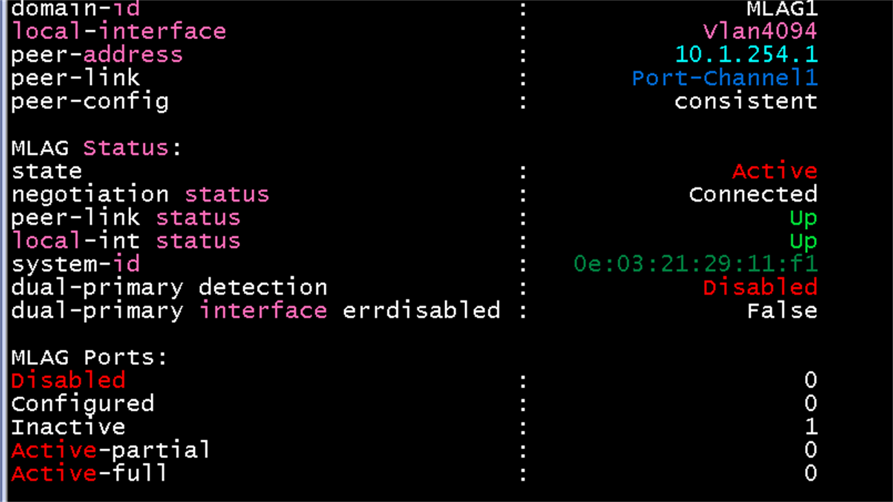 | domain MLAG1, peer 10.1.254.1, state Active, peer-config consistent |
| leaf2 | 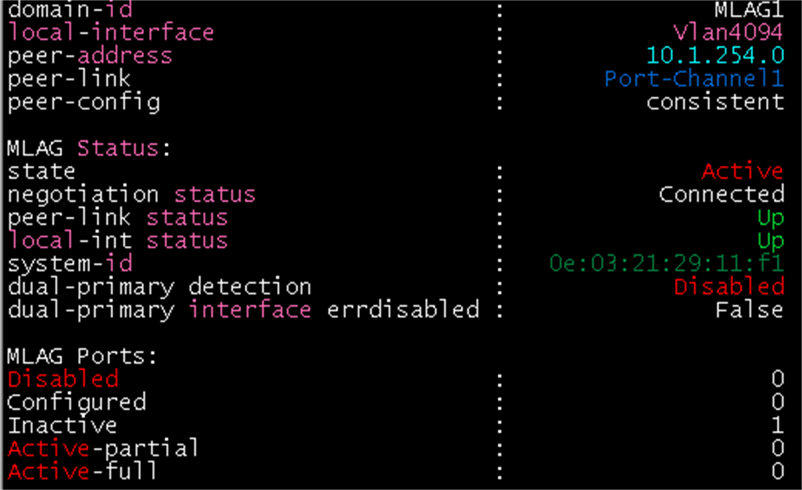 | domain MLAG1, peer 10.1.254.0, system-id가 leaf1과 같음 |
| leaf3 | 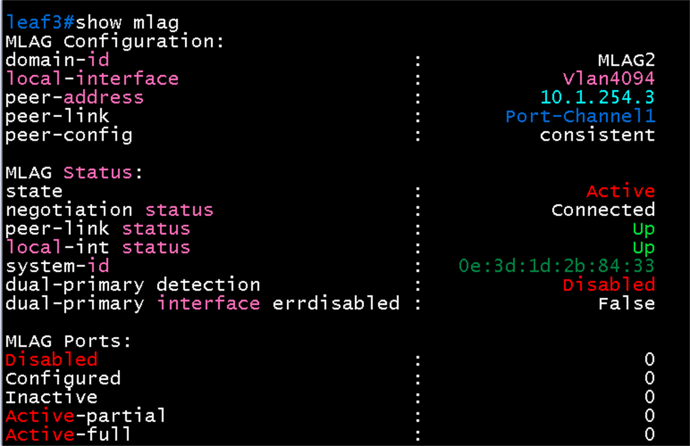 | domain MLAG2, peer 10.1.254.3, state Active |
| leaf4 | 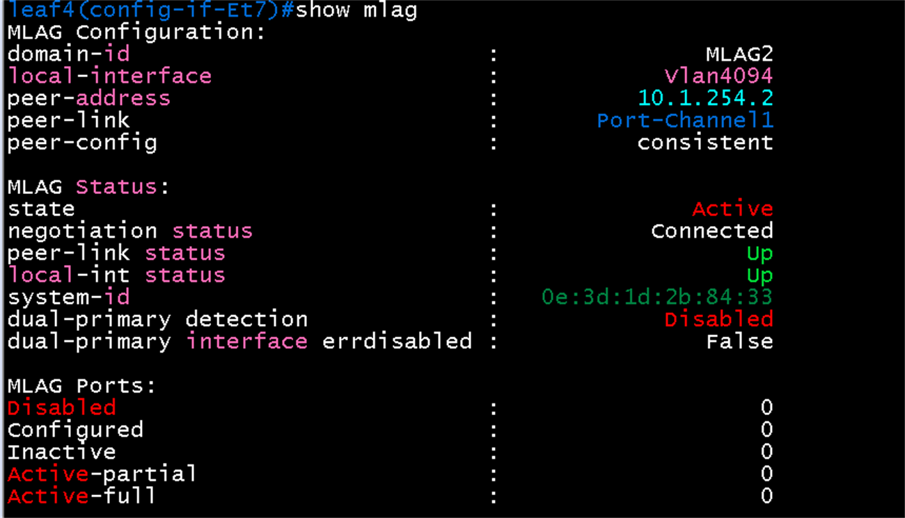 | domain MLAG2, peer 10.1.254.2, system-id가 leaf3과 같음 |

- leaf1, leaf2의 `MLAG Ports: Inactive 1`은 `Port-Channel10`(Host A). 호스트의 LACP가 올라오면 active-full로 바뀜(호스트 연결 전이라 정상).
- leaf3, leaf4는 MLAG 포트채널이 없어서 MLAG Ports가 모두 0임(호스트가 한쪽 leaf에만 붙은 access 포트).

### 2. show mlag config-sanity: 구성 불일치 없음

| 장비 | 화면 |
|---|---|
| leaf2 | 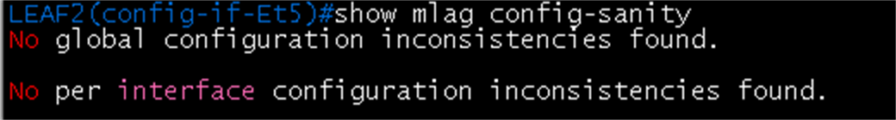 |
| leaf3 | 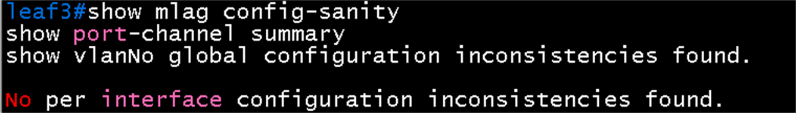 |
| leaf4 | 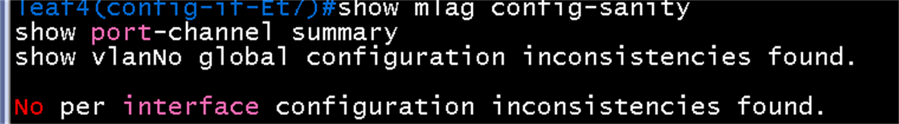 |

### 3. show port-channel dense: Po1(U), Et3·Et4 모두 PG+

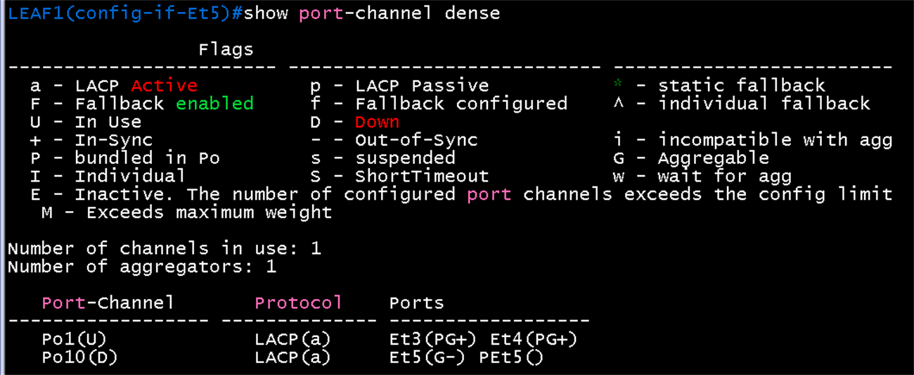

- `Po1(U)`의 멤버 `Et3(PG+)`, `Et4(PG+)`는 묶였고(P), 집합 가능하며(G), 동기화(+) 상태
- `Po10(D)`는 Host A 연결 전이므로 Down
- 이 EOS 버전에서는 `show port-channel summary`와 `show lacp neighbor`를 쓸 수 없고 `show port-channel dense`, `show lacp peer`를 씀

### 4. show vlan: 피어 포트(PEt)와 Po1이 VLAN에 들어감

| 장비 | 화면 | 볼 곳 |
|---|---|---|
| leaf2 | 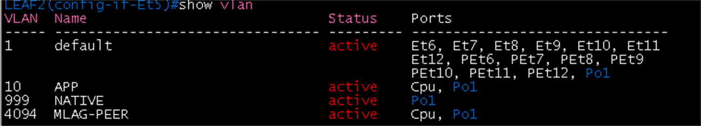 | VLAN 10, 999(NATIVE), 4094에 Po1 |
| leaf3 | 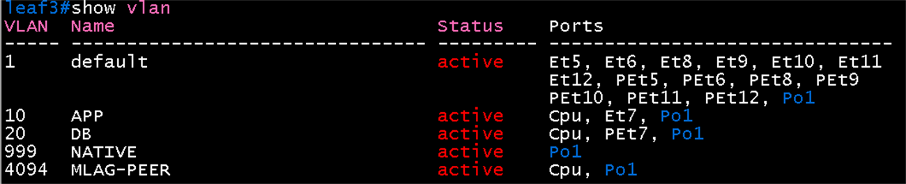 | VLAN 10 Et7(Host B), VLAN 20에 피어의 PEt7(Host C) |
| leaf4 | 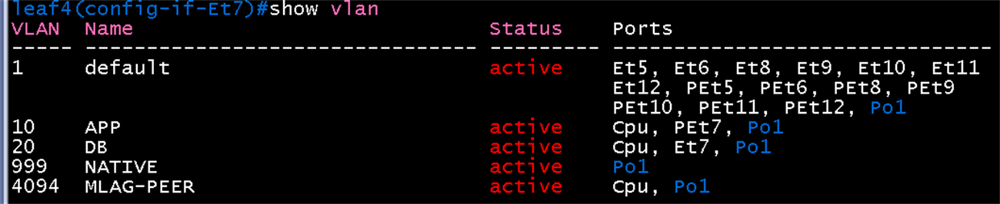 | VLAN 20 Et7(Host C), VLAN 10에 피어의 PEt7(Host B) |

### 5. 호스트 포트의 STP (항목 7, leaf3·leaf4)

| 장비 | 화면 | 볼 곳 |
|---|---|---|
| leaf3 | 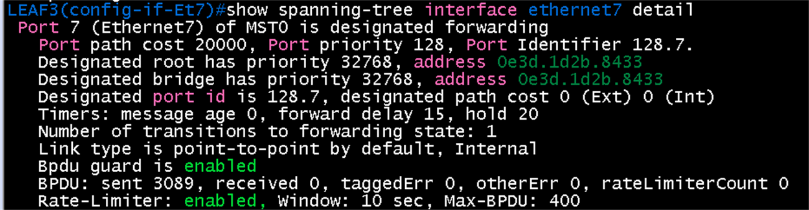 | `designated forwarding`, **`Bpdu guard is enabled`**, BPDU sent 3089 / received 0 |
| leaf4 | 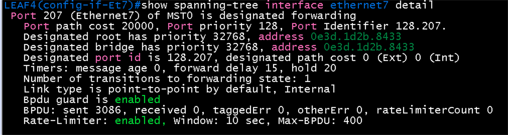 | 같은 내용, BPDU sent 3086 / received 0 |
| leaf1 (Host A 연결 뒤) |  | `Port-Channel10`이 `designated forwarding`, **`Bpdu guard is enabled`**, BPDU received 0, Port path cost 19999 |

- 호스트 포트가 **포워딩 상태**이고 `bpduguard`가 켜져 있음. 받은 BPDU가 0인 것은 이 포트에 스위치가 연결되지 않았다는 뜻이라 정상임(호스트는 BPDU를 보내지 않음).
- `Designated root ... address 0e3d.1d2b.8433`은 leaf3·4의 **MLAG system-id**. MLAG 쌍이 STP에서 하나의 브리지로 동작함(leaf1·2 쌍은 `0e03.2129.11f1`).
- Port Identifier가 leaf3은 `128.7`, leaf4는 `128.207`로 다른 것은 MLAG 쌍이 같은 브리지 ID를 쓰기 때문에 포트 번호가 겹치지 않도록 EOS가 한쪽에 200을 더하는 것
- 이 출력에는 edge(portfast) 표시가 따로 없음. 짧은 형식(`show spanning-tree interface ethernet7`)의 Type 열에서 `Edge`로 확인
- leaf1의 `port-channel10`은 Host A의 LACP bond가 올라온 뒤 같은 방식으로 확인됨(`Port 101 (Port-Channel10)`, 포트 번호는 포트채널이 101부터 시작). leaf2도 설정이 같아 같은 결과가 기대됨

### 6. Host A 연결: LACP bond와 active-full (항목 3, 4, 5, 6, 2026-10-22)

| 위치 | 화면 | 볼 곳 |
|---|---|---|
| Host A |  | 802.3ad, LACP rate fast, 해시 layer3+4, **Number of ports 2**, **Partner Mac `0e:03:21:29:11:f1`**, `eth0`·`eth1`이 둘 다 **Aggregator ID 1** |
| Host A |  | `bond0` MASTER, `eth0`·`eth1` SLAVE가 모두 UP. `ping 192.168.10.1`(anycast gateway) 3개 중 3개 응답, 손실 0% |
| leaf1 |  | `mlag 10 to-HostA`가 **active-full**(local Po10 / remote Po10, up/up). `Po1(U)`는 `Et3(PG+)`, `Et4(PG+)`, `Po10(U)`는 `Et5(PG+)`와 `PEt5(P)` |
| leaf2 |  | leaf1과 같은 결과 (active-full, `Po10(U)`: `Et5(PG+)`, `PEt5(P)`) |

- 호스트의 두 어댑터가 하나의 묶음(Aggregator 1)으로 협상되고, 파트너는 leaf1·2 MLAG 쌍의 system-id. leaf1과 leaf2에서 각각 한 링크씩 올라와 있음
- 호스트의 LACP는 `fast`(1초 간격)이고 leaf 쪽 기본값은 normal(30초 간격). 장애 감지를 더 빠르게 하려면 leaf의 호스트 포트에 `lacp timer fast`를 주는 방법이 있음(필요하면 적용).

### 7. LACP fast timer (leaf1·2 `ethernet5`, 2026-10-22)

leaf1·2의 호스트 포트 `ethernet5`에 `lacp timer fast`를 적용한 뒤의 화면

| 위치 | 화면 | 볼 곳 |
|---|---|---|
| leaf1 |  | `lacp timer fast` 적용. `Et5 Bundled`, Partner Sys-id `02-42-ac-a2-49-00`(Host A), Actor와 Partner 상태가 `ASGS+CD`(**S = ShortTimeout**), `muxActorCollectingDistributing`, TimeoutMultiplier 3 |
| leaf2 |  | 같은 결과 (Partner Port# 2, 상태 `ASGS+CD`) |

- Host A의 `bond0`에서 두 slave의 파트너 `port state`가 **63**으로 바뀐 것이 확인됨(이전 61, 짧은 타임아웃 비트가 켜짐). 해당 화면 이미지는 미수록.
- **양쪽이 모두 fast**: 호스트는 `lacp_rate fast`, leaf는 `lacp timer fast`. LACPDU가 1초 간격으로 오가고, 3번 못 받으면(약 3초) 링크를 빼므로 장애 감지가 기본(30초 간격, 약 90초)보다 훨씬 빨라짐.
- 적용 전에는 호스트가 보는 파트너 상태가 61이었음(`ShortTimeout` 비트 없음).
- `show lacp counters`의 `Et5`에서 **TX가 RX보다 훨씬 큰 것**(leaf1 TX 6166, RX 61)은 적용 직후라서 정상. 호스트가 `fast`를 요청해서 leaf는 계속 1초 간격으로 보냈고, 호스트는 leaf가 slow를 요청하던 동안 30초 간격으로만 보냈기 때문. 적용 뒤에는 RX도 1초에 1개씩 올라감
- 피어링크(`Et3`, `Et4`)는 이 타이머를 적용하지 않아서 normal(30초) 간격
## 결과 기록

| 일시 | 결과 (성공, 실패) | 비고 |
|---|---|---|
| 2026-10-22 | 성공 (leaf1/leaf2, leaf3/leaf4 MLAG, Host A bond) | 항목 1, 2, 3, 4, 5, 6 확인(Host A bond0 두 slave Aggregator 1, Po10 active-full, 게이트웨이 ping), 항목 7은 leaf1, leaf3, leaf4 확인(leaf2 Po10도 같은 설정). 장애 시험(leaf1 정지, 피어링크 shut)은 구축 완료 후 |
