# EVPN-VXLAN 검증

**선행 조건**: **모든 spine, leaf에서 `service routing protocols model multi-agent`를 설정하고 `write memory` 후 `reload`(재부팅)한 상태여야 함**(재부팅 전에는 `address-family evpn`이 거부됨). [MLAG 검증](02-mlag.md)이 끝나 있고, [leaf 샘플](../../samples/dc1/07-evpn-vxlan-leaf.md)과 [spine 샘플](../../samples/dc1/08-evpn-spine.md)이 적용되어 있어야 함

기준 문서: [05-evpn-vxlan.md](../../baseline/dc1/05-evpn-vxlan.md)

## 확인 항목

| 순서 | 장비 | 명령 | 기대 결과 | 안 될 때 확인 |
|---|---|---|---|---|
| 0 | 모든 leaf, spine | `show running-config \| include routing protocols` | `service routing protocols model multi-agent`가 보임(**reload 후**) | 없으면 설정, `write memory`, `reload` |
| 1 | leaf1~leaf4 | `show bgp evpn summary` | spine1, spine2 두 세션이 **Established** | OSPF 도달성, update-source loopback0, AS 번호(65100), send-community extended, spine의 route-reflector-client |
| 1-1 | leaf1 | `show bgp neighbors 10.1.0.1` | **keepalive 3초, hold 9초**가 협상됨 (양쪽 `timers 3 9`) | 이웃 peer group의 `timers 3 9`, 양쪽 값 |
| 1-2 | spine1 | `show bgp evpn summary` | leaf 4대(10.1.0.11 ~ 10.1.0.14)가 **Established**이고 leaf끼리는 이웃으로 보이지 않음 | cluster-id, route-reflector-client |
| 1-3 | leaf1 | `show bgp neighbors 10.1.0.1` | `remote router ID`가 **10.1.2.1**(spine1의 BGP router-id). OSPF router-id(`show ip ospf neighbor`의 10.1.0.1)와 **다른 값** | 장비의 `router-id`(BGP)가 OSPF와 다른지, 10.1.2.x |
| 2 | leaf1~leaf4 | `show interfaces vxlan1` | **up/up**, `Source interface is Loopback1 and is active`(leaf1·2 10.1.1.12, leaf3·4 10.1.1.34), `UDP port 4789`, VLAN-VNI 매핑, `MLAG Shared Router MAC`이 MLAG 쌍끼리 같음 (**BGP 전에도 확인 가능**) | vxlan source-interface, `vxlan vlan ... vni`, `vxlan virtual-router encapsulation mac-address mlag-system-id`, MLAG system-id |
| 3 | leaf1 | `show vxlan vtep` | 원격 VTEP **10.1.1.34**(leaf3, leaf4 공유)가 보임 | Loopback1 광고, vxlan source-interface |
| 4 | leaf1, leaf3 | `show vxlan vni` | leaf1은 VNI **10010**(VLAN 10)과 **50001**(L3VNI, 동적 VLAN 4093, VRF TENANT-A), leaf3·4는 10010, 10020, 50001 | vxlan vlan ... vni, VRF 설정 |
| 5 | leaf1 | `show bgp evpn route-type mac-ip` | Host A, B, C의 MAC/IP 경로 | 호스트 ARP(ping으로 학습 유도) |
| 6 | Host A | `ping -c 3 192.168.10.102` | Host B 응답 (**같은 VLAN, L2VNI**) | VLAN 10 VNI, RT |
| 7 | Host A | `ping -c 3 192.168.20.101` | Host C 응답 (**다른 VLAN, L3VNI**) | VRF TENANT-A, L3VNI 50001, SVI |
| 8 | leaf1 | `show ip route vrf TENANT-A` | 192.168.20.0/24가 VXLAN 경유로 보임 | redistribute connected, RT import/export |
| 9 | leaf3 | `show bgp evpn route-type mac-ip` | leaf1이 광고한 경로에 **ORIGINATOR_ID**(leaf1 BGP router-id 10.1.2.11)와 **CLUSTER_LIST**(10.1.0.100)가 보임 (spine이 reflect) | RR 설정, cluster-id |
| 10 | spine1 | `show ip access-lists MGMT-ACL` | 규칙 40, 50(BGP)의 카운터가 올라감 | 관리 ACL이 BGP를 허용하는지 |

## 장애 시험

| 동작 | 기대 결과 |
|---|---|
| spine1 정지 | EVPN 세션이 spine2 하나로 유지되고 ping은 계속 됨 |
| leaf3 정지 | Host B, C는 leaf4로 계속 통신 |

## 증빙 (VXLAN 인터페이스, BGP 설정 전, 2026-10-22)

leaf1~leaf4에 `interface vxlan1`을 적용한 뒤 `show interfaces vxlan1`. EVPN(BGP) 설정 전이므로 `show vxlan vtep`은 비어 있고, 인터페이스 상태만 확인

| 장비 | 화면 | 볼 곳 |
|---|---|---|
| leaf1 | 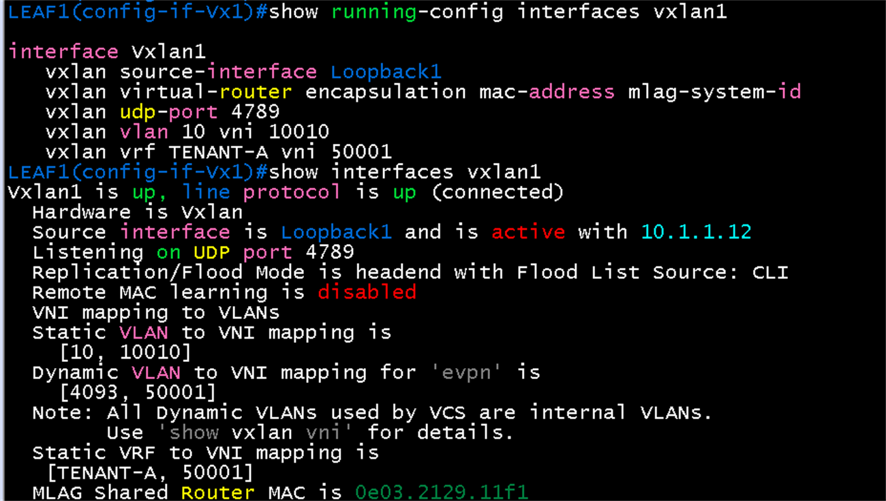 | up/up, Source Loopback1 `10.1.1.12`, UDP 4789, Static VLAN-VNI `[10, 10010]`, VRF-VNI `[TENANT-A, 50001]`, MLAG Shared Router MAC `0e03.2129.11f1` |
| leaf2 | 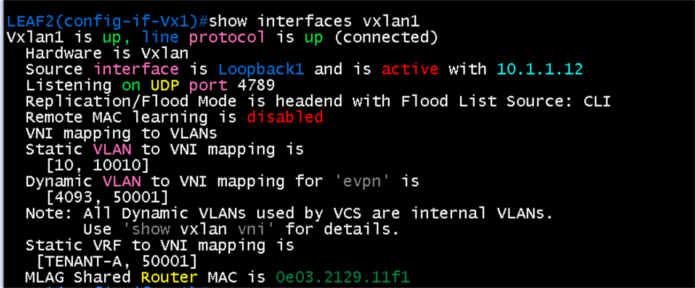 | leaf1과 같은 VTEP `10.1.1.12`와 같은 MLAG Shared Router MAC `0e03.2129.11f1` |
| leaf3 | 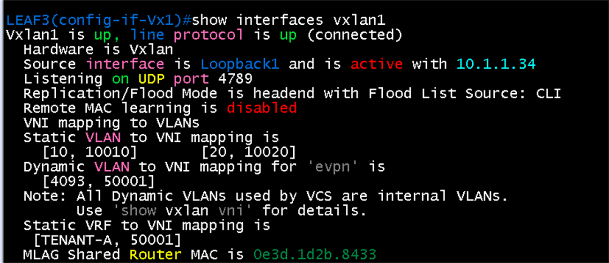 | up/up, Source Loopback1 `10.1.1.34`, Static VLAN-VNI `[10, 10010]`, `[20, 10020]`, MLAG Shared Router MAC `0e3d.1d2b.8433` |
| leaf4 | 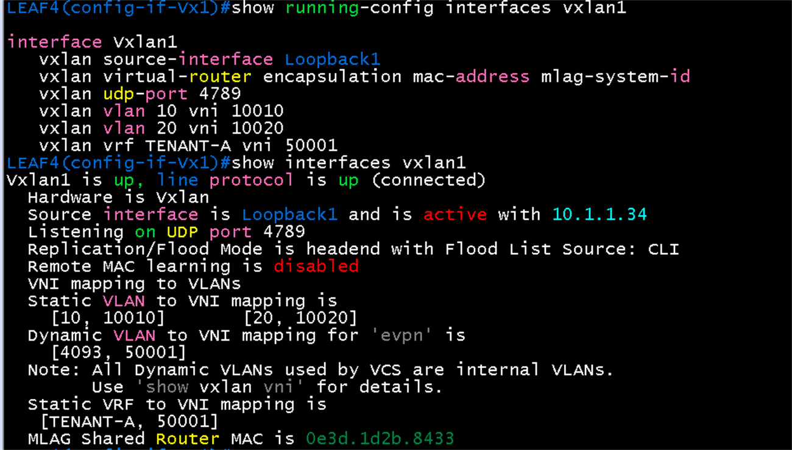 | leaf3과 같은 VTEP `10.1.1.34`와 같은 MLAG Shared Router MAC `0e3d.1d2b.8433`. 설정(`show running-config interfaces vxlan1`)도 함께 보임 |

- **VTEP 공유**: MLAG 쌍이 `loopback1`의 같은 주소(leaf1·2 10.1.1.12, leaf3·4 10.1.1.34)를 VXLAN 출발 주소로 씀
- **MLAG Shared Router MAC**은 MLAG system-id와 같은 값이고(`show mlag`의 system-id `0e:03:21:29:11:f1`, `0e:3d:1d:2b:84:33`), 쌍 안의 두 장비가 같음. `vxlan virtual-router encapsulation mac-address mlag-system-id`가 적용되었다는 뜻
- **Replication/Flood Mode는 headend, Flood List Source는 CLI**: 수동 flood 목록은 비어 있고, EVPN이 올라오면 EVPN 경로로 채워짐.
- **Remote MAC learning is disabled**: 원격 MAC은 데이터 평면이 아니라 EVPN(BGP)으로 배움
- **Dynamic VLAN-VNI for 'evpn' `[4093, 50001]`**: L3VNI(50001)에 EOS가 내부 VLAN 4093을 자동으로 할당
- leaf3·4만 VLAN 20 -> VNI 10020 매핑이 있음(leaf1·2는 VLAN 20이 없음).

## 증빙 (호스트 연결, BGP 설정 전, 2026-10-22)

호스트가 자기 leaf의 anycast gateway까지 통신되는지 확인한 화면. VXLAN(다른 leaf의 호스트와 통신)은 BGP EVPN이 올라온 뒤 확인

| 호스트 | 화면 | 볼 곳 |
|---|---|---|
| Host B |  | `eth0 192.168.10.102/24`, 기본 경로 `via 192.168.10.1`, `ping 192.168.10.1` 3개 중 3개 응답, 손실 0% (leaf3 `ethernet7`, VLAN 10) |
| Host C |  | `eth0 192.168.20.101/24`, 기본 경로 `via 192.168.20.1`, `ping 192.168.20.1` 3개 중 3개 응답, 손실 0% (leaf4 `ethernet7`, VLAN 20) |
| Host B -> VLAN 20 게이트웨이 |  | VLAN 10의 Host B가 VLAN 20의 게이트웨이 `192.168.20.1`에 3개 중 3개 응답. leaf3의 `Vlan10`과 `Vlan20` SVI 사이 **로컬 VLAN 간 라우팅**이며 VXLAN은 아님 |

- `eth0`이 `UNKNOWN`으로 표시되는 것은 컨테이너 가상 인터페이스의 정상 표시
- 콘솔에서 한글 주석이 깨져 보이는 것은 콘솔이 UTF-8을 표시하지 못해서이며 동작에는 영향이 없음(호스트 스크립트 주석은 영문으로 쓰는 것을 권장).
- Host A(bond, `192.168.10.101`)는 [MLAG 검증](02-mlag.md)에서 확인됨

## 증빙 (iBGP RR, EVPN 세션과 VTEP, 2026-10-22)

spine1·2를 Route Reflector로, leaf1~4를 client로 설정한 뒤의 화면

### 1. EVPN 세션 Established (항목 1, 1-2)

| 장비 | 화면 | 볼 곳 |
|---|---|---|
| spine1 | 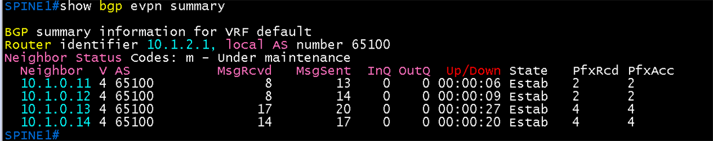 | `Router identifier 10.1.2.1`, AS 65100, leaf 4대(10.1.0.11 ~ 10.1.0.14)가 모두 **Estab** |
| spine2 | 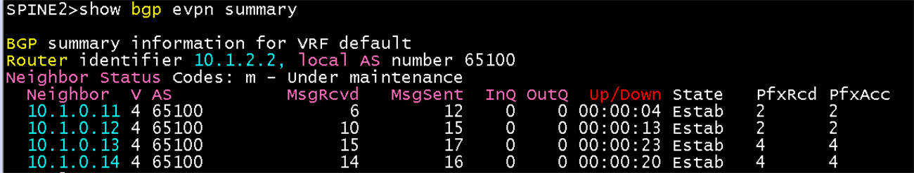 | `Router identifier 10.1.2.2`, leaf 4대가 모두 **Estab** |
| leaf1 | 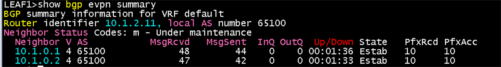 | `Router identifier 10.1.2.11`, spine1(10.1.0.1), spine2(10.1.0.2)가 **Estab**, PfxRcd 10 |
| leaf2 | 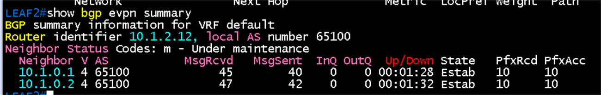 | `Router identifier 10.1.2.12`, spine 2대 Estab, PfxRcd 10 |
| leaf3 | 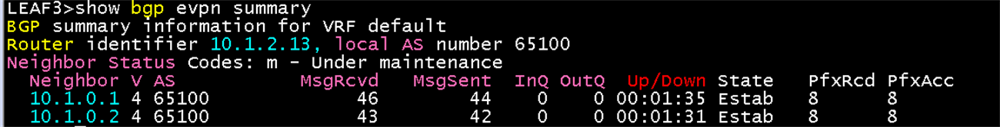 | `Router identifier 10.1.2.13`, spine 2대 Estab, PfxRcd 8 |
| leaf4 | 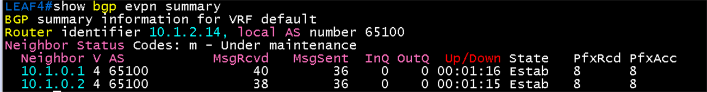 | `Router identifier 10.1.2.14`, spine 2대 Estab, PfxRcd 8 |

- **BGP router-id**(`Router identifier`)가 모든 장비에서 `10.1.2.x`이고, 이웃 주소(`Neighbor`)는 `loopback0`(10.1.0.x). OSPF router-id(10.1.0.x)와 BGP router-id가 다름
- 세션은 총 8개(leaf 4대 x spine 2대)이고 모두 AS 65100(iBGP). leaf끼리는 이웃을 맺지 않음
- spine이 leaf에서 받은 경로(PfxRcd)는 leaf1·2가 각 2개, leaf3·4가 각 4개이고, leaf는 spine에서 8 ~ 10개를 받음. spine이 RR로 다른 leaf의 경로를 reflect해서 준 것
- 이 화면은 `service routing protocols model multi-agent`를 적용(`write memory`, `reload`)한 뒤 `address-family evpn`이 받아들여진 상태. 적용 전에는 `% Routing protocols model multi-agent must be configured for EVPN address-family`가 나옴

### 2. 원격 VTEP (항목 3)

| 장비 | 화면 | 볼 곳 |
|---|---|---|
| leaf1 | 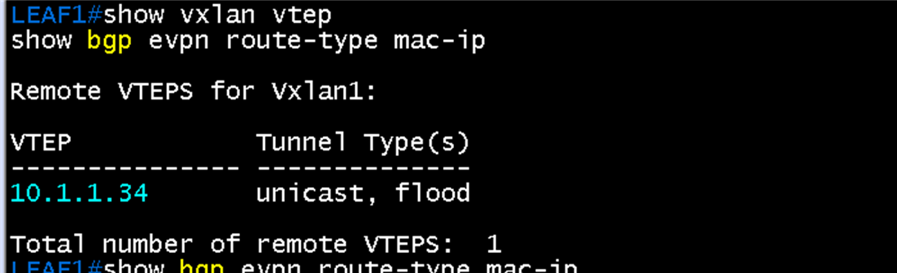 | 원격 VTEP **10.1.1.34**(leaf3·4가 공유하는 VTEP), `unicast, flood`, Total 1 |
| leaf2 | 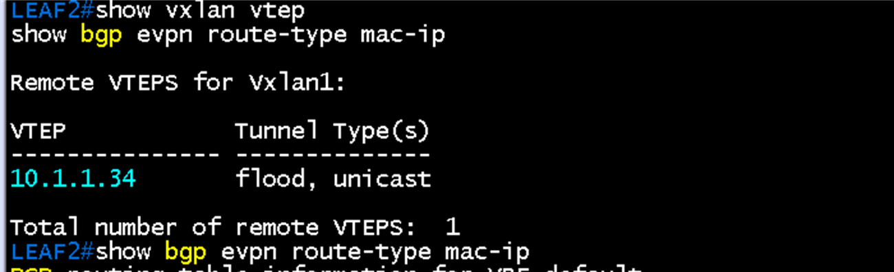 | 같음 (10.1.1.34) |
| leaf3 |  | 원격 VTEP **10.1.1.12**(leaf1·2가 공유), Total 1 |
| leaf4 | 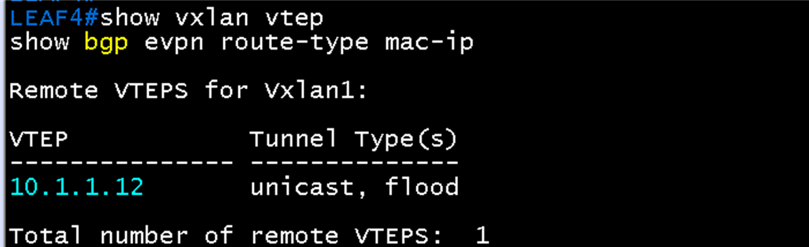 | 같음 (10.1.1.12) |

- MLAG 쌍이 VTEP 주소를 공유하므로 각 leaf는 원격 VTEP을 **한 개**로 봄(상대 쌍의 공유 주소). 터널 종류 `unicast, flood`는 EVPN으로 알게 된 VTEP에 flood 목록을 만들었다는 뜻
- `show bgp evpn route-type mac-ip`는 호스트 MAC이 학습되기 전에는 비어 있음(호스트가 트래픽을 보내지 않으면 MAC이 만료됨). 호스트에서 ping을 보낸 뒤 재확인 필요

### 3. BGP 이웃 상세: 타이머와 router-id (항목 1-1, 1-3)

`show bgp neighbors 10.1.0.1`(leaf에서 spine1) 화면의 윗부분

| 장비 | 화면 |
|---|---|
| leaf1 | 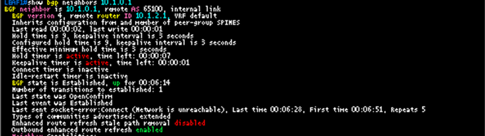 |
| leaf2 | 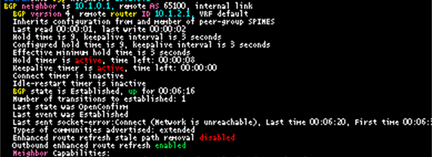 |
| leaf3 | 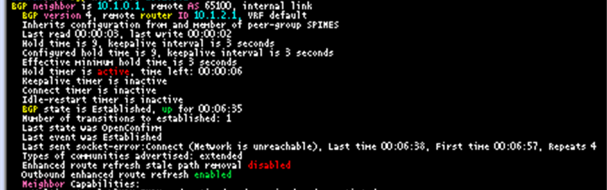 |
| leaf4 | 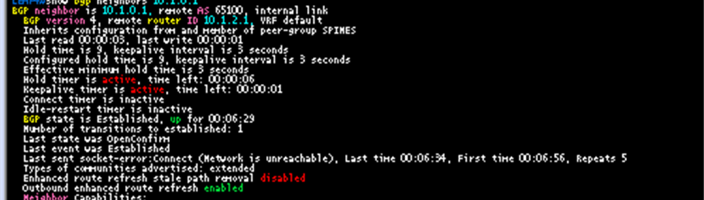 |

- **`remote router ID 10.1.2.1`**: spine1의 BGP router-id. 이웃 주소(10.1.0.1, spine1의 loopback0)와 OSPF router-id(10.1.0.1)와 다른 값. 각 leaf의 `local router ID`는 `10.1.2.11 ~ 10.1.2.14`
- **`Hold time is 9, keepalive interval is 3 seconds`**, `Configured hold time is 9, keepalive interval is 3 seconds`: `timers 3 9`가 적용되어 협상되었음
- `Inherits configuration from and member of peer-group SPINES`: peer group 설정을 상속. `internal link`, remote AS 65100(iBGP)
- `Multiprotocol L2VPN EVPN: advertised and received and negotiated`가 같은 출력의 아랫부분에 있고, `Extended` 커뮤니티를 보냄(`send-community extended`).
- `Last sent socket-error:Connect (Network is unreachable)`가 5회 보이는 것은 reload 직후 OSPF가 loopback 경로를 만들기 전에 시도한 연결이 실패한 흔적. 현재 `Established`이고 `Number of transitions to established: 1`이라 이후 끊김이 없음

### 4. EVPN 경로: MAC/IP (Type 2) (항목 5, 9)

`show bgp evpn route-type mac-ip`. 호스트 3대(Host A MAC `0242.aca2.4900` / 192.168.10.101, Host B `0242.2e8f.e000` / 192.168.10.102, Host C `0242.16c7.3c00` / 192.168.20.101)가 모두 보임

| 장비 | 화면 |
|---|---|
| leaf1 | 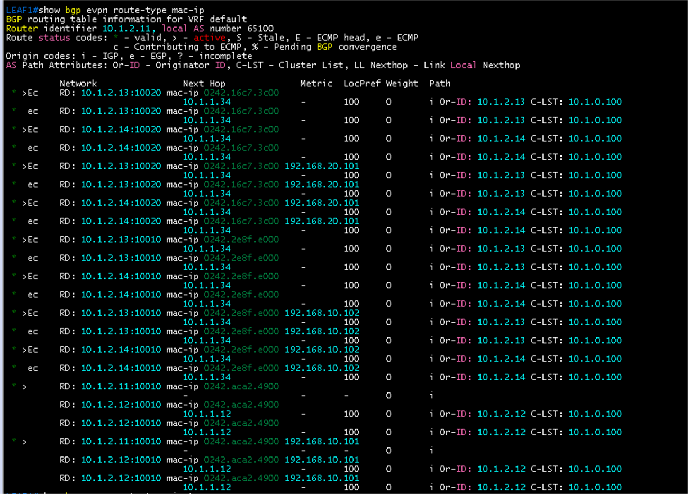 |
| leaf2 | 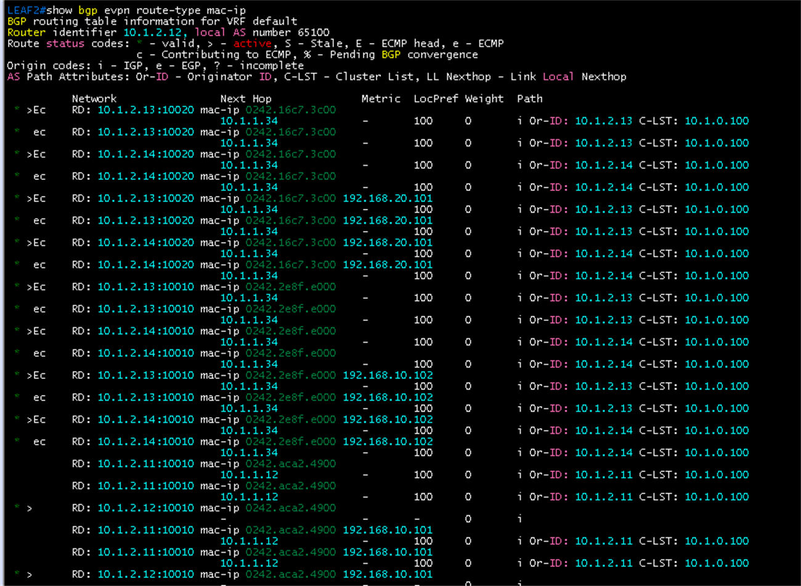 |
| leaf3 | 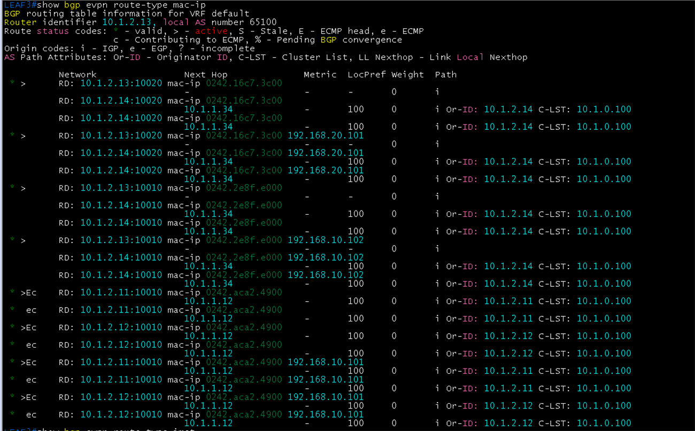 |
| leaf4 | 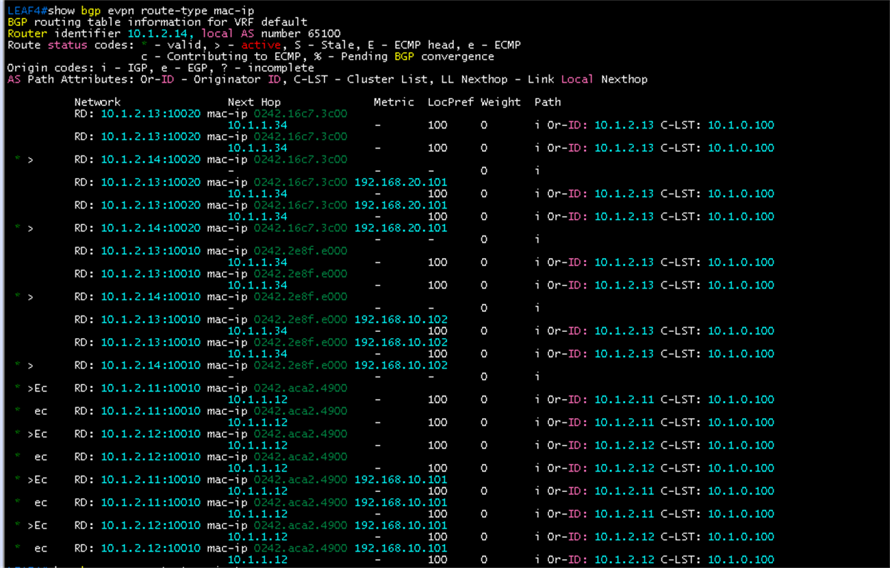 |

- **RD가 leaf마다 다름**: `10.1.2.11:10010`(leaf1), `10.1.2.12:10010`(leaf2), `10.1.2.13:10010` / `:10020`(leaf3), `10.1.2.14:10010` / `:10020`(leaf4). BGP router-id를 접두로 쓴 RD
- **Route Reflector 동작**: 다른 leaf에서 온 경로에 **`Or-ID`(Originator ID, 경로를 처음 만든 leaf의 router-id)** 와 **`C-LST: 10.1.0.100`(Cluster List, RR의 cluster-id)** 가 붙어 있음. spine이 reflect했다는 증거
- **Next Hop은 VTEP**: 반대편 쌍의 경로는 `10.1.1.34`(leaf3·4 공유) 또는 `10.1.1.12`(leaf1·2 공유). iBGP라 next-hop이 바뀌지 않고, RR(spine)을 거쳐도 VTEP 주소가 그대로. leaf 자신이 만든 경로는 next-hop `-`(로컬)이고 `i`로 표시됨
- **MLAG 쌍은 같은 MAC을 둘 다 광고**. 예: Host B의 MAC `0242.2e8f.e000`이 `RD 10.1.2.13:10010`과 `RD 10.1.2.14:10010` 두 개로 보이고, 같은 VTEP `10.1.1.34`임(`>Ec`/`ec`는 ECMP). RD가 leaf마다 달라서 두 경로가 서로 덮어쓰지 않고 공존

### 5. EVPN 경로: IMET (Type 3, flood 목록) (항목 5)

`show bgp evpn route-type imet`. VLAN(VNI)마다 VTEP이 어떤 flood 대상인지 알리는 경로

| 장비 | 화면 |
|---|---|
| leaf1 | 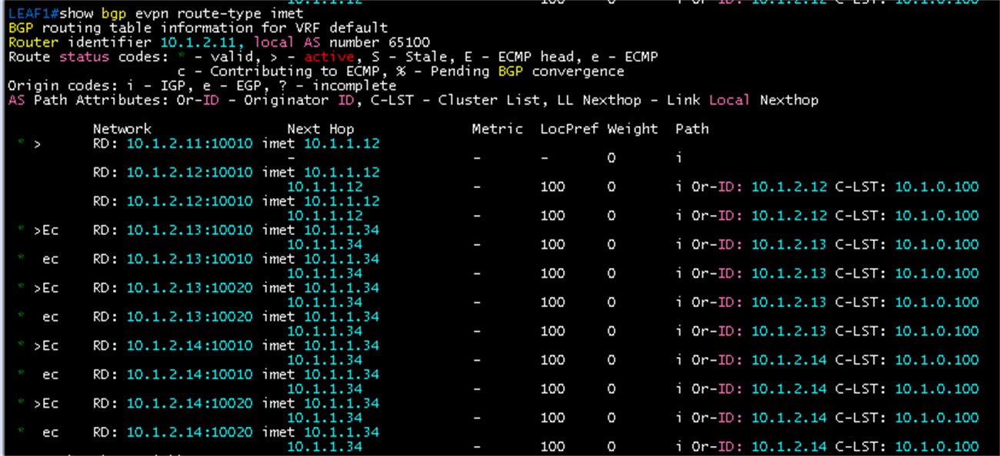 |
| leaf2 | 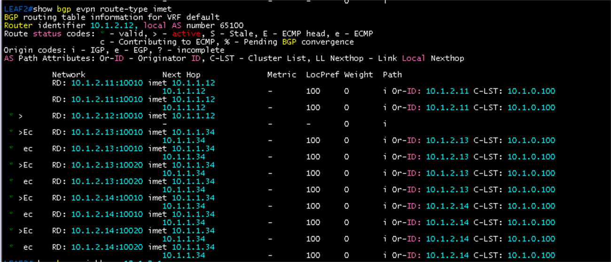 |
| leaf3 | 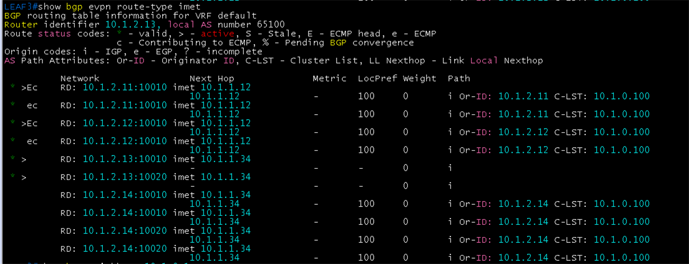 |
| leaf4 | 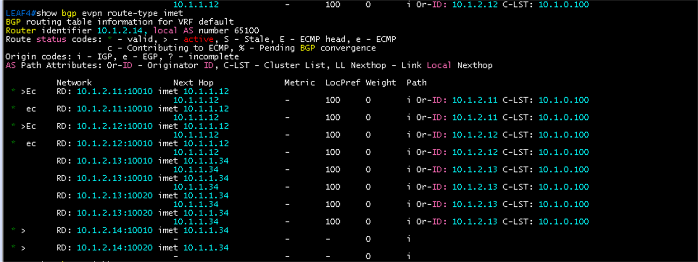 |

- leaf1·2는 VLAN 10(`:10010`)의 imet만, leaf3·4는 VLAN 10(`:10010`)과 VLAN 20(`:10020`) 두 개를 광고. 설계(leaf1·2는 VLAN 20 없음)와 일치
- 반대편 쌍의 imet이 spine1과 spine2 양쪽에서 와서 `>Ec`와 `ec` 두 줄(ECMP)로 보임. RR 두 대가 같은 경로를 reflect해서 경로가 이중화되어 있음

### 6. 다른 VLAN 통신: Host A -> Host C (L3VNI) (항목 7)

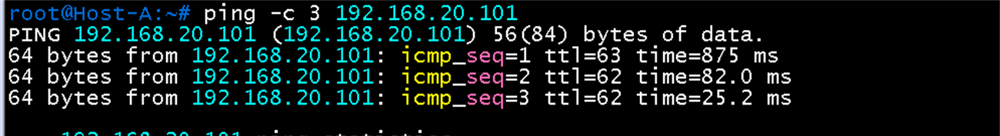

- `ping 192.168.20.101`(Host C, VLAN 20)이 3개 중 3개 응답, 손실 0%. Host A는 leaf1·2(VLAN 10만 있음)에 연결되어 있어서 VRF `TENANT-A`로 라우팅한 뒤 **L3VNI(VNI 50001)** 로 leaf3·4에 전달됨
- 첫 응답이 875ms로 느린 것은 ARP와 경로가 처음 만들어지는 시간이고, 이후 82ms, 25ms로 줄었음. TTL이 63, 62로 내려가는 것은 라우팅 홉을 지났다는 뜻

### 7. VRF 경로 (항목 8)

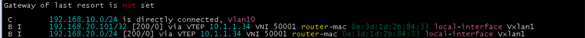

- `C 192.168.10.0/24 is directly connected, Vlan10`: 자기 VLAN은 연결된 경로
- `B I 192.168.20.101/32`와 `B I 192.168.20.0/24`: iBGP로 배운 경로이고 `via VTEP 10.1.1.34 VNI 50001 router-mac 0e:3d:1d:2b:84:33 local-interface Vxlan1`. VLAN 20이 없는 leaf1이 L3VNI(50001)로 VLAN 20 서브넷에 도달
- `router-mac 0e:3d:1d:2b:84:33`은 leaf3·4의 **MLAG system-id**. `vxlan virtual-router encapsulation mac-address mlag-system-id`가 VRF 간 라우팅의 안쪽 MAC으로 쓰였다는 증거

### 8. 관리 ACL이 BGP, OSPF를 통과시킴 (항목 10)

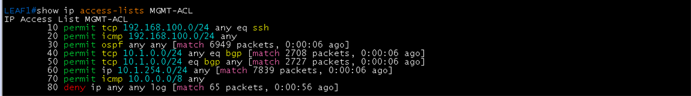

- 규칙 30(OSPF) 6949, 규칙 40·50(BGP, `10.1.0.0/24`끼리) 2708과 2727, 규칙 60(MLAG) 7839 packets가 쌓였음. 관리 ACL이 BGP와 OSPF 통신을 막지 않고 통과시킴.
- 규칙 80(deny)은 65이고, 설정이 없는 장비의 DHCP 요청 같은 쓰지 않는 트래픽

### 9. 같은 VLAN 통신: Host A -> Host B (L2VNI) (항목 6)

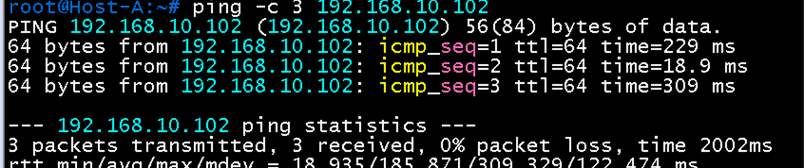

- `ping 192.168.10.102`(Host B)가 3개 중 3개 응답, 손실 0%이고 **`ttl=64`** . 라우팅 홉을 지나지 않았다는 뜻으로, 같은 VLAN 10 안의 L2 통신이 VXLAN(**L2VNI, VNI 10010**)으로 leaf1·2에서 leaf3으로 전달되었음. 응답 시간(229ms, 18.9ms, 309ms)이 들쭉날쭉한 것은 vEOS의 소프트웨어 VXLAN 처리와 장비 부하 때문

### 10. VNI 매핑 (항목 4, leaf1)

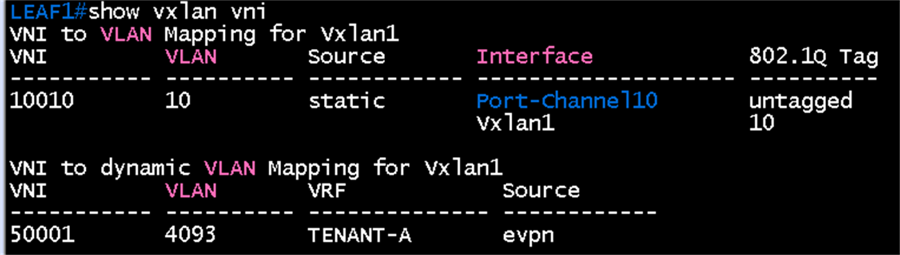

- **정적 매핑**: `VNI 10010 -> VLAN 10`, source `static`(설정한 `vxlan vlan 10 vni 10010`), 인터페이스 `Port-Channel10`(Host A 포트)과 `Vxlan1`이 이 VLAN에 들어 있음
- **동적 매핑**: `VNI 50001 -> VLAN 4093`, VRF `TENANT-A`, source **`evpn`**. L3VNI는 EOS가 내부 VLAN(4093)을 자동으로 만들어 쓰고, EVPN이 만든 매핑이라 source가 `evpn`
- leaf1에는 VLAN 20이 없으므로 **VNI 10020은 나오지 않는 것이 정상**임(leaf3·4에는 10020이 보임).
## 패킷 캡처 (Wireshark, 2026-10-22)

캡처 링크는 **spine1 `ethernet1` - leaf1 `ethernet1`** 한 곳

### VXLAN 캡슐화 (Frame 44, 표시 필터 `vxlan`)

| 계층 | 값 | 뜻 |
|---|---|---|
| 바깥 IP | `10.1.1.34` -> `10.1.1.12` | leaf3·4의 공유 VTEP에서 leaf1·2의 공유 VTEP으로 가는 터널 |
| UDP | 목적지 포트 **4789**, 출발 포트 10285 | VXLAN 표준 포트. 출발 포트는 안쪽 흐름의 해시값(ECMP 분산용) |
| VXLAN | **VNI 10010**, Flags 0x0800 | VLAN 10의 L2VNI |
| 안쪽 이더넷 | `02:42:2e:8f:e0:00` -> `02:42:ac:a2:49:00` | Host B MAC -> Host A MAC |
| 안쪽 IP, ICMP | `192.168.10.102` -> `192.168.10.101` | Host B가 Host A로 보낸 echo 응답이 캡슐화됨 |

- 바깥 이더넷 `0c:64:22:d3:d6:f8`(spine1 `ethernet1`) -> `0c:6f:e5:90:b9:7a`(leaf1 `ethernet1`)는 앞의 OSPF Hello 캡처와 같은 링크임을 보여 줌

### BGP OPEN (Frame 462, 표시 필터 `bgp`)

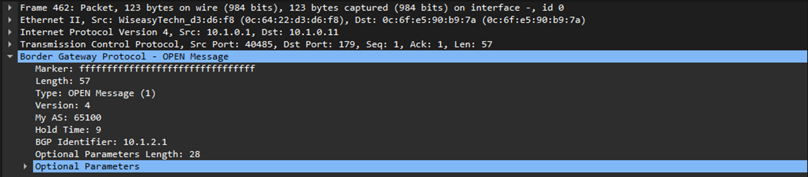

| 필드 | 값 | 뜻 |
|---|---|---|
| IP | `10.1.0.1` -> `10.1.0.11` | spine1 loopback0 -> leaf1 loopback0 (`update-source loopback0`) |
| TCP | 목적지 포트 **179** | BGP |
| My AS | **65100** | DC1 iBGP AS |
| Hold Time | **9** | `timers 3 9` (keepalive는 hold의 1/3인 3초) |
| BGP Identifier | **10.1.2.1** | spine1의 BGP router-id. 출발 주소(10.1.0.1)와 OSPF router-id(10.1.0.1)와 **다른 값** |

- 출발 IP(loopback0, 10.1.0.1)와 BGP Identifier(10.1.2.1)가 다른 것이 router-id를 분리한 증거
## 결과 기록

| 일시 | 결과 (성공, 실패) | 비고 |
|---|---|---|
| 2026-10-22 | 성공 (장애 시험 제외) | 항목 0~10 모두 확인: 세션 Established, 타이머 3/9, remote router ID 10.1.2.1, 원격 VTEP, VNI 매핑(10010, 50001), MAC/IP·IMET 경로와 RR 속성, Host A -> Host B(L2VNI), Host A -> Host C(L3VNI), VRF 경로, ACL BGP 카운터. Wireshark VXLAN(VNI 10010), BGP OPEN 확인. 장애 시험(spine1 정지, leaf3 정지)은 구축 후 |
