# DC1 외부 연결 검증 (border leaf - Hub - PE1)

**선행 조건**: [EVPN-VXLAN 검증](03-evpn-vxlan.md)이 끝나 있고, MPLS 코어(PE1)가 올라와 있어야 함([core 검증](../core/06-mp-bgp-vpnv4.md))

기준 문서: [06-dci-hub-ebgp.md](../../baseline/dc1/06-dci-hub-ebgp.md) / 샘플: [09-pe-ce-ebgp.md](../../samples/dc1/09-pe-ce-ebgp.md), [Hub 가이드](../../guide/06-hub.md)

## 확인 항목

| 순서 | 장비 | 명령 | 기대 결과 | 안 될 때 확인 |
|---|---|---|---|---|
| 1 | spine1, spine2 | `show ip ospf neighbor` | border-leaf1·2(10.1.0.15, 10.1.0.16)를 포함한 이웃 6개가 **FULL** | 링크 IP, OSPF 설정 |
| 2 | spine1, spine2 | `show bgp evpn summary` | 10.1.0.15, 10.1.0.16이 **Established** | border leaf의 `service routing protocols model multi-agent` 적용 여부(재부팅 필요), `address-family evpn` activate |
| 3 | border-leaf1 | `show ip bgp summary vrf TENANT-A` | Hub1(10.0.31.1, AS 65010)이 **Established** | VRF 안 neighbor, address-family activate |
| 4 | border-leaf2 | `show ip bgp summary vrf TENANT-A` | Hub2(10.0.31.3, AS 65010)가 **Established** | 같은 점검 |
| 5 | leaf3 | `show ip route vrf TENANT-A 192.168.50.0` | Branch 경로가 VTEP 10.1.1.15와 10.1.1.16 두 경로(ECMP, VNI 50001) | border leaf의 route-target, `vxlan vrf` |
| 6 | Hub1, Hub2 | `show ip bgp summary` | PE1(10.0.30.0 또는 10.0.30.2)과 border leaf(10.0.31.0 또는 10.0.31.2)만 **Established**, 10.0.32.x 이웃 없음 | 이웃 삭제 여부 |
| 7 | PE1 | `show ip bgp vpnv4 vrf TENANT-A summary` | Hub1(10.0.30.1), Hub2(10.0.30.3)가 **Established** | PE1 `Gi2/0`, `Gi5/0` |
| 8 | Host A | `ping -c 4 192.168.50.101` | 4/4 응답 (DC1 -> Branch) | 위 항목 순서대로 |

## 증빙 (2026-11-09)

### border leaf 연결 확인 (항목 1 ~ 4)

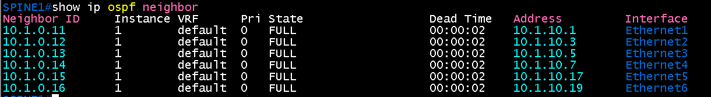

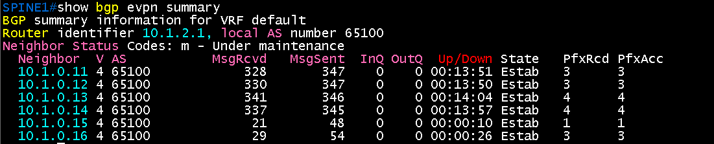

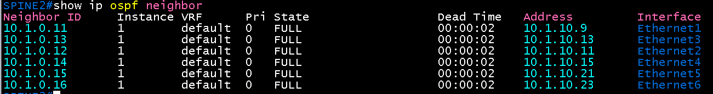

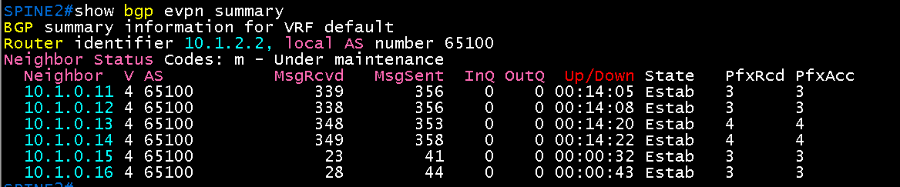

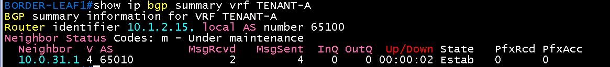

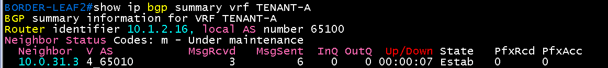

- spine1·2 모두 border-leaf1·2가 FULL, EVPN 세션 6개가 Established(PfxRcd는 세션이 올라온 직후 값)
- border leaf 화면의 `PfxRcd 0`은 세션이 올라온 직후(2초, 7초)의 값이고, 이후 Hub1·2 화면에서 border leaf 이웃으로부터 4 prefix를 받는 것이 보임

### 경로와 통신 (항목 5 ~ 8)

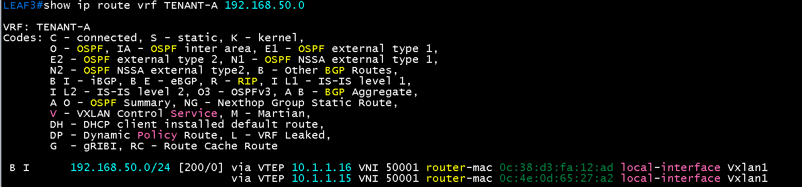

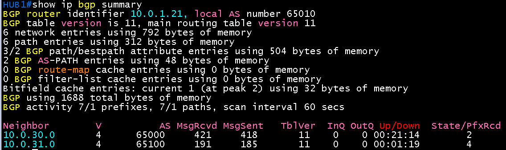

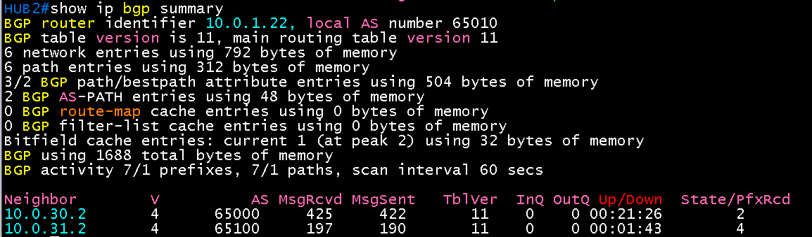

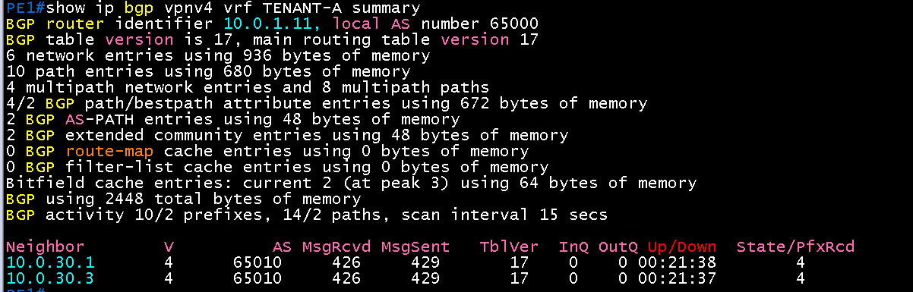

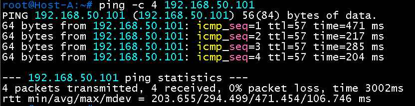

- leaf3에서 192.168.50.0/24가 VTEP 10.1.1.16과 10.1.1.15 두 경로(`B I`, VNI 50001)
- Hub1·2에 border leaf와 PE1 이웃만 있고, PE1에서 10.0.30.1과 10.0.30.3이 Established
- Host A → Host F: 4개 중 4개 응답, 손실 0%, TTL 57

## 장애 시험 (2026-11-09)

링크를 내릴 때 PE에서 `shutdown`, 올릴 때 `no shutdown`. 복구는 모두 자동. 가상 라우터(Dynamips)는 링크를 내려도 상대가 바로 알지 못해 BGP hold 9초가 감지 기준이 됨. 손실 시간은 손실 패킷 수 × 0.2초(ping 간격)로 환산한 값이고 타임스탬프로 잰 값이 아님. ECMP로 흐름마다 타는 Hub가 달라서 시험 직전에 traceroute로 경로를 확인함

### T1: PE1 `Gi2/0` (PE1 - Hub1) 단절

Host F에서 `ping -c 300 -i 0.2 192.168.10.101`을 보내면서 약 20초 뒤 단절

| 확인 | 기대 결과 | 결과 |
|---|---|---|
| 단절 직전 traceroute | 5번째 홉 10.0.30.1(Hub1), 6번째 홉 10.0.31.0(border-leaf1) | 일치 |
| 단절 중 PE1 이웃, 경로 | 10.0.30.1 Idle, 192.168.10.0 다음 홉이 10.0.30.3 하나 | 일치 |
| ping | 자동 복구 | 300/300 응답, 손실 0%, 최대 RTT 712ms |
| 단절 중 traceroute | 5번째 홉 10.0.30.3(Hub2), 6번째 홉 10.0.31.2(border-leaf2) | 일치 |
| 복구 | 10.0.30.1 Established | 일치 |

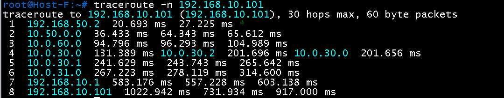

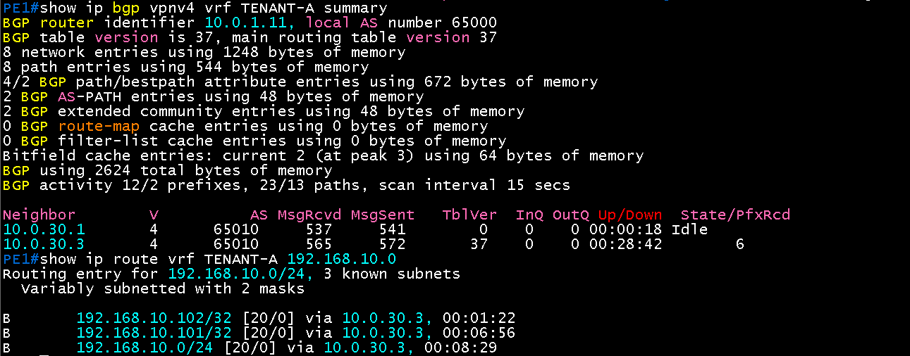

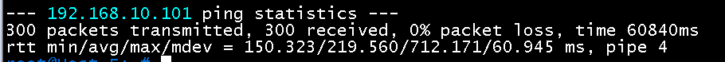

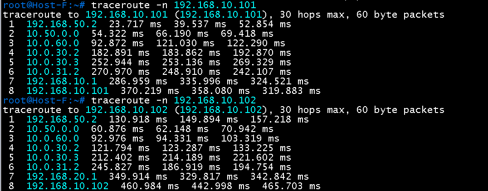

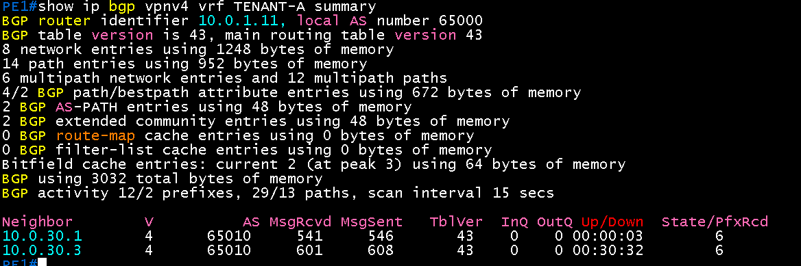

- 응답(Host A → Host F)은 원래 border-leaf2·Hub2를 타고 돌아와서 Hub1 링크 단절의 영향을 받지 않음. 요청만 Hub1에서 Hub2로 전환되었고 손실은 없었음(돌아오는 경로 traceroute는 아래 화면)

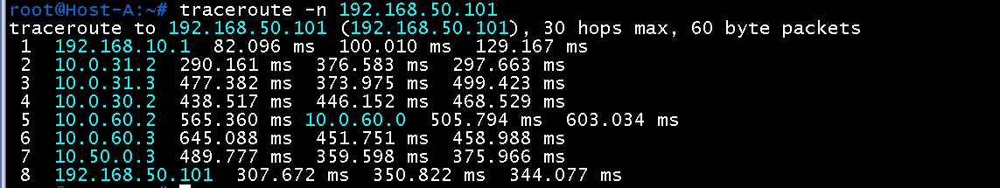

### T1b: PE1 `Gi5/0` (PE1 - Hub2) 단절

Host A에서 `ping -c 300 -i 0.2 192.168.50.101`을 보내면서 약 20초 뒤 단절

| 확인 | 기대 결과 | 결과 |
|---|---|---|
| 단절 직전 traceroute | 2번째 홉 10.0.31.2(border-leaf2), 3번째 홉 10.0.31.3(Hub2) | 일치 |
| 단절 중 PE1 이웃, 경로 | 10.0.30.3 Idle, 192.168.10.0 다음 홉이 10.0.30.1 하나 | 일치 |
| ping | 자동 복구, 손실 약 45개 안팎(hold 9초) | 253/300 응답, 손실 47개(15.67%, 환산 약 9.4초), +2 errors, 최대 RTT 4540ms |
| 단절 중 traceroute | 2번째 홉 10.0.31.0(border-leaf1), 3번째 홉 10.0.31.1(Hub1) | 일치 |
| 복구 | 10.0.30.3 Established | 일치 |

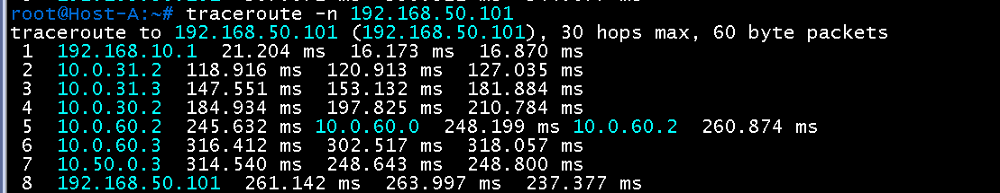

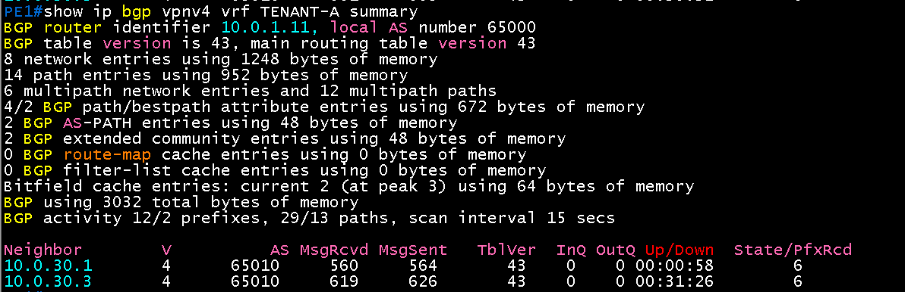

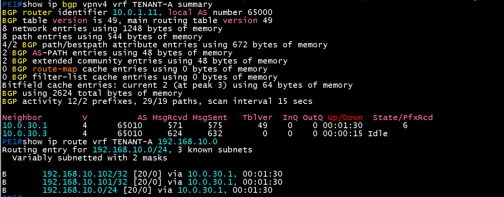

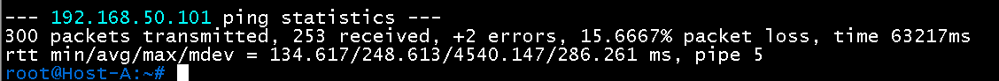

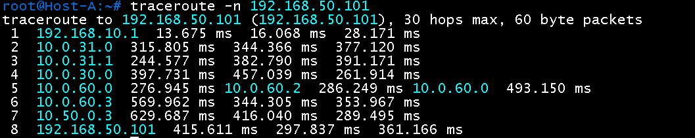

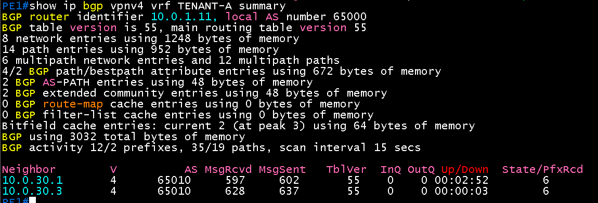

- 손실은 Hub2가 PE1 링크 다운을 바로 알지 못해 BGP hold가 끝날 때까지 이 경로로 보낸 패킷이 버려진 것으로 보임(추정)

### T2: PE2 `Gi1/0` (코어 링크, PE2 - PE3) 단절

Host E에서 `ping -c 300 -i 0.2 192.168.50.101`을 보내면서 약 20초 뒤 단절. 3회 측정

| 회차 | 응답 | 손실 | 환산 | PE2 - PE3 iBGP |
|---|---|---|---|---|
| 1 | 165/300 (+3 errors) | 135개 (45%) | 약 27초 | 끊기지 않음 |
| 2 | 64/300 (+11 errors) | 236개 (78.7%) | 약 47초 이상 (복구 전에 ping 종료) | Hold 만료로 Down(06:17:00.94), 38.6초 뒤 Up(06:17:32.80, 단절 06:16:54.17 기준) |
| 3 | 230/300 (+3 errors) | 70개 (23.3%) | 약 14초 | 끊기지 않음(업타임 연속) |

- 항목별 확인(1회차): 단절 전 PE2 경로 10.0.0.13이 10.0.10.5(PE3 직결, metric 2), OSPF 이웃 2개 FULL. 단절 중 10.0.10.0(PE1) 경유(metric 3), 이웃 PE1만 FULL, traceroute에 PE1(10.0.10.0) 등장. 복구 후 10.0.10.5로 원복, 이웃 2개 FULL
- 단절 직후 OSPF와 LDP 이웃이 바로 내려가고(06:16:54.17, 06:16:54.19), 2회차에서는 PE2 - PE3 iBGP가 단절 약 6.8초 뒤 Hold 만료로 끊김
- OSPF SPF 지연 기본값이 초기 5000ms, 최소 간격 10000ms. Hello 1초·Dead 4초는 감지 시간이고 재계산에는 이 지연이 더해져 손실 시간이 시험마다 달라졌을 가능성이 있음(추정, 확정하지 않음)
- 편차가 커서 대표값을 두지 않고 3회 값을 모두 기록함

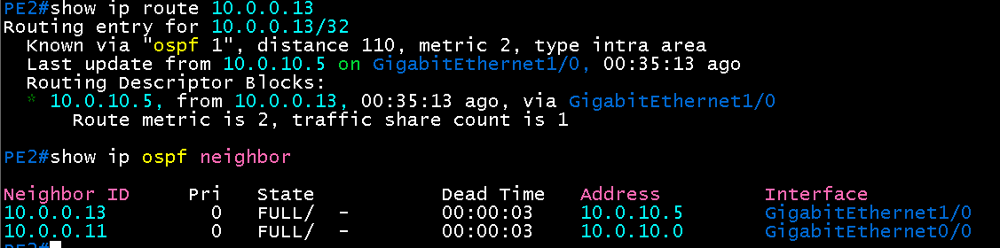

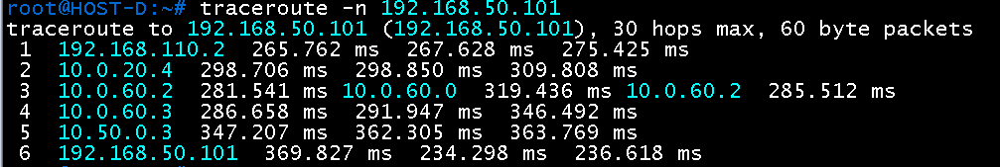

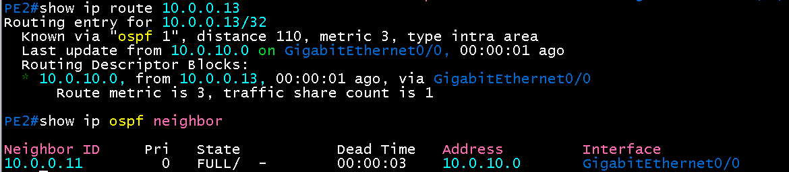

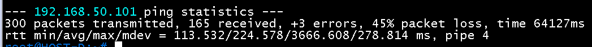

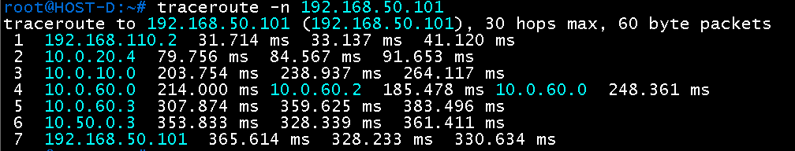

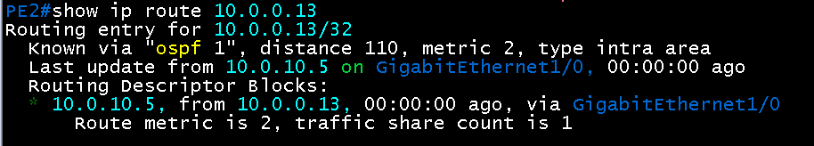

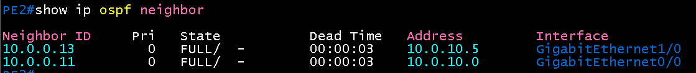

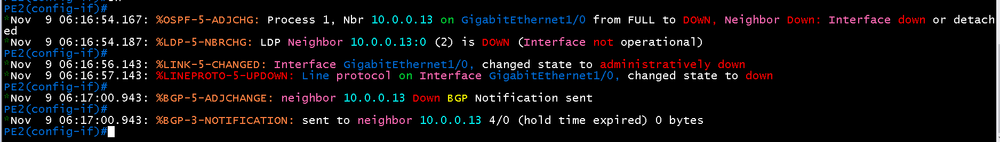

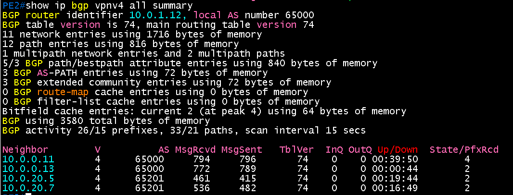

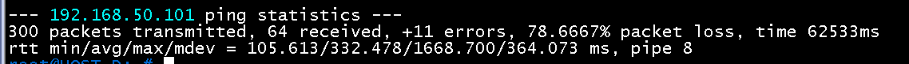

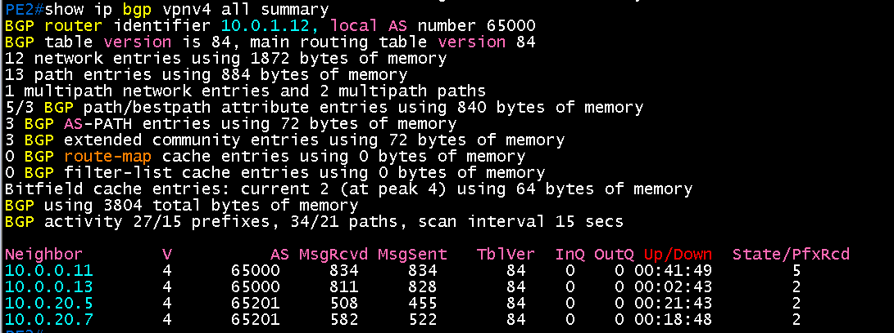

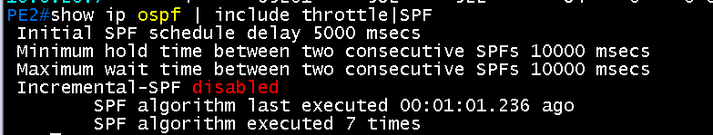

## 최종 구성에서 추가할 증빙

항목 9로 DC1 -> DC2 `ping`이 응답 없음(정상, 분리)인 화면과 T2 재측정(SPF 지연 설정 조정 시)은 추가하지 않았음

## 결과 기록

| 일시 | 결과 (성공, 실패) | 비고 |
|---|---|---|
| 2026-10-22 | 이전 구성 | leaf3·4 - PE1 직결, Hub 정적 경로 구성에서 확인. 구성 변경으로 대체됨 |
| 2026-11-07 | 이전 구성 | leaf3·4 - Hub 교차 연결 구성의 장애 시험. 현재 구성이 아니므로 값을 쓰지 않음 |
| 2026-11-09 | 성공 | border leaf 2대 추가 후 항목 1 ~ 8 통과. T1 손실 0, T1b 47개, T2 3회(135, 236, 70개), 모두 자동 복구(T2 2회차는 복구 구간을 ping으로 확인하지 못함) |
