# DCI와 Hub 연동 검증

**선행 조건**: [EVPN-VXLAN 검증](03-evpn-vxlan.md)이 끝나 있고, MPLS 코어(PE1)가 올라와 있어야 함([core 검증](../core/06-mp-bgp-vpnv4.md))

기준 문서: [06-dci-hub-ebgp.md](../../baseline/dc1/06-dci-hub-ebgp.md) / 샘플: [09-pe-ce-ebgp.md](../../samples/dc1/09-pe-ce-ebgp.md)

## 확인 항목

| 순서 | 장비 | 명령 | 기대 결과 | 안 될 때 확인 |
|---|---|---|---|---|
| 1 | leaf3 | `ping vrf TENANT-A 10.0.20.0` | PE1 응답 | 링크 IP, VRF 인터페이스 |
| 2 | leaf3 | `show ip bgp summary vrf TENANT-A` | PE1(65000)과 Hub1(65010)이 **Established** | AS 번호, 주소, address-family ipv4의 activate |
| 3 | leaf3 | `show ip route vrf TENANT-A` | 다른 지역(DC2, Branch) 경로가 PE1, Hub 경유로 보임 | 원격 지역 설정(3단계 이후) |
| 4 | Host A | `ping -c 3 192.168.110.101` | Host D 응답 (DC1에서 DC2로, 3단계 이후) | PE-CE eBGP, VPNv4 RT |
| 5 | leaf3 | `show ip bgp neighbors <PE1 주소> vrf TENANT-A \| include hold` | `Hold time is 9`, `keepalive interval is 3 seconds` | 양쪽 `timers 3 9` |

## 장애 시험

| 동작 | 기대 결과 |
|---|---|
| leaf3 - PE1 링크 shut | leaf4 - PE1 링크로 통신 유지 |
| Hub1 정지 | Hub2를 통해 통신 유지 |

## 증빙 (PE1 연동)

### leaf3, leaf4 VRF 경로

- leaf3: `show ip route vrf TENANT-A`에 10.0.20.0/31(Ethernet5), 192.168.10.0/24(Vlan10), 192.168.20.0/24(Vlan20)가 직결(C)
- leaf4: 10.0.20.2/31(Ethernet5), 192.168.10.0/24, 192.168.20.0/24가 직결(C)
- 설정 입력 전에는 10.0.20.x 직결 경로가 없었고(ethernet5 미설정), 입력 뒤 생김
- BGP로 받은 경로(B E)는 아직 없음. PE2 쪽(DC2) 경로가 들어오는 3단계 이후 확인. leaf3의 `show ip route vrf TENANT-A summary`도 bgp External 0

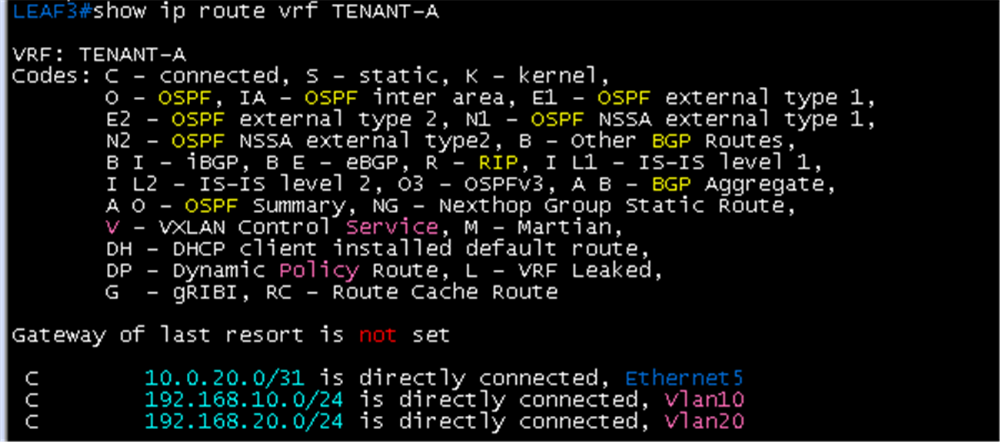

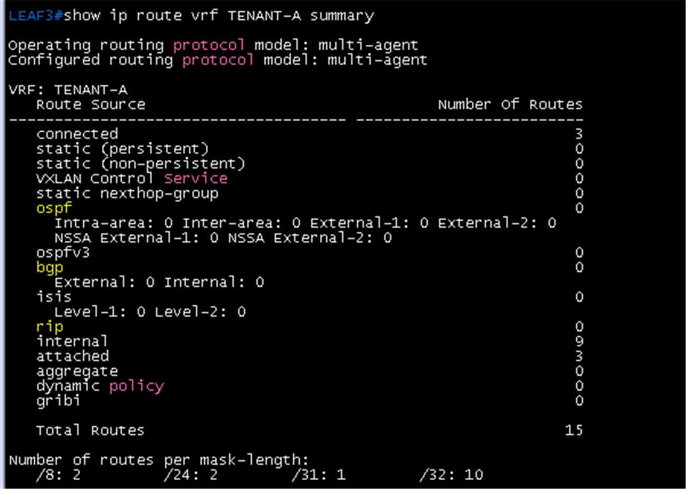

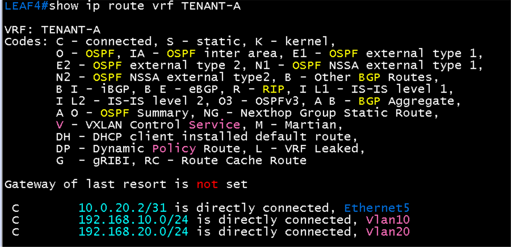

### leaf3 BGP 요약

- `show ip bgp summary vrf TENANT-A`: 이웃 10.0.20.0(PE1) AS 65000, State **Estab**, Up 00:03:23, PfxRcd 0, PfxAcc 0 (PE1이 보낼 외부 경로가 아직 없어서 0)
- **router identifier가 192.168.20.1**로 표시됨. VRF 안 BGP router-id가 지정되지 않아 VLAN 20 anycast 주소가 자동 선택된 것으로, leaf3과 leaf4가 같은 값을 갖게 됨. 설계값은 10.1.2.13(leaf3), 10.1.2.14(leaf4)이므로 `vrf TENANT-A` 안에 `router-id`를 지정해야 함. 아래 Hub 연동 뒤 화면에서 설계값으로 바뀐 것을 확인

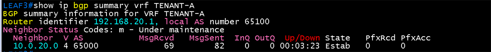

## 증빙 (Hub 연동)

### Hub 링크 ping

- Hub1 `ping 10.0.30.0`(PE1 `Gi4/0`): 5/5, 28/36/56 ms
- Hub2 `ping 10.0.31.2`(leaf4): 5/5, 20/28/32 ms
- 확인 중 Hub1에서 `10.0.30.2`(PE1 `Gi5/0`, Hub2 쪽 링크), Hub2에서 `10.0.31.0`(leaf3 쪽 링크)로 보낸 ping은 0/5. 해당 주소는 Hub 자신의 링크가 아니고 Hub에 그 주소로 가는 경로도 없으므로 정상(Hub1은 PE1 10.0.30.0, leaf3 10.0.31.0, Hub2는 PE1 10.0.30.2, leaf4 10.0.31.2로 확인)

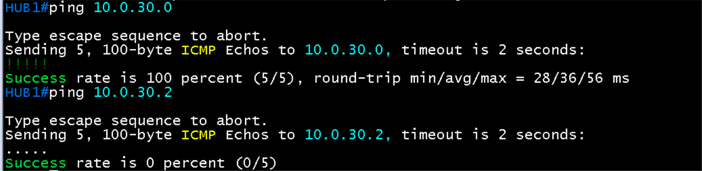

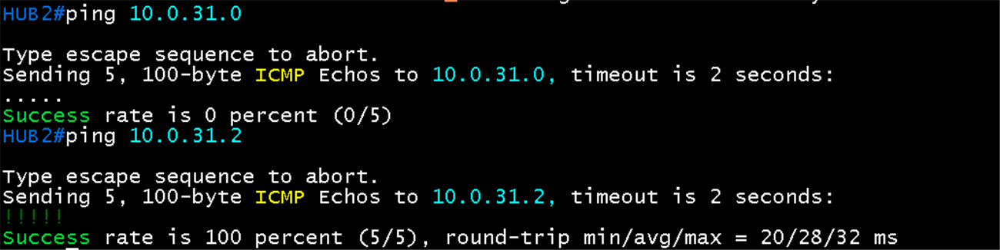

### Hub1 정적 경로

- `show ip route 10.0.30.5`: **10.0.30.5/32**, Known via **static**, distance 1, metric 0, next-hop **10.0.30.0**(PE1 `Gi4/0`). BGW1 터널 주소로 가는 경로
- 처음에 `ip route 10.0.30.5 255.255.255.255 10.0.30.1`을 입력하면 `%Invalid next hop address (it's this router)`로 거부됨. 10.0.30.1이 Hub1 자신의 주소라서 next-hop은 PE1 쪽 주소 10.0.30.0이어야 함
- Hub1에는 DC2(192.168.110.0/24)와 DC1(192.168.10.0/24, 192.168.20.0/24) 경로가 leaf3(10.0.31.0)에서 BGP로 들어와 있음. BGW1(10.0.30.5)이 구성되기 전이라 `ping 10.0.30.5`는 아직 확인 전

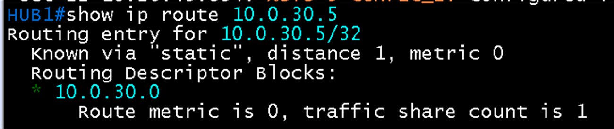

### Hub2 정적 경로와 PE1에서 Hub ping

- Hub2 `show ip route 10.0.30.7`: **10.0.30.7/32**, Known via **static**, distance 1, metric 0, next-hop **10.0.30.2**(PE1 `Gi5/0`)
- PE1 `ping vrf WAN-UL 10.0.30.1`(Hub1): 5/5, 28/40/64 ms. `ping vrf WAN-UL 10.0.30.3`(Hub2): 5/5, 28/31/36 ms ([core 07 검증](../core/07-pe-ce-ebgp.md) 항목 4)

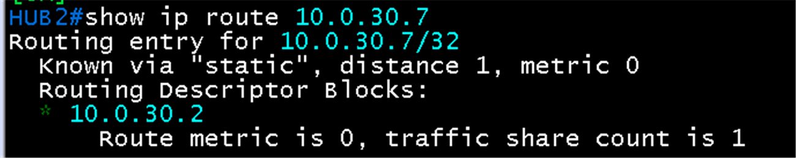

### BGP 타이머 (hold 9, keepalive 3)

- Hub1 `show ip bgp neighbors 10.0.31.0 | include hold`: **hold time is 9, keepalive interval is 3 seconds**, 설정값(Configured)도 9와 3
- Hub2 `... neighbors 10.0.31.2 ...`: 같은 값
- leaf3 `show ip bgp neighbors 10.0.31.1 vrf TENANT-A | include hold`, leaf4 `... 10.0.31.3 ...`: **Configured hold time is 9, keepalive interval is 3 seconds**. EOS 출력은 협상된 값을 `Effective minimum hold time is 3 seconds`로 보여 줌(상대의 최소 hold 허용값). IOS처럼 `hold time is 9` 줄은 나오지 않음

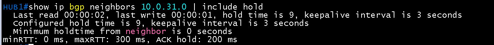

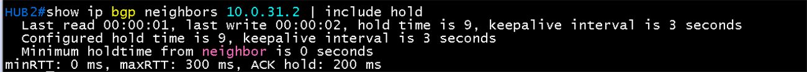

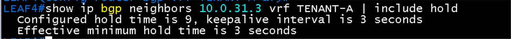

### leaf와 Hub eBGP

- leaf3 `show ip bgp summary vrf TENANT-A`: **router identifier 10.1.2.13**(VRF router-id 적용), 이웃 10.0.20.0(PE1) AS 65000 **Estab** 00:33:16 PfxRcd 3, 이웃 **10.0.31.1(Hub1) AS 65010 Estab** 00:02:04, PfxRcd 0
- leaf4: **router identifier 10.1.2.14**, 이웃 10.0.20.2(PE1) Estab 00:32:51 PfxRcd 3, 이웃 **10.0.31.3(Hub2) AS 65010 Estab** 00:01:37, PfxRcd 0
- Hub1 `show ip bgp summary`: router identifier **10.0.1.21**, local AS **65010**, 이웃 **10.0.31.0(leaf3) AS 65100**, Up 00:02:32, State/PfxRcd **7**
- Hub2: router identifier **10.0.1.22**, 이웃 **10.0.31.2(leaf4) AS 65100**, Up 00:02:26, PfxRcd **7**
- Hub가 leaf에서 경로 7개를 받음. leaf가 Hub에서 받는 경로는 0개인데, Hub가 아직 광고할 경로를 정하지 않았고 터널 위 Branch 경로도 없기 때문

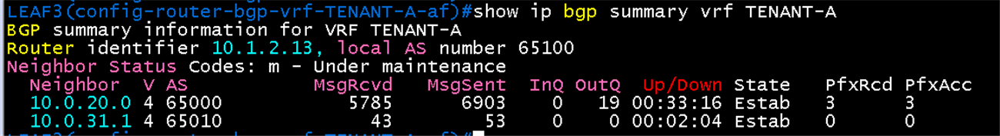

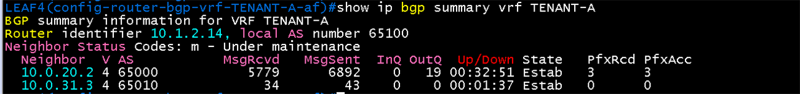

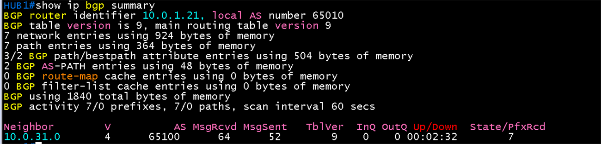

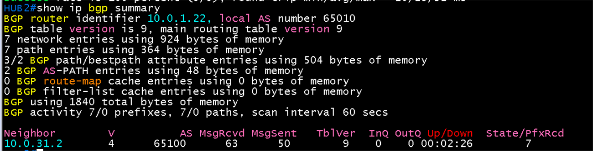

## 결과 기록

| 일시 | 결과 (성공, 실패) | 비고 |
|---|---|---|
| 2026-10-22 | 부분 성공 | PE1 쪽에서 leaf3, leaf4 Established와 ECMP 확인([core 07 검증](../core/07-pe-ce-ebgp.md)). leaf3 `show ip bgp summary vrf TENANT-A`에서 PE1 Estab 확인(항목 2의 PE1 부분). VRF router-id 수정 필요(위 참조). 항목 1(leaf에서 PE1 ping), 5(hold)는 미확인. 항목 3, 4와 Hub 구간은 이후 |
| 2026-10-22 | 성공 (Hub 연동) | 항목 2의 Hub 부분 완료. leaf3-Hub1(10.0.31.0/.1), leaf4-Hub2(10.0.31.2/.3) eBGP **Established**, VRF router-id가 10.1.2.13, 10.1.2.14로 적용됨. Hub는 leaf에서 경로 7개 수신, leaf가 Hub에서 받는 경로는 0(Hub 광고 설정 이후). Hub1, Hub2 정적 경로(BGW 터널 주소 방향), PE1에서 Hub1, Hub2 ping 5/5, 모든 leaf-Hub, Hub-leaf 세션의 hold 9와 keepalive 3까지 확인. 터널과 Hub ↔ BGW ping은 BGW 구성 뒤 |