# 관리 접속 제한 (ACL) 검증

**선행 조건**: [샘플](../../samples/dc1/10-mgmt-acl.md)의 `MGMT-ACL`이 장비에 적용되어 있고, PC가 관리망(`192.168.100.1`)에 연결되어 있어야 함

기준 문서: [07-mgmt-acl.md](../../baseline/dc1/07-mgmt-acl.md)

## 확인 항목

| 순서 | 장비 | 명령 | 기대 결과 | 안 될 때 확인 |
|---|---|---|---|---|
| 1 | 적용 장비 | `show ip access-lists MGMT-ACL`, `show running-config section control-plane` | 규칙 10~80이 보이고 `system control-plane` 아래에 `ip access-group MGMT-ACL in` | ACL 이름, `system control-plane` 적용 |
| 2 | PC | `ping 192.168.100.21`, `ssh admin@192.168.100.21` | 응답, 로그인 | 관리망 경로, 규칙 10, 20 |
| 3 | 적용 장비 | `show ip access-lists MGMT-ACL` (2번 직후) | 규칙 10, 20의 match 카운터가 올라 있음 | PC 출발 주소가 `192.168.100.0/24`인지 |
| 4 | spine1 | `ssh -l admin 10.1.10.1` (leaf1의 링크 주소로) | **연결 실패**(시간 초과, 허용 목록에 없는 출발 주소 `10.1.10.0`) | 규칙 순서, 적용 위치 |
| 5 | 적용 장비 | `show logging last 30 minutes \| include ACL` | `denied tcp 10.1.10.0(...) -> 10.1.10.1(22)` | deny 규칙의 `log` |
| 6 | leaf1, leaf2 | `show mlag` | **Active, Connected** 유지 | 규칙 60(`10.1.254.0/24`) |
| 7 | 모든 노드 | `show ip ospf neighbor`, `show bgp evpn summary` | OSPF FULL, BGP Established 유지 | 규칙 30, 40, 50 (OSPF, BGP 설정 후 확인) |

## 장애 시험

| 동작 | 기대 결과 |
|---|---|
| `system control-plane` 아래 `no ip access-group MGMT-ACL in` | 제한이 풀려 어떤 출발 주소에서도 SSH가 됨 (잠겼을 때 복구용, 콘솔에서 실행) |

## 증빙 (leaf1, 2026-10-22)

### 허용: 관리망 PC에서 접속

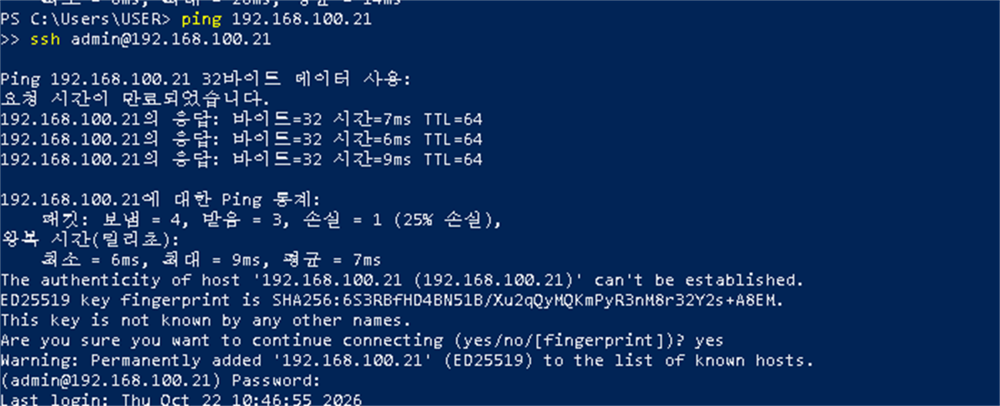

- ping 응답이 `TTL=64`로 오고(첫 요청의 시간 초과는 ARP 확인 중), SSH 로그인까지 됨

### ACL 카운터

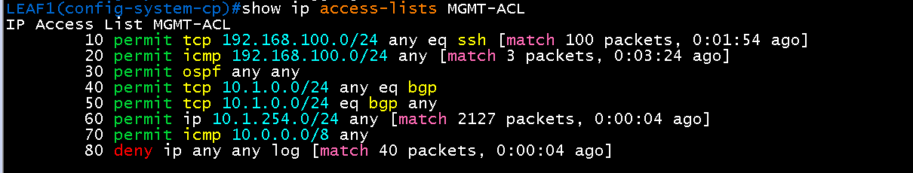

- 규칙 10(SSH) 100 packets, 규칙 20(ICMP) 3 packets: PC 접속이 허용 규칙으로 통과
- 규칙 60(MLAG 피어) 2127 packets: leaf2와의 MLAG 통신이 계속 통과
- 규칙 80(deny)에도 일치가 쌓임. 다음 두 로그가 그 내용

### 차단: 허용 목록에 없는 출발 주소

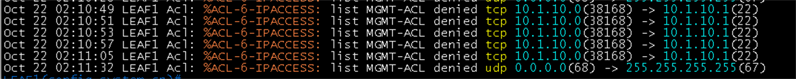

- `tcp 10.1.10.0(38168) -> 10.1.10.1(22)`가 `MGMT-ACL`에서 **denied** 됨(재시도까지 모두 차단). spine1의 링크 주소에서 leaf1로 가는 SSH

### 막힌 나머지: DHCP 요청 (정상)

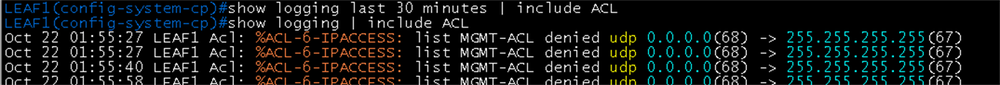

- `udp 0.0.0.0(68) -> 255.255.255.255(67)`은 설정이 없는 vEOS(ZTP)가 보내는 DHCP 요청. 우리가 쓰지 않는 트래픽이라 막혀도 영향이 없음

## 증빙 (spine1, spine2, leaf2~4, 2026-10-22)

### 관리망 PC에서 6대 접속 확인

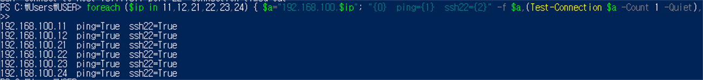

- 192.168.100.11, .12, .21, .22, .23, .24가 모두 `ping=True`, `ssh22=True`

### 장비별 ACL 적용 상태

| 장비 | 화면 | 볼 곳 |
|---|---|---|
| leaf2 | 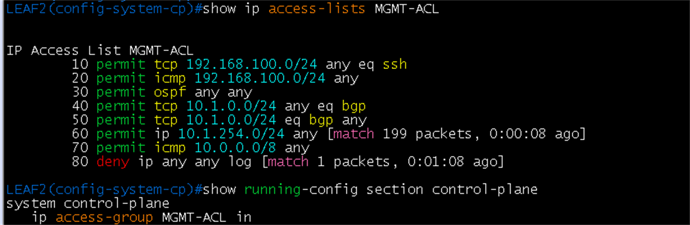 | 규칙 10~80, `ip access-group MGMT-ACL in`, 규칙 60(MLAG) 199 packets |
| leaf3 | 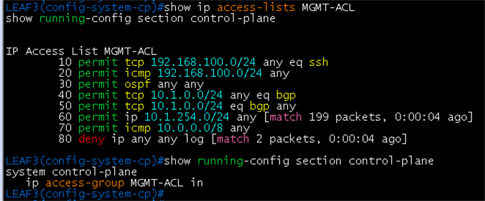 | 같은 내용, 규칙 60 199 packets |
| leaf4 | 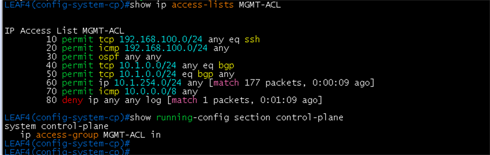 | 같은 내용, 규칙 60 177 packets |
| spine1 | 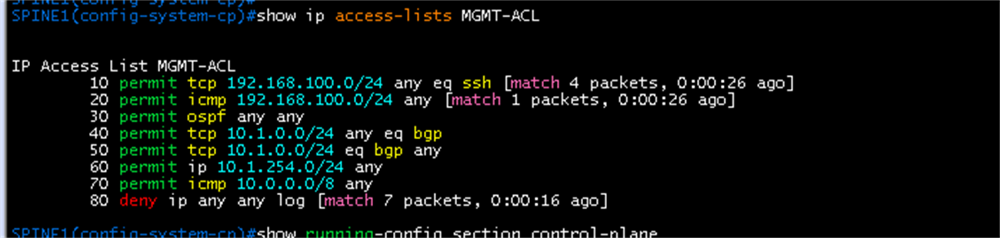 | 규칙 10, 20에 PC 접속 카운터 |
| spine2 | 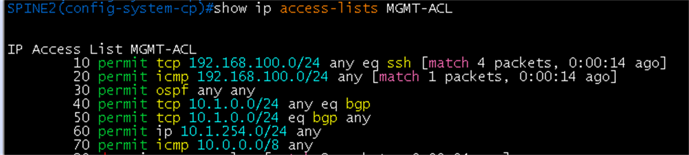 | 규칙 10, 20에 PC 접속 카운터 |

- leaf2~4의 규칙 80(deny)은 1~2 packets로 작음. 설정이 없는 장비의 DHCP 요청 정도이고 정상
- leaf1~4 모두 `show mlag`가 **Active, Connected**, `peer-config: consistent`로 유지됨(leaf1 MLAG1, leaf2 MLAG1, leaf3 MLAG2, leaf4 MLAG2).
### 차단: spine에서 leaf로 SSH (허용 목록에 없는 출발 주소)

| 출발 | 대상 | 화면 |
|---|---|---|
| spine1 (10.1.10.6) | leaf4 (10.1.10.7) | 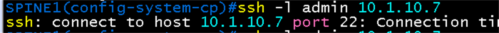 |
| spine2 (10.1.10.10) | leaf2 (10.1.10.11) | 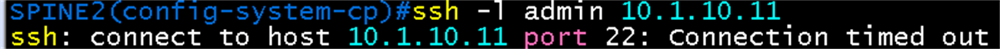 |
| spine2 (10.1.10.12) | leaf3 (10.1.10.13) | 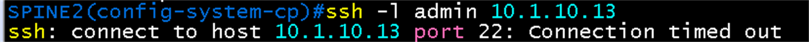 |

- 세 경우 모두 `Connection timed out`. leaf1은 로그(`denied tcp 10.1.10.0 -> 10.1.10.1(22)`)로 확인됨. leaf1~4 모두 차단이 동작
## 결과 기록

| 일시 | 결과 (성공, 실패) | 비고 |
|---|---|---|
| 2026-10-22 | 성공 (leaf1~4, spine1, spine2) | 적용, 관리망 접속, MLAG 유지, spine 출발 SSH 차단(leaf1~4) 모두 확인. OSPF, BGP 유지(7번)는 설정 후 확인 |