# VLAN, MSTP, 호스트 접속 검증 (2026-11-14 설계)

**선행 조건**: leaf1~4에 VLAN 10, 20, 30, 99, MSTP(region DC1, 인스턴스 1 = VLAN 10·20, 인스턴스 2 = VLAN 30·99), anycast SVI, VXLAN VNI 10010·10020·10030·10099가 적용되어 있어야 함. 호스트는 [호스트 개요](../../baseline/host/01-overview.md). [VLAN 기준](../../baseline/dc1/02-vlan-ip.md)

## 확인 항목

| 순서 | 장비 | 명령 | 기대 결과 | 안 될 때 확인 |
|---|---|---|---|---|
| 1 | leaf1 | `show spanning-tree mst` | MST1 = VLAN 10,20, MST2 = VLAN 30,99, priority 4097·4098(4096 + sysid) | `spanning-tree mst configuration` |
| 2 | leaf1 | `show interfaces vxlan1` | VLAN 10·20·30·99 -> VNI 10010·10020·10030·10099, L3VNI 50001, flood VTEP 10.1.1.34 | `vxlan vlan` 줄 |
| 3 | leaf3 | `show vxlan vni` | 같은 VNI 4개와 50001 | 같음 |
| 4 | leaf3 | `show bgp evpn route-type mac-ip` | Host C, Host D의 MAC·IP가 type 2로 보임(RD 10.1.2.13·14) | `router bgp`의 `vlan` 블록 |
| 5 | Host A | `ping -c 4 192.168.20.101`, `192.168.30.101`, `192.168.99.101` | 0% 손실 (VLAN 간은 anycast SVI 라우팅) | 호스트 IP, 포트 VLAN |

## 증빙

### MSTP와 VXLAN (항목 1, 2, 3)

- leaf1 `show spanning-tree mst`: MST0은 나머지 VLAN, **MST1 vlans mapped 10,20**(priority 4097), **MST2 30,99**(priority 4098), 이 스위치가 두 인스턴스의 root. 호스트 포트 Et5는 P2p Edge
- leaf1 `show interfaces vxlan1`: VLAN 10→10010, 20→10020, 30→10030, 99→10099, L3VNI 50001(VRF TENANT-A, 동적 VLAN 4093), Replication/Flood Mode headend(flood list EVPN), flood VTEP 10.1.1.34
- leaf3 `show vxlan vni`: 10010~10099 4개와 동적 50001

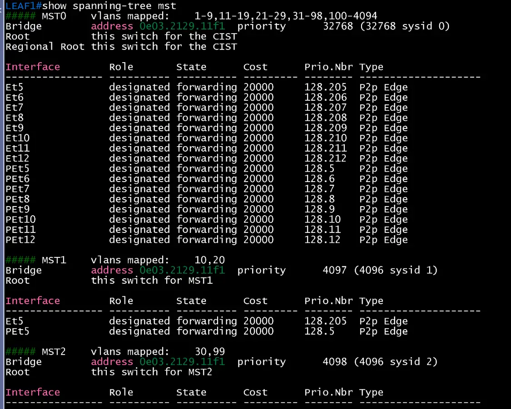

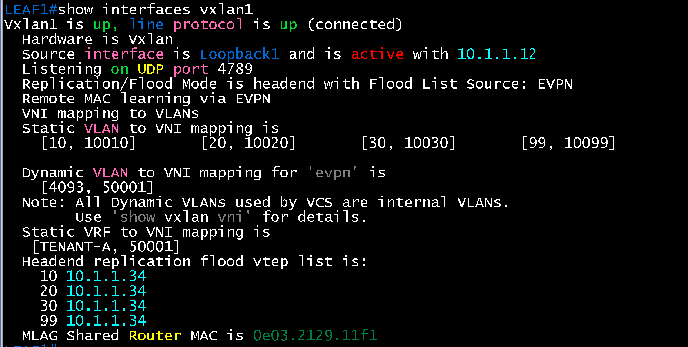

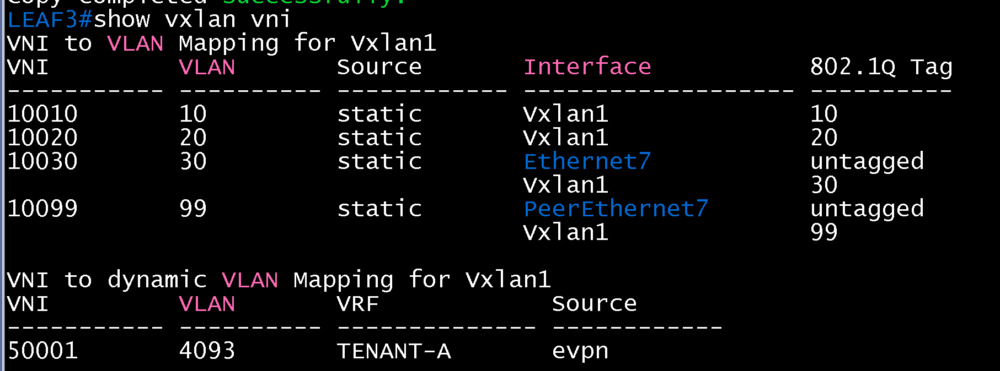

### EVPN MAC·IP (항목 4)

- leaf3 `show bgp evpn route-type mac-ip`: Host D(`0242.16c7.3c00`, 192.168.99.101)와 Host C(`0242.2e8f.e000`, 192.168.30.101)가 type 2로 보이고 next hop 10.1.1.34(leaf3·4 VTEP). 같은 MAC에 RD 10.1.2.13과 10.1.2.14 경로가 둘 다 보임(MLAG 쌍이 둘 다 광고, 이전 검증과 같은 패턴)

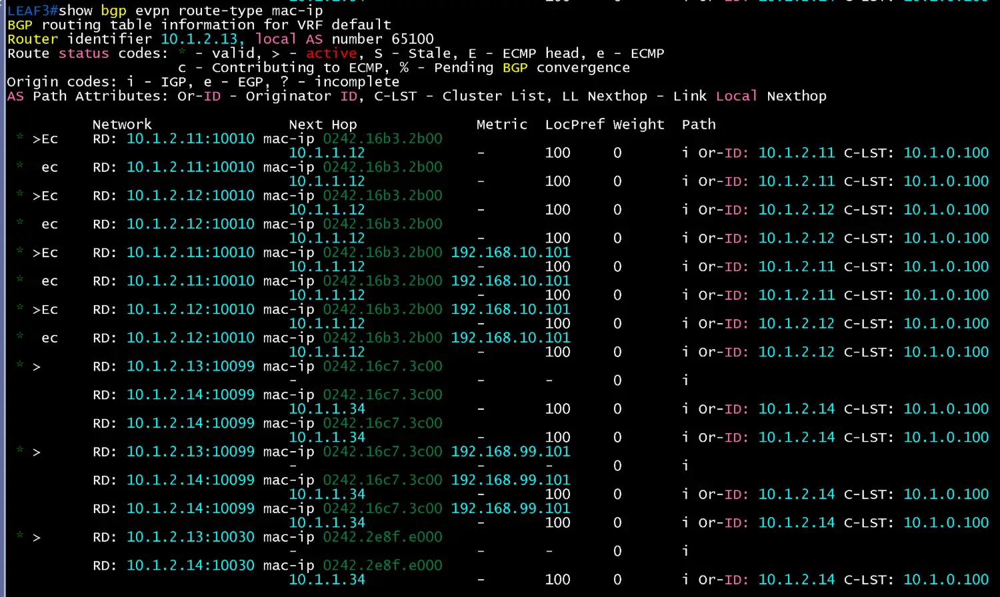

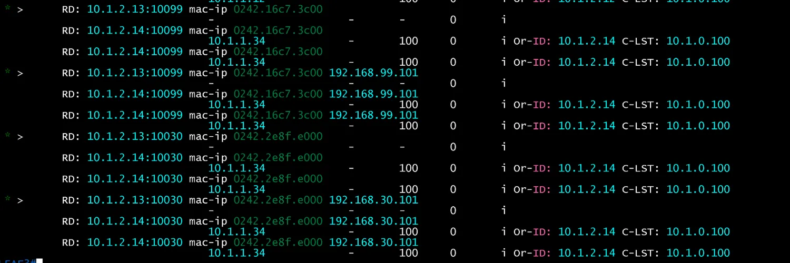

### 호스트 접속과 통신 (항목 5)

- 처음에 leaf3 Et7이 이전 설정(`to-HostB`, VLAN 10)으로 남아 있어 Host C가 게이트웨이 192.168.30.1에 닿지 않았음(`Destination Host Unreachable`). `show interfaces ethernet7 status`에서 VLAN 10이었고 `show vlan 30`의 포트 목록에 Et7이 없었음. `switchport access vlan 30`, `description to-HostC` 반영 뒤 해결
- 해결 뒤: Host C -> 192.168.30.1 3/3, Host A -> 192.168.30.101 4/4, Host C -> 192.168.99.101 4/4, Host A -> 192.168.99.101 4/4, 모두 0% 손실. TTL이 62~63(라우팅 홉 2개, VXLAN 통과)

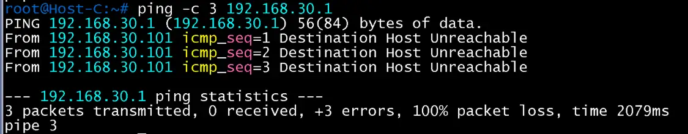

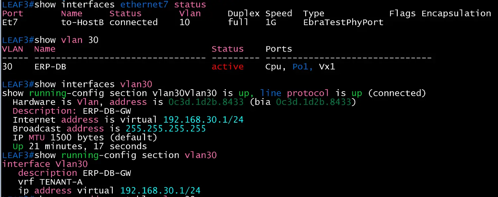

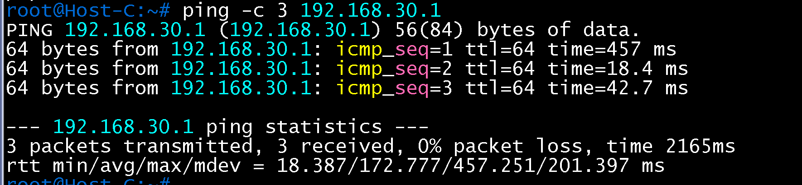

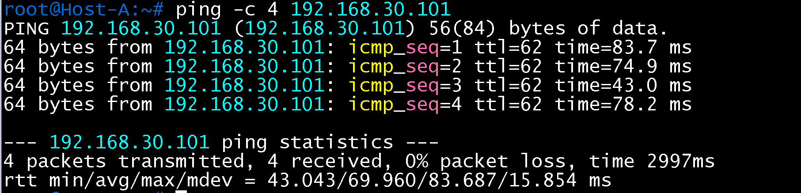

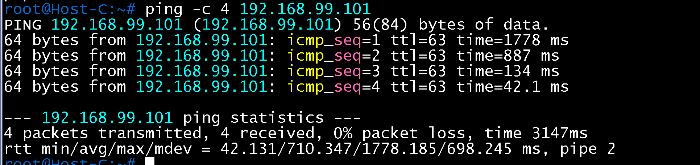

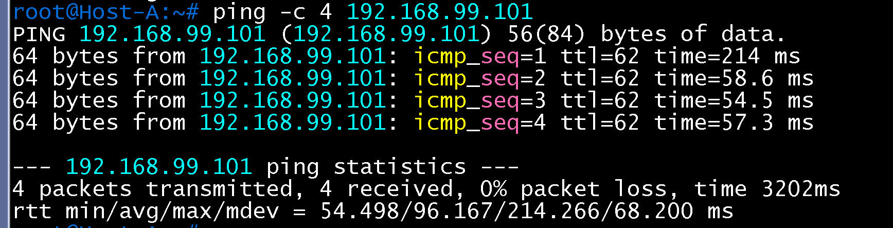

## 결과 기록

| 일시 | 결과 | 비고 |
|---|---|---|
| 2026-11-14 | 성공 | 항목 1~5 완료. leaf3 Et7 설정 미반영을 확인해 수정한 뒤 통과 |
