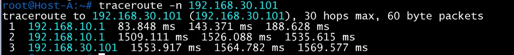
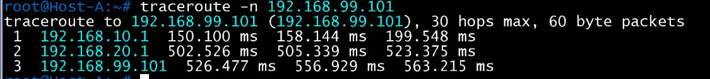
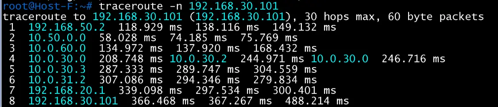
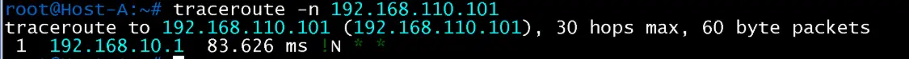

# traceroute 경로 검증 (2026-11-14)

홉 응답 주소로 경로와 장비를 확인. Leaf의 anycast 게이트웨이는 어느 Leaf인지 구분되지 않음. 응답 시간은 이 랩의 부하로 크게 흔들려 증빙에 쓰지 않음

## 정상 경로

| 출발 -> 목적 | 홉 | 의미 | 증빙 |
|---|---|---|---|
| Host A -> Host C (192.168.30.101) | 192.168.10.1 -> 192.168.x.1 -> 도착 (3홉) | DC1 안 VLAN 간 라우팅, 코어·Hub 미경유 |  |
| Host A -> Host D (192.168.99.101) | 192.168.10.1 -> 192.168.20.1 -> 도착 | 관리 VLAN 99 도달 |  |
| Host F -> Host C | 192.168.50.2(DSW1), 10.50.0.0(BGW1), 10.0.60.0(PE3), 10.0.30.0·10.0.30.2(PE1, Hub1·Hub2 ECMP), 10.0.30.3(Hub2), 10.0.31.2(border leaf2), 192.168.20.1, 도착 (8홉) | 개발지사 -> 코어 -> Hub -> border leaf -> ERP |  |

## 분리

| 출발 -> 목적 | 결과 | 증빙 |
|---|---|---|
| Host A(DC1) -> Host E(DC2, 192.168.110.101) | 1홉 192.168.10.1에서 `!N`, 이후 `* *`, 도달 안 함 |  |
| Host E(DC2) -> Host C(DC1) | 1홉부터 30홉까지 `* * *`, 도달 안 함 | [DC2 분리 검증](../dc2/08-connect-isolation.md) |

두 방향 모두 목적지에 도달하지 않아 DC1(누리데이터 ERP)과 DC2(청명정밀 매체제어) 분리가 새 VLAN까지 유지됨
