# 장애 시험 T1 ~ T4 (2026-11-14)

앞부분은 이전 타이머(OSPF 1/4, BGP 3/9) 기준, 새 타이머(OSPF 3/9, BGP 30/90) 기준은 아래 "새 타이머 기준 장애 시험" 절

기준: 시험 전에 같은 ping이 0% 손실인지 확인하고, ping을 시작한 뒤 5초쯤 지나 인터페이스를 `shutdown`. 끝나면 `no shutdown`으로 복구하고 BGP·OSPF가 돌아온 것까지 확인. 응답 시간은 증빙에 쓰지 않음

## 결과 (이전 타이머 기준)

| 시험 | 단절 (ping 중) | 단절 중 상태 | 손실 | 복구 확인 |
|---|---|---|---|---|
| T1 Hub1 경로 | PE1 `Gi2/0` | Hub1 Idle, 경로는 Hub2(10.0.30.3) 하나, traceroute 4홉 10.0.30.2 -> 5홉 Hub2 -> 6홉 10.0.31.2(border leaf2) | `Host F: ping -c 300 -i 0.2 192.168.30.101` **손실 0**(두 번 모두 300/300) | Hub1 Established, 경로 multipath 복귀, traceroute 4홉이 10.0.30.0·.2 번갈아 |
| T1b Hub2 경로 | PE1 `Gi5/0` | Hub2 Idle, 경로는 Hub1(10.0.30.1) 하나, traceroute 4홉 10.0.30.0 -> 5홉 Hub1 -> 6홉 10.0.31.0(border leaf1) | **손실 0**(300/300), 처음 한 번은 300개 중 1개 | Hub2 Established, 두 경로 복귀 |
| T2 코어 링크 | PE2 `Gi1/0`(PE3 방향) | OSPF 이웃 PE1만, `10.0.0.13`이 PE1(10.0.10.0) 경유 metric 3, traceroute 7홉(PE1 경유), 단절 중 ping 120/120 0% | 복구(`no shutdown`) 중 `Host E: ping -c 120 -i 0.2 192.168.50.101` **손실 0** | PE2에 PE1·PE3 FULL, 10.0.0.13 next hop 10.0.10.5 metric 2, traceroute 6홉(PE3 직접) |
| T3 Leaf 업링크 | leaf1 `Et1`(spine1 방향) | leaf1 OSPF 이웃 spine2만, `10.1.1.34` next hop 10.1.10.8 하나(정상은 두 개), traceroute 3홉 | `Host A: ping -c 120 -i 0.2 192.168.30.101` 120개 중 **5개 손실**(4.17%, 약 1초) | spine1·spine2 FULL, next hop 두 개 복귀 |
| T4 호스트 포트 | leaf1 `Et5`(Host A) | Host A -> 192.168.30.101 **100% 손실**, Host B -> 같은 대역 0% 손실(leaf2 Et5) | 호스트가 단일 연결이라 Host A만 끊김 | `no shutdown` 뒤 Host A 4/4 0% |

- T1b의 이전 기록(47개 손실, 약 9.4초)은 단절 방식이 달라 값이 다름. 이번 시험은 인터페이스 `shutdown`으로 링크 다운이 바로 감지되어 손실이 거의 없었던 것으로 보이나 이 해석은 확인하지 못함
- T2는 코어 링크를 내려둔 상태가 길게 이어져 단절 직후 손실은 측정하지 못했고, 단절 중 통신 유지와 복구 중 손실 0을 기록

## 증빙

### T1 Hub1 단절 / 복구

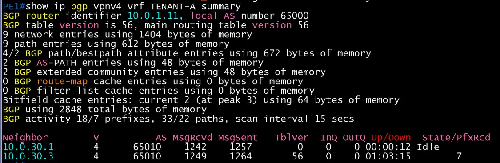

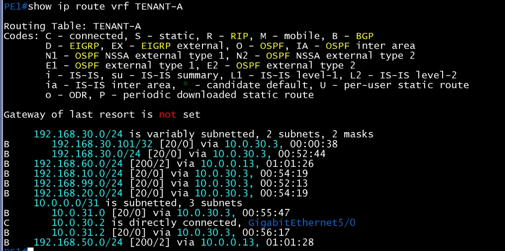

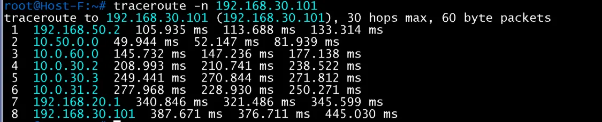

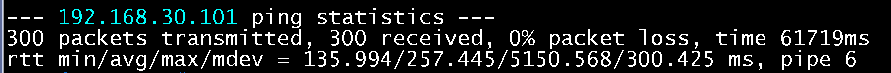

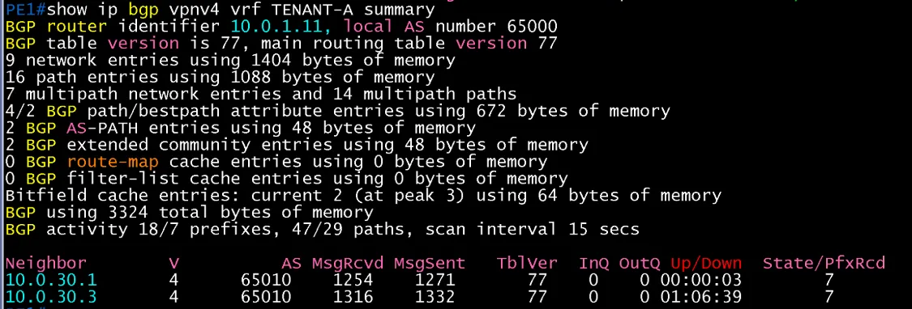

### T1b Hub2 단절 / 복구

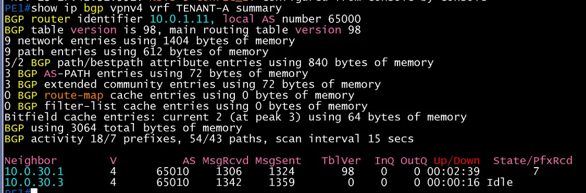

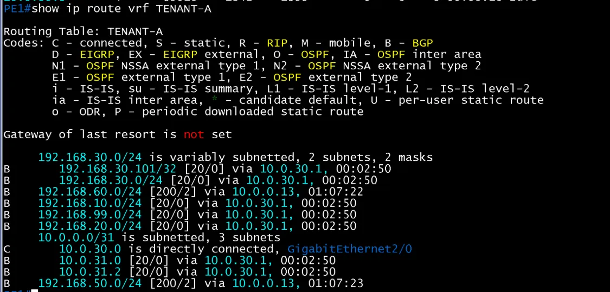

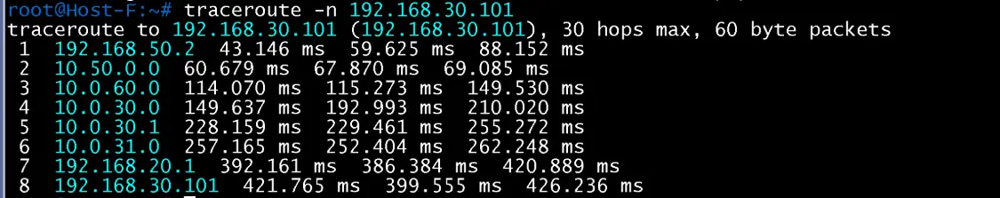

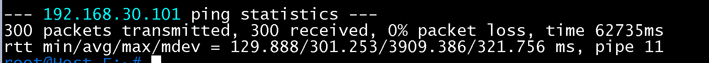

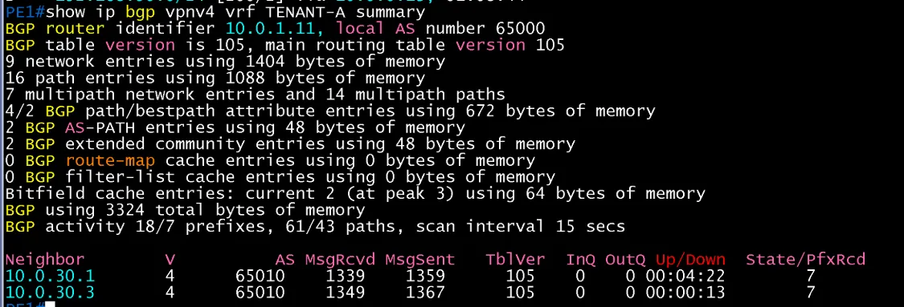

### T2 코어 링크

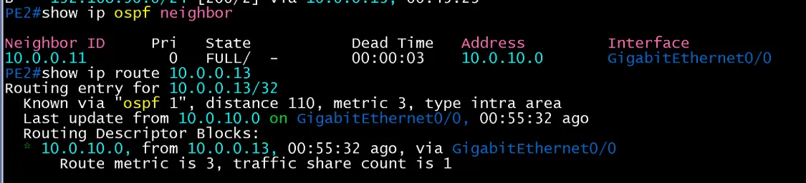

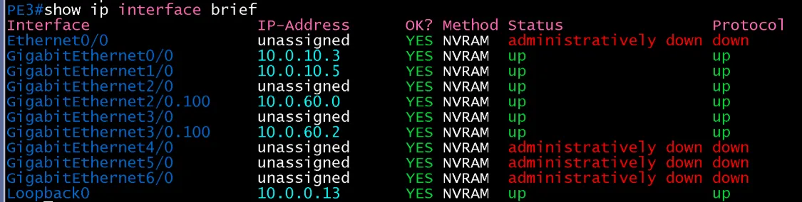

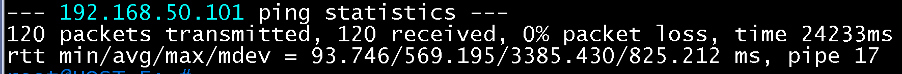

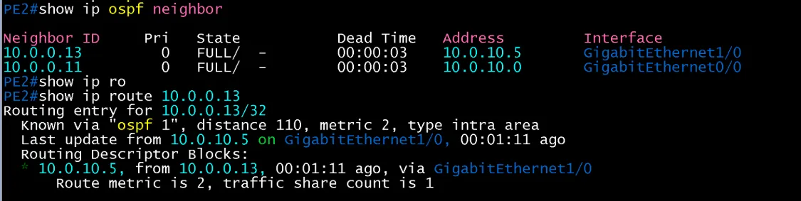

### T3 Leaf 업링크, T4 호스트 포트

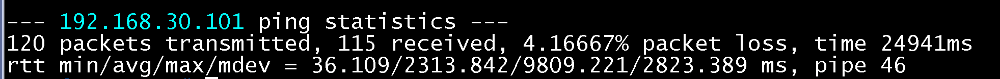

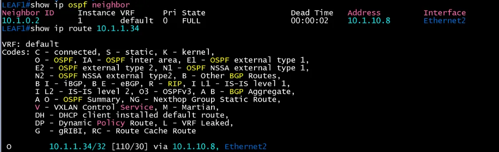

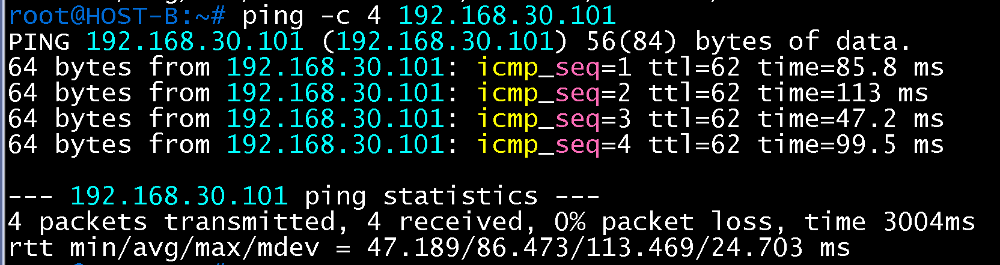

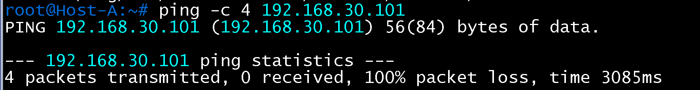

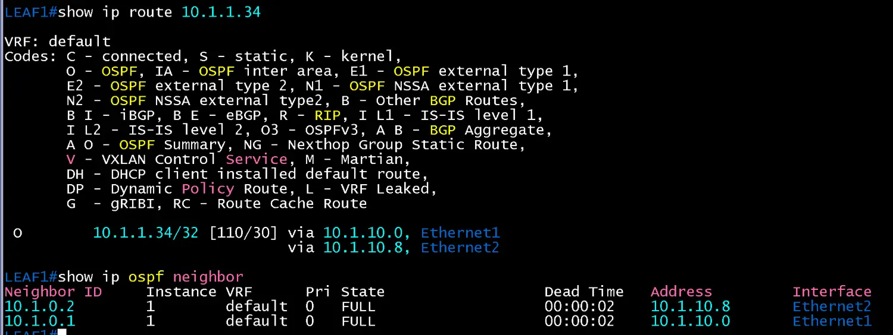

## 결과 기록

| 일시 | 결과 | 비고 |
|---|---|---|
| 2026-11-14 | 성공 | T1~T4 완료(이전 타이머). 단절 중 통신 유지와 복구 확인 |
| 2026-11-14 | 성공 | 새 타이머 기준 시험 완료. 시험마다 정상 경로, 단절 중 경로, 복구 후 경로 확인 |

## 새 타이머 기준 장애 시험 (2026-11-14, OSPF hello 3 / dead 9, BGP 30 / 90)

앞의 T1 ~ T4 결과는 이전 타이머(OSPF 1/4, BGP 3/9) 기준. 아래는 새 타이머 기준이며 시험마다 정상 경로, 단절 중 경로, 복구 후 경로를 확인함. `손실 x 0.2초` 환산 시간은 참고값이고 측정한 시간이 아님

### 경로 요약

| 내린 링크 | 정상 경로 | 단절 중 경로 | 손실 |
|---|---|---|---|
| Hub1 링크 (PE1 `Gi2/0`) | A -> F: Leaf1 -> Border-Leaf1(10.0.31.0) -> **Hub1(10.0.31.1)** -> PE1(10.0.30.0) -> PE3 -> BGW -> DSW -> Host F / F -> A: PE1(10.0.30.2) -> **Hub2(10.0.30.3)** -> Border-Leaf2(10.0.31.2) -> Leaf -> Host A | A -> F: Leaf1 -> Border-Leaf2(10.0.31.2) -> **Hub2(10.0.31.3)** -> PE1(10.0.30.2) -> PE3 -> BGW -> DSW -> Host F | A -> F 393/800 (49.1%), F -> A 434/600 (72.3%), 두 방향 동시 355 · 354/800 |
| Hub2 링크 (PE1 `Gi5/0`) | F -> A: PE1(10.0.30.2) -> **Hub2(10.0.30.3)** -> Border-Leaf2(10.0.31.2) -> Leaf -> Host A | F -> A: PE1(10.0.30.0) -> **Hub1(10.0.30.1)** -> Border-Leaf1(10.0.31.0) -> Leaf -> Host A | F -> A 1/800 (0.125%) |
| 코어 링크 (PE2 `Gi1/0`) | Host E -> PE2 -> **PE3 직접** -> BGW -> DSW -> Host F (6홉) | Host E -> PE2 -> **PE1(10.0.10.0) 경유** -> PE3 -> BGW -> DSW -> Host F (7홉) | E -> F 68/1000 (6.8%) |
| Leaf1 업링크 (`Et1`) | `10.1.1.34` next hop 두 개: Spine1(10.1.10.0 `Et1`), Spine2(10.1.10.8 `Et2`) | next hop 하나: Spine2(10.1.10.8 `Et2`), metric 30 | A -> C 4/800 (0.5%) |
| Leaf1 호스트 포트 (`Et5`) | Host A -> Leaf1 -> Host C 3홉 | 경로 없음(Host A 단일 연결), Host B는 영향 없음 | Host A 100%, Host B 0% |

- 우회 경로가 다른 링크(Hub1 <-> Hub2, 직접 <-> PE1 경유, Spine1 <-> Spine2)로 바뀌어 통신이 이어지는 것을 시험마다 traceroute와 경로 표로 확인
- Hub1 링크를 내린 시험만 손실이 수백 개이고 나머지는 한 자리 또는 두 자리(T2) 수. 아래 "손실 차이" 절 참고

### Hub1 링크 (PE1 `Gi2/0`) 단절

#### Host A -> Host F (`ping -i 0.2 -c 800 192.168.50.101`)

| 항목 | 값 |
|---|---|
| 정상 경로 | A -> F는 Border-Leaf1 -> Hub1(10.0.31.1) -> PE1(10.0.30.0), F -> A는 PE1 -> Hub2(10.0.30.3) -> Border-Leaf2(10.0.31.2) (왕복이 서로 다른 Hub) |
| shutdown 시각 | 18:40:41.959 ~ 18:40:42.431 (PE1 `show clock` 전후) |
| PE1의 Hub1 이웃 | 단절 약 5초 뒤 `Idle`, Hub2 이웃과 PE2 · PE3는 Estab 유지 |
| Hub1의 PE1 이웃 | 단절 직후 화면은 `Estab 00:32:10`(유지), 약 100초 시점 화면은 `Idle 00:00:18`(hold 만료로 내려감) |
| ping 결과 | **800개 중 407개 응답, 손실 393개(49.1%)**, `+1 errors`, 169.7초, rtt 최대 2,963ms |
| 단절 중 경로 | Border-Leaf2(10.0.31.2) -> Hub2(10.0.31.3) -> PE1(10.0.30.2) -> PE3 (정상 때 Border-Leaf1 · Hub1에서 바뀜) |
| 복구 시각 | 18:44:11.903 (`no shutdown`) |
| 복구 후 | PE1의 Hub1 이웃 Estab(00:00:10), Hub1의 PE1 이웃 Estab(00:00:31), ping 5/5 응답 |

- 손실 393개 x 0.2초는 약 79초로 환산됨. BGP는 마지막 keepalive 수신 뒤 hold 90초를 세므로 단절 뒤 60 ~ 90초 사이에 만료되는 값과 맞음(환산값이며 ping 시작 시각을 기록하지 못함)
- ping은 `no shutdown`보다 먼저 끝났으므로 손실은 모두 단절 중에 생긴 값
- 정상 경로와 단절 중 경로를 보면 같은 두 호스트가 단절 뒤에는 Hub2를 지남

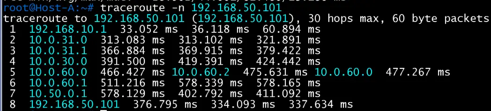

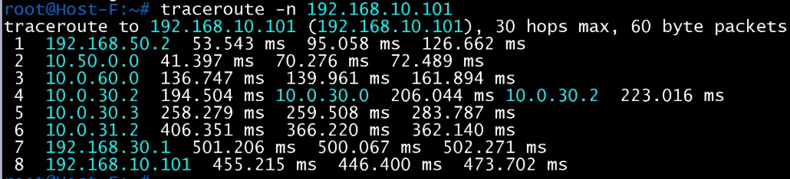

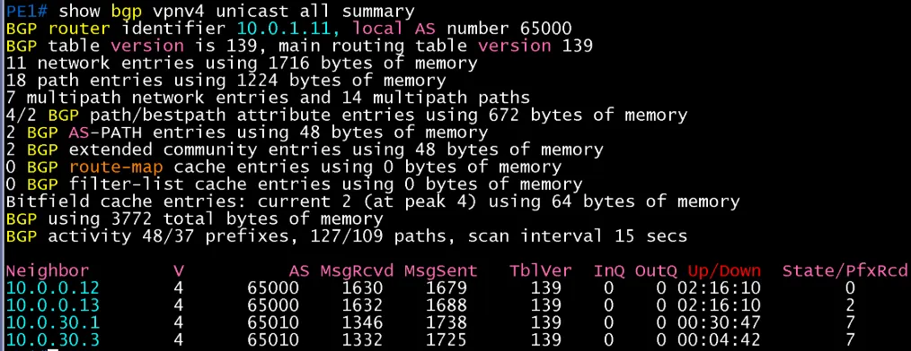

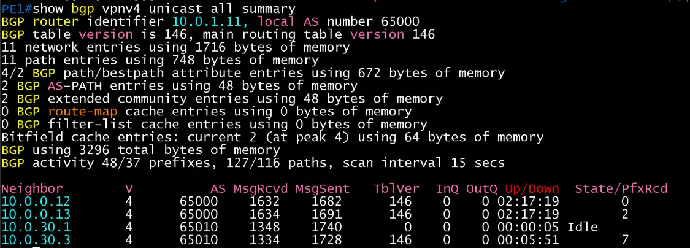

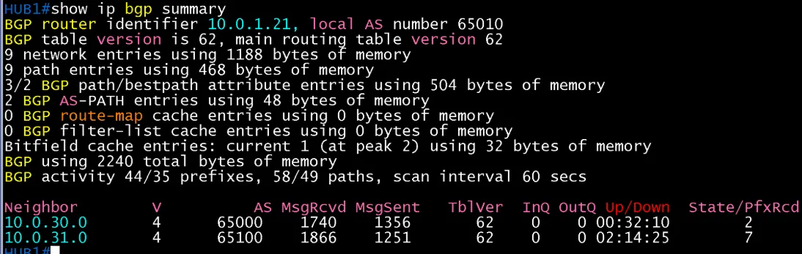

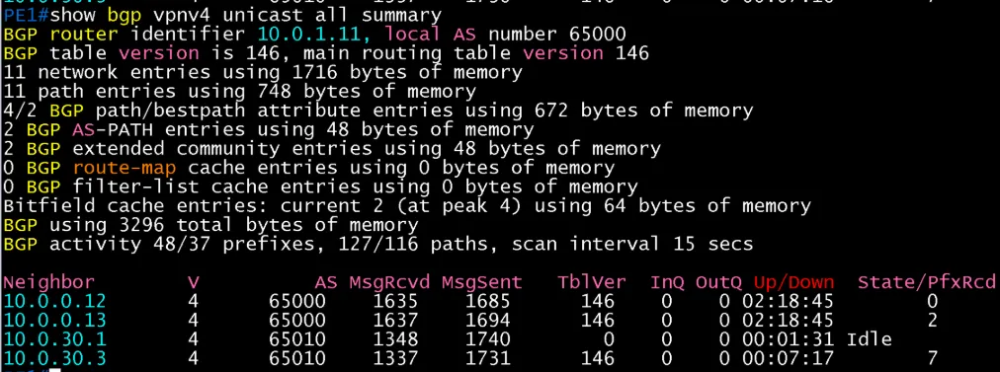

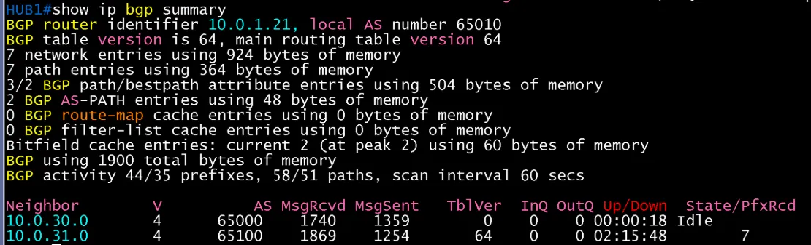

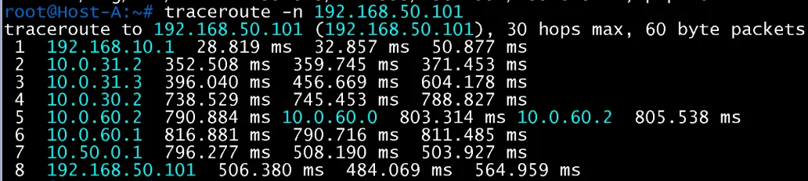

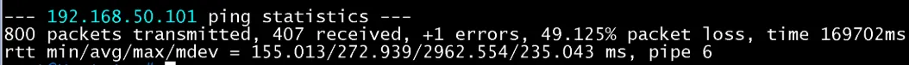

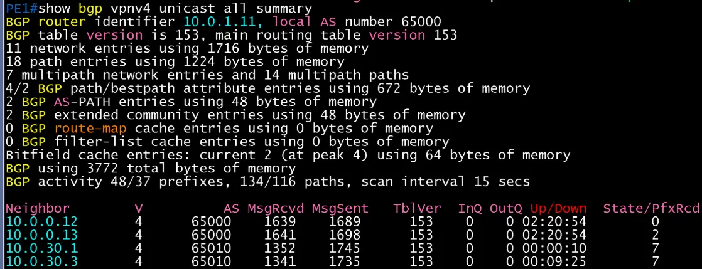

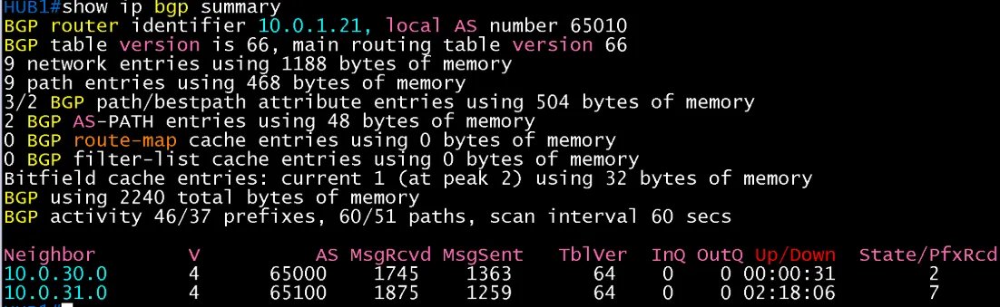

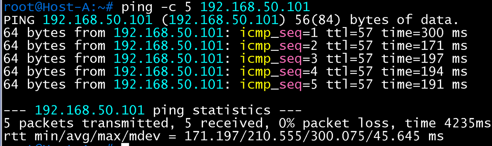

#### Host F -> Host A (`ping -i 0.2 -c 600 192.168.30.101`)

| 항목 | 값 |
|---|---|
| shutdown 시각 | 08:48:26 (PE1 로그, `neighbor 10.0.30.1 ... Down Interface flap`) |
| PE1의 Hub1 이웃 | 즉시 `Idle`(사유 Interface flap). Hub2 이웃은 Estab 유지 |
| Hub1의 PE1 이웃 | 약 90초 뒤 `Idle`(`hold time expired`). 두 화면의 촬영 시각이 달라 근사값 |
| ping 결과 | **600개 중 166개 응답, 손실 434개(72.3%)**, 총 127.3초, rtt 최대 4,133ms |
| 복구 | PE1의 Hub1 이웃 Estab(00:00:08), Hub2 Estab(00:06:36, 경로 7), Host F -> A ping 5/5 |

- 손실 434개를 0.2초 간격으로 환산하면 약 87초이고 hold 90초와 비슷하지만 환산값일 뿐. ping 시작 시각과 복구 시각을 기록하지 못함. 이 시험은 시험 전 경로를 따로 확인하지 못했고, 이후 경로 확인(위 표)에서 이 링크가 A -> F 경로(Hub1)에 포함된다는 것을 확인함

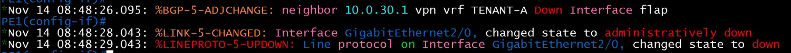

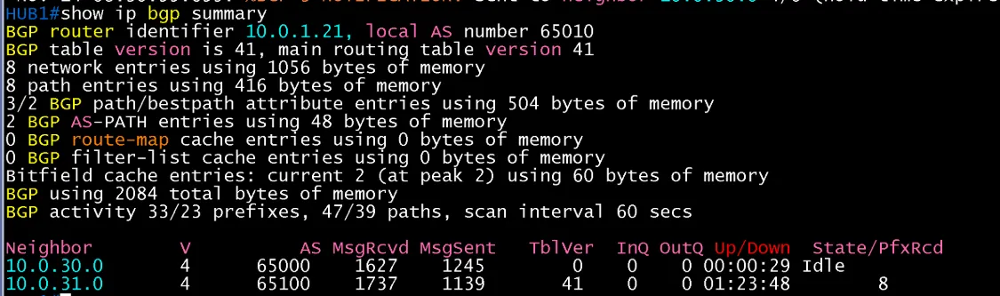

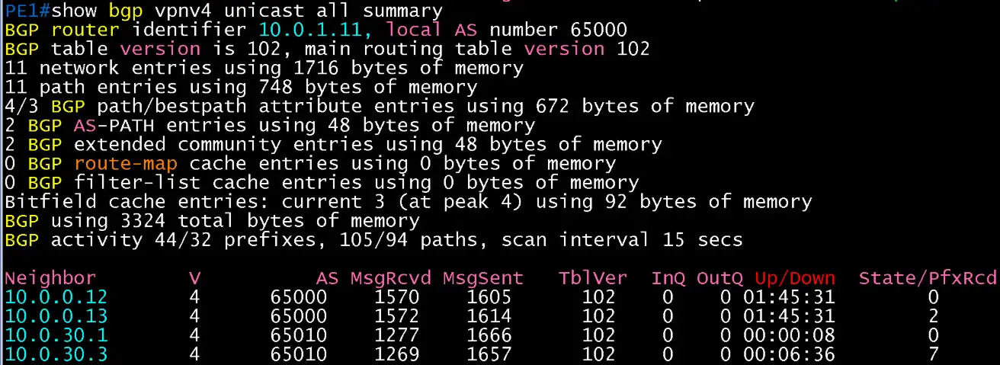

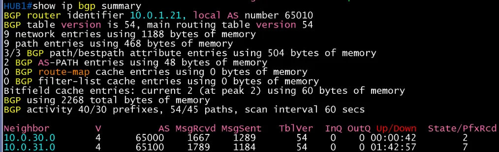

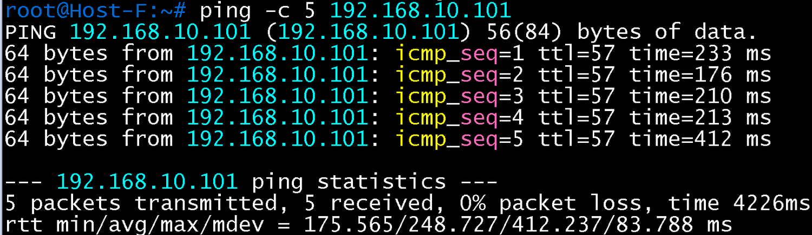

#### 두 방향 동시 (Host A -> F, Host F -> A 각 `ping -i 0.2 -c 800`, 시작 약 20초 뒤 shutdown)

| ping | 전송 | 응답 | 손실 | 비고 |
|---|---|---|---|---|
| Host A -> Host F | 800 | 445 | **355개 (44.375%)** | +3 errors, rtt 최대 1,840ms, 164.6초 |
| Host F -> Host A | 800 | 446 | **354개 (44.25%)** | rtt 최대 1,469ms, 164.6초 |

- 두 방향의 손실이 거의 같음. ping은 요청과 응답이 왕복이라 왕복 경로 중 한 구간(Hub1을 지나는 쪽)만 끊겨도 두 ping 모두 손실이 나므로 같은 값이 나오는 것이 자연스러움. 방향별 손실을 따로 잰 시험이 아님
- 손실 355개 x 0.2초는 약 71초로 환산되지만 환산값일 뿐이고 shutdown 시각과 복구 시각을 기록하지 못함
- Hub2 BGP 타이머는 두 이웃 모두 hold 90, keepalive 30으로 확인(Hub2 `Last reset ... hold time expired`)

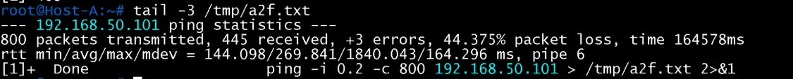

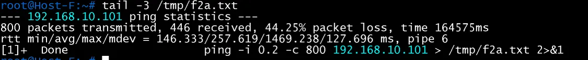

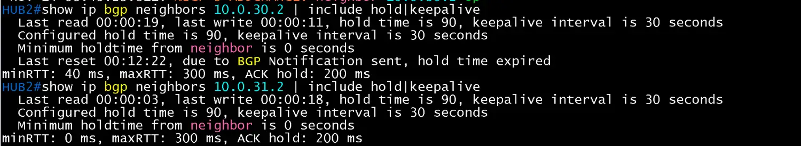

### Hub2 링크 (PE1 `Gi5/0`) 단절, Host F -> Host A (`ping -i 0.2 -c 800 192.168.10.101`)

| 항목 | 값 |
|---|---|
| 링크 | PE1 `Gi5/0` = `description Hub2 to Gi0/0`, `ip vrf forwarding TENANT-A`, `10.0.30.2/31` |
| 정상 경로 | PE1(10.0.30.2 / 10.0.30.0 응답) -> **Hub2(10.0.30.3)** -> Border-Leaf2(10.0.31.2) -> 192.168.30.1 -> Host A, 8홉 |
| shutdown 시각 | 18:31:17.995 ~ 18:31:19.287 (PE1 `show clock` 전후) |
| PE1의 Hub2 이웃 | 단절 직후 `Idle`(28초 전 내려감), Hub1 이웃 Estab 유지. 경로는 Hub1(10.0.30.1) 하나 |
| 단절 중 경로 | PE1(10.0.30.0) -> **Hub1(10.0.30.1)** -> Border-Leaf1(10.0.31.0) -> 192.168.30.1 -> Host A, 8홉 |
| ping 결과 | **800개 중 799개 응답, 손실 1개(0.125%)**, 163.0초, rtt 최대 2,560ms |
| 복구 시각 | 18:34:54.907 (`no shutdown`) |
| 복구 후 | Hub2 이웃 Estab(00:00:18, 경로 7), 경로는 정상 경로(5홉 Hub2, 6홉 10.0.31.2)로 복귀, ping 5/5 |

- PE1이 단절을 로컬에서 바로 감지해 Hub2 이웃을 즉시 내리고 Hub1로 전환
- 이전 값: Host A -> F 방향 `ping -c 1500`에서 손실 0이었으나 시험 전 경로를 확인하지 못했음. 이 흐름은 정상 때 Hub1을 지나므로(위 표) Hub2 링크 단절의 영향을 받지 않은 것으로 보임(추정)
- 복구 직후 Hub2에서 받는 경로는 7개로 시험 전 9개와 다름. 원인은 확인하지 못함

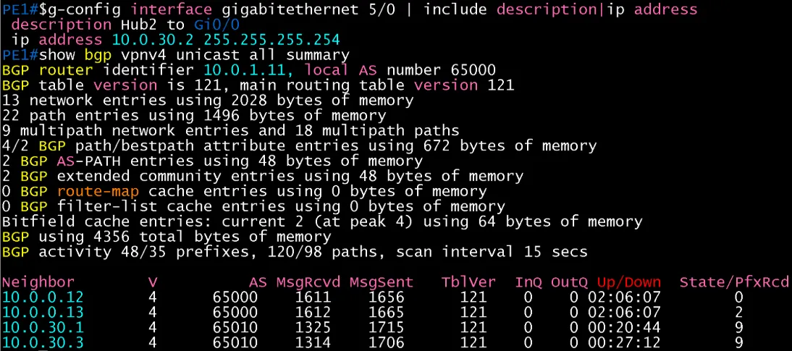

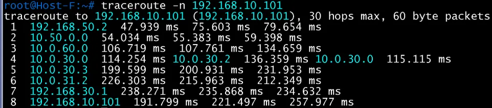

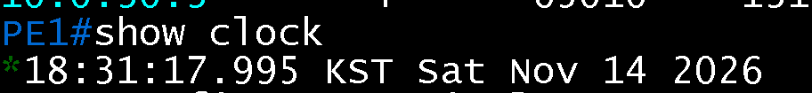

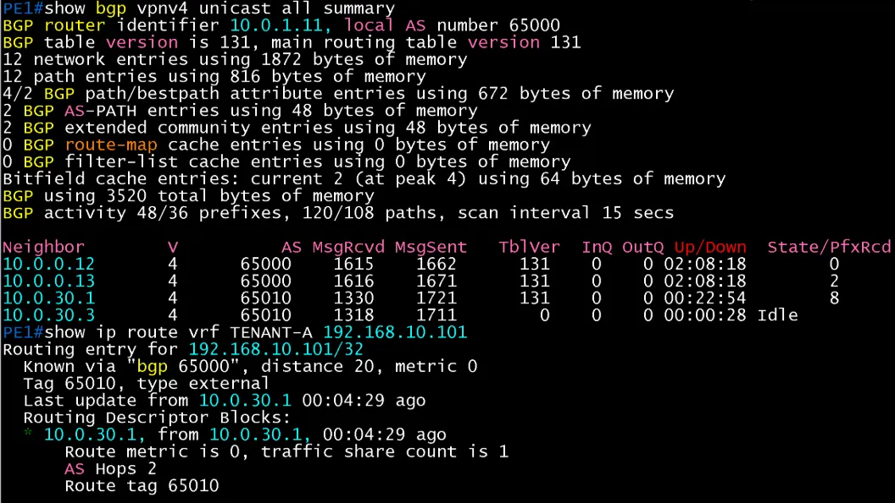

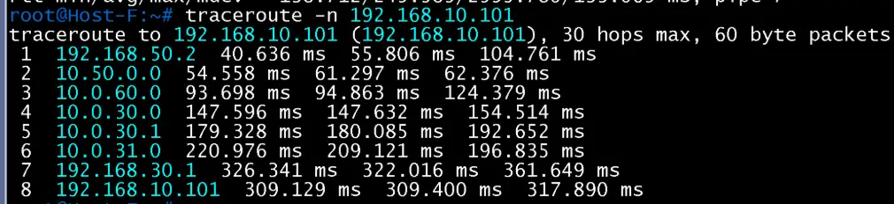

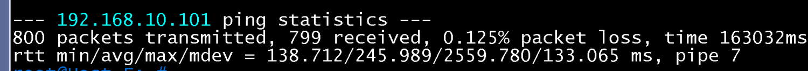

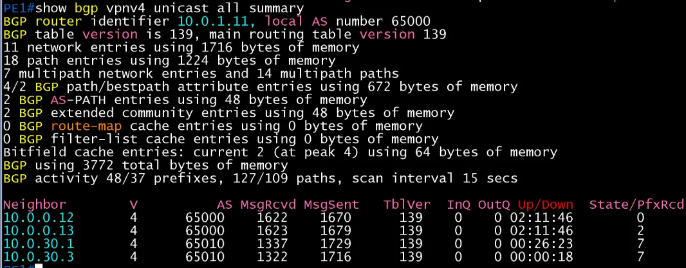

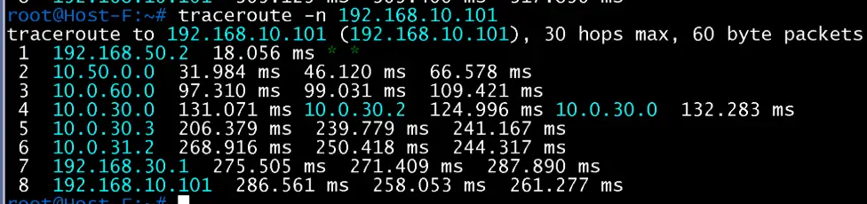

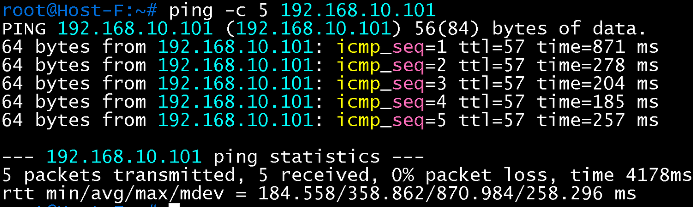

#### 이전에 시험한 Host A -> F 방향 (`ping -i 0.2 -c 1500`)

| 항목 | 값 |
|---|---|
| PE1의 Hub2 이웃 | shutdown 직후 `Idle`(7초 전 내려감). Hub1 이웃은 Estab 유지 |
| Hub2의 PE1 이웃 | shutdown 약 7초 뒤에는 Estab, 이후 `Active`(33초 전 내려감) |
| ping 결과 | **1500개 중 1500개 응답, 손실 0**, 총 306.9초, rtt 최대 4,586ms |
| 단절 중 경로 | Leaf -> Border-Leaf1(10.0.31.0) -> **Hub1(10.0.31.1)** -> PE1(10.0.30.0) -> PE3 -> BGW -> DSW -> 호스트, 8홉 |

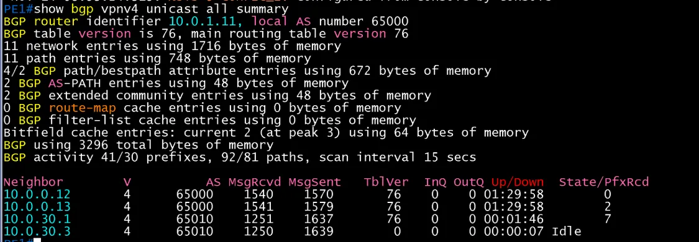

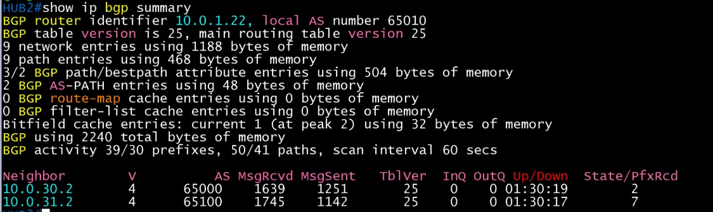

### 손실 차이: 누가 링크 다운을 아는가 (추정)

| 내린 링크 | 영향 받는 구간에서 패킷을 링크로 내보내는 장비 | 그 장비가 장애를 아는가 | 손실 |
|---|---|---|---|
| Hub2 링크 (PE1 `Gi5/0`) | PE1(F -> A 구간) | 안다(직접 내림) -> 즉시 Hub1로 전환 | 1/800 |
| Hub1 링크 (PE1 `Gi2/0`) | Hub1(A -> F 구간) | 모른다 -> BGP hold(90초)까지 내려간 링크로 전송 | 수백 개 |

- 이 랩(Dynamips)은 한쪽에서 `shutdown`해도 반대편이 링크 다운을 보지 못함. 단절 직후 PE1은 Hub1을 `Idle`로, Hub1은 PE1을 `Estab`으로 보고 있던 화면이 근거
- 같은 두 호스트의 왕복이 서로 다른 Hub를 지나는 경로 비대칭도 위 traceroute로 확인
- 손실 규모가 Hub1 링크에서만 큰 이유를 이 두 사실로 설명하는 것이며, 다른 요인이 없는지는 별도 시험으로 확인하지 않음

### 정상 상태 경로 (Hub2 링크 복구 후)

| 출발 -> 대상 | 경로 |
|---|---|
| Host A -> Host F | Leaf -> **Border-Leaf1(10.0.31.0) -> Hub1(10.0.31.1)** -> PE1(10.0.30.0) -> PE3 -> BGW1 -> DSW1 -> Host F |
| Host B -> Host F | Border-Leaf1 -> Hub1 -> PE1 -> PE3 -> BGW2(10.0.60.3) -> DSW2(10.50.0.3) |
| Host C -> Host F | **Border-Leaf2(10.0.31.2) -> Hub2(10.0.31.3)** -> PE1(10.0.30.2) -> PE3 -> BGW2 -> DSW2 |
| Host F -> Host A | DSW -> BGW1 -> PE3 -> PE1 -> **Hub2(10.0.30.3) -> Border-Leaf2(10.0.31.2)** -> Leaf -> Host A |

### 코어 링크 (PE2 `Gi1/0`, PE2 - PE3) 단절, Host E -> Host F (`ping -i 0.2 -c 1000 192.168.50.101`)

| 항목 | 값 |
|---|---|
| 시험 전 | PE2 · PE3 OSPF 이웃 PE1 · PE3(PE2) FULL, Dead Time 6 ~ 8초(dead 9초 설정). PE2 - PE3 BGP hold 90, keepalive 30 |
| 정상 경로 | Host E(192.168.110.2) -> PE2(10.0.20.4) -> **PE3 직접** -> 10.0.60.3 -> 10.50.0.3 -> Host F, 6홉 |
| 단절 중 OSPF | PE2 이웃 PE1(10.0.0.11 `Gi0/0`)만 남음 |
| 단절 중 BGP | PE2 - PE3(10.0.0.13) 세션 Estab 유지(01:48:40, 경로 2). PE3 loopback이 PE1 경유로 도달 가능 |
| 단절 중 경로 | PE2 -> **PE1(10.0.10.0)** -> PE3 -> 10.0.60.3 -> 10.50.0.3 -> Host F, 7홉. `10.0.0.13`은 OSPF metric 3, next hop 10.0.10.0 `Gi0/0` |
| LDP | PE1(10.0.0.11)만 Oper |
| ping 결과 | **1000개 중 932개 응답, 손실 68개(6.8%)**, `+2 errors`, 204.0초, rtt 최대 8,677ms |
| 복구 후 | PE2 OSPF 이웃 PE3 · PE1 FULL(Dead Time 8초), traceroute 6홉(PE3 직접) 복귀 |

- 우회는 OSPF가 수행하고 BGP 세션은 끊기지 않으므로 BGP 타이머는 이 시험의 손실에 영향이 없음
- shutdown 시각을 기록하지 못함. 복구 후 LDP와 `show ip route 10.0.0.13`은 확인하지 못함

### Leaf1 업링크 (`Et1`, Spine1 방향) 단절, Host A -> Host C (`ping -i 0.2 -c 800 192.168.30.101`)

| 항목 | 값 |
|---|---|
| 시험 전 | Leaf1 OSPF 이웃 Spine1(10.1.0.1 `Et1`) · Spine2(10.1.0.2 `Et2`) FULL(Dead Time 7초), `10.1.1.34` next hop 두 개(10.1.10.0 `Et1`, 10.1.10.8 `Et2`, metric 30), EVPN BGP 이웃 둘 다 Estab(01:52:08, 경로 35), Spine1 hold 90 / keepalive 30 |
| 정상 경로 | Host A -> Leaf1(192.168.10.1) -> 192.168.30.1 -> Host C, 3홉 |
| 단절 중 OSPF | Spine2(10.1.0.2 `Et2`)만 FULL |
| 단절 중 경로 | `10.1.1.34` next hop 하나(10.1.10.8 `Et2`, metric 30). Spine1 loopback `10.1.0.1`은 OSPF [110/40] via 10.1.10.8 `Et2`(우회로 도달) |
| 단절 중 EVPN BGP | Spine1 · Spine2 모두 Estab 유지(01:53:26, 경로 35). 세션이 loopback끼리 맺어져 우회 경로로 유지됨 |
| ping 결과 | **800개 중 796개 응답, 손실 4개(0.5%)**, 162.2초, rtt 최대 3,557ms |
| 복구 후 | OSPF Spine1 · Spine2 FULL, next hop 두 개 복귀, EVPN Spine1 · Spine2 Estab(01:56:23, 경로 35, 세션 끊김 없음) |

- Host A에서 보이는 3홉은 Spine을 거치지 않는 L3 게이트웨이 단위라 우회를 보여 주지 못함. 우회 증빙은 Leaf1의 OSPF 이웃과 `10.1.1.34` 경로
- shutdown 시각을 기록하지 못함

### Leaf1 호스트 포트 (`Et5`, Host A) 단절

| 항목 | 값 |
|---|---|
| 시험 전 | Host A -> `192.168.30.101` 4/4(평균 63ms), Host B -> 같은 대역 4/4(평균 122ms) |
| 단절 중 | Leaf1 `Et5`(`to-HostA`) `disabled`. Host A -> `192.168.30.101` **4개 중 0개 응답(100% 손실)**, `192.168.10.101 Destination Host Unreachable`(Host A 자신의 응답). Host B -> 같은 대역 4/4(Leaf2 `Et5`는 영향 없음) |
| 복구 후 | `Et5` `connected`(VLAN 10, 1G), Host A 4/4 |

- 호스트가 Leaf1에 단일 연결이라 우회 경로가 없고, 타이머와 무관한 시험

