# DC1 동시 부하 시험 (Spine ECMP)

**목적**: DC1에서 부하를 걸었을 때 경로가 어떻게 나뉘는지 확인. DC1의 MSTP는 L2 인스턴스 매핑이고, Leaf - Spine 업링크는 L3(OSPF, ECMP)이므로 이 시험은 MSTP가 아니라 업링크 분산을 본 것

**방법**: Host A, Host B에서 `iperf3 -u -b <속도> -l 1000 -t 30`으로 UDP를 보내고, Leaf1 업링크(`Ethernet1` = Spine1 쪽, `Ethernet2` = Spine2 쪽)의 `packets output`을 전후 비교. 이 환경의 처리 한계가 약 275 ~ 300 Kbit/s 부근이라 낮은 속도를 씀(TCP는 개발지사 시험과 같은 이유로 제외)

## MSTP 설정 (참고)

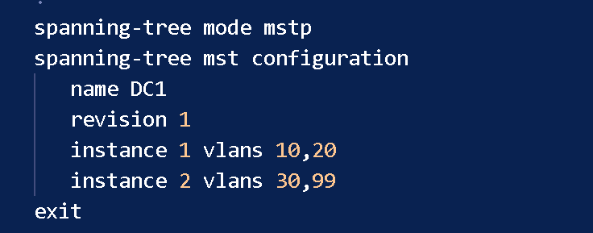

- region `DC1`, revision 1, 인스턴스 1 = VLAN 10·20, 인스턴스 2 = VLAN 30·99. 두 인스턴스의 priority는 모두 4096이라 인스턴스별로 root를 나눠 경로를 갈라놓는 설계가 아님

## 시험 1: Host A -> C, Host B -> D (각 300 Kbit/s, 서로 다른 Leaf)

| 포트 | output 전 | output 후 | 증가 |
|---|---|---|---|
| Leaf1 Ethernet1 | 1,126 packets | 2,509 packets | +1,383 packets |
| Leaf1 Ethernet2 | 1,290 packets | 1,514 packets | +224 packets |

- Host A, Host B 모두 1,125개 중 0% 손실로 수신(Host B는 Leaf2 연결이라 Leaf1 카운터에는 Host A 흐름만 나타남). Host A 흐름은 Ethernet1 한 곳에 실림(Ethernet2 증가는 배경 수준)

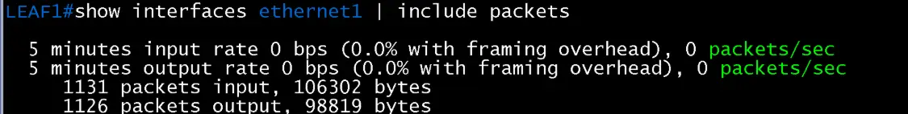

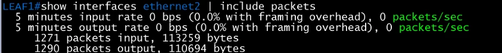

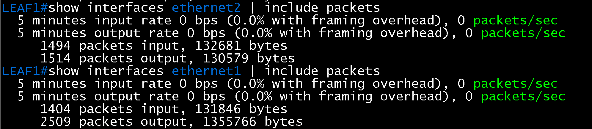

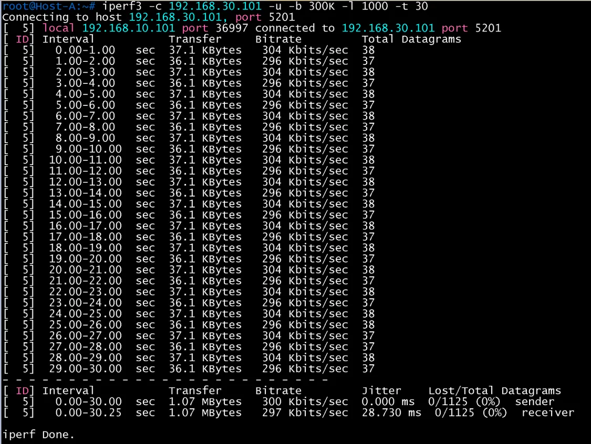

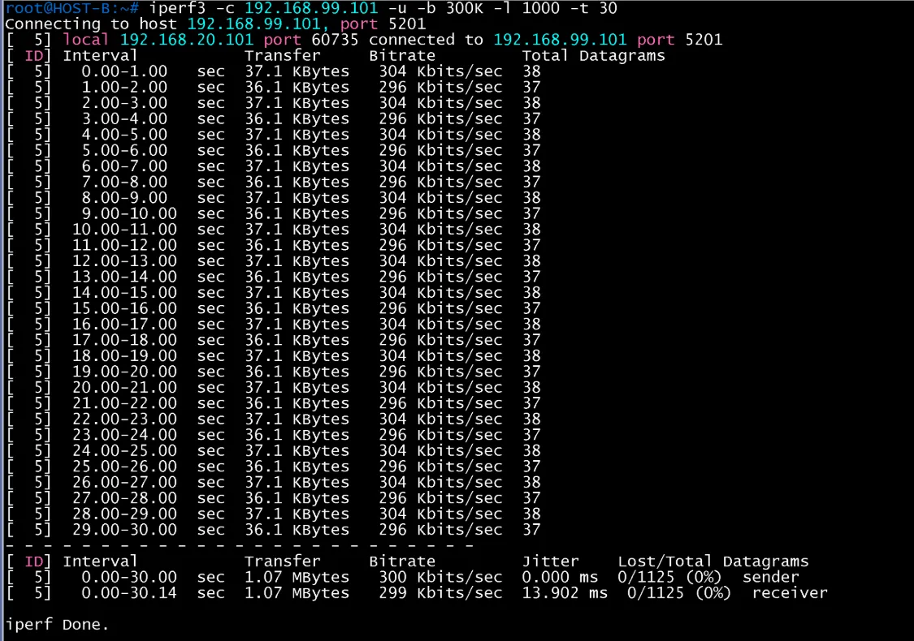

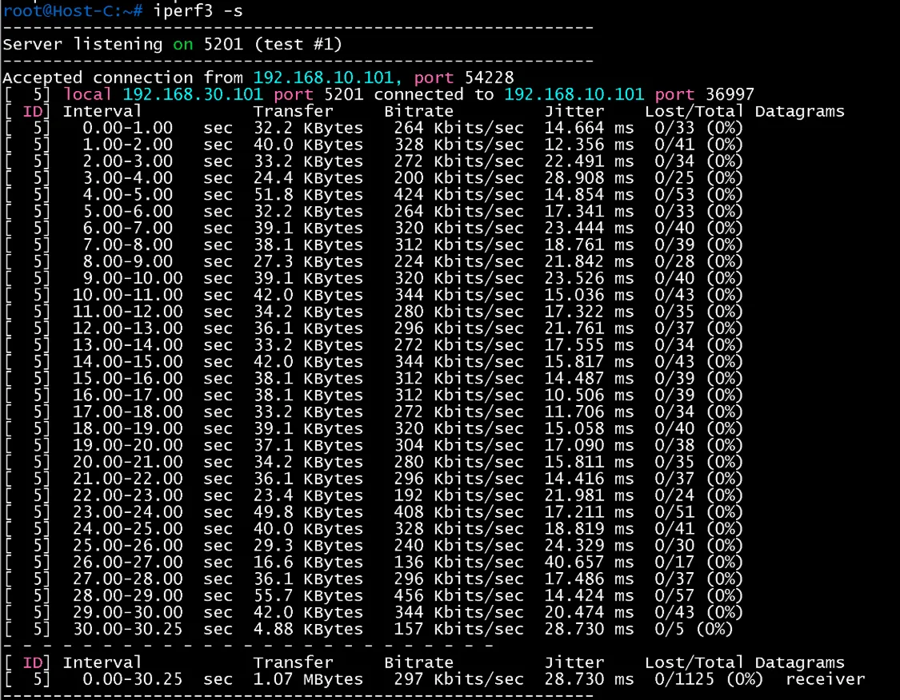

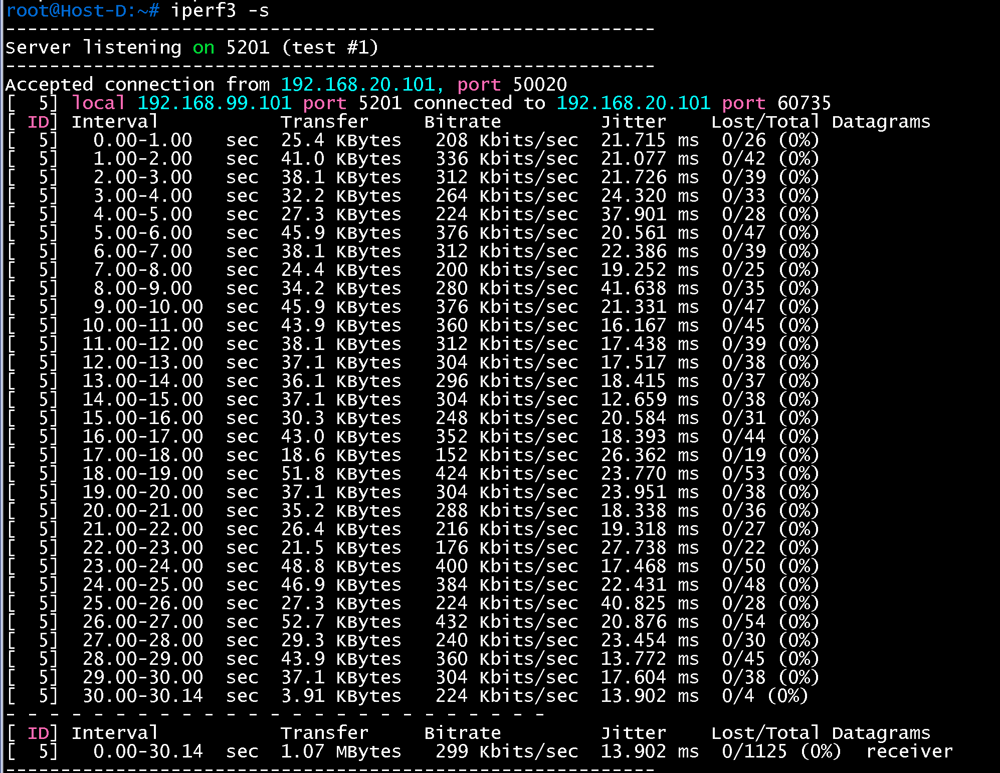

## 시험 2: Host A -> C, 출발 포트가 다른 4개 흐름 (`-P 4`, 각 100 Kbit/s)

| 포트 | output 전 | output 후 | 증가 |
|---|---|---|---|
| Leaf1 Ethernet1 | 2,676 packets | 4,078 packets | +1,402 packets |
| Leaf1 Ethernet2 | 1,685 packets | 1,947 packets | +262 packets |

- 4개 흐름이 모두 Ethernet1로 나감. 합계 400 Kbit/s가 한계를 넘어 29% 손실(433/1500), 지터 약 510ms라 분산 판정에는 쓰지 않음

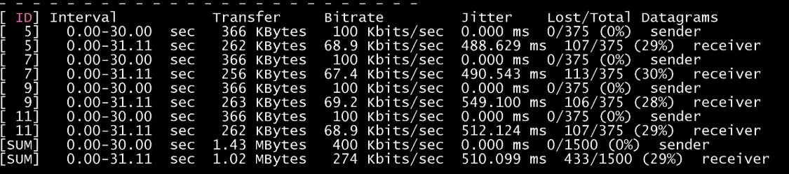

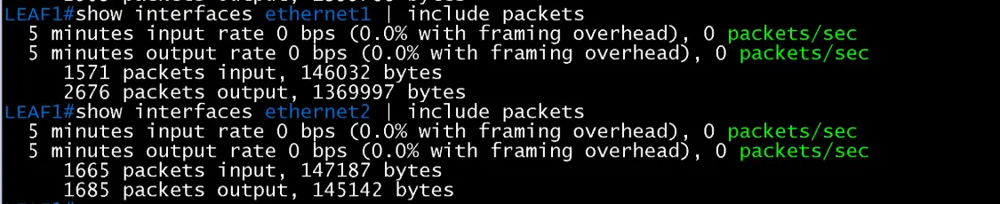

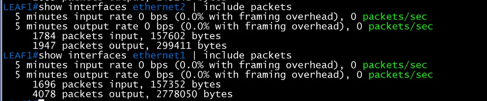

## 시험 3: Host A -> C, Host A -> D (목적지 IP가 다른 두 흐름, 각 100 Kbit/s)

| 포트 | output 전 | output 후 | 증가 |
|---|---|---|---|
| Leaf1 Ethernet1 | 4,160 packets | 5,944 packets | +1,784 packets |
| Leaf1 Ethernet2 | 2,032 packets | 2,362 packets | +330 packets |

- 두 흐름 모두 375개 중 0% 손실(지터 약 45 ~ 48ms). 두 흐름 모두 Ethernet1로 나감. 증가량이 두 흐름 합(약 750 packets)보다 큰 것은 붙여 넣기 실패 때 명령이 일부 중복 실행되었을 가능성으로 보이며 확인하지 못함

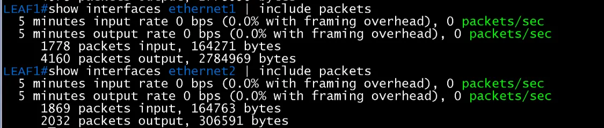

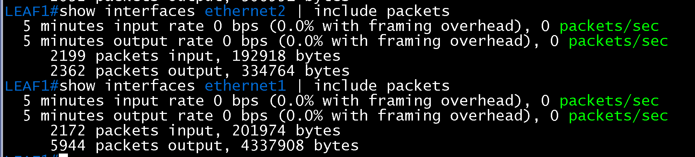

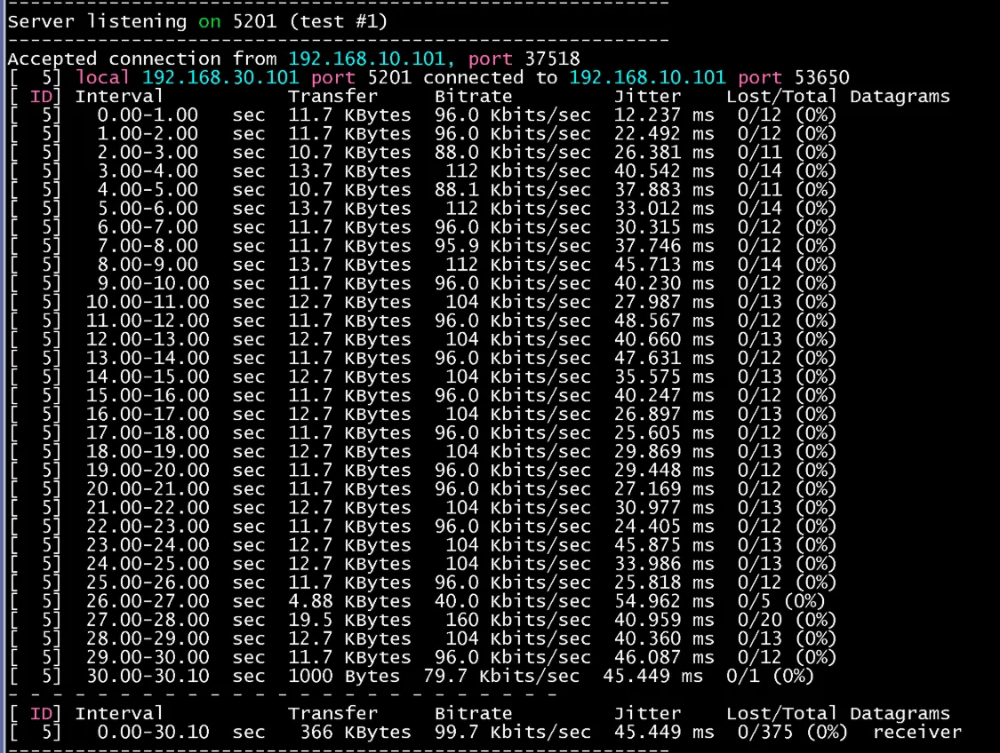

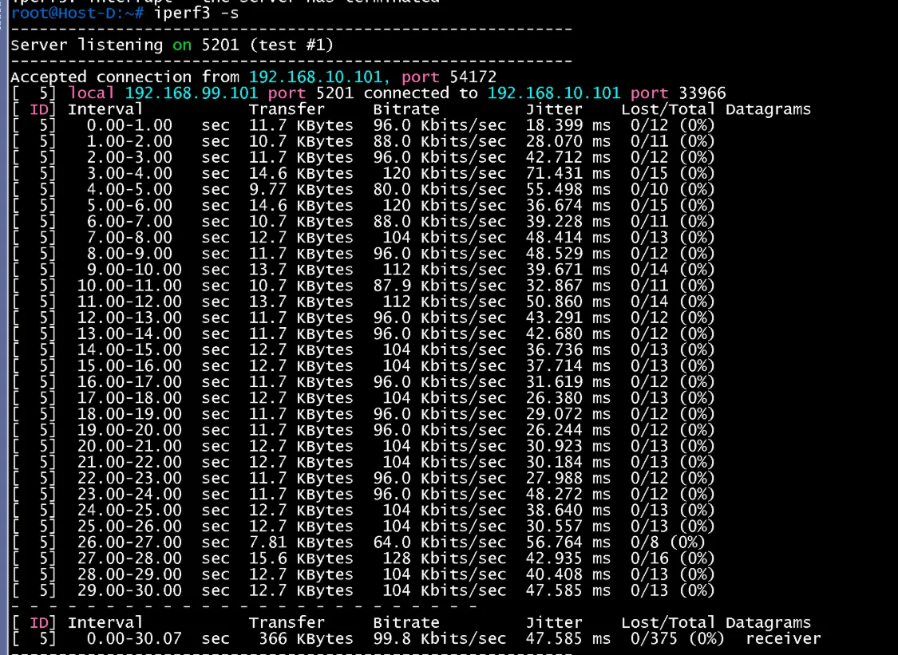

## 시험 4: BR1 -> DC1 (Host F -> Host A, Host G -> Host C, 각 100 Kbit/s)

VLAN 10(인스턴스 1)의 Host A와 VLAN 30(인스턴스 2)의 Host C로, 개발지사 VLAN 50의 Host F와 VLAN 60의 Host G가 동시에 UDP를 보냄. 서버는 Host A, Host C에서 `iperf3 -s`(포그라운드)로 실행. 목적지 VTEP이 달라지는(VLAN 10·20은 Leaf1·2의 10.1.1.12, VLAN 30·99는 Leaf3·4의 10.1.1.34) 흐름이 어떻게 나뉘는지 봄

| 장비 | 포트 | input 증가 | output 증가 |
|---|---|---|---|
| Border-Leaf1 | Ethernet2 (Spine1 쪽) | 3,575 -> 4,151 (+576) | 5,220 -> 5,763 (+543, 약 46KB) |
| Border-Leaf1 | Ethernet3 (Spine2 쪽) | 3,355 -> 3,884 (+529) | 3,921 -> 4,451 (+530, 약 45KB) |
| Border-Leaf2 | Ethernet2 (Spine1 쪽) | 3,541 -> 4,109 (+568) | 5,220 -> 7,331 (**+2,111**, 약 1.70MB) |
| Border-Leaf2 | Ethernet3 (Spine2 쪽) | 3,344 -> 3,880 (+536) | 3,868 -> 4,404 (+536, 약 46KB) |
| Leaf1 | Ethernet1 (Spine1 쪽) | 2,757 -> 4,406 (+1,649, 약 0.90MB) | 6,907 -> 7,796 (+889) |
| Leaf1 | Ethernet2 (Spine2 쪽) | 2,783 -> 3,623 (+840, 약 74KB) | 2,946 -> 3,786 (+840) |
| Leaf3 | Ethernet1 (Spine1 쪽) | 10,459 -> 12,084 (+1,625, 약 0.90MB) | 3,023 -> 3,896 (+873) |
| Leaf3 | Ethernet2 (Spine2 쪽) | 2,864 -> 3,695 (+831) | 2,707 -> 3,538 (+831) |

- Host A(VLAN 10)와 Host C(VLAN 30)가 각각 375개 중 0% 손실로 수신(지터 약 29ms, 99 Kbit/s)
- Leaf1과 Leaf3의 Spine1 쪽 입력이 각각 약 0.90MB씩 비슷하게 늘고, Spine2 쪽은 배경 수준(수십 KB)만 늘어, VLAN 그룹(인스턴스)별 흐름이 각자의 Leaf 쌍(Leaf1·2, Leaf3·4)으로 들어감. 한 Leaf에 두 흐름이 몰리지는 않음
- Border-Leaf2의 Spine1 쪽 출력(+1.70MB)이 두 Leaf의 입력 합(약 1.8MB)과 비슷해, 두 흐름이 모두 Border-Leaf2 -> Spine1 한 경로를 지남. 목적지 VTEP이 달라도 이 환경에서는 Spine 분산은 보이지 않음. Border-Leaf1은 배경 수준만 늘어 사용되지 않음
- 증가량(약 0.90MB)이 흐름 하나(약 0.41MB, 375개 x 약 1.1KB)의 두 배에 가까워, 시험이 두 번 실행되었을 가능성이 있음(서버 화면이 나오지 않아 한 번 더 실행). 두 번 실행 여부는 확인하지 못함

### traceroute로 본 경로 (시험 4 직후)

| 출발 | 대상 | 경로 |
|---|---|---|
| Host F(VLAN 50) | Host A(192.168.10.101) | DSW(192.168.50.2) -> BGW1(10.50.0.0) -> PE3(10.0.60.0) -> PE1(10.0.30.x) -> **Hub2(10.0.30.3)** -> **Border-Leaf2(10.0.31.2)** -> Leaf 게이트웨이(192.168.30.1) -> 호스트, 8홉 |
| Host G(VLAN 60) | Host C(192.168.30.101) | DSW(192.168.60.3) -> BGW2(10.50.0.2) -> PE3(10.0.60.2) -> PE1(10.0.30.x) -> **Hub2(10.0.30.3)** -> **Border-Leaf2(10.0.31.2)** -> Leaf 게이트웨이(192.168.30.1) -> 호스트, 8홉 |

- 개발지사에서는 VLAN마다 다른 DSW·BGW(VLAN 50은 BGW1 쪽, VLAN 60은 BGW2 쪽)를 쓰고, 코어 이후는 두 흐름 모두 Hub2와 Border-Leaf2로 가서 위 카운터(Border-Leaf2 Spine1 쪽 +2,111)와 맞음
- 7번째 홉이 두 경우 모두 192.168.30.1로 보임(Host A 목적지도 같음). 응답을 보낸 Leaf의 SVI 주소를 장비가 고른 것으로 보이며 어느 Leaf인지는 이 출력으로 확정하지 못함. VXLAN 구간이라 Spine은 traceroute에 나타나지 않음

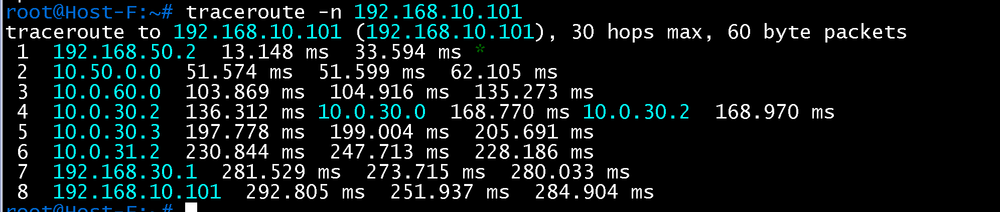

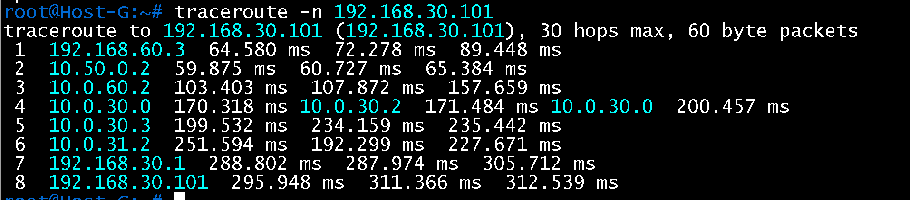

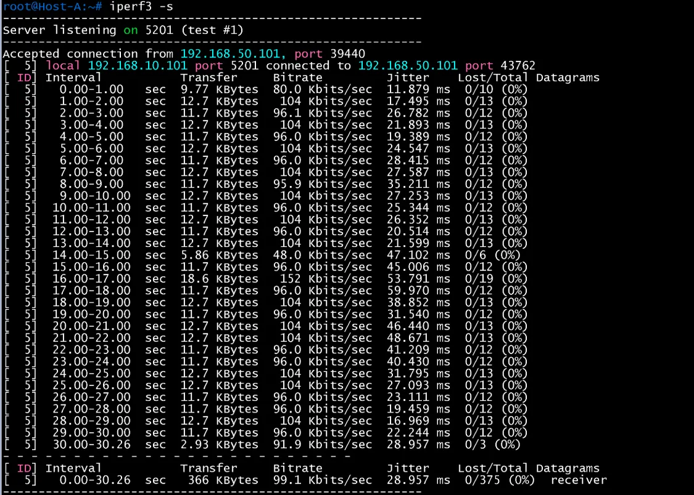

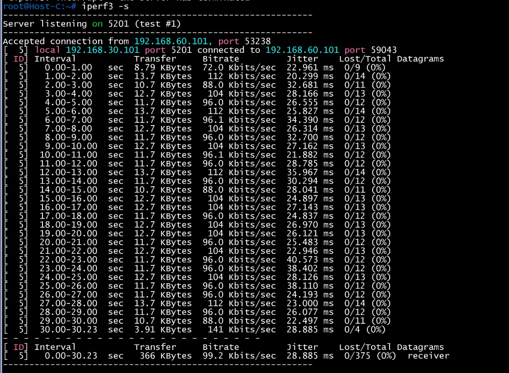

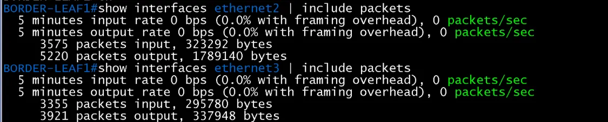

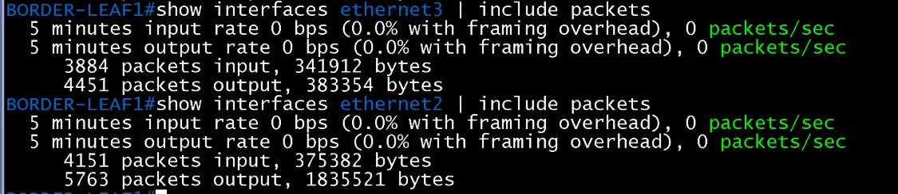

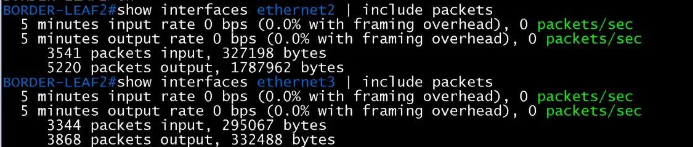

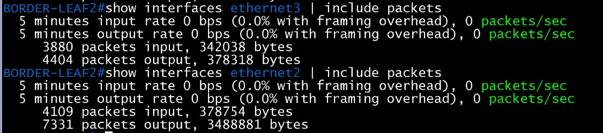

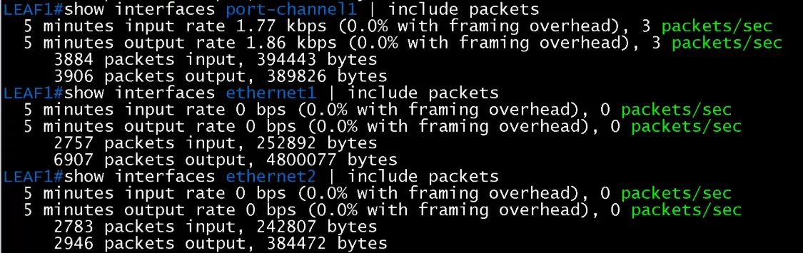

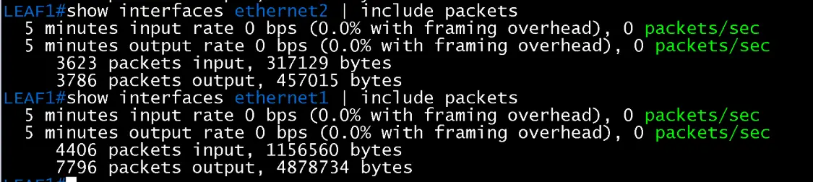

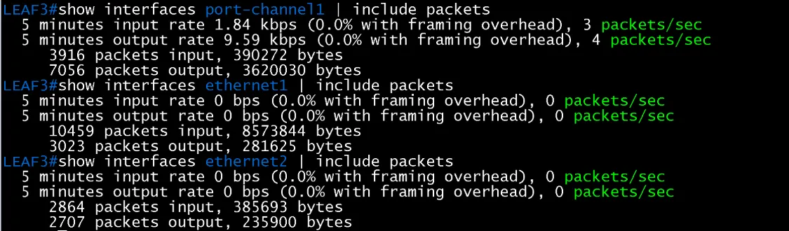

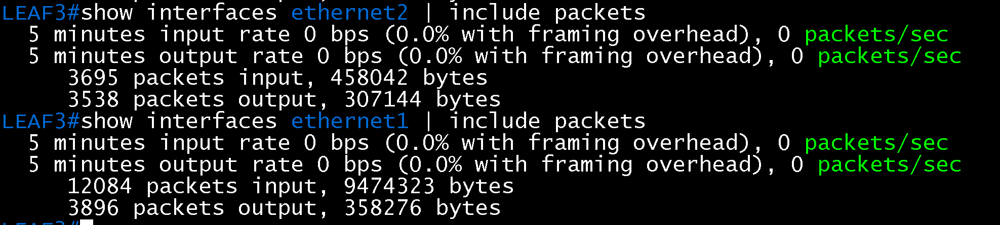

## 해석

- Leaf1은 Host, 포트, 목적지 IP와 관계없이 이 시험의 흐름을 모두 한 업링크(Spine1 쪽)로 보냄. Host A의 흐름은 모두 Leaf3·4 VTEP(10.1.1.34)로 가는 VXLAN이라 바깥 IP 쌍이 같음. 이 가상 환경(소프트웨어 포워딩)에서 ECMP 해시가 바깥 IP 쌍 중심이면 같은 VTEP 쌍은 같은 경로로 가므로 위 결과와 맞지만, 해시 방식은 확인하지 못함
- Leaf - Spine 구간은 L3 링크라 MSTP는 업링크 선택에 관여하지 않음. DC1의 MSTP로는 부하 분산을 보일 수 없고, VLAN별 경로 분산은 개발지사의 rapid-pvst에서 확인함([개발지사 RSTP 검증](../br/04-mstp-etherchannel.md))
- 시험 4에서 서로 다른 VTEP 목적지(Leaf1·2, Leaf3·4)로 가는 흐름이 각각 자기 Leaf 쌍으로 들어가는 것은 확인했으나, 경로는 둘 다 Border-Leaf2와 Spine1 한 곳이라 Spine 분산은 확인하지 못함

## 결과 기록

| 일시 | 결과 (성공, 실패) | 비고 |
|---|---|---|
| 2026-11-14 | 성공 (4회) | 시험 1~3은 단일 업링크 사용. 시험 4에서 VLAN 그룹(인스턴스)별 흐름이 서로 다른 Leaf 쌍으로 들어가는 것을 확인했으나 Spine 분산은 확인하지 못함 |
