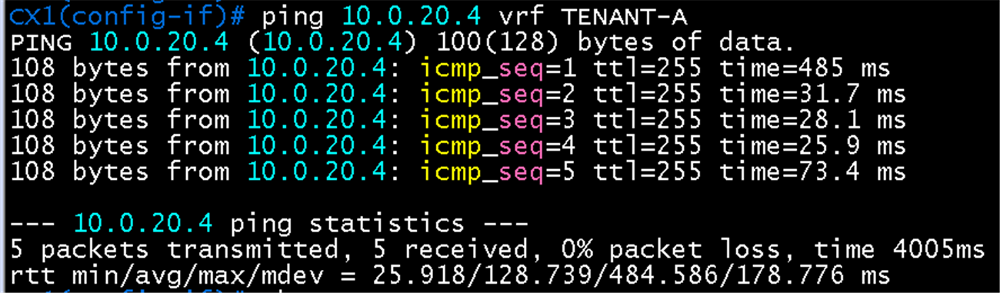

# 인터페이스 IP 검증 (CX1, CX2)

**선행 조건**: [기본 설정 검증](01-base.md)이 끝나 있고 [인터페이스 IP 샘플](../../samples/dc2/02-ip.md)이 CX1, CX2에 적용되어 있어야 함

기준 문서: [02-vlan-ip.md](../../baseline/dc2/02-vlan-ip.md) / 샘플: [02-ip.md](../../samples/dc2/02-ip.md)

## 기대 값

| 장비 | 인터페이스 | IP | VRF | 상대 | 상대 IP |
|---|---|---|---|---|---|
| CX1 | loopback 0 | 10.2.0.1/32 | global | - | - |
| CX1 | 1/1/1 | 10.0.20.5/31 | TENANT-A | PE2 Gi2/0 | 10.0.20.4 |
| CX2 | loopback 0 | 10.2.0.2/32 | global | - | - |
| CX2 | 1/1/1 | 10.0.20.7/31 | TENANT-A | PE2 Gi3/0 | 10.0.20.6 |

## 출력이 길 때

AOS-CX는 포트 52개가 모두 나와서 출력이 길어짐. 아래처럼 필터를 사용

| 목적 | 명령 |
|---|---|
| 특정 VRF만 | `show vrf TENANT-A`, `show vrf KEEPALIVE` |
| IP가 있는 인터페이스만 | `show ip interface brief \| exclude No` |
| up인 포트만 | `show interface brief \| exclude down` |
| 한 인터페이스만 | `show ip interface 1/1/1` |
| 설정 일부만 | `show running-config \| include 10.0.20` |

## 확인 항목

| 순서 | 장비 | 명령 | 기대 결과 | 안 될 때 확인 |
|---|---|---|---|---|
| 1 | CX1, CX2 | `show vrf TENANT-A` | TENANT-A가 보이고 1/1/1이 소속 | `vrf attach`, VRF 정의 |
| 2 | CX1, CX2 | `show ip interface brief \| exclude No` | 위 표의 IP가 up (이 포트 52개 중 IP가 있는 것만 보이게 `exclude No`로 `No Address` 줄을 제외) | `no shutdown`, IP 입력 |
| 3 | CX1 | `ping 10.0.20.4 vrf TENANT-A` | PE2 응답 (명령 순서가 다르면 `?`로 확인) | 링크 IP, VRF, PE2 Gi2/0 |
| 4 | CX2 | `ping 10.0.20.6 vrf TENANT-A` | PE2 응답 | 같은 점검 |
| 5 | PE2 | `ping vrf TENANT-A 10.0.20.5`, `ping vrf TENANT-A 10.0.20.7` | CX1, CX2 응답 | CX 쪽 1/1/1 설정 |

## 증빙

### CX1 PE2 ping

- `ping 10.0.20.4 vrf TENANT-A`: 5/5, 0% loss, rtt 25.9/128.7/484.6 ms (첫 패킷이 느린 것은 ARP 해석 때문)
- CX1 `show vrf`에서 TENANT-A에 1/1/1, KEEPALIVE에 1/1/4가 up, default에 loopback0 up. `show ip interface brief`에서 loopback0 10.2.0.1/32 up/up

## 결과 기록

| 일시 | 장비 | 결과 (성공, 실패) | 비고 |
|---|---|---|---|
| 2026-10-22 | CX1 | 성공 | VRF, loopback, 1/1/1 확인과 PE2 ping 성공. `show ip interface brief` 필터 출력은 미첨부 |
| 2026-10-22 | CX2 | 미확인 | PE2 ping과 인터페이스 화면 필요 |
