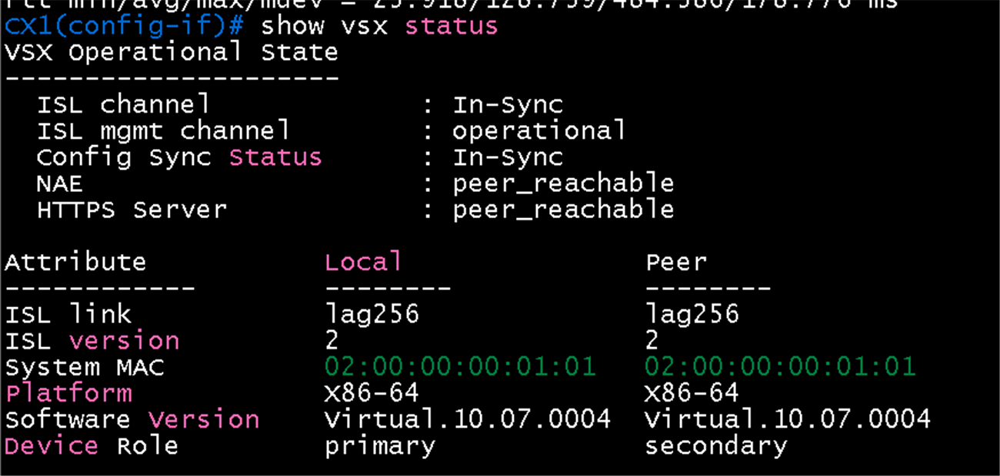
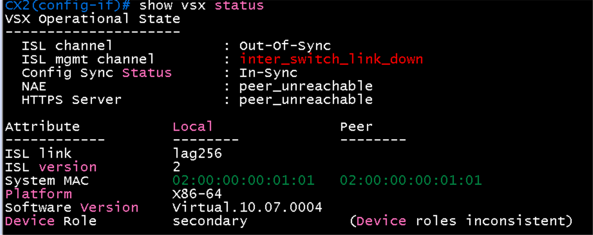
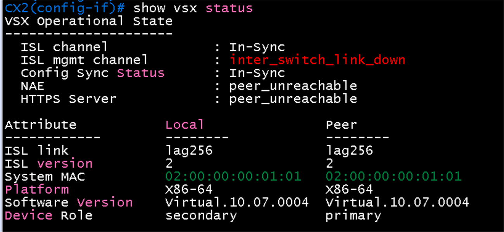
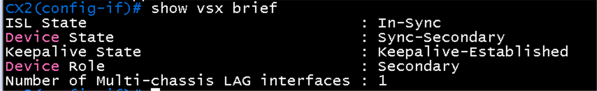
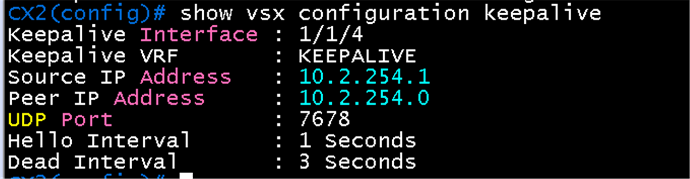
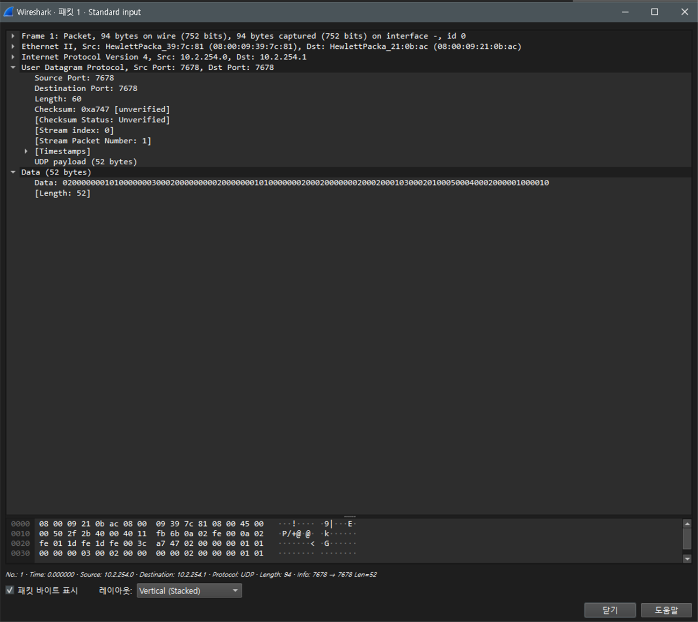

# VSX 검증

**선행 조건**: CX1, CX2, CX3이 켜져 있고 [VSX 샘플](../../samples/dc2/03-vsx.md)이 CX1, CX2에 적용되어 있어야 함

기준 문서: [03-vsx.md](../../baseline/dc2/03-vsx.md)

## 확인 항목

| 순서 | 장비 | 명령 | 기대 결과 | 안 될 때 확인 |
|---|---|---|---|---|
| 1 | CX1, CX2 | `show vsx status` | ISL channel **In-Sync**, keepalive **Established**, 역할이 primary와 secondary | system-mac, lag 256, keepalive 주소와 VRF |
| 2 | CX1 | `show vsx brief` | 두 스위치의 상태가 일치 | role, ISL 멤버 포트 |
| 3 | CX1 | `show lacp interfaces` | ISL(1/1/2-3)이 active, in-sync | lacp mode active |

## 장애 시험

| 동작 | 기대 결과 |
|---|---|
| ISL 링크 하나 shut | ISL 유지 (나머지 링크) |
| keepalive 링크 shut | 경고가 나오되 ISL이 살아 있으면 동작 유지 |

## 증빙

### CX1 `show vsx status`

- ISL channel **In-Sync**, ISL mgmt channel operational, Config Sync Status In-Sync
- ISL link lag256(양쪽), ISL version 2, System MAC **02:00:00:00:01:01**(Local과 Peer 같은 값), Software Version 같음
- Device Role: Local **primary**, Peer **secondary**
- NAE, HTTPS Server 모두 peer_reachable (두 번째 캡처). keepalive 상태 줄은 화면에 포함되지 않아 별도 확인 필요(`show vsx status` 전체 또는 `show vsx brief`)

### CX1 `show lacp interfaces` (ISL)

- ISL lag256: 1/1/2, 1/1/3이 Active, Short-timeout(fast), InSync, Aggr Key 256. Partner System-ID(CX2)와 key 256 일치
- Forwarding State가 `lacp-block`으로 표시됨. VSX 상태가 In-Sync이고 설정 동기화도 정상이므로 ISL 동작은 정상으로 판단하나, CX2 쪽 같은 화면과 비교해 두 장비가 같은 표시인지 확인 필요

### CX2 `show vsx status` (확인 필요)

- ISL channel **Out-Of-Sync**, ISL mgmt channel **inter_switch_link_down**, Config Sync In-Sync, NAE와 HTTPS Server peer_unreachable
- Local은 ISL link lag256, secondary. Peer 칸이 비어 있고 `(Device roles inconsistent)`가 표시됨
- CX1 화면(In-Sync)과 상태가 다름. 캡처 시점이 다르거나 CX2 쪽 ISL 동기화가 아직 끝나지 않은 것으로 보이며, 다시 확인 필요

### CX2 `show vsx status` (재확인)

- ISL channel **In-Sync**, Config Sync In-Sync로 바뀜. Peer 칸에 ISL lag256, version 2, system-mac 02:00:00:00:01:01, Device Role **primary**가 보이고 Local은 **secondary**
- ISL mgmt channel은 **inter_switch_link_down**, NAE와 HTTPS Server는 peer_unreachable로 남음. ISL 동기화와 역할은 정상이며, 관리 채널은 CX1에서 처음에 peer_unreachable이었다가 나중에 peer_reachable로 바뀐 것과 같은 지연일 수 있어 다시 확인 필요

### CX2 `show vsx brief`

- ISL State **In-Sync**, Device State **Sync-Secondary**, Keepalive State **Keepalive-Established**, Device Role **Secondary**, Number of Multi-chassis LAG interfaces **1**(lag10)
- keepalive가 Established이므로 keepalive 링크(1/1/4, VRF KEEPALIVE)와 주소(10.2.254.0, 10.2.254.1)가 정상

### CX2 `show vsx configuration keepalive`

- Keepalive Interface **1/1/4**, VRF **KEEPALIVE**, Source IP **10.2.254.1**, Peer IP **10.2.254.0**, UDP Port 7678, Hello Interval 1초, Dead Interval 3초
- 설계값(CX2 keepalive 10.2.254.1, peer 10.2.254.0)과 일치

### CX2 `show lacp interface` (ISL)

- lag256 1/1/2, 1/1/3: State **ASFNCD**, Forwarding **up**, partner System-ID(CX1) 08:00:09:39:7c:81, key 256
- ISL의 LACP는 CX2에서 정상. 같은 화면에서 lag10(mc) 1/1/5, 1/1/6은 **down**(VSX LAG는 [04 검증](04-vsx-lag.md))

## 패킷 캡처 (Wireshark)

계획표: [08-wireshark-capture.md](../../00-overview/08-wireshark-capture.md). 링크 한 개만 캡처하고, 표시 필터로 패킷 한두 개의 상세 창이 보이게 잘라 images/에 저장. 캡처한 동작(어떤 명령으로 일으켰는지)을 설명에 남김

| 확인할 동작 | 캡처 링크 (GNS3 Start capture) | 일으킬 동작 | 표시 필터 | 볼 것 | 상태 |
|---|---|---|---|---|---|
| VSX keepalive | CX1 `1/1/4` - CX2 `1/1/4` | 그대로 대기 | `udp.port == 7678` | 10.2.254.0 <-> 10.2.254.1 사이 주기적 UDP(Hello 1초) | 캡처 완료 (아래) |
+| ISL LACP
| ISL LACP | CX1 `1/1/2` - CX2 `1/1/2` | - | `lacp` | - | 생략 (LACP는 [04 검증](04-vsx-lag.md)의 대표 캡처로 대체) |

### 캡처 결과: VSX keepalive

- 링크 CX1 `1/1/4` - CX2 `1/1/4`, 패킷 1. **UDP 출발 포트와 목적 포트가 모두 7678**
- Src IP **10.2.254.0**(CX1), Dst IP **10.2.254.1**(CX2). 설계한 keepalive 주소와 일치
- UDP Length 60, 페이로드 52바이트(VSX 전용 형식이라 Wireshark가 해석하지 않고 Data로 표시)
- Ethernet 주소는 08:00:09:39:7c:81 -> 08:00:09:21:0b:ac (CX1과 CX2의 시스템 MAC)
- 패킷 목록의 Time 열 간격으로 Hello 1초를 확인할 수 있음 (이 화면은 첫 패킷 하나)

## 결과 기록

| 일시 | 장비 | 결과 (성공, 실패) | 비고 |
|---|---|---|---|
| 2026-10-22 | CX1 | 성공 | ISL In-Sync, 역할 primary와 secondary, system-mac 일치. keepalive는 CX2의 `show vsx brief`에서 Established로 확인, CX1의 `show vsx brief`는 미첨부 |
| 2026-10-22 | CX2 | 성공 | 처음 캡처는 Out-Of-Sync, 재확인에서 ISL In-Sync, Sync-Secondary, Keepalive-Established, 역할 secondary와 primary 확인. ISL mgmt channel(NAE, HTTPS)은 inter_switch_link_down으로 남아 있어 시간이 지난 뒤 재확인(VSX 동작과는 무관한 관리 채널) |
