# VSX LAG 검증

**선행 조건**: [VSX 검증](03-vsx.md)이 끝나 있고 [VSX LAG 샘플](../../samples/dc2/04-vsx-lag.md)이 적용되어 있어야 함

기준 문서: [04-vsx-lag.md](../../baseline/dc2/04-vsx-lag.md)

## 확인 항목

| 순서 | 장비 | 명령 | 기대 결과 | 안 될 때 확인 |
|---|---|---|---|---|
| 1 | CX1, CX2 | `show lacp interfaces` | 1/1/5, 1/1/6이 active, in-sync | lag 10 multi-chassis, 포트 소속 |
| 2 | CX3 | `show lacp interfaces` | 1/1/1~1/1/4 **4개 모두** active, in-sync | LAG 번호, 케이블 연결 |
| 3 | CX1 | `show lacp aggregates` | lag 10이 multi-chassis | 양쪽 설정 |
| 4 | Host D | `ping -c 3 192.168.110.1` | 응답 | VLAN 110, trunk allowed |
| 5 | CX1, CX3 | `show lacp interfaces` | 멤버가 모두 `ASFNCD`이고 `X`, `lacp-block` 없음 (slow 사용 시 `S` 대신 `L` 표시) | 양쪽 LACP 속도 값 일치. 에뮬레이션에서 `lacp rate fast`가 흔들림을 일으켜 제거함 |

## 장애 시험

| 동작 | 기대 결과 |
|---|---|
| CX1 1/1/5 shut | LAG 유지 (나머지 3링크) |
| CX1 정지 | CX2로 계속 통신 |

## 증빙

### CX1 `show lacp interfaces` (lag10 멀티 섀시)

- 1/1/5, 1/1/6이 **lag10(mc)**, State **ASFNCD**(Active, Short-timeout(fast), Aggregable, InSync, Collecting, Distributing), Forwarding State **up**
- Actor System-ID가 VSX system-mac(02:00:00:00:01:01), Aggr Key 10
- Partner(CX3) System-ID 08:00:09:46:43:ad, Aggr Key 10, State ASFNCD: CX3와 LACP가 fast로 협상됨(항목 1, 5)
- 아래 화면에는 ISL lag256 항목도 함께 보임

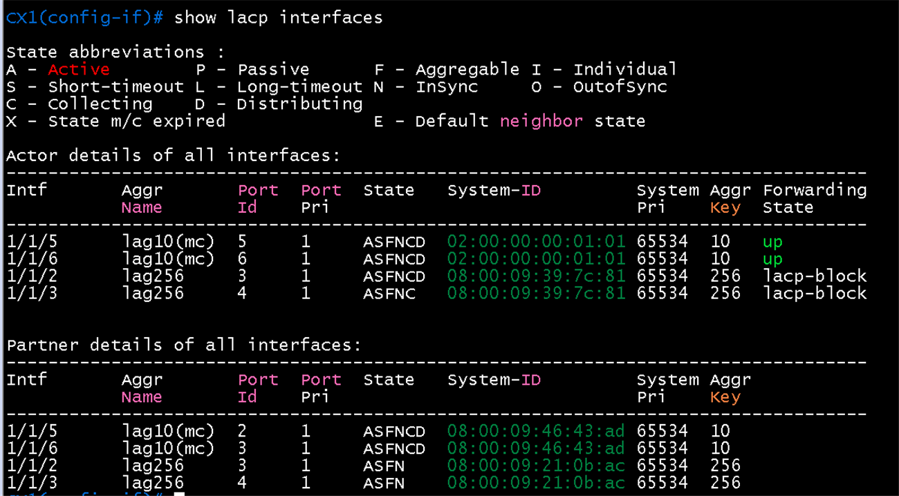

### CX3 `show lacp interface`(access 쪽)

- 1/1/1, 1/1/2: **ASFNCD**, Forwarding **up**, partner System-ID 02:00:00:00:01:01(VSX system-mac, CX1), key 10 (partner port id 5, 6)
- 1/1/3, 1/1/4: **ASFOE**(OutofSync, 기본 neighbor 상태), Forwarding **lacp-block**. partner가 `PLFOEX`, System-ID 00:00:00:00:00:00으로 상대(CX2)의 LACP 응답이 없음
- 4링크 중 CX1 쪽 2개만 동작. 나머지 2개는 CX2 쪽이 올라오지 않은 결과

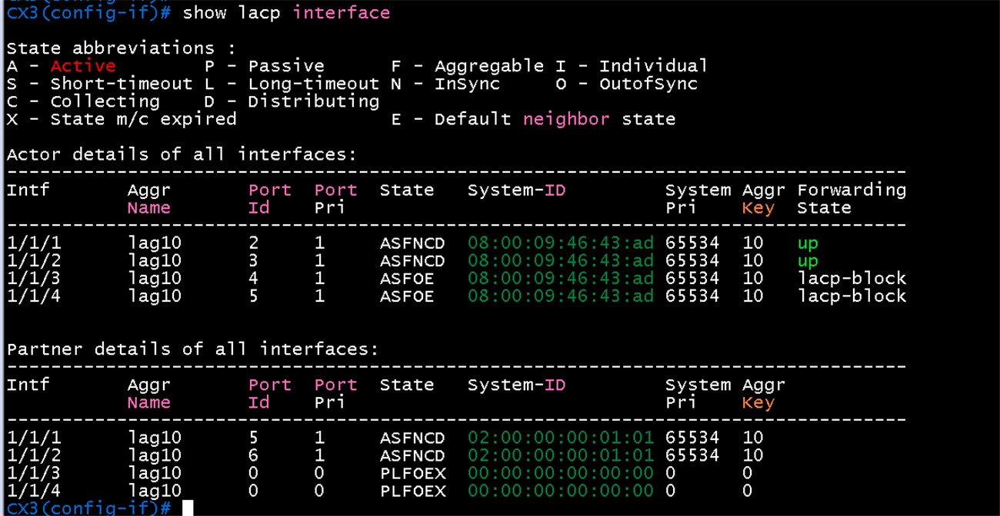

### CX2 `show lacp interface`(멀티 섀시 쪽)

- lag10(mc) 1/1/5, 1/1/6: State와 Port Id가 없고 Forwarding **down**, partner도 비어 있음. 포트가 LACP를 시작하지 못한 상태
- 원인 후보: (1) CX2 ISL이 Out-Of-Sync라 VSX secondary가 multi-chassis LAG 포트를 내려둠, (2) 1/1/5~6 링크(CX3 1/1/3~4) 물리 연결 또는 포트 상태

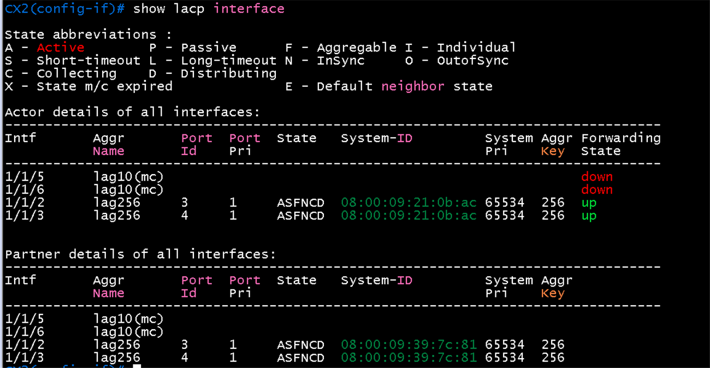

### CX2 `show lacp interface` (VSX 정상화 뒤 재확인)

- lag10(mc) 1/1/5: State **ASFO**(OutofSync), 1/1/6: **ASFOX**(OutofSync, 멀티 섀시 상태 만료), Forwarding 모두 **down**. 이제 Port Id(1005, 1006)와 Actor System-ID(VSX system-mac 02:00:00:00:01:01)는 보임
- partner(CX3, 08:00:09:46:43:ad)가 port id 4, 5로 보이고 State ASFO, ASFOE. 양쪽이 LACP PDU를 주고받기 시작했으나 InSync에 도달하지 못함
- ISL lag256 1/1/2~3은 ASFNCD, up
- 시간이 지나면 정상화될 수 있어 재확인 필요. 계속되면 CX2 1/1/5, 1/1/6을 shutdown, no shutdown 실행
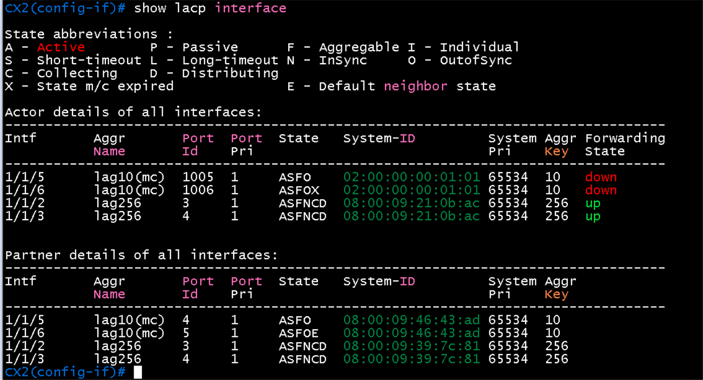

### 같은 시각 비교 (CX1, CX2, CX3)

- **CX1**: lag10(mc) 1/1/5, 1/1/6이 **ASFNCD, up**, partner(CX3) Port Id 2, 3. `show vsx brief`: ISL In-Sync, Sync-Primary, Keepalive-Established, Primary, 멀티 섀시 LAG 1개

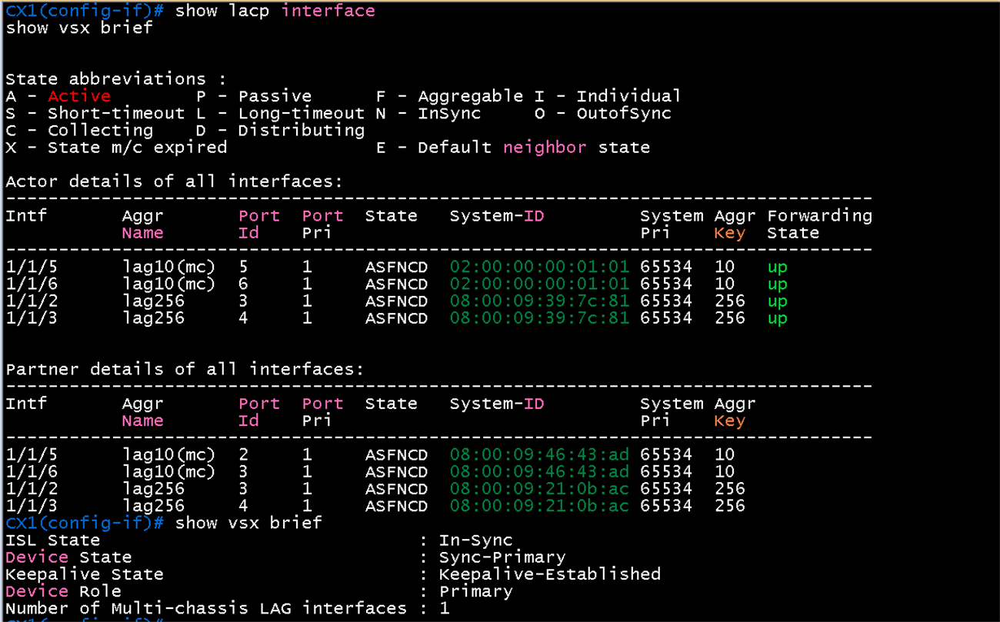

- **CX2**: lag10(mc) 1/1/5, 1/1/6이 State 없이 **down**, partner도 비어 있음(포트가 LACP를 시작하지 못함). ISL lag256 1/1/2~3은 ASFNCD, up. `show vsx brief`: In-Sync, Sync-Secondary, Keepalive-Established, Secondary

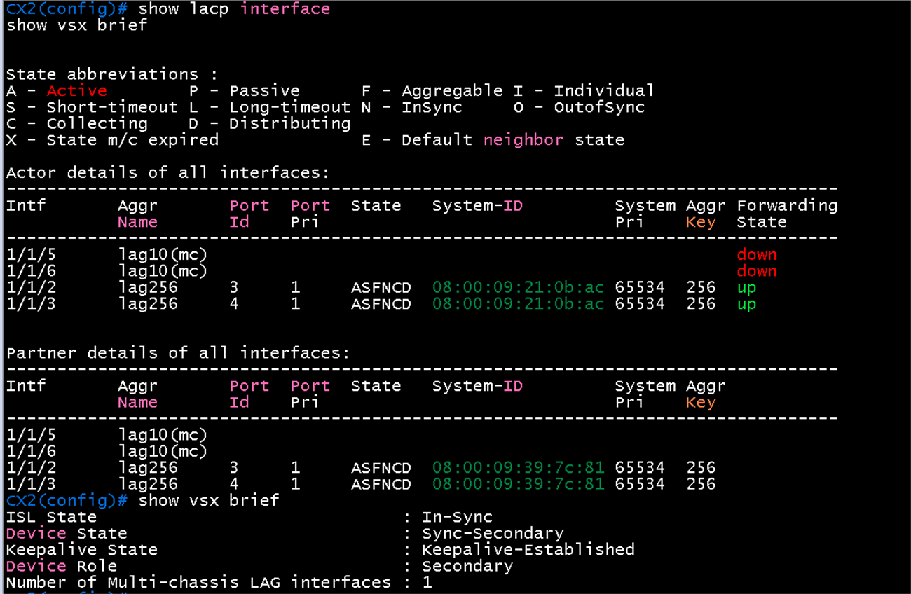

- **CX3**: 1/1/1, 1/1/2는 **ASFNCD, up**, partner System-ID 02:00:00:00:01:01(VSX system-mac), Port Id 5, 6(CX1). 1/1/3, 1/1/4는 ASFOE, **lacp-block**, partner 비어 있음(CX2 쪽 미동작). CX3에서 `show vsx brief`는 "VSX is not configured"(CX3는 VSX 대상이 아니므로 정상)

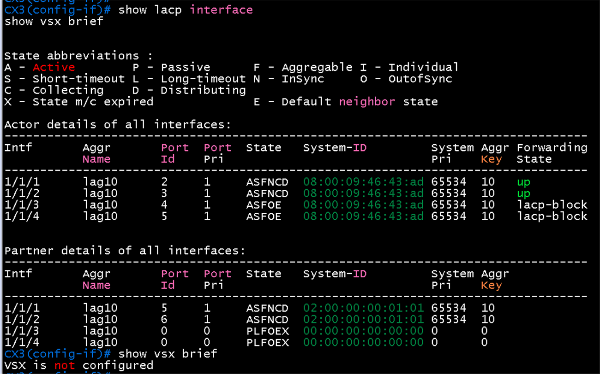

- 해석: CX1 쪽 LAG(2링크)는 정상 동작하고 CX3와 통신 가능. CX2 쪽 1/1/5~6은 down이며 원인 확인 중. 후보: VSX linkup delay timer(ISL 복구 뒤 멀티 섀시 LAG를 일정 시간 올리지 않음), CX2 1/1/5~6 링크 상태
### 정상화 뒤 (CX1, CX2, CX3)

- **CX3**: 1/1/1 ~ 1/1/4 **4개 모두 ASFNCD, Forwarding up**. partner System-ID가 모두 VSX system-mac(02:00:00:00:01:01), key 10. 1/1/1~2는 CX1(Port Id 5, 6), 1/1/3~4는 CX2(Port Id 1005, 1006)
- **CX1**: lag10(mc) 1/1/5, 1/1/6 ASFNCD, up. ISL lag256 1/1/2~3 ASFNCD, up
- **CX2**: lag10(mc) 1/1/5, 1/1/6 **ASFNCDX, up**(partner CX3 Port Id 4, 5), ISL 1/1/2 ASFNCDX, 1/1/3 ASFNCD, up. `X`는 멀티 섀시 상태 만료 표시로, 협상이 반복되며 잠깐 나타났다가 사라지는 흔적일 수 있음. 계속 보이면 LACP 타임아웃 가능성을 의심(fast 타이머와 에뮬레이션 부하)
- 복구 과정: CX2의 `vsx` 아래 `linkup-delay-timer 30`을 시험으로 넣고 1/1/5~6을 shutdown, no shutdown. 이 조치가 원인이라고 단정할 수는 없고, 시간이 지나 안정되었을 가능성도 있음

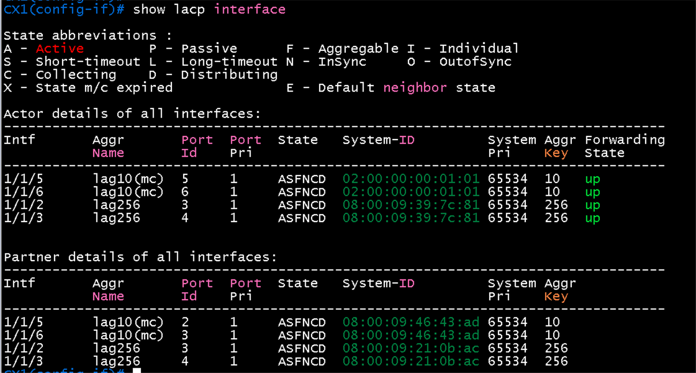

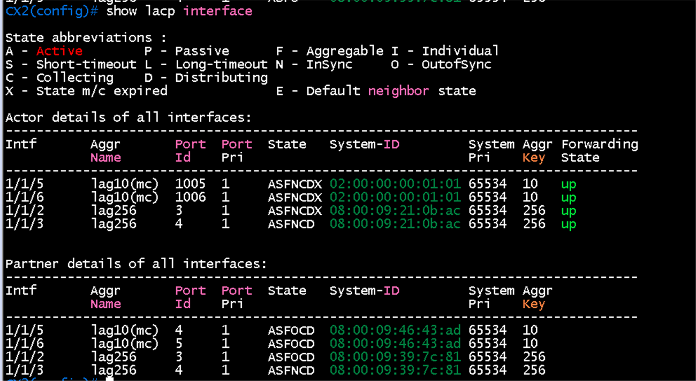

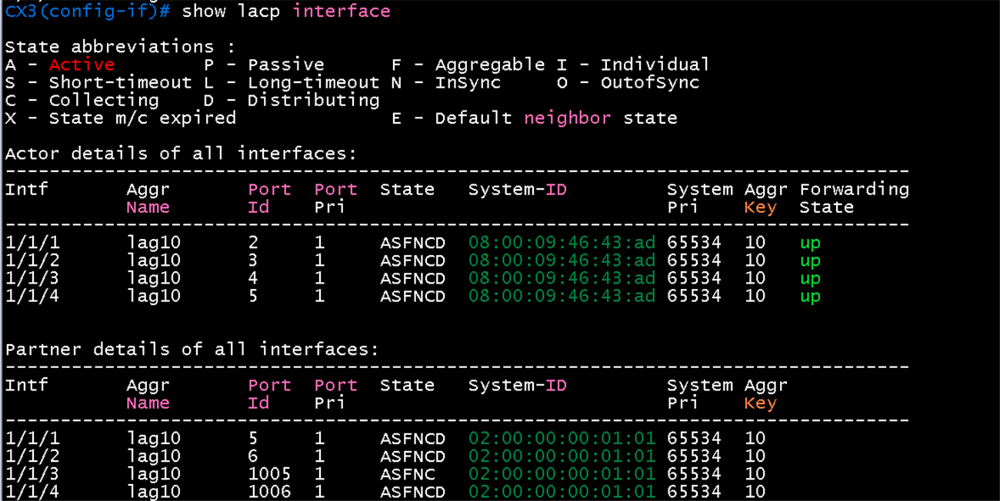
## 패킷 캡처 (Wireshark)

계획표: [08-wireshark-capture.md](../../00-overview/08-wireshark-capture.md). 링크 한 개만 캡처하고, 표시 필터로 패킷 한두 개의 상세 창이 보이게 잘라 images/에 저장. 캡처한 동작(어떤 명령으로 일으켰는지)을 설명에 남김

| 확인할 동작 | 캡처 링크 (GNS3 Start capture) | 일으킬 동작 | 표시 필터 | 볼 것 | 상태 |
|---|---|---|---|---|---|
| LACP (VSX LAG) | CX1 `1/1/5` - CX3 `1/1/1` | CX1 `interface 1/1/5` shutdown 후 no shutdown | `lacp` | Actor System-ID **02:00:00:00:01:01**(VSX system-mac), Key 10, Short-timeout, Active. CX2 쪽 같은 LAG의 Port Id는 1005, 1006 | 캡처 완료 (아래) |

### 캡처 결과: LACP (VSX LAG)

- 링크 CX1 `1/1/5` - CX3 `1/1/1`, 패킷 2. 목적지 **01:80:c2:00:00:02**(Slow Protocols 멀티캐스트), Src MAC 08:00:09:39:7c:c6(CX1 1/1/5)
- **Actor**: System Priority 65534, System ID **02:00:00:00:01:01**(VSX system-mac), Key **10**, Port 5, Port Priority 1
- Actor State **0x3f**: LACP Activity(active), **LACP Timeout(짧은 타임아웃, fast)**, Aggregation, Synchronization, Collecting, Distributing (플래그 `DCSGSA`)
- **Partner**: System ID 08:00:09:46:43:ad(CX3), Key 10, Port 2, State 0x3f(같은 플래그)
- CX1과 CX2는 같은 System ID와 Key를 쓰므로 CX3는 한 장비로 보며, 이것이 멀티 섀시 LAG가 동작하는 이유

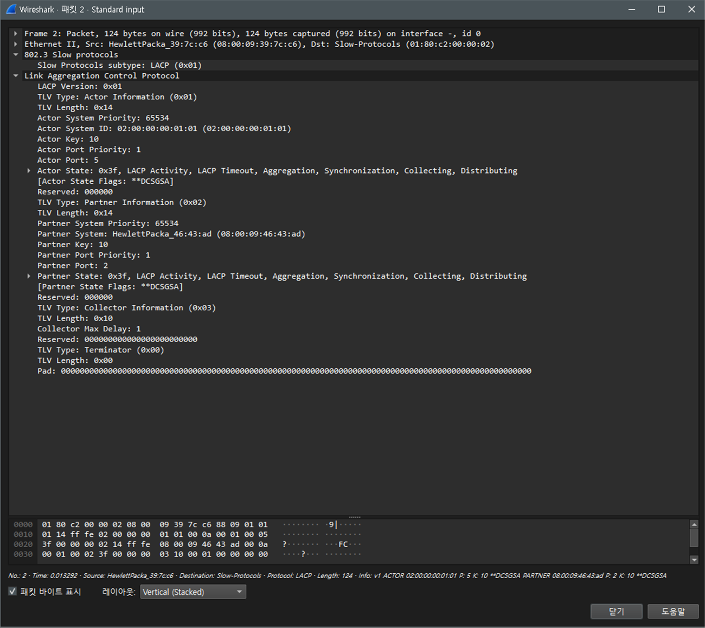

## 결과 기록

| 일시 | 장비 | 결과 (성공, 실패) | 비고 |
|---|---|---|---|
| 2026-10-22 | CX1 | 성공 | 1/1/5~6 ASFNCD, up, fast 협상(partner CX3). 두 번째 확인에서도 동일 |
| 2026-10-22 | CX2 | 성공 (주의) | 1/1/5~6 ASFNCDX, up. 한때 down(State 없음)이었으나 복구. X 표시가 남아 있어 안정 여부 재확인 필요 |
| 2026-10-22 | CX3 | 성공 | 1/1/1~4 4링크 모두 ASFNCD, up (한때 CX2 쪽 1/1/3~4가 lacp-block이었음) |
| 2026-10-22 | CX1, CX2, CX3 | 조치 후 안정 | 05단계 중 ISL `1/1/2` lacp-block, 상대 `O`(OutofSync), VSX Out-Of-Sync가 재발. `lag 256`과 `lag 10`에서 `lacp rate fast`를 제거(slow)하자 안정화. 위 결과(fast 협상)는 제거 전 기록 |
| 2026-10-22 | CX1, CX2, CX3 | 성공 (제한 있음) | LACP 협상과 LAG 상태는 정상(`ALFNCD`, up). 그러나 이 이미지(10.07)에서는 `lag10`을 통과하는 VLAN 110 데이터가 전달되지 않음(일반 트렁크는 정상). 항목 4(Host D ping)는 CX3 경유 대신 Host D를 CX1 `1/1/7`에 직접 연결해 [05단계](05-active-gateway.md)에서 확인. 상세는 05단계 "LAG 데이터 경로 한계" |
