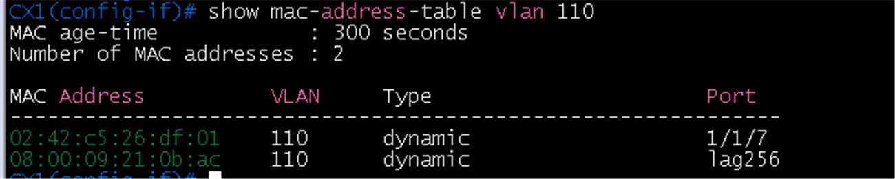
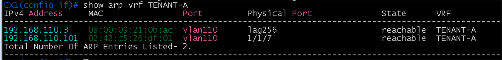
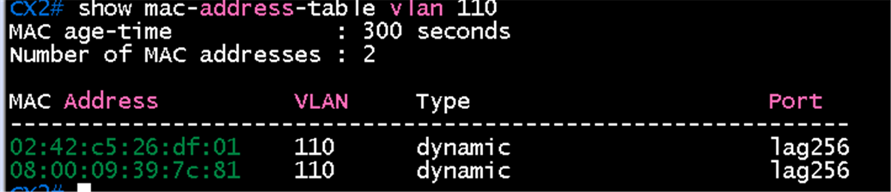
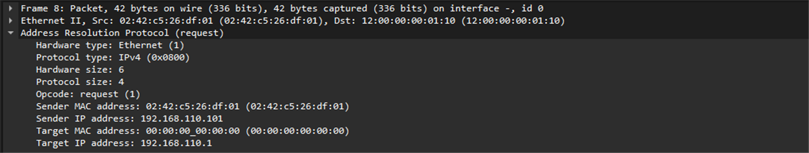
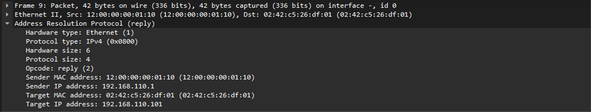
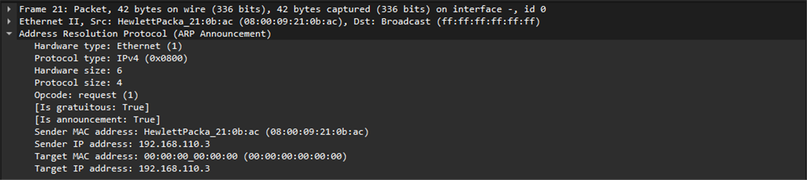

# VSX active gateway 검증

**선행 조건**: [VSX LAG 검증](04-vsx-lag.md)이 끝나 있고 [active gateway 샘플](../../samples/dc2/05-active-gateway.md)이 적용되어 있어야 함

기준 문서: [05-active-gateway.md](../../baseline/dc2/05-active-gateway.md)

## 확인 항목

| 순서 | 장비 | 명령 | 기대 결과 | 안 될 때 확인 |
|---|---|---|---|---|
| 1 | CX1, CX2 | `show active-gateway` | VMAC `12:00:00:00:01:10`, IPv4 interface VLAN `vlan110` | active-gateway ip, MAC 값 |
| 2 | CX1 | `ping 192.168.110.3 source 192.168.110.2 vrf TENANT-A` | ISL을 거쳐 CX2 SVI 응답 | ISL, VLAN 110 |
| 3 | Host D | `ping -c 3 192.168.110.1` | 응답 | 호스트 게이트웨이, 연결 포트 |
| 4 | CX1, CX2 | `show mac-address-table vlan 110` | Host D MAC이 CX1 `1/1/7`, CX2 `lag256`에서 보임 | VLAN 110 access, ISL |
| 5 | CX1 | `show arp vrf TENANT-A` | Host D `192.168.110.101`이 `1/1/7`에서 reachable | SVI, 호스트 연결 |

## Host D 연결 방식

- 설계는 Host D를 CX3 `1/1/5`에 연결하는 구성이었으나, 이 이미지(AOS-CX Virtual 10.07.0004)에서는 CX3와 VSX 사이 LAG(`lag10`)를 통과하는 VLAN 110 데이터 프레임이 전달되지 않음. 이 현상 때문에 Host D를 CX1에 직접 연결
- Host D에 두 번째 NIC(`eth1`)를 추가해 CX1 `1/1/7`(VLAN 110 access)에 연결. `eth0`은 내리고 `eth1`만 사용
- LAG 현상은 아래 "LAG 데이터 경로 한계"에 정리

## 증빙

### CX1, CX2 active gateway 설정

- CX1, CX2 모두 `show active-gateway`: VMAC `12:00:00:00:01:10`, IPv4 VIP ref count 1, interface VLAN `vlan110`. IPv6는 사용하지 않아 0

### CX1 SVI 간 ping

- CX1 `ping 192.168.110.3 source 192.168.110.2 vrf TENANT-A`: 5/5, ttl 64 (VLAN 110 L2 경로와 SVI 정상)

### Host D 학습 결과

| 화면 | 확인 내용 |
|---|---|
|  | CX1: Host D `eth1`(`02:42:c5:26:df:01`)이 VLAN 110, **`1/1/7`**에서 학습, CX2 SVI MAC(`08:00:09:21:0b:ac`)은 `lag256` |
|  | CX1: `192.168.110.101`이 `02:42:c5:26:df:01`, 포트 `vlan110`(물리 `1/1/7`), **reachable**. `192.168.110.3`은 CX2 SVI, `lag256` |
|  | CX2: Host D MAC(`02:42:c5:26:df:01`)이 **`lag256`**(ISL 경유)에서 학습, CX1 SVI MAC(`08:00:09:39:7c:81`)도 `lag256` |

## 패킷 캡처 (Wireshark)

계획표: [08-wireshark-capture.md](../../00-overview/08-wireshark-capture.md). 링크 한 개만 캡처하고, 표시 필터로 패킷 한두 개의 상세 창이 보이게 잘라 images/에 저장

| 확인할 동작 | 캡처 링크 (GNS3 Start capture) | 일으킬 동작 | 표시 필터 | 볼 것 | 상태 |
|---|---|---|---|---|---|
| active gateway ARP | CX1 `1/1/7` - Host D `eth1` | Host D `ping -c 3 192.168.110.1` | `arp` | ARP Reply의 sender MAC이 **12:00:00:00:01:10**, 가상 IP 192.168.110.1 | 캡처 완료 |

### 캡처 결과: 게이트웨이 ARP 요청과 응답

| 화면 | 확인 내용 |
|---|---|
|  | 패킷 8: Host D(`02:42:c5:26:df:01`)가 `Who has 192.168.110.1? Tell 192.168.110.101`. 목적지 MAC이 **12:00:00:00:01:10**(게이트웨이 VMAC)로 지정됨 (기존 ARP 캐시를 갱신하는 유니캐스트 요청) |
|  | 패킷 9: **reply**. Sender MAC **12:00:00:00:01:10**, Sender IP **192.168.110.1**, Target은 Host D(`02:42:c5:26:df:01`, `192.168.110.101`) |
|  | 패킷 21: `ARP Announcement for 192.168.110.3`. CX2 SVI(`08:00:09:21:0b:ac`)가 보낸 gratuitous ARP (SVI가 올라올 때 자신의 주소를 알림) |

- 게이트웨이 IP(.1)에 대한 응답이 CX1이나 CX2의 SVI MAC이 아니라 **active gateway의 가상 MAC**으로 나옴. Host D가 어느 CX로 가든 같은 MAC을 사용하므로 한 대가 멈춰도 게이트웨이 MAC이 바뀌지 않음

## LAG 데이터 경로 한계

- CX3와 VSX 사이 `lag10`은 LACP 협상(`ALFNCD`, up)까지는 정상이지만, VLAN 110 데이터 프레임이 LAG를 통과하지 못함
- 확인한 조건: 같은 링크를 LAG 없이 일반 트렁크로 쓰면 Host D에서 .1 ping 성공, 일반(비 multi-chassis) LAG와 `lag10 multi-chassis` 모두 실패, `allowed 110`, `allowed all`, native 변경, 재부팅, 멤버 1개 고정 모두 동일
- ISL(`lag256`)은 VLAN 110을 정상 전달. 포트 단독 설정 잔존, STP, 선로 문제는 확인으로 제외
- multi-chassis LAG는 LACP가 필수라 정적 LAG 시험은 불가(`Failed to change LACP mode. Interface is a multi-chassis LAG`)
- 이미지 10.07 계열의 에뮬레이션 한계로 판단. 원인 확정은 이미지 교체 후 비교가 필요함

## 장애 시험

| 동작 | 기대 결과 |
|---|---|
| CX1 정지 | 게이트웨이 .1이 CX2에서 계속 응답 |

## 결과 기록

| 일시 | 결과 (성공, 실패) | 비고 |
|---|---|---|
| 2026-10-22 | 성공 | 항목 1, 2, 4, 5 완료, ARP Reply로 항목 3 확인(게이트웨이 VMAC `12:00:00:00:01:10`). Host D를 CX1 `1/1/7`에 직접 연결해 확인. CX3 경유(`lag10`)는 이미지 한계로 실패 |
