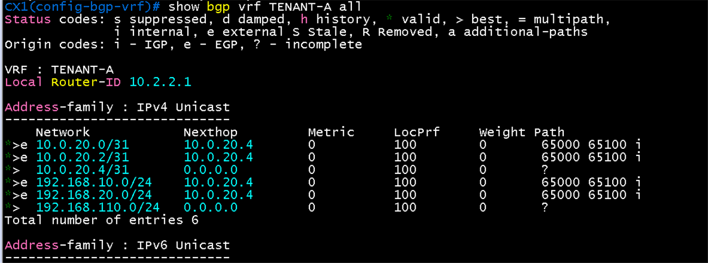
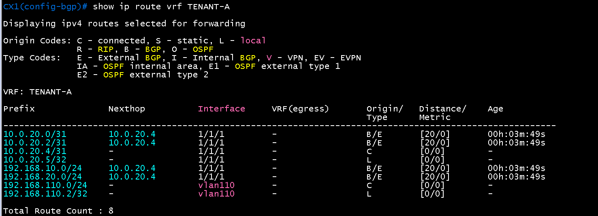
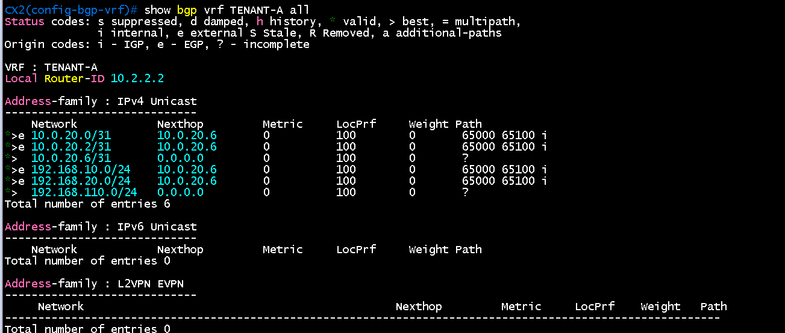
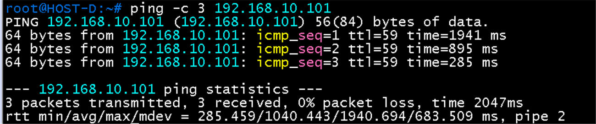

# PE와 eBGP 검증

**선행 조건**: [active gateway 검증](05-active-gateway.md)이 끝나 있고, 코어의 PE2가 올라와 있어야 함. [샘플](../../samples/dc2/06-ebgp-pe.md), [기준 문서](../../baseline/dc2/06-ebgp-pe.md).

## 확인 항목

| 순서 | 장비 | 명령 | 기대 결과 | 안 될 때 확인 |
|---|---|---|---|---|
| 1 | CX1 | `ping 10.0.20.4 vrf TENANT-A` | PE2 응답 | 링크 IP, VRF |
| 2 | CX1 | `show bgp all-vrf all summary` | PE2(65000)가 **Established** (명령이 다르면 ?로 확인) | AS 번호, activate |
| 3 | CX1 | `show ip route vrf TENANT-A` | DC1과 Branch 경로가 BGP로 보임 | PE2 쪽 RT, 원격 설정 |
| 4 | Host D | `ping -c 3 192.168.10.101` | Host A 응답 (DC2에서 DC1로) | VPNv4, DC1 쪽 설정 |
| 5 | CX1 | `show bgp vrf TENANT-A all neighbors <PE2 주소>` (hold, keepalive 항목) | hold 9초, keepalive 3초 | 양쪽 `timers 3 9`, AOS-CX 문법 확인 |

## 증빙

### PE2 쪽 (PE2 - CX1, CX2)

- PE2에서 CX1(10.0.20.5), CX2(10.0.20.7)가 AS 65201 **Established**, 각각 prefix 2개 수신(192.168.110.0/24와 링크 /31)
- PE2 `show ip route vrf TENANT-A`: 192.168.110.0/24가 next-hop 10.0.20.5와 10.0.20.7 두 개 (ECMP, `maximum-paths 2`)
- PE1 `show bgp vpnv4 unicast all`: 192.168.110.0이 next-hop 10.0.0.12(PE2)에서 수신
- hold 9, keepalive 3 확인
- 화면은 [core 07 검증](../core/07-pe-ce-ebgp.md)의 "증빙: DC2 구간"에 있음

### CX 쪽 (CX1, CX2)

- `show bgp ipv4 unicast summary vrf TENANT-A`는 `% There is no matched command.`로 실패. 이 이미지에서는 `show bgp vrf TENANT-A all`로 VRF의 BGP 테이블을 확인함
- CX1 `show bgp vrf TENANT-A all`: 192.168.10.0/24, 192.168.20.0/24와 10.0.20.0/31, 10.0.20.2/31이 next-hop **10.0.20.4**(PE2), 경로 **65000 65100 i**, `*>e`(external). 자신이 광고하는 192.168.110.0/24, 10.0.20.4/31은 next-hop 0.0.0.0, `*>`
- CX1 `show ip route vrf TENANT-A`: 192.168.10.0/24, 192.168.20.0/24가 **B/E [20/0]**, 1/1/1 경유 10.0.20.4. 192.168.110.0/24는 `vlan110` 직결(C), Total 8
- CX2 `show bgp vrf TENANT-A all`: 같은 경로를 next-hop **10.0.20.6**(PE2)으로 수신

| 화면 | 확인 내용 |
|---|---|
|  | CX1: DC1 경로가 PE2(10.0.20.4)에서 AS 경로 65000 65100으로 들어옴 |
|  | CX1: DC1 경로가 B/E, 192.168.110.0/24는 직결 |
|  | CX2: 같은 경로를 next-hop 10.0.20.6으로 수신 |

- **Local Router-ID**: `router bgp` 아래의 전역 `bgp router-id`만 설정했을 때는 VRF의 값이 SVI 주소(CX1 192.168.110.2, CX2 192.168.110.3)로 나옴. 전역 값은 VRF에 적용되지 않기 때문
- `vrf TENANT-A` 하위에 `bgp router-id`(CX1 **10.2.2.1**, CX2 **10.2.2.2**)를 지정하고 세션을 재시작하자 위 화면처럼 설계값으로 바뀜. 재시작 직후에는 CX2에서 PE2 경로가 한동안 비어 있다가 다시 들어옴
- 설정 파일 위치: `vrf TENANT-A` 아래 8칸 들여쓰기. 4칸으로 쓰면 전역 줄로 읽히므로 주의

### DC2에서 DC1로 end-to-end ping

- Host D `ping -c 3 192.168.10.101`(Host A): **3/3 응답**, ttl 59, 285~1941 ms (에뮬레이션 부하로 지연이 큼)
- 경로: Host D - CX1 - PE2 - (MPLS 코어 VPN 라벨) - PE1 - leaf3, leaf4 - Host A

## 패킷 캡처 (Wireshark)

계획표: [08-wireshark-capture.md](../../00-overview/08-wireshark-capture.md). 링크 한 개만 캡처하고, 표시 필터로 패킷 한두 개의 상세 창이 보이게 잘라 images/에 저장. 캡처한 동작(어떤 명령으로 일으켰는지)을 설명에 남김

| 확인할 동작 | 캡처 링크 (GNS3 Start capture) | 일으킬 동작 | 표시 필터 | 볼 것 | 상태 |
|---|---|---|---|---|---|
| eBGP (PE2) | CX1 `1/1/1` - PE2 `Gi2/0` | CX1에서 BGP 세션 재시작 (문법은 `?`로 확인) | `bgp` | OPEN: AS 65201과 65000, Hold Time **9**, BGP Identifier(CX1 **10.2.2.1**), UPDATE에 192.168.110.0/24 | 생략 (BGP는 [core 06 검증](../core/06-mp-bgp-vpnv4.md)의 대표 캡처로 대체) |

## 결과 기록

| 일시 | 결과 (성공, 실패) | 비고 |
|---|---|---|
| 2026-10-22 | 성공 | 항목 2(이웃 상태는 `show bgp vrf TENANT-A all`로 경로 수신 확인), 3, 4 완료. CX1, CX2가 PE2에서 DC1 경로를 받고 Host D가 Host A에 ping 성공. 항목 5(hold, keepalive)는 PE2 쪽에서 확인(9와 3). VRF router-id는 SVI 주소로 나오던 것을 `vrf TENANT-A` 하위 지정으로 설계값(10.2.2.1, 10.2.2.2)에 맞춤 |
