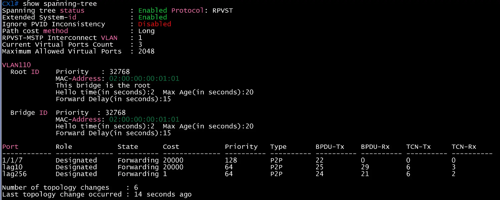
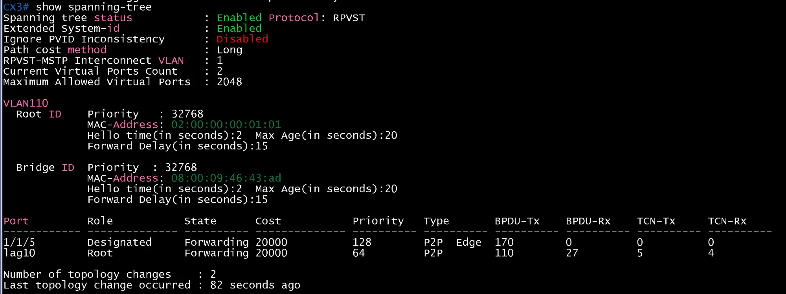
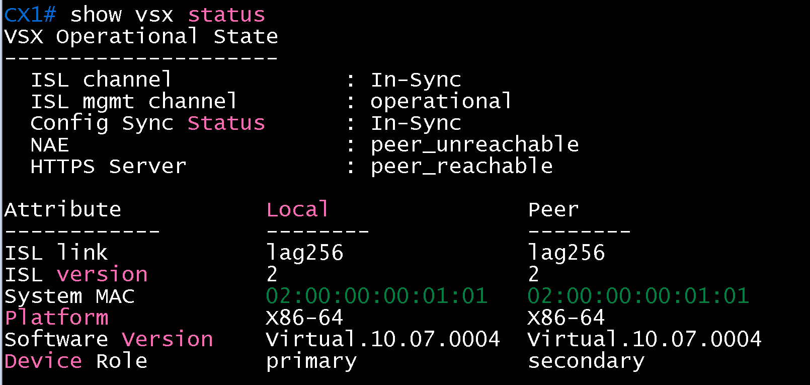
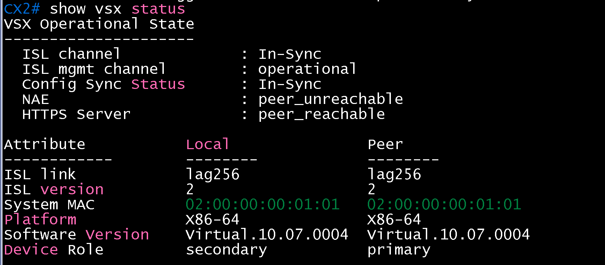
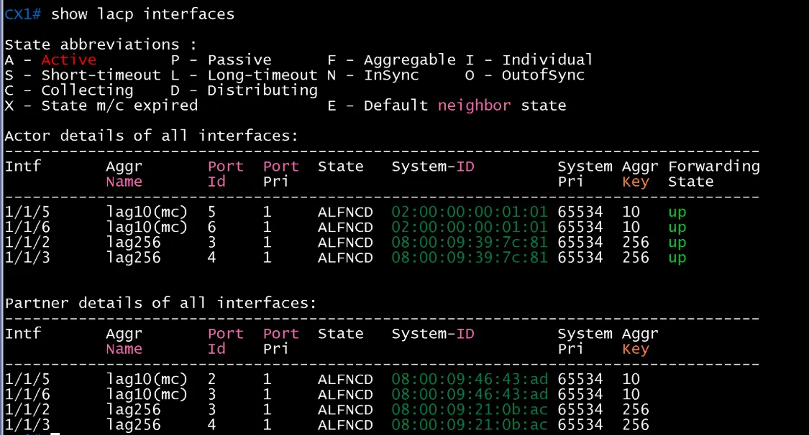
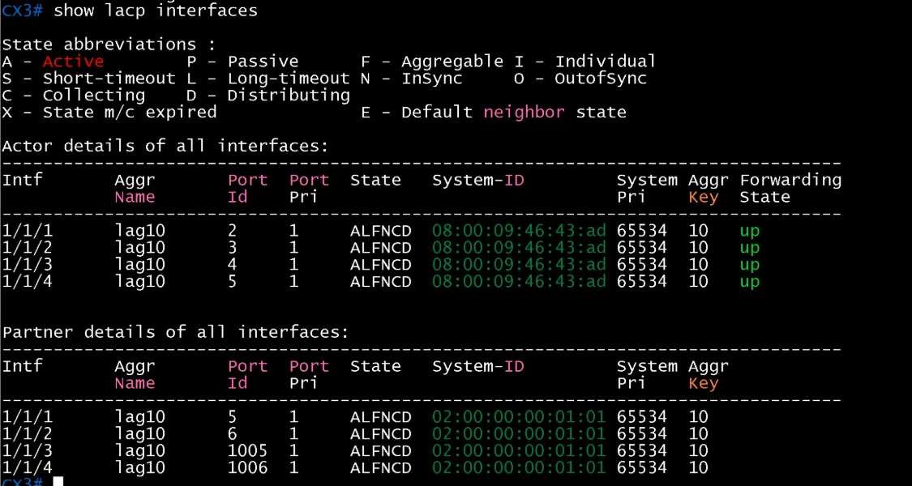
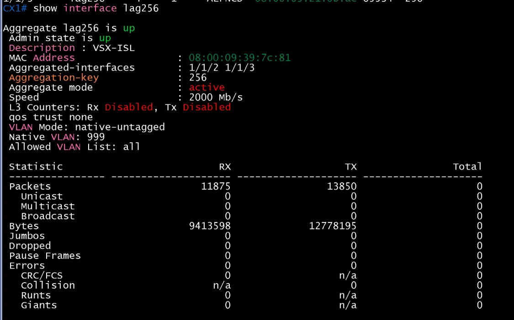
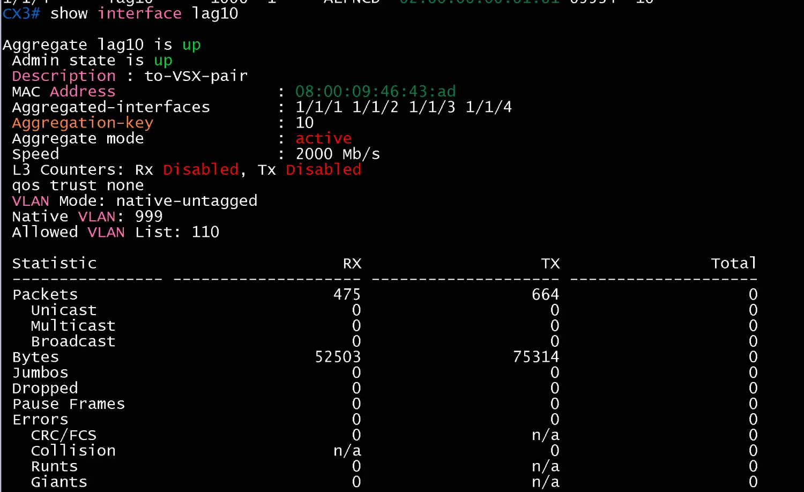

# DC2 STP, VSX 재확인 (2026-11-14)

DC2에 rpvst를 적용한 뒤 STP, VSX, LACP를 다시 확인. 시나리오: CX3 장비 문제로 Host E를 임시로 CX1 `1/1/7`에 연결

| 순서 | 장비 | 명령 | 기대 결과 | 결과 |
|---|---|---|---|---|
| 1 | CX1 | `show spanning-tree` | RPVST, VLAN 110, 이 브리지가 root, 포트 forwarding | 합격(root MAC 02:00:00:00:01:01, `1/1/7`·lag10·lag256 Designated Forwarding) |
| 2 | CX3 | `show spanning-tree` | RPVST, `1/1/5` Edge | 합격(`1/1/5` Designated Edge, lag10 Root Forwarding) |
| 3 | CX1, CX2 | `show vsx status` | ISL In-Sync, Config Sync In-Sync, primary/secondary | 합격 |
| 4 | CX1, CX2, CX3 | `show lacp interfaces` | lag10(mc)·lag256 ALFNCD up | CX1 lag256은 부팅 직후 `lacp-block`이었다가 정리 후 up. CX3 lag10 4개 모두 up |

- CX2에서 lag10(mc) 멤버(`1/1/5`, `1/1/6`)가 State 없이 down으로 보이지만 CX3는 4개 멤버를 모두 active, 파트너 port id 1005·1006으로 봄. 이전 기록과 같은 패턴으로 보이며 CX2의 `show interface lag10`은 받지 못해 확인하지 못함
- LACP 상태 표기가 `ASFNCD`(Short-timeout)에서 `ALFNCD`(Long-timeout)로 바뀜

| 일시 | 결과 | 비고 |
|---|---|---|
| 2026-11-14 | 성공 | STP, VSX, LACP 확인. CX2 lag10 표시는 확인하지 못함 |
