# DC2 통신과 분리 검증 (2026-11-14)

Host E(매체제어, 192.168.110.101, CX1 `1/1/7`)

| 순서 | 명령 | 기대 결과 | 결과 |
|---|---|---|---|
| 1 | Host E `ping -c 3 192.168.110.1` | 응답 | 3/3, 0% 손실 |
| 2 | CX1 `show arp vrf TENANT-A` | 192.168.110.101이 `1/1/7`에서 reachable | 합격(ping 직후, 이전에는 시간이 지나 항목이 비어 있었음) |
| 3 | Wireshark CX1 - Host E, 필터 `arp` | ARP reply의 sender MAC이 가상 MAC 12:00:00:00:01:10 | 합격(응답 4개 모두 가상 MAC) |
| 4 | CX1 `show bgp all-vrf all summary`, `show bgp vrf TENANT-A all` | PE2(10.0.20.4) Established, 개발지사 대역 수신, DC1 대역 없음 | 합격 |
| 5 | PE2 `show ip bgp vpnv4 vrf PARTNER summary`, `show ip route vrf PARTNER` | CX 이웃 10.0.20.5·.7 Established, 192.168.110.0/24와 50·60.0/24, DC1 대역 없음 | 합격 |
| 6 | Host E -> 192.168.50.101, Host F -> 192.168.110.101 | 0% 손실 | 각각 4/4 |
| 7 | Host E -> 192.168.30.101, 192.168.99.101 | 100% 손실(분리) | 각각 4 송신 0 수신 |
| 8 | Host E traceroute -> 192.168.30.101 | 도달 안 함 | 30홉 모두 `* * *` |

- CX1의 `show ip bgp summary vrf ...`는 이 이미지에서 `Invalid input`이라 `show bgp all-vrf all summary`를 씀
- Host E -> Host F traceroute: 192.168.110.2(CX1), 10.0.20.4(PE2), 10.0.60.0·.2(PE3), 10.0.60.3(BGW2), 10.50.0.3(DSW2), 도착(6홉, PE2 -> PE3 직접). PE2–PE3 링크 단절 중에는 PE1(10.0.10.0) 경유 7홉

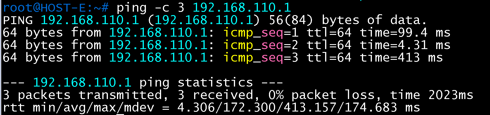

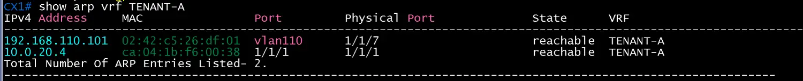

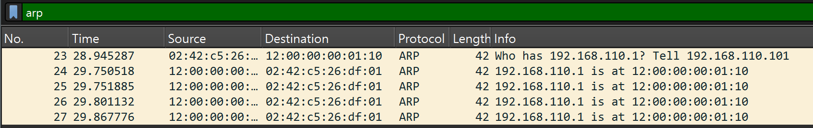

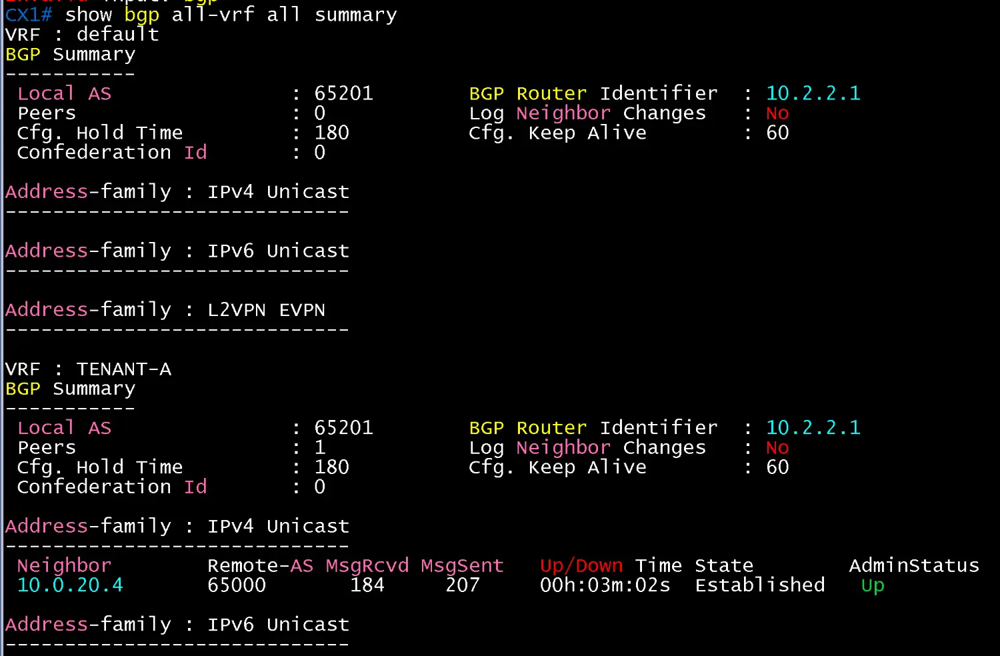

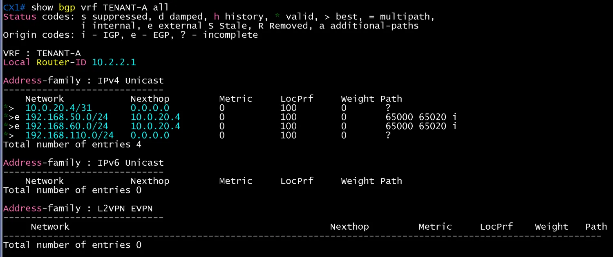

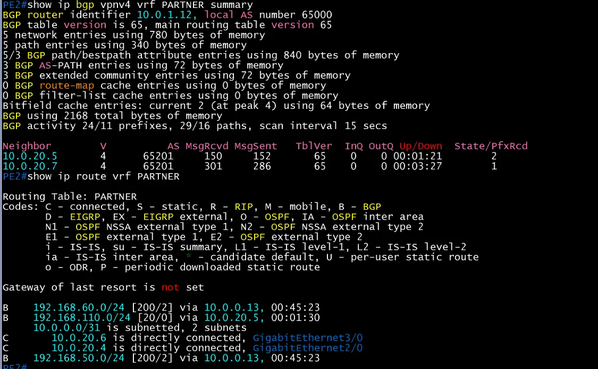

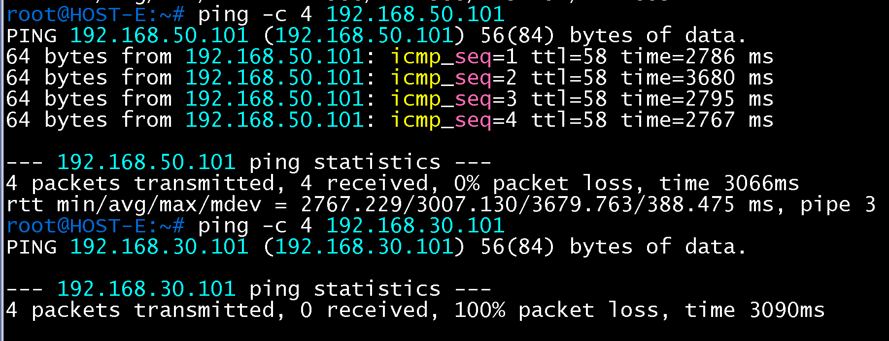

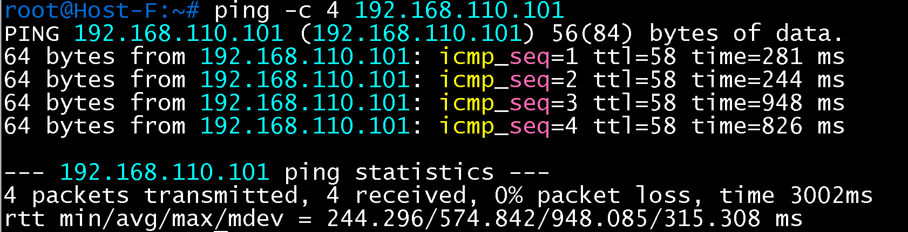

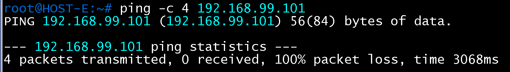

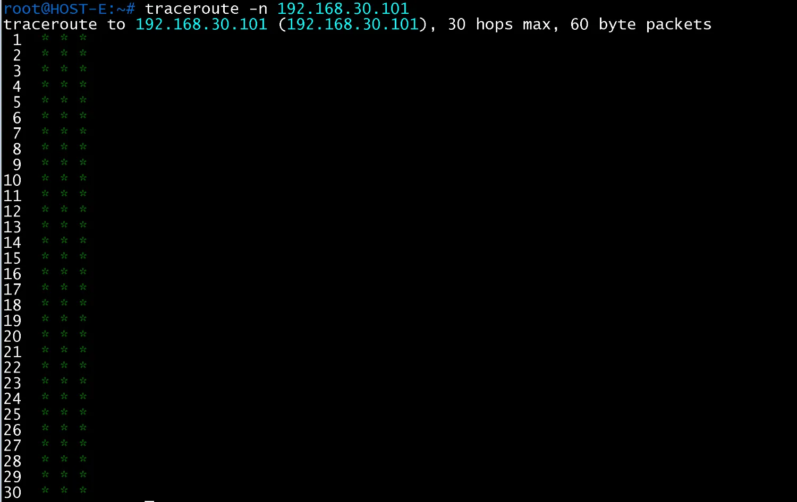

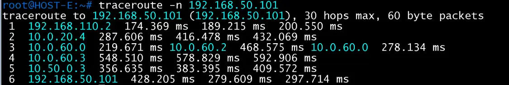

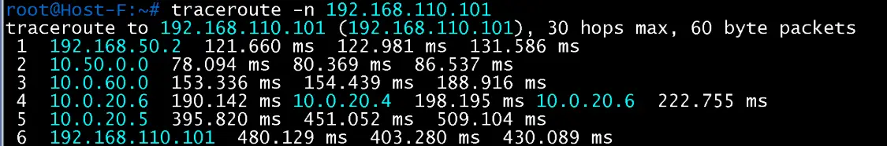

| 일시 | 결과 | 비고 |
|---|---|---|
| 2026-11-14 | 성공 | 항목 1~8 완료 |
