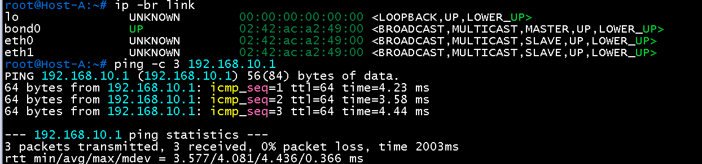
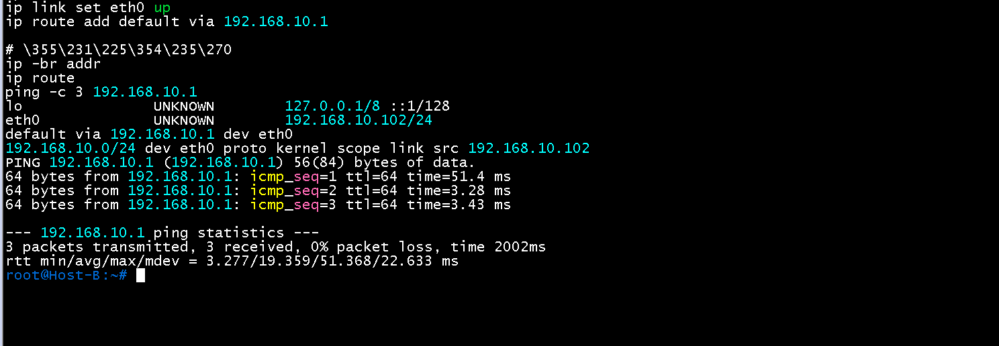
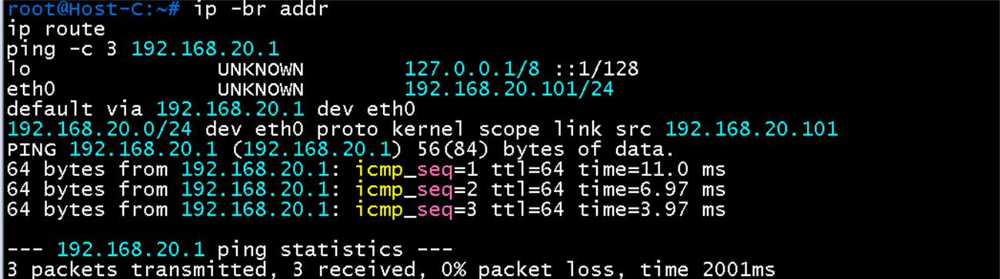
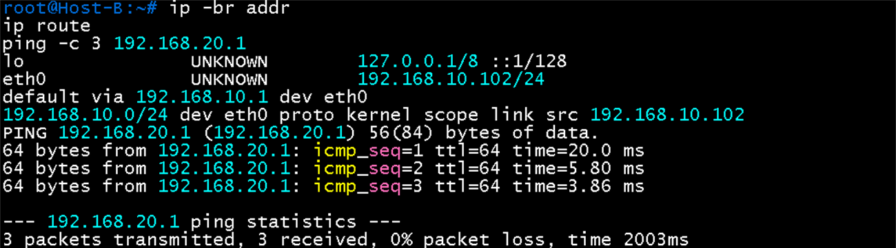
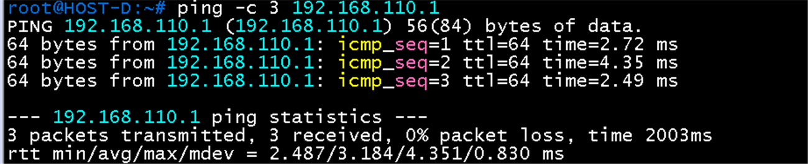
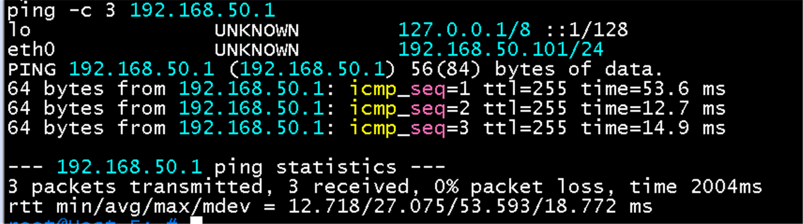
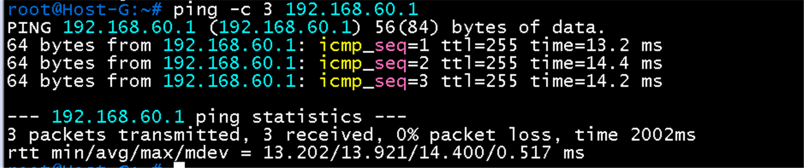

# 게이트웨이 연결 검증

**선행 조건**: 해당 호스트가 연결된 스위치의 VLAN, SVI(게이트웨이)가 올라와 있고 [호스트 기준 문서](../../baseline/host/01-overview.md)대로 IP가 설정되어 있어야 함

샘플: [01-ip-config.md](../../samples/host/01-ip-config.md)

## 확인 항목

| 순서 | 호스트 | 명령 | 기대 결과 | 안 될 때 확인 |
|---|---|---|---|---|
| 1 | Host A | `ip -br link`, `ping -c 3 192.168.10.1` | `bond0`이 UP, 게이트웨이 3개 응답 | bond 설정, leaf1·2 `Vlan10` up, `port-channel10` |
| 2 | Host B | `ip -br addr`, `ping -c 3 192.168.10.1` | `eth0 192.168.10.102/24`, 응답 | leaf3 `ethernet7` access VLAN 10, `Vlan10` |
| 3 | Host C | `ip -br addr`, `ping -c 3 192.168.20.1` | `eth0 192.168.20.101/24`, 응답 | leaf4 `ethernet7` access VLAN 20, `Vlan20` |
| 4 | Host D | `ping -c 3 192.168.110.1` | 응답 (VSX active gateway) | CX3 `1/1/5` VLAN 110, CX1·2 active gateway |
| 5 | Host F | `ping -c 3 192.168.50.1` | 응답 (VRRP VIP) | ASW1 `Gi1/0` VLAN 50, DSW1 VRRP master |
| 6 | Host G | `ping -c 3 192.168.60.1` | 응답 (VRRP VIP) | ASW1 `Gi1/1` VLAN 60, DSW2 VRRP master |

- 호스트 이름 `eth0`이 `UNKNOWN`으로 표시되는 것은 컨테이너 가상 인터페이스의 정상 표시
- 한글 주석이 콘솔에서 깨져 보이는 것은 콘솔이 UTF-8을 표시하지 못해서이며 동작에는 영향이 없음

## 증빙 (DC1, 2026-10-22)

| 호스트 | 화면 | 볼 곳 |
|---|---|---|
| Host A |  | `bond0` MASTER, `eth0`·`eth1` SLAVE UP, `192.168.10.1` 3개 중 3개 응답 |
| Host B |  | `eth0 192.168.10.102/24`, 기본 경로 `via 192.168.10.1`, 응답 3/3 |
| Host C |  | `eth0 192.168.20.101/24`, 기본 경로 `via 192.168.20.1`, 응답 3/3 |
| Host B -> VLAN 20 게이트웨이 |  | leaf3의 `Vlan10`과 `Vlan20` SVI 사이 **로컬 VLAN 간 라우팅**(VXLAN 아님) |

## 증빙 (DC2, Branch, 2026-10-23)

| 호스트 | 화면 | 볼 곳 |
|---|---|---|
| Host D |  | `192.168.110.1`(VSX active gateway) 응답 3/3, TTL 64 |
| Host F |  | `eth0 192.168.50.101/24`, `192.168.50.1`(VRRP VIP) 응답 3/3, TTL **255**(VIP를 가진 DSW1이 직접 응답) |
| Host G |  | `192.168.60.1`(VRRP VIP) 응답 3/3, TTL 255 |

## 결과 기록

| 일시 | 결과 (성공, 실패) | 비고 |
|---|---|---|
| 2026-10-22 | 성공 (Host A, B, C) | DC1 호스트 3대가 게이트웨이까지 통신. Host D, F, G는 DC2, Branch 구성 후 확인 |
| 2026-10-23 | 성공 (Host D, F, G) | DC2 Host D가 VSX active gateway, Branch Host F, G가 VRRP VIP까지 통신. 항목 1 ~ 6 모두 완료 |