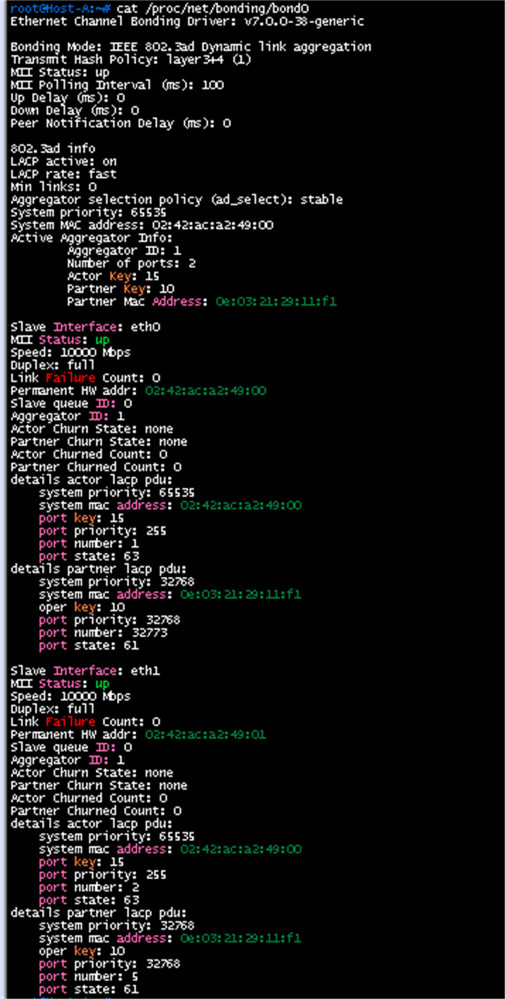
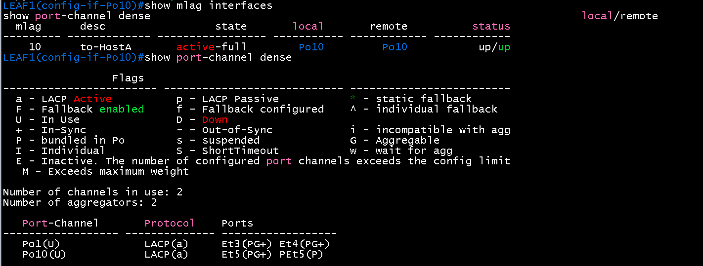
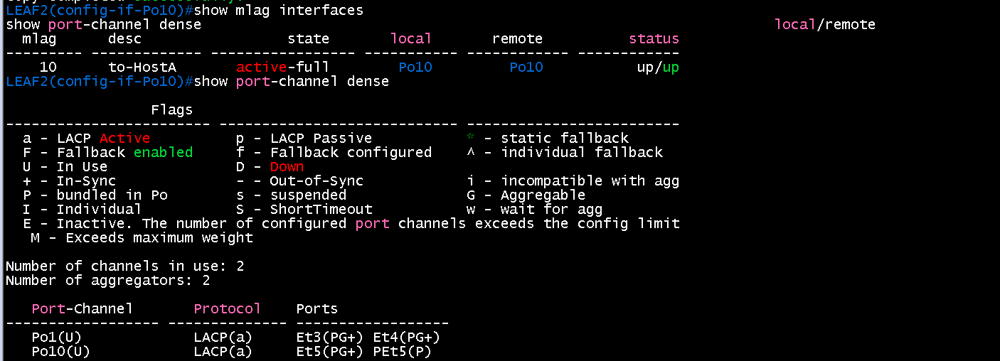
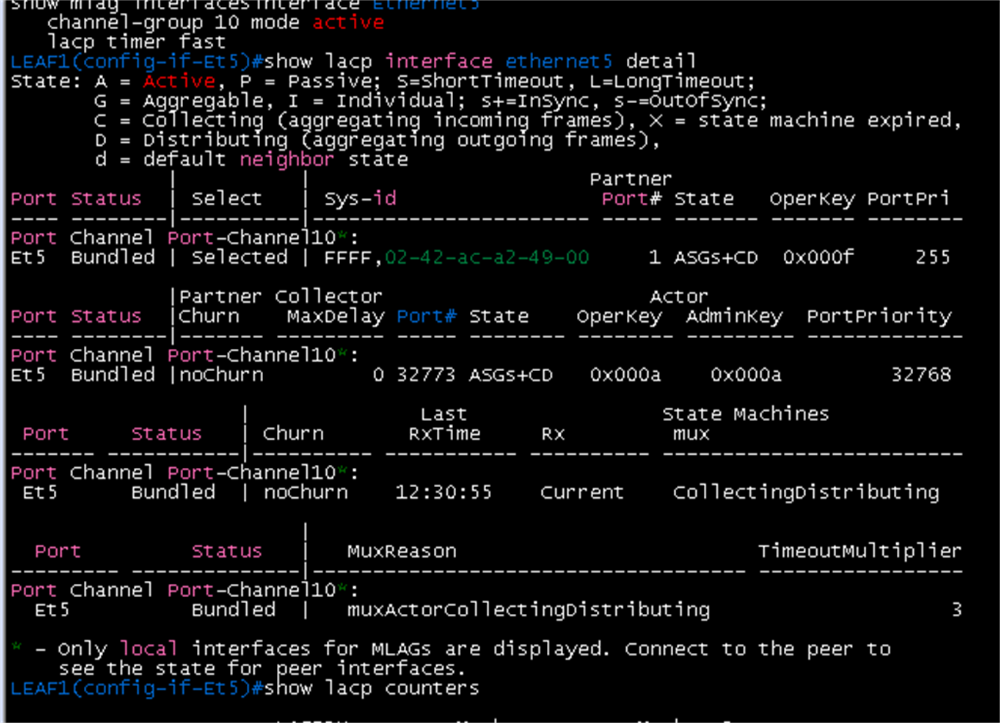
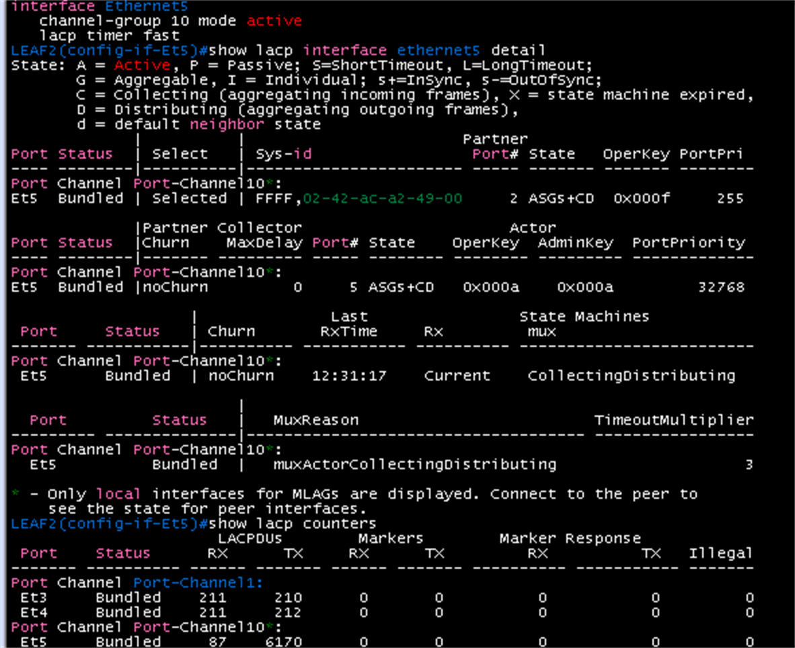
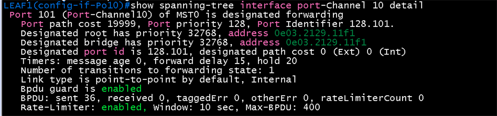

# LACP bond (Host A) 검증

**선행 조건**: leaf1·2의 MLAG와 `port-channel10`이 설정되어 있고 Host A에 [bond 샘플](../../samples/host/02-bond-lacp.md)이 적용되어 있어야 함

기준 문서: [02-bond-lacp.md](../../baseline/host/02-bond-lacp.md)

## 확인 항목

| 순서 | 위치 | 명령 | 기대 결과 | 안 될 때 확인 |
|---|---|---|---|---|
| 1 | Host A | `cat /proc/net/bonding/bond0` | `802.3ad`, `Number of ports: 2`, `eth0`·`eth1`의 **Aggregator ID가 같음**, Partner Mac이 leaf의 MLAG system-id(`0e:03:21:29:11:f1`) | 어댑터 2개, bond 옵션, `lacp_rate fast` |
| 2 | Host A | 같은 출력의 파트너 `port state` | **63**(양쪽 fast). 61이면 leaf에 `lacp timer fast`가 없음 | leaf1·2 `ethernet5`의 `lacp timer fast` |
| 3 | leaf1, leaf2 | `show mlag interfaces` | `mlag 10`이 **active-full** | 양쪽 `mlag 10`, 호스트 LACP |
| 4 | leaf1, leaf2 | `show port-channel dense` | `Po10(U)`의 멤버 `Et5(PG+)`와 상대의 `PEt5(P)` | `channel-group 10 mode active` |
| 5 | leaf1, leaf2 | `show lacp interface ethernet5 detail` | `Bundled`, 파트너 Host A, 상태 `ASGS+CD`(S = fast) | `lacp timer fast` |
| 6 | leaf1 | `show spanning-tree interface port-channel 10 detail` | `designated forwarding`, **`Bpdu guard is enabled`** | `portfast`, `bpduguard` |
| 7 | Host A | `ping -c 3 192.168.10.1` | 응답 | VLAN 10, 게이트웨이 |

## 장애 시험 (구축을 모두 끝낸 뒤)

| 동작 | 기대 결과 |
|---|---|
| leaf1 정지 | Host A는 leaf2 링크로 계속 통신(ping 유지, 한두 개 손실 가능), bond의 한 slave가 내려감 |
| leaf2 `ethernet5` shutdown | 같은 결과, LACP fast로 3초 안팎에 감지 |

## 증빙 (2026-10-22)

증빙 화면은 [DC1 MLAG 검증](../dc1/02-mlag.md)의 6번(Host A 연결)과 7번(LACP fast)에 있음

| 항목 | 화면 |
|---|---|
| 1, 2 (bond0) |  |
| 3, 4 (leaf1) |  |
| 3, 4 (leaf2) |  |
| 5 (leaf1) |  |
| 5 (leaf2) |  |
| 6 (leaf1) |  |

## 결과 기록

| 일시 | 결과 (성공, 실패) | 비고 |
|---|---|---|
| 2026-10-22 | 성공 (항목 1, 3 ~ 7) | 항목 2(파트너 port state 63)는 확인됨(화면 이미지는 미수록). 장애 시험은 구축 후 |