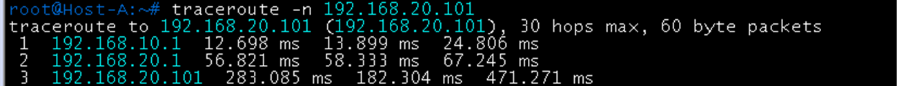
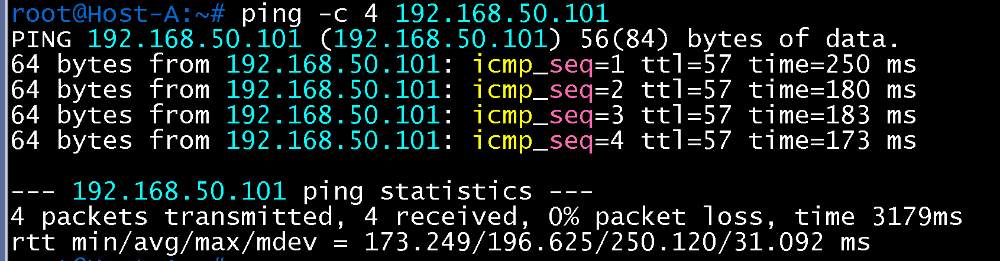
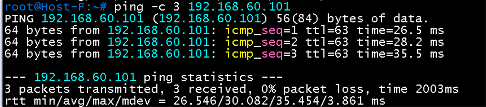
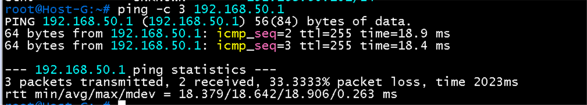

# 연결 확인 시나리오 검증

**선행 조건**: 각 구간의 설정(EVPN-VXLAN, MPLS 코어, PE-CE, DC2, Branch)이 끝나 있어야 함

기준 문서: [04-connectivity.md](../../baseline/host/04-connectivity.md) / 샘플: [04-connectivity.md](../../samples/host/04-connectivity.md)

## 확인 항목

| 순서 | 구간 | 출발 -> 대상 | 명령 | 기대 결과 | 안 될 때 확인 |
|---|---|---|---|---|---|
| 1 | 게이트웨이 | 각 호스트 -> 게이트웨이 | [게이트웨이 연결 검증](01-gateway.md) | 응답 | 해당 지역 SVI |
| 2 | 같은 VLAN (L2VNI) | Host A -> Host B | `ping -c 3 192.168.10.102` | 응답 (VNI 10010) | [EVPN 검증](../dc1/03-evpn-vxlan.md)의 항목 3 ~ 6 |
| 3 | 다른 VLAN (L3VNI) | Host A -> Host C | `ping -c 3 192.168.20.101` | 응답 (VNI 50001, VRF TENANT-A) | L3VNI, RT, SVI |
| 4 | DC1 -> DC2 | Host A -> Host E | `ping -c 3 192.168.110.101` | **응답 없음**(정상). DC1과 DC2는 분리 | TENANT-A와 PARTNER가 서로의 RT를 import하지 않아야 함 |
| 5 | DC1 -> Branch | Host A -> Host F | `ping -c 4 192.168.50.101` | 4/4 응답 (leaf, border leaf, Hub, PE1, MPLS L3VPN(VRF BR1), PE3, BGW, DSW 경유) | Hub, PE-CE eBGP, VPNv4 RT |
| 6 | Branch 내부 | Host F -> Host G | `ping -c 3 192.168.60.101` | 응답 (DSW SVI 간 라우팅) | VRRP, SVI |
| 7 | DC2 -> Branch | Host E -> Host F | `ping -c 4 192.168.50.101` | 4/4 응답 (CX, PE2, MPLS L3VPN, PE3, BGW, DSW 경유) | PE-CE eBGP, VRF BR1 import RT 65000:2 |
| 8 | Branch -> DC1, DC2 | Host F -> Host A, Host F -> Host E | `ping -c 4 192.168.10.101`, `ping -c 4 192.168.110.101` | 모두 4/4 응답 | BGW `PARTNER-TO-BR` in 필터 |
| 9 | 경로 | Host A -> Host F | `traceroute -n 192.168.50.101` | leaf, border leaf, Hub(10.0.31.x)를 지나 Branch로 | 라우팅 |

## 증빙

### Host A -> Host C (항목 3, 2026-10-23)

- `traceroute -n 192.168.20.101`: 1 **192.168.10.1**(VLAN 10 게이트웨이), 2 **192.168.20.1**(VLAN 20 게이트웨이), 3 192.168.20.101(Host C). 게이트웨이 두 개를 거쳐 VRF TENANT-A 안에서 VLAN 간 라우팅이 됨

### Host A -> Host F (항목 5, 2026-11-07)

- `ping -c 4 192.168.50.101`: 4개 중 4개 응답, 손실 0%, TTL 57, 지연 약 173 ~ 250 ms(에뮬레이션 지연)
- 같은 ping을 PE1 `Gi1/0` - PE3 `Gi0/0` 링크에서 캡처하면 MPLS Label 26(PE1 -> PE3), Label 33(PE3 -> PE1)이 보임([MPLS 검증](../core/04-mpls-ldp.md))

### Host F -> Host G (항목 6, 2026-10-23)

- `ping -c 3 192.168.60.101`: 3개 중 3개 응답, TTL **63**(DSW SVI에서 라우팅 한 번)
- Host G에서 `ping -c 3 192.168.50.1`은 3개 중 2개 응답(첫 패킷 손실, 이후 정상). 첫 패킷은 ARP 해석 중 손실되는 일반적인 동작이며 이후 TTL 255로 응답

### 최종 구성에서 추가할 증빙

항목 4(Host A -> Host E 응답 없음), 항목 7, 8(Host E <-> Host F, Host F -> Host A), 항목 9 화면은 최종 구성에서 다시 찍어 추가해야 함. 이전 구성(GRE over IPsec 터널 경유, DC1과 DC2 통신)에서 찍은 화면은 삭제함

## 결과 기록

| 일시 | 순서 | 결과 | 비고 |
|---|---|---|---|
| 2026-10-22 | 1 | Host A, B, C 성공 | 2 ~ 7은 EVPN BGP, DCI, 코어, DC2, Branch 구성 후 확인 |
| 2026-10-23 | 1, 3, 6 | 성공 | 게이트웨이 6대 모두, Host A -> Host C(traceroute), Host F -> Host G. 나머지 항목은 이전 구성에서 확인했고 최종 구성에서 재확인 |
| 2026-11-07 | 5 | 성공 | 최종 구성에서 Host A -> Host F 4/4 응답. Host E <-> Host F도 양방향 통과(화면 추가 필요) |
