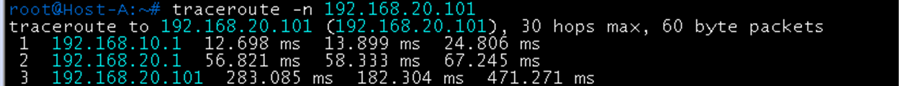
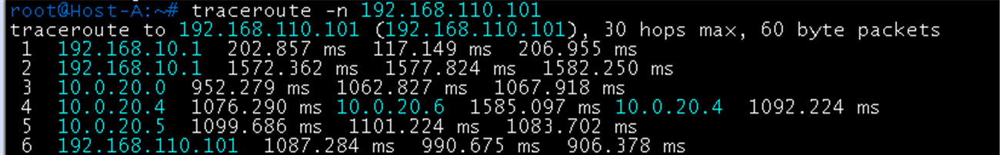
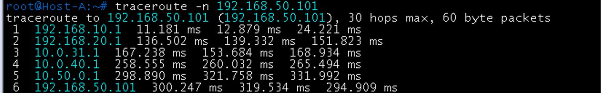
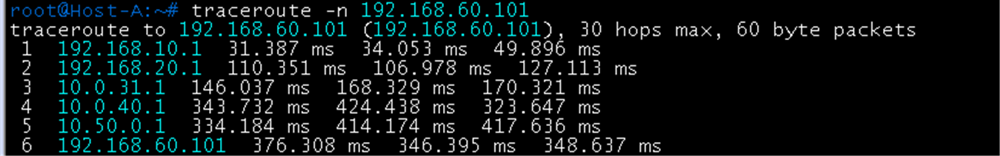
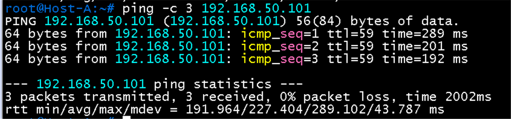
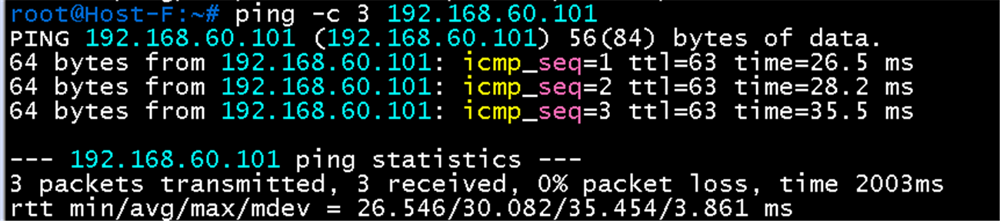
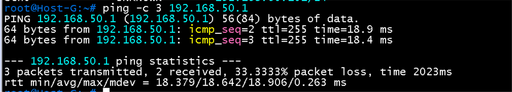
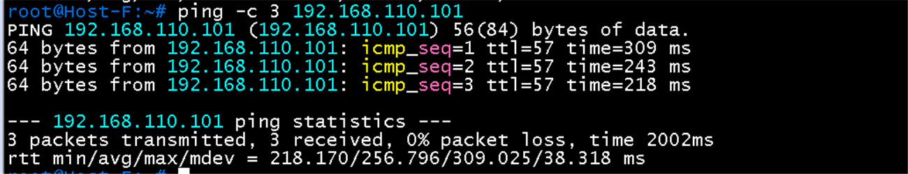
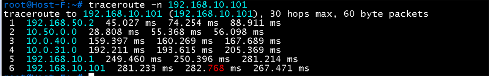

# 연결 확인 시나리오 검증

**선행 조건**: 각 구간의 설정(EVPN-VXLAN, DCI, MPLS 코어, DC2, Hub와 Branch)이 끝나 있어야 함

기준 문서: [04-connectivity.md](../../baseline/host/04-connectivity.md) / 샘플: [04-connectivity.md](../../samples/host/04-connectivity.md)

## 확인 항목

| 순서 | 구간 | 출발 -> 대상 | 명령 | 기대 결과 | 안 될 때 확인 |
|---|---|---|---|---|---|
| 1 | 게이트웨이 | 각 호스트 -> 게이트웨이 | [게이트웨이 연결 검증](01-gateway.md) | 응답 | 해당 지역 SVI |
| 2 | 같은 VLAN (L2VNI) | Host A -> Host B | `ping -c 3 192.168.10.102` | 응답 (VNI 10010) | [EVPN 검증](../dc1/03-evpn-vxlan.md)의 항목 3 ~ 6 |
| 3 | 다른 VLAN (L3VNI) | Host A -> Host C | `ping -c 3 192.168.20.101` | 응답 (VNI 50001, VRF TENANT-A) | L3VNI, RT, SVI |
| 4 | DC1 -> DC2 | Host A -> Host D | `ping -c 3 192.168.110.101` | 응답 (MPLS L3VPN) | PE-CE eBGP, VPNv4, RT |
| 5 | DC1 -> Branch | Host A -> Host F | `ping -c 3 192.168.50.101` | 응답 (GRE over IPsec) | Hub, 터널, 터널 위 eBGP |
| 6 | Branch 내부 | Host F -> Host G | `ping -c 3 192.168.60.101` | 응답 (DSW SVI 간 라우팅) | VRRP, SVI |
| 7 | 경로 | Host A -> Host D | `traceroute -n 192.168.110.101` | leaf, spine이 아니라 PE를 지나는 경로 | 라우팅 |
| 8 | Branch -> DC2 | Host F -> Host D | `ping -c 3 192.168.110.101` | 응답 (BGW, 터널, Hub, DC1 leaf3, MPLS 코어 경유) | Hub의 DC2 경로 광고, PE-CE eBGP |
| 9 | Branch -> DC1 경로 | Host F -> Host A | `traceroute -n 192.168.10.101` | DSW1, BGW1, 터널(10.0.40.0), Hub1 쪽 leaf3, DC1 게이트웨이 순서 | 터널 위 eBGP, DSW default |

## 증빙 (DC1 구간, 2026-10-23)

### Host A -> Host C (항목 3)

- `traceroute -n 192.168.20.101`: 1 **192.168.10.1**(VLAN 10 게이트웨이), 2 **192.168.20.1**(VLAN 20 게이트웨이), 3 192.168.20.101(Host C). 게이트웨이 두 개를 거쳐 VRF TENANT-A 안에서 VLAN 간 라우팅이 됨

### Host A -> Host D 경로 (항목 4, 7)

- `traceroute -n 192.168.110.101`: 1~2 **192.168.10.1**(DC1 leaf, 같은 anycast 주소라 두 홉이 같은 값), 3 **10.0.20.0**, 4 **10.0.20.4**와 **10.0.20.6**(PE-CE 링크, 두 CX로 번갈아 응답), 5 **10.0.20.5**, 6 192.168.110.101(Host D)
- spine이 아니라 PE-CE 링크(`10.0.20.x`)를 거쳐 DC2에 도달. MPLS 코어 내부 홉은 보이지 않음
- 없는 주소(192.168.110.102)로 보낸 traceroute는 CX2(10.0.20.7)의 `!H`(host unreachable)로 끝남. Host D가 `.101`뿐이라서 정상

### Host A -> Host F, Host G 경로 (항목 5)

- `traceroute -n 192.168.50.101`: 192.168.10.1, 192.168.20.1, **10.0.31.1**(Hub1), **10.0.40.1**(BGW1 터널 주소), **10.50.0.1**(DSW1), Host F
- `traceroute -n 192.168.60.101`: 같은 경로로 DSW1(10.50.0.1)까지 가서 Host G(VLAN 60)에 도달
- 두 경로 모두 **Hub1과 터널 0**만 사용하고 Hub2와 터널 1은 쓰이지 않음. DC1에서 ECMP가 되지 않고 한 경로가 best로 선택된 것

## 증빙 (Branch 구간, 2026-10-23)

### Host A -> Host F (항목 5)

- `ping -c 3 192.168.50.101`: 3개 중 3개 응답, TTL **59**(라우터 5개 통과: leaf, leaf3, Hub1, BGW1, DSW1 순서의 역방향), 지연 약 200 ~ 290 ms(터널과 에뮬레이션 지연)

### Host F -> Host G (항목 6)

- `ping -c 3 192.168.60.101`: 3개 중 3개 응답, TTL **63**(DSW SVI에서 라우팅 한 번)
- Host G에서 `ping -c 3 192.168.50.1`은 3개 중 2개 응답(첫 패킷 손실, 이후 정상). 첫 패킷은 ARP 해석 중 손실되는 일반적인 동작이며 이후 TTL 255로 응답

### Host F -> Host D (항목 8)

- `ping -c 3 192.168.110.101`: 3개 중 3개 응답, TTL **57**(라우터 7개 통과), 지연 약 220 ~ 310 ms
- DC2 경로가 Hub에서 `65100 65000 65201`로 광고되므로 Branch에서 DC2로 가는 트래픽은 DC1 leaf3을 거쳐 MPLS 코어로 나감

### Host F -> Host A 경로 (항목 9)

- `traceroute -n 192.168.10.101`: 1 **192.168.50.2**(DSW1 SVI), 2 **10.50.0.0**(BGW1), 3 **10.0.40.0**(Hub1 터널 주소), 4 **10.0.31.0**(leaf3, Hub1 쪽 링크), 5 **192.168.10.1**(DC1 게이트웨이), 6 **192.168.10.101**(Host A)
- 3번 홉의 `10.0.40.x`로 터널을 통과한 것이 확인됨

## 결과 기록

| 일시 | 순서 | 결과 | 비고 |
|---|---|---|---|
| 2026-10-22 | 1 | Host A, B, C 성공 | 2 ~ 7은 EVPN BGP, DCI, 코어, DC2, Branch 구성 후 확인 |
| 2026-10-23 | 1, 3, 5 ~ 9 | 성공 | 게이트웨이 6대 모두, Host A -> Host C(traceroute), Host A -> Host F, Host F -> Host G, Host F -> Host D, 경로(Host A -> Host D는 PE-CE 링크 경유, Host A <-> Host F는 터널 0 경유) 확인. 항목 2(Host A -> Host B ping)와 4(Host A -> Host D ping)는 ping 화면 미수집 |